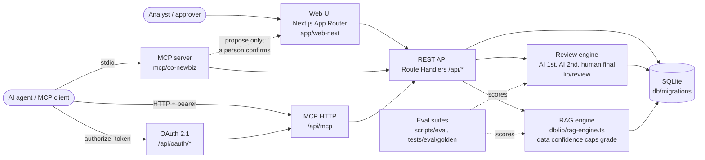

# co-newbiz

> **Language**: **English** · [한국어](README_ko.md)
> **Status**: 🔧 Active development — v1.0.0
> New-business-review AI team and system. Owns the regulations, procedures, guidelines and checklists for new business development and their ongoing operation (axis A), implements and maintains them as a system (axis B), and performs the actual deal reviews on top of that (axis C). Covers Green Field (new establishment) and Brown Field (M&A), with proxy-chain demand estimation for industries that have no direct market data.

## What Is This?

`co-newbiz` is an AI-agent team and system for new-business-review — Green Field (new establishment) and Brown Field (M&A). It owns the governance for new business development (regulations, procedures, guidelines, checklists — axis A), implements and maintains that governance as a system (axis B), and performs the actual deal reviews on top of both (axis C). Its signature capability is proxy-chain demand estimation for industries that have no direct market data (e.g. crankshaft → marine engine → ship, with CGT/BHP/ton unit conversion), with the resulting data-confidence grade capping every downstream RAG assessment.

See [docs/context.md](docs/context.md) for full architecture and standards.

## Repository Structure

```
co-newbiz/
  agents/            domain agents (functional, technical, industry, region) + _core/_shared
  policies/           group and entity-level regulations
  procedures/         shared/entity/region/group procedures with references: + overrides
  checklists/         gate checklists, item-level mandatory:true/false
  templates/          deliverable templates (IC memo, etc.)
  glossary/           business/financial/legal/technical/industry term sets
  region-profiles/    per-region regulatory and incentive profiles (Stage 2+)
  process/            flow.spec.yaml — the process SSOT (12 stages S1~S12, 7 gates, flow.spec v2.2.0)
  docs/               topic subfolders (meta/ architecture/ governance/ security/ design/ dd/
                      planning/ guidelines/ manuals/ adr/ research/ runbooks/ ...); all rendered
                      live via /library (ADR-0108) — no separate generated site
  memory/             session logs and meeting transcripts
```

The review flow is a 12-stage stage-gate chain (S1 market analysis ... S11
investment review & execution -> S12 post-management) with a dedicated S10
deal-structuring stage (investment vehicle incl. SPC, the four mandatory
axes, financing sources & uses); AI agents propose, humans decide at every
gate. See `process/flow.spec.yaml` and `docs/governance/process-map.md`.

## Quick Start

This is a beta variant of the workspace template. It inherits from `templates/common` and includes variant-specific customizations.

### Running the web app (fresh clone)

The SQLite database is gitignored — it does not exist in a fresh clone. On the
first server start, Next.js instrumentation (`app/web-next/instrumentation.ts`)
automatically applies all migrations and bootstraps an initial admin account
(random password, printed once to the server console; the first login forces a
password change):

```bash
# Python computational layer (fin-pipeline / document renderers)
python3 -m venv .venv && .venv/bin/pip install -r python/requirements.txt

cd app/web-next
bun install
bun run dev          # first boot prints the initial admin credentials
# open http://localhost:7748
```

Manual DB/account management (optional):

```bash
bun scripts/co-newbiz/newbiz.ts db:migrate
echo 's3cret-password' | bun scripts/co-newbiz/newbiz.ts user:create alice --role analyst
bun scripts/co-newbiz/newbiz.ts user:approve alice
```

Note: the database path is anchored to the repository (`<repo>/db/data/co-newbiz.sqlite`), so the server, CLI scripts, and tests all share one database regardless of the working directory. Set `CO_NEWBIZ_DB_PATH` to override (tests do).

### Internal demo

`bun run demo` starts the production build on a free port (never 7748 or 7749). It uses a throwaway SQLite database seeded with the S1–S12 brownfield demo deal (human decisions recorded) and the greenfield E2E deal. LLM, DART and web-research settings are blanked, so every executor runs its deterministic fallback. The command prints the URL and the run-only passwords for `analyst` (deal work) and `admin` (no deal data, ADR-0091). Each first login forces a password change. Ctrl-C stops the server and deletes the database. `bun run demo -- --capture` walks S1 to S12 headlessly and writes the numbered screenshots in [`docs/evidence/demo/`](docs/evidence/demo/). Requirements: `bun install` in the repository root and in `app/web-next`, plus a Chromium or an installed Chrome.



AI agents can only create proposals. Gate decisions, the S12 transition and closure are recorded by a person on the same screens shown in the demo.

### For Claude Code users:

See `CLAUDE.md` for detailed instructions.

### For Gemini CLI users:

See `GEMINI.md` for detailed instructions.

## Team Mission

**Mission:** New-business-review AI team and system. Owns the regulations, procedures, guidelines and checklists for new business development and their ongoing operation (axis A), implements and maintains them as a system (axis B), and performs the actual deal reviews on top of that (axis C). Covers Green Field (new establishment) and Brown Field (M&A), with proxy-chain demand estimation for industries that have no direct market data.

## Meet the AI Team

Your partners consist of specialized agents, each with a distinct role. The **Project Manager (PM)** is your single point of entry—they orchestrate the rest of the team.

| Agent | Role | Tier | Model |
|-------|------|------|-------|
| **antitrust-agent** | Antitrust and merger-control review: market definition, HHI calculation, multi-j | high | inherit |
| **backend-engineer** | Next.js Route Handler REST API, authentication, MCP server, the analysis-engine CLI, and the moni | medium | inherit |
| **brownfield-agent** | M&A review lead: target screening, deal structuring, and carve-out assessment | high | inherit |
| **certification-agent** | Certification and regulatory response, kept structurally distinct from permits | high | inherit |
| **commercial-dd-agent** | Commercial due diligence: customer concentration, pricing power, channel checks, | medium | inherit |
| **compliance-officer** | Owns governance operation: the standing work of running the rules the team write | high | inherit |
| **customer-retention-agent** | Post-acquisition customer attrition risk: change-of-control clause scanning, cus | medium | inherit |
| **data-architect** | ERD, master data governance, normalization, indexing, migration, and portability | high | inherit |
| **dba** | Database operations: backup/restore, monthly recovery drills, performance tuning | medium | inherit |
| **docs-writer** | Document formatting and language-policy enforcement across all four domains | medium | inherit |
| **financial-analyst** | Historical financial analysis, peer benchmarking, quality-of-earnings, and growt | high | inherit |
| **frontend-engineer** | Next.js (App Router) UI, ECharts visualizations, the RAG dashboard, the admin cons | medium | inherit |
| **glossary-curator** | Owns the glossary: registration, review, duplicate merging, and the four tooling | medium | inherit |
| **greenfield-agent** | New-establishment review lead: site selection, infrastructure assessment, talent | high | inherit |
| **group-review-agent** | Group-level review distinct from entity-level review: portfolio fit, intra-group | high | inherit |
| **hr-integration-agent** | Executive compensation review, employee pay-and-benefits parity analysis, and la | high | inherit |
| **incentive-agent** | Bidirectional policy-benefit management: sourcing regional tax and infrastructur | medium | inherit |
| **industry-lead** | Domain lead for industry, owning the industry profile system used across the ros | high | inherit |
| **infra-automation-engineer** | OS configuration, service registration, the scheduled-collection scheduler, and  | medium | inherit |
| **legal-counsel** | Domestic and overseas statute, contract, and regulatory advisory | high | inherit |
| **market-intelligence-agent** | TAM/SAM/SOM sizing, demand forecasting, competitor capacity-expansion tracking,  | high | inherit |
| **partnership-agent** | Partner sourcing strategy, partner due diligence including compliance screening, | medium | inherit |
| **platform-lead** | Domain lead for technical | high | inherit |
| **pm** | New Business Review Lead — coordinates four domain leads, enforces stage gates, approves ADRs | high | inherit |
| **pmi-agent** | Post-merger integration planning: synergy realization tracking and integration r | medium | inherit |
| **process-governance-manager** | Domain lead for functional | high | inherit |
| **quant-methodologist** | Owns the proxy industry chain methodology: unit conversion, regression calibrati | high | inherit |
| **region-lead** | Domain lead for region, owning the region profile system covering domestic and o | high | inherit |
| **release-engineer** | Build and deployment pipeline, migration execution ordering, and rollback proced | medium | inherit |
| **risk-officer** | Red-team function | high | inherit |
| **security-engineer** | Threat modeling, security baseline, vulnerability and secrets management, and im | high | inherit |
| **sre** | Monitoring and alerting, log pipeline, and incident response with post-incident  | medium | inherit |
| **technical-dd-agent** | Technical due diligence: site visits, remaining equipment life, TRL assessment,  | medium | inherit |
| **valuation-agent** | DCF/NPV/IRR/Payback/DSCR modeling, WACC assembly from live and user-supplied inp | high | inherit |

## Skills

The team ships 120+ workflow skills (governance authoring, due diligence playbooks, financial analysis, platform operations). The maintained index lives at [skills/SKILLS.md](skills/SKILLS.md); per-skill instructions are in `skills/<name>/SKILL.md`, with mirrored copies under `.claude/skills/`, `.gemini/skills/`, and `.agents/skills/`.

## Session Start Checklist

1. Read [docs/context.md](docs/context.md) and the design of record it links to.
2. Confirm the current Stage (per the design's §10 execution order — process/governance docs before code).
3. Check `memory/MEMORY.md` for the latest session and meeting entries before starting new work.
4. Route all requests through the PM — see below.

## Multi-Agent Workflow

PM acts as **New Business Review Lead**, coordinating four domain leads (`process-governance-manager`, `platform-lead`, `industry-lead`, `region-lead`) rather than dispatching every specialist directly. See [CLAUDE.md](CLAUDE.md) for the full role override and the three co-equal team axes (governance ownership, system build, deal review).

## How to Collaborate

Working with us is structured to maximize quality and prevent collisions. Here is our standard workflow:

### A. The PM Gateway

Always start your requests by talking to the **PM**. Do not invoke specialist agents directly. The PM will analyze your request and bring in the right experts.

### B. Standard Workflow Phases

1. **Team Assembly:** The PM creates specialized agents/skills if required.
2. **Triage:** The PM classifies the request; dispatches read-only agents in parallel.
3. **Analysis:** The PM synthesizes findings into requirements + acceptance criteria.
4. **Design:** An architect produces an implementation plan + ADR.
5. **Implementation:** Specialists implement; the PM loops up to 3× on failures.
6. **Finalization:** The PM logs decisions; runs `/sync`; opens a PR.

### C. Available Commands

Our daily operations are driven by slash commands (registered as Skills by Claude Code and Gemini CLI):

- `/sync "feat: ..."` — Full pipeline: memlog → changelog → audit → commit → PR.
- `/changelog "..."` — Add an entry to `CHANGELOG.md`.
- `/memlog "summary"` — Append a summary to today's session log.
- `/meeting` — Run a structured, inline multi-agent discussion.

## Variant Type

**Type**: web | cli | api | mcp

This variant implements a new-business-review governance team and its supporting system: policy/procedure/checklist authoring and operation, a Next.js Route Handler REST API with SQLite persistence, an MCP server over that API, a Python computational layer, and deal-review workflows for Green Field and Brown Field cases. (Originally built on Hono + React/Vite + ECharts per ADR-0010; migrated to Next.js + Tailwind + ECharts per ADR-0069/0070, accepted 2026-08-26.)

> ⚠️ Prototype variant — not for production use.

See [AGENTS.md](AGENTS.md) §8 (Lifecycle Management) for agent/skill/script lifecycle rules and `docs/context.md` for project identity.

## License

Internal workspace project — not for external distribution. Governed by the same terms as the parent `ai_workspace` repository.

---

*Last Updated: 2026-10-11*
