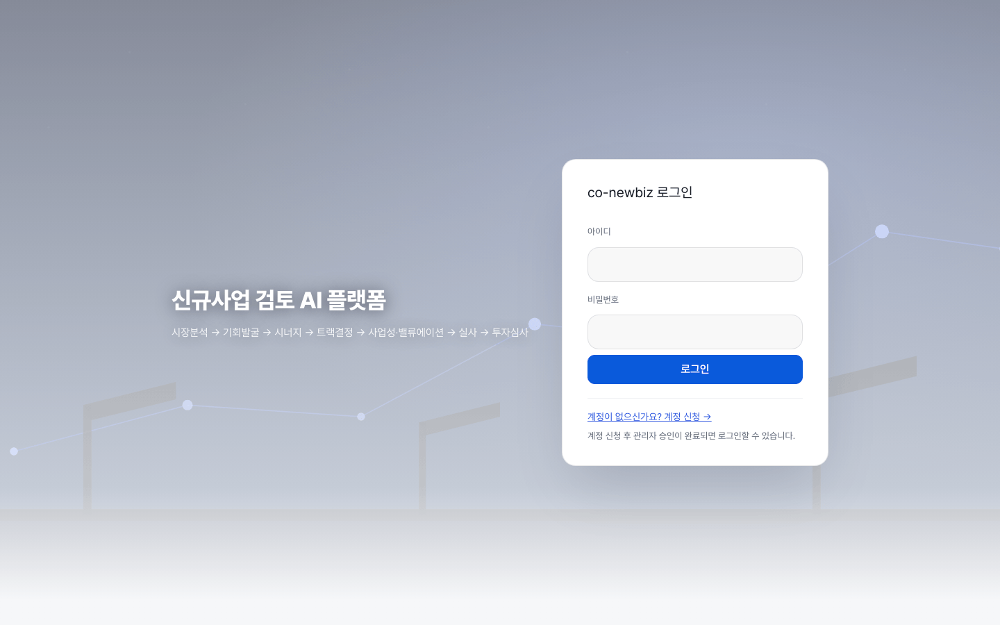
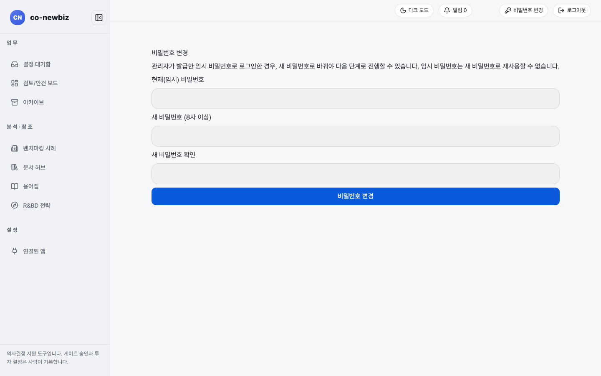
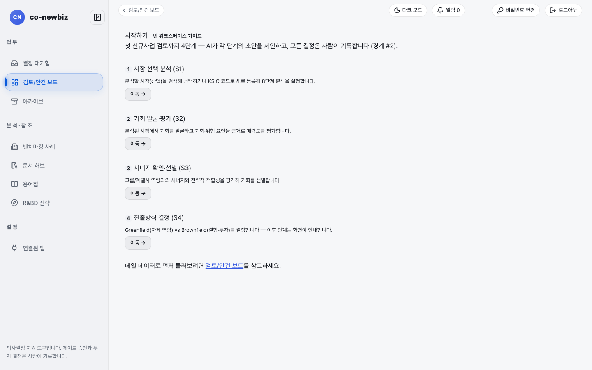
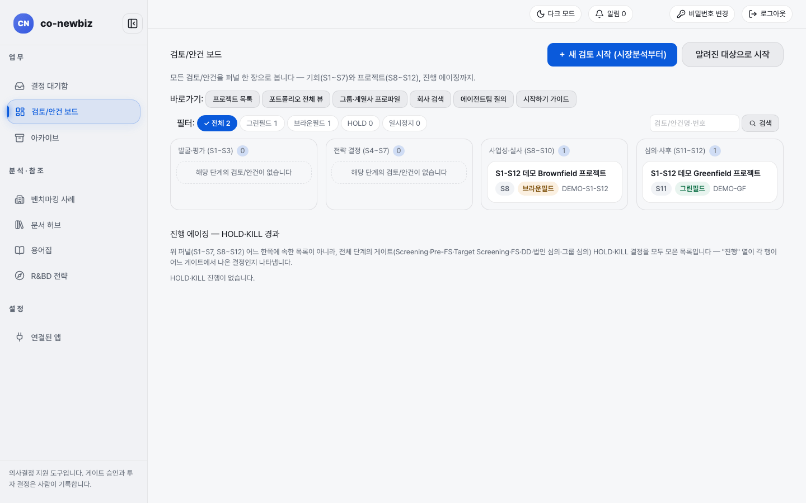
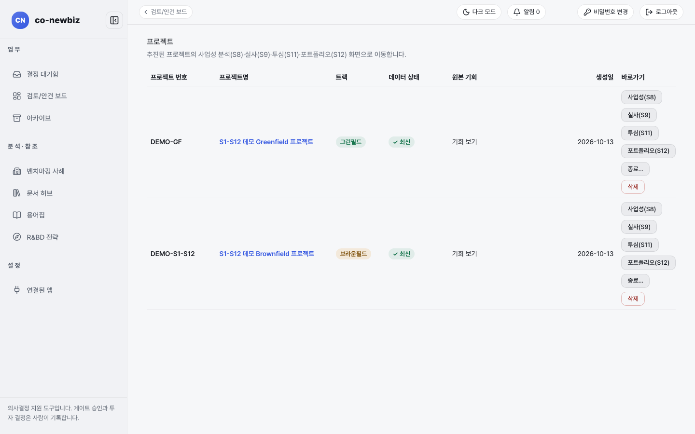
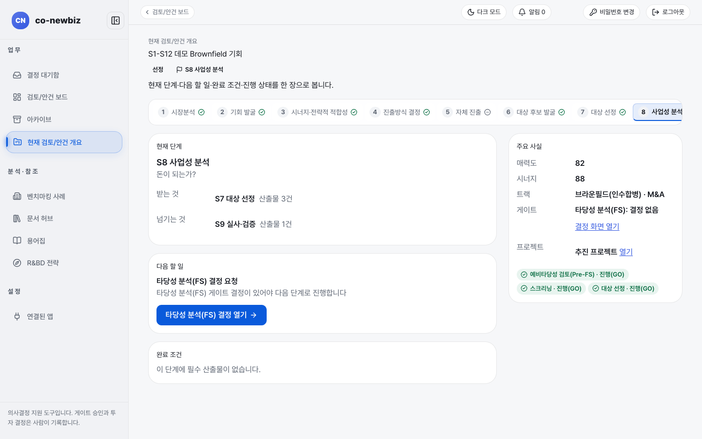

# 시작하기: 로그인부터 사례 안건 읽기까지

**목적:** 로그인하고 첫 화면을 읽고 데모 안건 `S1-S12 데모 Brownfield 기회`를 열어 열두 단계의 모양을 눈으로 익힌다.

**누가/언제:** 처음 쓰는 모든 사람. 15분이면 된다.

**사전 조건:** ① 직전 단계·게이트: 이 안내서가 첫 쪽이라 없다. ② 필요 권한: 로그인 계정(모든 역할). ③ 준비물: 데모 안건 `S1-S12 데모 Brownfield 기회`(5번에서 연다). 아무 자료도 만들거나 저장하지 않는다(읽기 전용).

> [!NOTE]
> 이 쪽의 화면 그림은 모두 **데모 자료**(따로 만든 연습용 자료)로 찍었다. 안건 이름, 숫자, 사용자 이름은 내 화면과 다를 수 있다. 화면 글자와 버튼 이름은 같다.

## 단계

### 1. 로그인하기

1. 주소창에 서버 주소(`/login`)를 연다. 화면 제목은 `co-newbiz 로그인`이다.
2. `아이디`와 `비밀번호`를 입력하고 **로그인**을 누른다.
3. 계정이 없으면 `계정이 없으신가요? 계정 신청 →`을 누른다. 화면 아래 안내대로 계정 신청 뒤 관리자 승인이 끝나야 로그인할 수 있다.

*로그인 화면. 왼쪽에는 시장분석부터 투자심사까지의 흐름이 한 줄로 적혀 있다.*

### 2. 첫 로그인이면 비밀번호 바꾸기

관리자가 알려 준 임시 비밀번호로 처음 들어오면 `비밀번호 변경` 화면이 열린다. 임시 비밀번호를 그대로 쓸 수 없으며 바꾸어야 다음 화면으로 갈 수 있다.

1. `현재(임시) 비밀번호`에 받은 임시 비밀번호를 입력한다.
2. `새 비밀번호 (8자 이상)`와 `새 비밀번호 확인`에 같은 새 비밀번호를 입력한다.
3. **비밀번호 변경**을 누른다.

*첫 로그인 뒤 비밀번호 변경 화면. 임시 비밀번호는 새 비밀번호로 다시 쓸 수 없다고 적혀 있다.*

### 3. 시작하기 안내 훑어보기

1. 왼쪽 메뉴에서 `검토/안건 보드`를 누른 뒤 `바로가기` 줄의 `시작하기 가이드`를 누른다(주소 `/onboarding`).
2. 화면에는 첫 신규 사업 검토까지의 4단계가 나온다: 1 `시장 선택·분석 (S1)`, 2 `기회 발굴·평가 (S2)`, 3 `시너지 확인·선별 (S3)`, 4 `진출방식 결정 (S4)`. 단계마다 **이동 →** 버튼이 있다.
3. 맨 아래 "데일 데이터로 먼저 둘러보려면 `검토/안건 보드`를 참고하세요"의 링크로 보드로 돌아간다.

*시작하기 안내. 단계 이름 옆 괄호는 S1~S4 단계 번호다.*

### 4. 검토/안건 보드 읽기

1. 보드(`/`)의 위쪽에 **+ 새 검토 시작 (시장분석부터)**와 **알려진 대상으로 시작**이 있다. 둘러보기에서는 누르지 않는다.
2. `필터` 줄의 `전체`, `그린필드`, `브라운필드`, `HOLD`, `일시정지` 중 하나를 눌러 목록을 좁힌다. 오른쪽 `검토/안건명·번호` 칸에 글자를 넣고 **검색**을 누르면 이름이나 번호로 찾는다.
3. 칸 네 개는 단계 구간이다: `발굴·평가 (S1~S3)`, `전략 결정 (S4~S7)`, `사업성·실사 (S8~S10)`, `심의·사후 (S11~S12)`. 안건 카드에는 현재 단계(예: `S8`), 트랙(`브라운필드` 또는 `그린필드`), 번호가 붙는다.
4. 아래 `진행 에이징 — HOLD·KILL 경과`는 멈추거나 중단된 안건이 얼마나 지났는지 보는 표다.

*검토/안건 보드(첫 화면). 데모에는 사업성·실사 구간에 브라운필드 한 건, 심의·사후 구간에 그린필드 한 건이 있다.*

> [!NOTE]
> 안건 목록 화면(`/deals`)도 같은 보드를 보여 준다. 그래서 `common-05-deals` 그림은 위 그림과 같은 화면이다.

### 5. 안건 열어서 번호 띠 읽기

보드의 카드는 승격된 프로젝트(S8 이후)의 화면으로 들어간다. S1~S4 화면을 보려면 기회 쪽으로 들어간다.

1. 보드의 브라운필드 카드 아래 `사업 기회 보기`를 누른다. 안건 개요 화면(`현재 검토/안건 개요`)이 열린다.
2. 화면 위 번호 띠에서 1 `시장분석` → 2 `기회 발굴` → 3 `시너지·전략적 적합성` → 4 `진출방식 결정`을 차례로 누르며 제목 아래 질문을 읽는다: "어디에 기회가 있는가?", "무엇을 할 것인가?", "우리가 해야 하는가?", "어떻게 들어갈 것인가?"
3. 개요 오른쪽 `주요 사실`에서 `매력도`, `시너지`, `트랙`, `게이트`를 읽고 아래 초록 표지(`스크리닝 · 진행(GO)` 등)로 지나온 게이트를 확인한다.

*프로젝트 목록. 행마다 단계별 바로가기(`사업성(S8)`, `실사(S9)`, `투자심사(S11)`, `사후 관리(S12)`)가 있다.*

*안건 개요. 위쪽 번호 띠의 5 `자체 진출`은 브라운필드 안건이라 쓰지 않는 단계로 표시된다.*

### 6. 단계마다 `입력과 출력` 펼쳐 보기

각 단계 화면의 `입력과 출력`(이 단계가 받는 것 · 넘기는 것)을 펼치면 앞 단계의 무엇이 들어오고 무엇이 다음으로 넘어가는지 적혀 있다.

### 7. S4 `결정` 탭 읽기

1. 번호 띠 4 `진출방식 결정`을 누르고 `결정` 탭을 연다.
2. `결정 기록됨` 표지와 맨 아래 `결정 이력 (1건)`을 읽는다.
3. **어떤 버튼도 누르지 않는다.** `저장`, `결정`은 기록을 남기고 `결정`은 되돌릴 수 없다.

## 결과 확인

| 화면에 남는 변화 | 어디서 보이는지 |
|---|---|
| 지금 위치 | 화면 제목 위 경로(예: `검토/안건 보드 › S1-S12 데모 Brownfield 기회 › S4 진출방식 결정`) |
| 검토 방식 | 단계 화면의 `3단계 검토`. `확인됨`, `확인하지 못함`, `판단 필요` 세 구역이 나오고 "통과" 도장은 없다. 이 방식은 [02-역할과-권한](02-역할과-권한.md)에서 설명한다 |
| 쓰지 않는 단계 | 번호 띠 5 `자체 진출`처럼 쓰지 않는 단계는 표지로 구분된다(어떤 표지인지는 안건마다 다를 수 있다) |

## 자주 하는 실수

| 오해 | 바른 읽기 |
|---|---|
| 데모 안건에서 `저장`이나 `결정`을 눌러 보는 것 | 기록이 남으며 `결정`은 불변 기록이다 |
| 보드 카드를 눌렀는데 S1~S4 화면이 아니라 사업성 분석 화면이 열려서 길을 잃는 것 | 카드는 프로젝트(S8 이후) 화면으로 간다. S1~S4는 위 5번 방법으로 연다 |
| 임시 비밀번호를 새 비밀번호로 다시 쓰려고 하는 것 | 허용되지 않는다 |

## 스스로 확인하기

`S1-S12 데모 Brownfield 기회`의 안건 개요에서 `매력도`와 `시너지` 값, 그리고 지나온 게이트 세 곳의 이름을 찾아 말한다(읽기 전용).

## 마무리

이 훑어보기로 확인한 것:

- [ ] 로그인과 첫 비밀번호 변경 화면을 읽었다.
- [ ] 시작하기 안내의 4단계(S1~S4)를 확인했다.
- [ ] 보드에서 단계 구간과 안건 카드 표지를 읽었다.
- [ ] 안건 개요의 번호 띠와 `주요 사실`을 읽었다.
- [ ] S4 `결정` 탭의 불변 기록 성격을 이해했다.

이어지는 읽기: 누가 무엇을 할 수 있는지는 [02-역할과-권한](02-역할과-권한.md), 단계별 안내는 [20-공통-S1-시장분석](20-공통-S1-시장분석.md)부터, 화면 전체 구성은 [12-공통-화면-둘러보기](12-공통-화면-둘러보기.md), 내 역할에 맞는 길은 [04-역할별-시작-페이지](04-역할별-시작-페이지.md)에 있다.

이전: [Home](Home.md) | 다음: [02-역할과-권한](02-역할과-권한.md)
