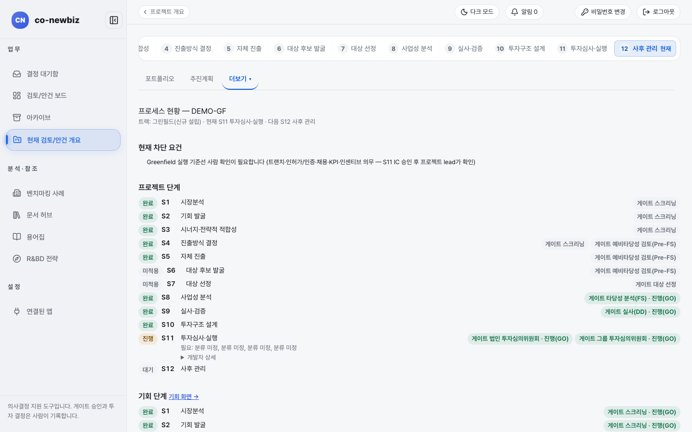
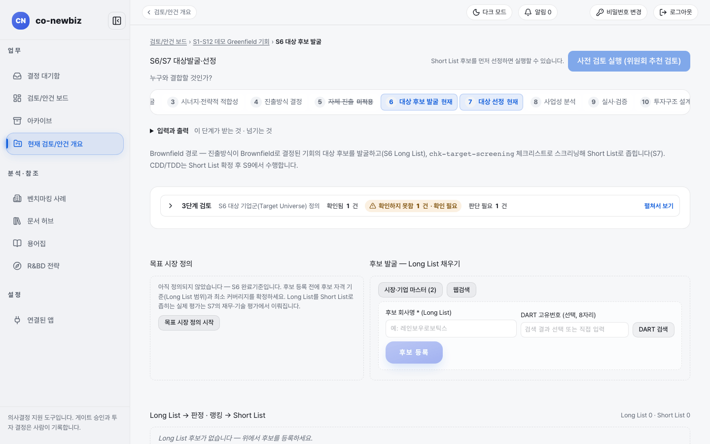

# 그린필드 여정 (자체 진출)

**목적:** 우리 역량으로 새로 세워 들어가는 안건이 S1부터 S12까지 어떤 길을 가는지 한눈에 본다.

**누가/언제:** 프로젝트 리드와 분석가.

**사전 조건:** 없다. 이 쪽은 읽는 안내이고 쓰는 화면이 아니다.

> [!NOTE]
> **Green Field에서만:** 이 쪽은 그린필드 길이다. 브라운필드(기존 기업·자산과 결합)는 [11-브라운필드-여정](11-브라운필드-여정.md)을 본다. 브라운필드 단계별 안내는 [50-브라운필드-S6-대상-후보-발굴](50-브라운필드-S6-대상-후보-발굴.md)부터 [56-브라운필드-S12-통합-PMI](56-브라운필드-S12-통합-PMI.md)까지다.

> [!NOTE]
> 이 쪽의 화면 캡처는 연습용 데모 데이터로 찍었다. 안건 이름, 숫자, 담당자 이름이 사용자의 데이터와 다를 수 있다.

## 길 개요

```
S1 → S2 → S3 →[Screening]→ S4 →[Pre-FS]→ S5 → S8 →[FS]→ S9 →[DD]→ S10 → S11 →[법인][그룹]→ S12
                         (공통)   갈림길  (그린필드)   (S6, S7은 건너뜀)
```

게이트 이름은 화면에 나오는 그대로 적었다(`Screening`, `Pre-FS`, `FS`, `DD`). 11단계에서 `법인 투자심의위원회`와 `그룹 투자심의위원회`가 차례로 열린다.


*그린필드 프로젝트의 `프로젝트 단계`. S6, S7 줄에 `미적용`이 붙어 있다. 데모 프로젝트 `DEMO-GF`.*

## 단계별 한눈에 보기

| 단계 | 쓰는가 | 하는 일 | 끝에 열리는 게이트 | 안내 |
|---|---|---|---|---|
| S1 시장분석 | 예 (공통) | 시장 크기와 구조를 본다 | `Screening` | [20-공통-S1-시장분석](20-공통-S1-시장분석.md) |
| S2 기회 발굴 | 예 (공통) | 신호를 채점된 기회로 만든다 | `Screening` | [21-공통-S2-기회-발굴](21-공통-S2-기회-발굴.md) |
| S3 시너지·전략적 적합성 | 예 (공통) | 우리와 맞는지, 필요 역량이 무엇인지 본다 | `Screening` | [22-공통-S3-시너지-전략적-적합성](22-공통-S3-시너지-전략적-적합성.md) |
| S4 진출방식 결정 | 예 (갈림길) | `트랙`을 `Greenfield`로 고르고 세부 갈래를 기록한다 | `Pre-FS` | [23-공통-S4-진출방식-결정](23-공통-S4-진출방식-결정.md) |
| S5 자체 진출 | 예 (그린필드만) | 역량 격차, 진출전략, 투자비 검토 요건 | `Pre-FS` | [40-그린필드-S5-자체-진출](40-그린필드-S5-자체-진출.md) |
| S6 대상 후보 발굴 | 건너뜀 | 브라운필드 전용 | 없음 | |
| S7 대상 선정 | 건너뜀 | 브라운필드 전용 | 없음 | |
| S8 사업성 분석 | 예 (단일 범위) | 대상이 하나인 사업 케이스와 가중평균자본비용 | `FS` | [41-그린필드-S8-사업성-분석](41-그린필드-S8-사업성-분석.md), 공통 설명 [30-공통-S8-사업성-분석](30-공통-S8-사업성-분석.md) |
| S9 실사·검증 | 예 | 그린필드 실사 점검표 판정 | `DD` | [42-그린필드-S9-실사](42-그린필드-S9-실사.md), 공통 설명 [31-공통-S9-실사](31-공통-S9-실사.md) |
| S10 투자구조 설계 | 예 | 설립 법인 형태, 4축 검토, 자금조달, 투자 분할 집행 | 없음 | [43-그린필드-S10-실행-기준선](43-그린필드-S10-실행-기준선.md), 공통 설명 [32-공통-S10-투자심의-전](32-공통-S10-투자심의-전.md) |
| S11 투자심사·실행 | 예 | 투자심의 자료, 법인·그룹 심의, 설립 실행 5단계, 실행 기준선 | `법인 투자심의위원회`, `그룹 투자심의위원회` | [44-그린필드-S11-설립-실행](44-그린필드-S11-설립-실행.md), 공통 설명 [33-공통-S11-투자심의와-실행](33-공통-S11-투자심의와-실행.md) |
| S12 사후 관리 | 예 | 분기 점검, 전환 결정, 실행 기준선 대비 차이 | 없음 | [45-그린필드-S12-사후-관리](45-그린필드-S12-사후-관리.md), 공통 설명 [34-공통-S12-사후-관리](34-공통-S12-사후-관리.md) |

이 표의 "끝에 열리는 게이트"는 `process/flow.spec.yaml`에 적힌 단계별 게이트다. 프로세스 사양에는 단계별 소요 기간이 적혀 있지 않다. 기간은 안건마다 다르므로 이 안내에서 약속하지 않는다. 대신 앞 단계가 끝나야 다음 단계가 열리는 선후 관계만 믿고 계획한다(아래 「단계 사이의 의존」 절 참고).

> [!NOTE]
> **S10의 게이트:** S10은 게이트를 열지 않는다. 4축 검토와 자금조달 조건이 끝나야 S11로 넘어간다(아래 「단계 사이의 의존」 절).

## S4에서 길이 갈립니다

S4 `결정` 탭에서 `트랙 *`에 `Greenfield — 자체 역량으로 진출`을 고르면 이후 길이 이 쪽 길이 된다. 이때 `라우트 (선택)` 칸이 그린필드의 세부 갈래다. 이 갈래가 나중에 S9, S10, S12 화면을 바꾼다.

| `라우트 (선택)` 선택 | 뜻 | 이후 영향 |
|---|---|---|
| (비워 둠, `선택...`) | 신규 부지에 새로 세움. 화면에서는 `신규 부지 설립(세부 트랙 없음)`으로 읽힌다 | S9에서 부지 방문 실사 등 부지 단계가 기본으로 적용된다 |
| `기존 사업 R&BD 확장` | 이미 하는 사업 위에 연구개발을 얹음 | S9에서 `부지 필요 여부` 확인과 `인력/조직 계획` 탭이 나온다 |
| `사내벤처(CVC)` | 사내벤처로 키움 | 위와 같고 `법인 설립 준비` 점검표가 추가된다 |

자세한 입력 순서는 [23-공통-S4-진출방식-결정](23-공통-S4-진출방식-결정.md)을 본다. `결정`은 불변 기록이라 한 번 기록하면 고치지 않고 새 결정으로 남긴다.

> [!NOTE]
> 갈래를 비워 두고 결정을 기록하는 것이 막히지는 않는다. 그래도 `기존 사업 R&BD 확장`이나 `사내벤처(CVC)`에 해당하는 안건이라면 S4에서 고른다. 나중에 S9가 열리면 이 값을 보고 점검표 범위가 정해진다.

## 건너뛰는 단계: S6과 S7

그린필드는 대상 회사를 찾지 않으므로 S6 `대상 후보 발굴`과 S7 `대상 선정`을 거치지 않고 S5에서 S8로 곧바로 간다. 화면에서 확인한 모습은 이렇다.

- 번호 띠에서 6, 7에 취소선과 `미적용`이 붙는다.
- `프로젝트 단계` 목록의 S6, S7 줄에 `미적용`이 붙고 게이트 `대상 선정`은 회색으로 남는다.
- S8의 탭에는 `대상 비교·선정` 탭이 없다(대상이 하나뿐이기 때문이다).


*그린필드 안건에서 S6 주소를 직접 열면 브라운필드용 화면(`후보 등록`, `사전 검토 실행`)이 그대로 열린다. 데모 안건.*

> [!NOTE]
> **주의:** 번호 띠에서는 `미적용`이지만, 주소를 직접 입력해 S6을 열면 브라운필드 화면이 열린다. 이 화면에 입력해도 그린필드 길에는 아무 영향이 없다. 눌러 보지 말고 번호 띠의 `5 자체 진출`로 돌아간다.

## 사람이 직접 정하는 지점

AI는 초안과 제안만 만든다. 아래는 사람만 기록할 수 있다.

| 어디서 | 사람이 하는 일 | 누가 |
|---|---|---|
| S4 `결정` 탭 | `트랙`과 `라우트` 결정 (`결정` 버튼) | 프로젝트 리드 |
| S5 `Pre-FS` 게이트 | GO, HOLD, KILL 결정 기록, 그 뒤 `프로젝트로 추진` | 프로젝트 리드 (게이트 승인은 사람) |
| S8 | 사업 케이스 `채택`, 가중평균자본비용 확인, `FS` 게이트 결정 | 프로젝트 리드, 분석가는 제안까지 |
| S9 | 점검 항목 판정, `부지 필요 여부 확인`, `DD` 게이트 결정 | 분석가가 판정, 게이트는 리드 |
| S10 | 투자구조 가설 기록, 투자 분할 집행 승인(요청자와 승인자가 다른 두 사람) | 분석가 기록, 승인은 별도 사람 |
| S11 | 법인·그룹 투자심의위원회 결정, 설립 실행 완료 처리와 재개, 실행 기준선 확정 | 위원회 결정은 사람, 기준선 확정은 프로젝트 리드 |
| S12 | 분기 `전환 결정` 기록 | 사람(결정 주체는 벤처 포트폴리오 투자심의) |

더 보기: [02-역할과-권한](02-역할과-권한.md).

## 단계 사이의 의존

| 경계 | 다음으로 넘어가는 조건 |
|---|---|
| S5 끝 | `Pre-FS` 게이트가 GO로 기록되어야 `프로젝트로 추진`을 누를 수 있다. 여기서 안건이 프로젝트가 되고 S8로 넘어간다 |
| S8 끝 | `FS` 게이트. 사업 케이스가 `채택`되어야 한다 |
| S9 끝 | `DD` 게이트. 적용되는 점검표의 모든 항목이 판정되고 필수 미충족이 0건이어야 한다 |
| S10 끝 | 4축 검토가 끝나고 자금조달의 조달과 사용이 같아야 한다 |
| S11 끝 | 두 투자심의위원회가 모두 GO이고, 설립 실행 5단계가 5/5이며(해당하는 프로젝트), 실행 기준선을 프로젝트 리드가 확정해야 한다 |
| S12 | 게이트는 없고 분기마다 점검과 전환 결정을 기록한다 |

## 알려진 불일치

- 번호 띠는 S6, S7을 `미적용`으로 표시하지만 주소로 직접 열면 브라운필드 화면이 열린다(위 주의 참고).
- 연습용 데이터의 그린필드 안건 S4 화면에는 `추천: Brownfield`가 나온다. 실제 안건에서는 추천이 다를 수 있고, 추천은 어디까지나 제안이다.

## 핵심 요약

- 그린필드는 S5에서 S8로 곧바로 가고 S6·S7은 건너뛴다.
- S4에서 `트랙`을 `Greenfield`로 기록하고 `라우트 (선택)` 갈래가 S9·S10·S12의 화면 범위를 바꾼다.
- 게이트 결정과 진출방식 기록은 사람만 하고 AI는 초안과 제안만 만든다.
- `결정`은 불변 기록이다.
- 프로젝트 화면의 `부지`, `인허가`, `인센티브`, `지역 협력` 보조 화면 안내는 아직 작성 예정이다.

이전: [23-공통-S4-진출방식-결정](23-공통-S4-진출방식-결정.md) | 다음: [40-그린필드-S5-자체-진출](40-그린필드-S5-자체-진출.md)
