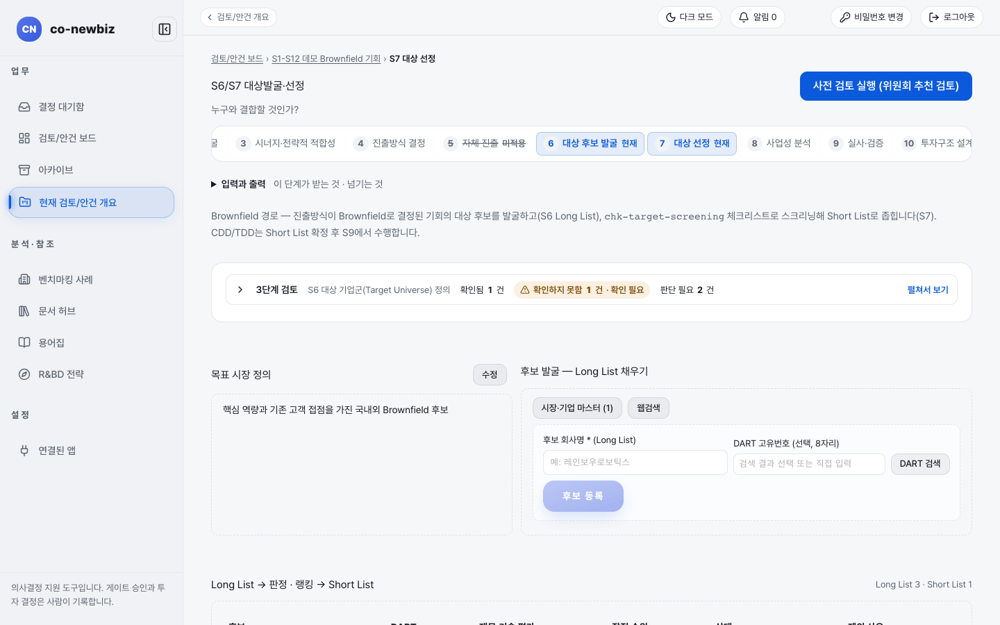

# 브라운필드 여정 (기존 기업·자산과 결합)

**목적:** 기존 기업이나 자산과 결합해 들어가는 안건이 S1부터 S12까지 어떤 길을 가는지, 어디서 사람이 결정하는지 한눈에 본다.

**누가/언제:** 프로젝트 리드와 분석가. S4에서 `Brownfield`를 고른 뒤 읽는다.

**사전 조건:** S1~S3 산출물, 프로젝트 `lead` 또는 `member` 권한.

> [!NOTE]
> **Brown Field에서만:** 이 길은 S4에서 `트랙`을 `Brownfield — 기존 기업·자산과 결합`으로 기록한 안건만 간다. 새로 세우는 길은 [10-그린필드-여정](10-그린필드-여정.md)을 본다. 브라운필드는 곧 M&A가 아니다. 아래 일곱 가지 중에서 `라우트`를 따로 고린다.

> [!NOTE]
> 이 쪽의 화면 캡처는 시험용 가상 자료(데모)로 찍었다. 화면에 보이는 회사 이름과 숫자는 여러분의 자료와 다르다.


*캡션: 데모 브라운필드 안건의 단계 띠. `5 자체 진출`에 `미적용` 표시가 붙고 `6 대상 후보 발굴`·`7 대상 선정`이 현재 단계다.*

## 길 개요

```
S1 → S2 → S3 →[Screening]→ S4 →[Pre-FS]→ S6 → S7 →[Target Screening]→ S8 →[FS]→ S9 →[DD]→ S10 → S11 →[법인][그룹]→ S12
                             갈림길   (S5는 건너뜀)
```

| 단계 | 쓰는가 | 한 줄 설명 | 안내 |
|---|---|---|---|
| S1~S3 | 예 (공통) | 시장, 기회, 시너지·전략 적합성 | [20-공통-S1-시장분석](20-공통-S1-시장분석.md), [21-공통-S2-기회-발굴](21-공통-S2-기회-발굴.md), [22-공통-S3-시너지-전략적-적합성](22-공통-S3-시너지-전략적-적합성.md) |
| S4 진출방식 결정 | 예 | 여기서 `트랙`과 `라우트`를 기록한다 | [23-공통-S4-진출방식-결정](23-공통-S4-진출방식-결정.md) |
| S5 자체 진출 | 건너뜀 | 그린필드 전용. 단계 띠에 `미적용`으로 보인다 | 없음 |
| S6 대상 후보 발굴 | 예 | 목표 시장을 정하고 후보 목록(`Long List`)을 채운다 | [50-브라운필드-S6-대상-후보-발굴](50-브라운필드-S6-대상-후보-발굴.md) |
| S7 대상 선정 | 예 | 후보를 좁혀 `Short List`를 만들고 `Target Screening` 게이트를 기록한다 | [51-브라운필드-S7-대상-선정](51-브라운필드-S7-대상-선정.md) |
| S8 사업성 분석 | 예 | 후보 묶음의 대상별 사업성을 비교하고, 사람이 대상을 고린다 | [52-브라운필드-S8-사업성-분석](52-브라운필드-S8-사업성-분석.md) |
| S9 실사·검증 | 예 | 거래 형태에 맞는 점검표와 M&A 필수 검증 여섯 가지 | [53-브라운필드-S9-실사](53-브라운필드-S9-실사.md) |
| S10 투자구조 설계 | 예 | 투자 주체, `차입·여신`, 합작 조건 | [54-브라운필드-S10-거래-구조](54-브라운필드-S10-거래-구조.md) |
| S11 투자심사·실행 | 예 | 법인 투자심의위원회 → 그룹 투자심의위원회, 킥오프 | [55-브라운필드-S11-클로징](55-브라운필드-S11-클로징.md) |
| S12 사후 관리 | 예 | 통합(PMI)과 포트폴리오 점검 | [56-브라운필드-S12-통합-PMI](56-브라운필드-S12-통합-PMI.md) |

그린필드와 함께 쓰는 공통 쪽 설명은 [30-공통-S8-사업성-분석](30-공통-S8-사업성-분석.md) ~ [34-공통-S12-사후-관리](34-공통-S12-사후-관리.md)에 있다.

## S4에서 갈라지는 점

S4 `결정` 탭에서 `트랙`을 `Brownfield — 기존 기업·자산과 결합`으로 고르면, `라우트 * (Brownfield)`를 반드시 함께 고린다. 이 선택이 S9에서 어떤 점검표와 범위가 적용되는지를 정한다. 그래서 S4 이후 가장 무거운 선택이다.

### 일곱 가지 라우트와 고르는 때

| `라우트` | 이럴 때 고린다 | S9에서 달라지는 점 |
|---|---|---|
| `M&A` | 대상 회사의 경영권을 사서 가져올 때 | 기준이 되는 전체 범위. 제외되는 항목이 없다 |
| `JV(합작)` | 파트너와 새 합작법인을 함께 세울 때 | 합작에 맞게 읽는 항목과 제외 항목이 생기고, 파트너 점검표가 붙는다 |
| `전략적 투자` | 경영권 없이 지분을 사되 사업 연계를 노릴 때 | 기업결합 신고와 외국인 투자 심사 항목이 붙는다 |
| `소수지분 투자` | 소수 지분만 취득할 때 | 위와 같은 신고·심사 항목과 파트너 점검표가 붙는다 |
| `전략 제휴` | 지분 없이 계약으로 협력할 때 | 파트너 점검표가 붙고, 지분 인수를 전제로 한 항목은 제외되거나 읽는 방식이 바뀐다(일곱 중 변화가 가장 크다) |
| `R&BD(공동연구)` | 기술 중심으로 공동연구나 기술 확보를 할 때 | 기술 점검표가 붙는다 |
| `사내벤처(CVC)` | 우리 회사의 벤처 투자 조직으로 투자할 때 | 기업결합 신고와 외국인 투자 심사 항목이 붙는다 |

고르기 어려우면 S4 화면의 `진출방식 추천`을 참고한다. 추천은 제안일 뿐이고 기록은 프로젝트 리드가 한다.

> [!NOTE]
> 일곱 가지 중 `M&A`만 기준 범위를 그대로 쓴다. 나머지 여섯은 S9에서 범위가 조정된다. 어떤 항목이 어떻게 바뀌는지는 [53-브라운필드-S9-실사](53-브라운필드-S9-실사.md)에서 본다.

## S5를 건너뛰는 까닭

S5는 우리 힘으로 새로 세울 때 필요한 역량 격차와 부지를 따지는 단계다. 브라운필드는 이미 있는 기업·자산과 결합하므로 이 단계를 건너뛰고, S6에서 "누구와 결합할 것인가?"를 묻는다.

> [!NOTE]
> 화면에서의 모습: 단계 띠에서 `5 자체 진출`에 `미적용` 표시가 붙는다(위 그림). 빈 단계가 아니라 쓰지 않는 단계다.

## 사람이 결정하는 자리

AI는 초안과 제안을 만들 뿐이다. 아래는 모두 사람이 기록한다.

| 자리 | 단계 | 기록하는 사람 |
|---|---|---|
| 진출방식(`트랙`·`라우트`) 결정 | S4 | 프로젝트 리드 |
| 후보 `Short List` 승격과 순위 조정, `Target Screening` 게이트 결정 | S6~S7 | 분석가 이상 |
| 프로젝트로 추진 (안건이 프로젝트가 되는 전환) | S7 → S8 | 분석가 이상 |
| 대상 선정 (근거 기록 필수) | S8 | 사람 (근거를 남긴다) |
| `fs`, `dd` 게이트 결정 | S8, S9 | 검토자 |
| 법인 투자심의위원회, 그룹 투자심의위원회 결정 | S11 | 위원회 구성원 |
| PMI 킥오프 기록 | S11 | 사람 (에이전트는 기록할 수 없음) |

## S4 이후 달라지는 점

| 영역 | 달라지는 점 |
|---|---|
| S6~S7 | 후보를 찾아 좁히고, 대상 선정은 S8에서 사람이 근거와 함께 기록한다 |
| S9 실사 범위 | 선정된 대상이 필수이고, 대상별 실사는 선택 사항이다 |
| M&A 필수 검증 | 필수 검증 여섯 가지가 모두 기록되어야 한다. 하나라도 빠지면 면제 경로가 없다 |
| S11·S12의 PMI | `PMI 킥오프`와 `PMI` 탭은 `M&A`, `JV(합작)`, `전략적 투자`에만 쓰인다. 나머지 `라우트`에서는 나타나지 않는다 |
| 인증 | 지배권 변경 때 승계되는지를 인증 기관의 규정으로 확인해야 하며, 추정은 허용되지 않는다 |

## 자주 하는 실수

| 오해 | 바른 읽기 |
|---|---|
| 브라운필드를 M&A와 같은 말로 읽는 것 | `라우트`가 여섯 가지 더 있다 |
| S6과 S7을 서로 다른 화면으로 찾는 것 | 두 단계는 한 화면에서 이어서 진행한다([50-브라운필드-S6-대상-후보-발굴](50-브라운필드-S6-대상-후보-발굴.md) 참고) |
| S5가 비어 있다고 걱정하는 것 | 건너뛰는 단계다 |

## 알려진 불일치

S6~S7 화면에 `Long List`, `Short List`, `Target Screening` 같은 영어 표기가 남아 있다(결함 기록 D-04). 이 쪽도 화면에 보이는 그대로 적었다.

## 스스로 확인하기

데모 브라운필드 안건의 단계 띠에서 `5 자체 진출`에 `미적용`이 붙어 있는지, `6 대상 후보 발굴`과 `7 대상 선정`이 현재 단계로 표시되는지 확인한다. 어떤 버튼도 누르지 않는다.

## 핵심 요약

- 브라운필드는 S5를 건너뛰고 S6~S7에서 대상을 찾아 좁힌 뒤 S8에서 사람이 대상을 고른다.
- S4에서 `트랙`과 함께 `라우트`를 반드시 고른다. 브라운필드는 곧 M&A가 아니다.
- `M&A`만 기준 실사 범위를 그대로 쓰고, M&A 필수 검증 여섯 가지는 면제 경로가 없다.
- 진출방식 결정, 대상 선정, 게이트, 두 투자심의위원회 결정, PMI 킥오프는 사람만 기록한다.

이전: [23-공통-S4-진출방식-결정](23-공통-S4-진출방식-결정.md) | 다음: [50-브라운필드-S6-대상-후보-발굴](50-브라운필드-S6-대상-후보-발굴.md)
