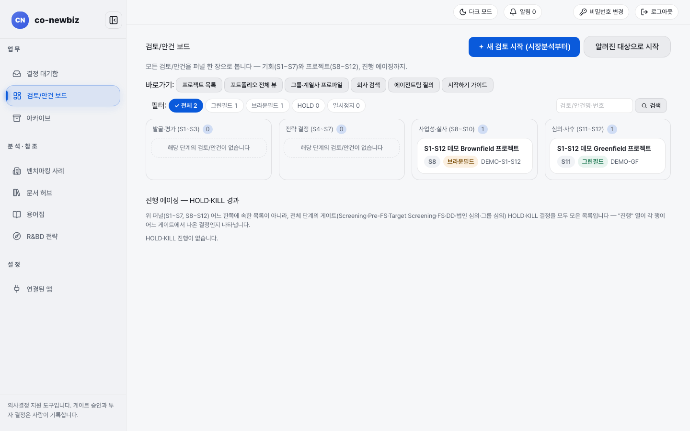
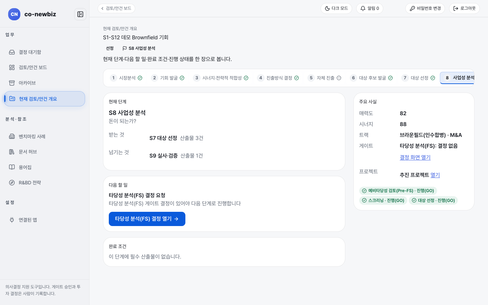
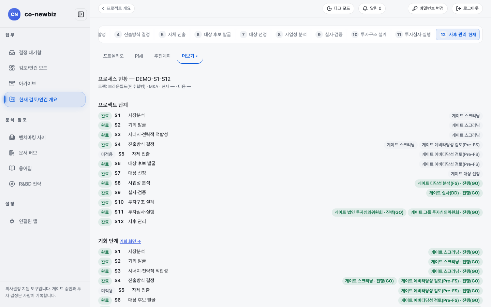
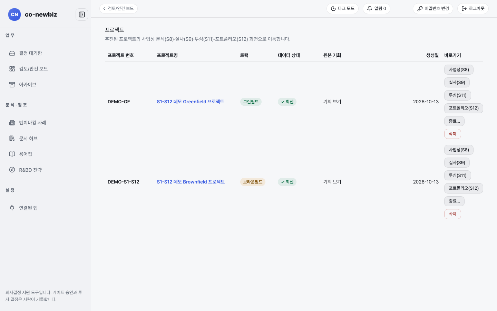
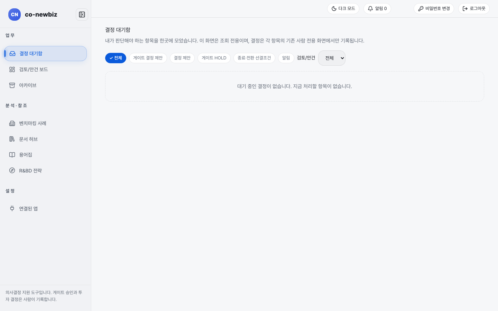
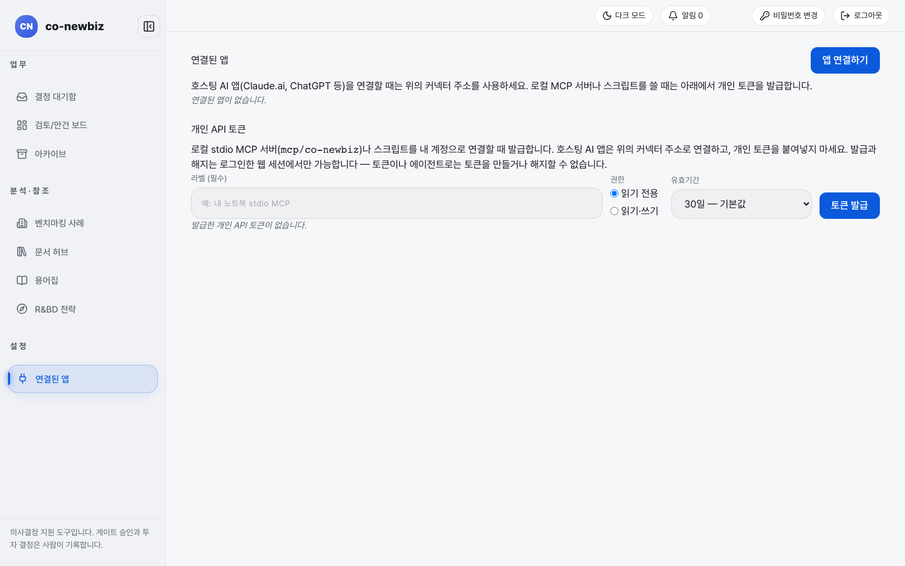
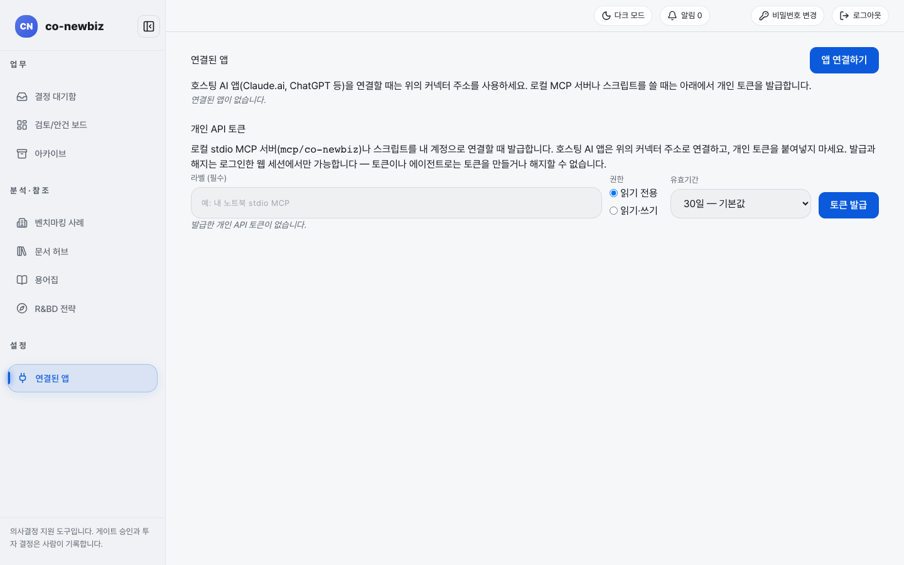
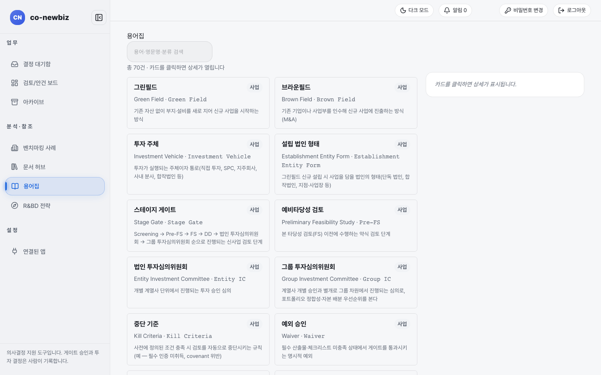

# 공통 화면 둘러보기: 보드, 결정 대기함, 설정, 용어집

**목적:** 단계와 상관없이 늘 쓰는 화면의 생김새와 쓰임을 한 쪽에서 본다.

**누가/언제:** 모든 사용자, 로그인 직후와 길을 잃었을 때.

**사전 조건:** 로그인.

> [!NOTE]
> 이 쪽의 화면 그림은 모두 **데모 자료**(따로 만든 연습용 자료)로 찍었다. 안건 이름, 숫자, 사용자 이름은 내 화면과 다를 수 있다. 로그인과 첫 비밀번호 변경, 시작하기 안내는 [01-시작하기](01-시작하기.md)에서 따라 한다.

## 모든 화면에 있는 것

| 자리 | 이름 | 하는 일 |
|---|---|---|
| 왼쪽 메뉴 `업 무` | `결정 대기함`, `검토/안건 보드`, `아카이브` | 내가 판단할 것, 진행 중 안건 전체, 끝난 안건 |
| 왼쪽 메뉴 `분 석 · 참 조` | `벤치마킹 사례`, `문서 허브`, `용어집`, `R&BD 전략` | 참고 자료 |
| 왼쪽 메뉴 `설 정` | `연결된 앱` | AI 앱·토큰 연결 |
| 위쪽 오른쪽 | `다크 모드`, `알림 0`, `비밀번호 변경`, `로그아웃` | 화면 색, 알림, 내 계정 |
| 왼쪽 아래 문구 | "의사결정 지원 도구입니다. 게이트 승인과 투자 결정은 사람이 기록합니다." | 이 시스템의 약속 |

안건 안으로 들어가면 왼쪽 메뉴에 `현재 검토/안건 개요`가 더해지고, 위쪽에 단계 번호 띠가 나온다.

## 1. 검토/안건 보드 읽기

1. 로그인하면 첫 화면으로 `검토/안건 보드`(`/`)가 열린다. 왼쪽 메뉴 `검토/안건 보드`로 언제든 돌아온다.
2. `바로가기` 줄에서 `프로젝트 목록`, `포트폴리오 전체 뷰`, `그룹·계열사 프로파일`, `회사 검색`, `에이전트팀 질의`, `시작하기 가이드`로 이동한다.
3. `필터`(`전체`, `그린필드`, `브라운필드`, `HOLD`, `일시정지`)와 검색 칸 `검토/안건명·번호`로 목록을 좁힌다.
4. 단계 구간 칸 네 개(`발굴·평가 (S1~S3)`, `전략 결정 (S4~S7)`, `사업성·실사 (S8~S10)`, `심의·사후 (S11~S12)`)에서 카드의 현재 단계와 트랙을 읽는다.
5. 새로 시작할 때만 **+ 새 검토 시작 (시장분석부터)** 또는 **알려진 대상으로 시작**을 누른다. 안건이 만들어지므로 둘러보기에서는 누르지 않는다.

*검토/안건 보드. `/`와 `/deals`가 같은 화면이다.*

## 2. 안건 개요와 번호 띠 읽기

1. 안건 이름을 누르면 `현재 검토/안건 개요`가 열린다. 왼쪽부터 `현재 단계`(받는 것·넘기는 것), `다음 할 일`, `완료 조건`, 오른쪽 `주요 사실`이 있다.
2. 번호 띠 1~12를 눌러 단계를 오간다. 단계 이름 옆 초록 표지는 끝난 단계, 쓰지 않는 단계는 별도 표지로 보인다.
3. `다음 할 일` 카드의 파란 버튼(예: **타당성 분석(FS) 결정 열기 →**)은 다음 게이트 결정 화면으로 간다. 이 화면에서는 읽기만 한다.

*안건 개요(브라운필드 데모). 5 `자체 진출`은 이 안건이 브라운필드라 쓰지 않는 단계다.*

## 3. 프로젝트 단계 띠(프로세스) 읽기

1. 프로젝트 화면의 번호 띠 아래 `더보기`에서 `프로세스`를 연다(S12의 더보기에 붙은 항목이다). 열리는 화면 제목은 `프로세스 현황`이다.
2. `프로젝트 단계`(S1~S12)와 `기회 단계` 두 묶음이 나오고 단계마다 `완료`, `미적용`과 지나온 `게이트 …` 표지가 붙는다.

*프로세스 현황. `트랙: 브라운필드(인수합병) · M&A · 현재 — · 다음 —`처럼 현재 위치가 맨 위에 적힌다.*

## 4. 프로젝트 목록 읽기

1. 보드 `바로가기`의 `프로젝트 목록`(`/projects`)을 연다.
2. 열은 `프로젝트 번호`, `프로젝트명`, `트랙`, `데이터 상태`, `생성일`, `바로가기` 여섯 개다. `프로젝트명`이 곧 링크라 `사업 기회` 열은 없다.
3. `바로가기`의 `사업성(S8)`, `실사(S9)`, `투자심사(S11)`, `사후 관리(S12)`로 단계 화면에 바로 간다. 같은 칸의 **종료…**와 **삭제**는 되돌릴 수 없으니 둘러볼 때는 누르지 않는다.

*프로젝트 목록. 데모에는 그린필드 한 건, 브라운필드 한 건이 있다.*

## 5. 결정 대기함 쓰기

내가 판단해야 할 항목을 한곳에 모은 화면이다.

1. 왼쪽 메뉴 `결정 대기함`(`/inbox`)을 연다.
2. 위쪽 칩 `전체`, `게이트 결정 제안`, `결정 제안`, `게이트 HOLD`, `종료·전환 선결조건`, `알림`으로 종류를 고르고, `검토/안건` 목록으로 안건을 고른다.
3. 항목을 눌러 해당 화면으로 간다. 이 화면은 조회 전용이라, 결정은 각 항목의 사람 전용 화면에서만 기록된다.
4. 비어 있으면 "대기 중인 결정이 없습니다. 지금 처리할 항목이 없습니다."가 나온다.

*결정 대기함. 데모에는 대기 항목이 없다.*

### AI 제안을 사람이 확정하는 화면

에이전트(AI)가 만든 결정 제안은 `/proposals/{id}/confirm` 화면에서 사람이 직접 본다. 이 화면에는 `확인 대기`, `확정됨`, `거절됨`, `만료됨`(확인 기한 72시간), `대체됨` 중 하나의 상태가 나오고, 맨 아래에 **결정 확정**과 **거절**이 있다. 확정하면 지금 로그인한 본인 계정으로 결정이 기록된다. 에이전트는 결정을 제안만 할 수 있다.

> [!NOTE]
> 데모에는 열려 있는 제안이 없어 이 화면의 그림은 없다. 제안을 만들지 않고는 화면을 열 수 없기 때문이다.

## 6. 설정과 연결된 앱

1. 왼쪽 메뉴 `연결된 앱`(`/settings`는 이 화면으로 바로 옮겨 간다)을 연다.
2. 위쪽 **앱 연결하기**와 안내: Claude.ai, ChatGPT 같은 호스팅 AI 앱은 안내에 적힌 커넥터 주소로 연결한다. 연결된 앱이 없으면 "연결된 앱이 없습니다."가 나온다.
3. `개인 API 토큰`은 내 컴퓨터의 MCP 서버나 스크립트를 내 계정에 연결할 때만 쓴다. `라벨 (필수)`을 쓰고, `권한`(`읽기 전용` 또는 `읽기·쓰기`)과 `유효기간`(기본 `30일`)을 고른 뒤 **토큰 발급**을 누른다. 호스팅 AI 앱에는 개인 토큰을 붙여 넣지 않는다.
4. 토큰 발급과 해지는 로그인한 웹 화면에서만 된다. 토큰이나 에이전트가 토큰을 만들거나 해지할 수 없다.

*`/settings`는 곧바로 `연결된 앱` 화면으로 옮겨 간다.*

*연결된 앱과 개인 API 토큰. `읽기 전용`이 기본 권한이다.*

## 7. 용어집으로 낯선 말 찾기

1. 왼쪽 메뉴 `용어집`(`/glossary`)을 연다.
2. 위쪽 검색 칸 `용어·영문명·분류 검색`에 글자를 넣으면 목록이 좁혀진다. 위쪽에 `총 70건`처럼 건수가 나온다.
3. 카드(예: `투자 주체`, `설립 법인 형태`, `법인 투자심의위원회`)를 누르면 오른쪽에 자세한 풀이가 열린다. 풀이가 열리기 전에는 "카드를 클릭하면 상세가 표시됩니다."가 보인다.
4. 이 안내서가 쓰는 말은 [03-용어집-링크](03-용어집-링크.md)에도 모아 두었다.

*용어집. 카드에 한글 이름, 영문 이름, 분류(`사업`), 한 줄 뜻이 나온다.*

## 자주 하는 실수

| 오해 | 바른 읽기 |
|---|---|
| 보드 카드를 눌러 S1~S4 화면을 기대하는 것 | 승격된 프로젝트 카드는 프로젝트(S8 이후) 화면으로 간다. [01-시작하기](01-시작하기.md)의 5단계 방법을 쓴다 |
| 결정 대기함에서 결정을 기록하려는 것 | 대기함은 조회 전용이다 |
| `/settings`에 다른 설정이 더 있을 거라고 찾는 것 | 지금은 `연결된 앱`이 유일한 설정 화면이다 |
| 개인 API 토큰을 호스팅 AI 앱에 붙여 넣는 것 | 개인 토큰은 내 컴퓨터의 MCP 서버나 스크립트용이다 |

## 스스로 확인하기

`결정 대기함`을 열어 칩 여섯 개의 이름을 말하고, `용어집`에서 `투자 주체`를 찾아 뜻을 읽는다(읽기 전용).

이전: [04-역할별-시작-페이지](04-역할별-시작-페이지.md) | 다음: [20-공통-S1-시장분석](20-공통-S1-시장분석.md)
