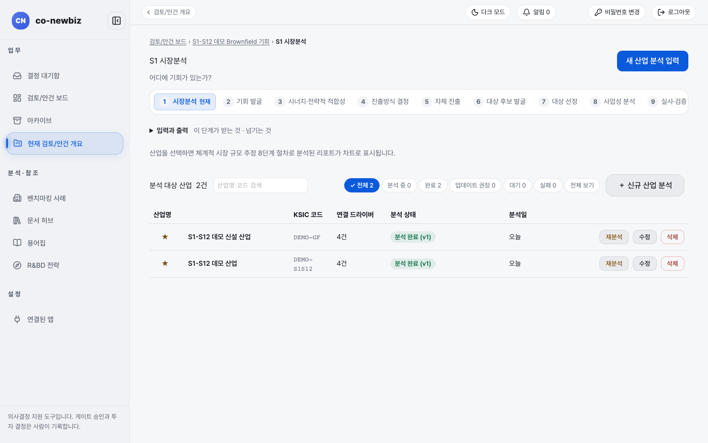
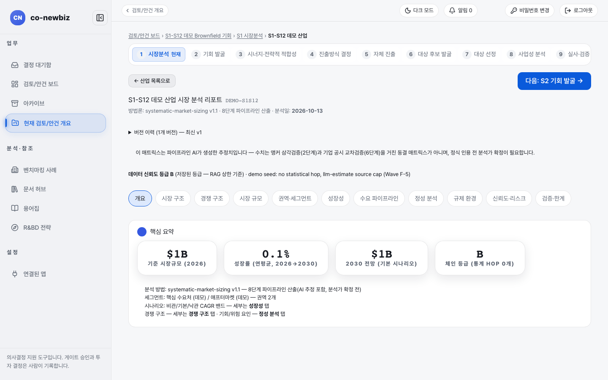
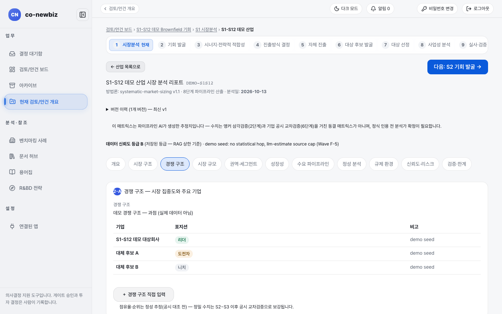
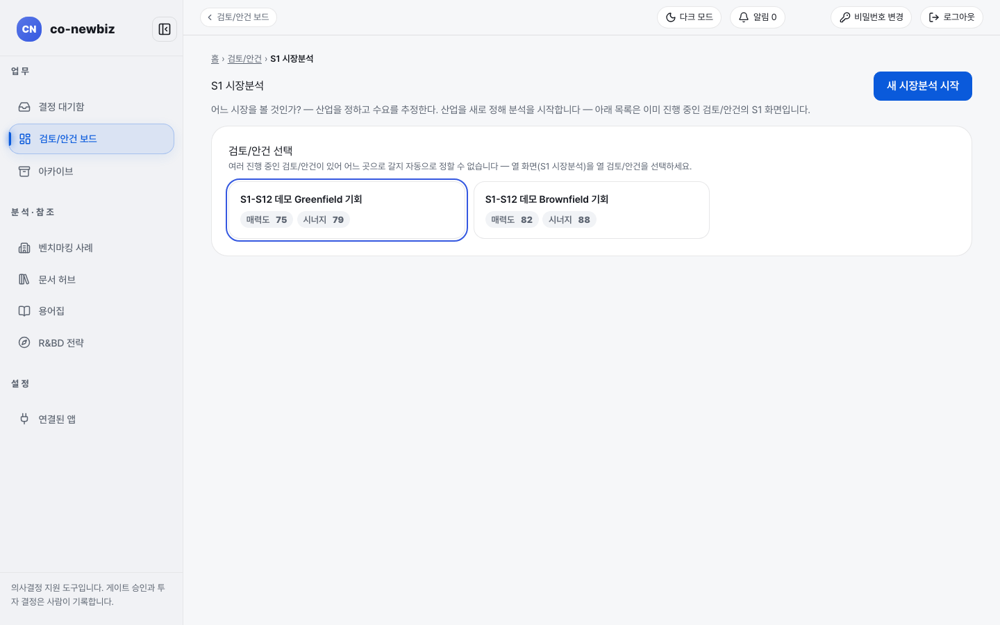

# 시장분석 읽고 입력하기

**목적** — 대상 산업의 시장 규모와 구조를 체계적 시장 규모 추정 8단계 절차로 분석하고, 결과 리포트를 읽습니다.  **누가/언제** — 분석가. 첫 단계라 앞선 게이트는 없습니다.  **사전 조건** — 프로젝트 구성원 이상의 권한. 읽기만 하면 열람자도 됩니다.

> [!NOTE]
> **트랙** — 그린필드와 브라운필드 모두 같은 화면을 씁니다. 갈라지는 곳은 [23-공통-S4-진출방식-결정](23-공통-S4-진출방식-결정.md)입니다.

> [!NOTE]
> 이 쪽의 화면 그림은 **데모 자료**(따로 만든 연습용 자료)입니다. 산업 이름, 시장 규모, 등급은 내 자료와 다릅니다.

*S1 시장분석 첫 화면. 데모에는 분석 완료된 산업이 두 건 있습니다.*

## 단계

읽기 전용으로 둘러볼 때는 1~4번, 6~7번만 따릅니다.

1. 안건 화면 위 번호 띠에서 `1 시장분석`을 누릅니다. 제목은 `S1 시장분석`, 질문은 "어디에 기회가 있는가?"입니다. (안건을 아직 열지 않았다면 주소 `/market`로 들어가 `검토/안건 선택`에서 안건 카드를 먼저 고릅니다. 이 화면의 오른쪽 위 버튼은 `새 시장분석 시작`입니다.)
2. `입력과 출력`을 펼쳐 이 단계가 받는 것과 넘기는 것을 읽습니다.
3. `분석 대상 산업` 표에서 산업을 확인합니다. 열은 `산업명`, `KSIC 코드`, `연결 드라이버`, `분석 상태`, `분석일`입니다. 필터 칩은 `전체`, `분석 중`, `완료`, `업데이트 권장`, `대기`, `실패`, `전체 보기`입니다. 칸 위쪽 `산업명·코드 검색`에 글자를 넣어 찾을 수도 있습니다.
4. 산업명(예: `S1-S12 데모 산업`)을 누르면 리포트가 열립니다. 탭은 `개요`, `시장 구조`, `경쟁 구조`, `시장 규모`, `권역·세그먼트`, `성장성`, `수요 파이프라인`, `정성 분석`, `규제 환경`, `신뢰도·리스크`, `검증·한계`입니다. 목록으로 돌아가려면 `← 산업 목록으로`를 누릅니다.
5. (쓰기) 새 산업을 분석하려면 `+ 신규 산업 분석`을 누르거나 오른쪽 위 `새 산업 분석 입력`을 누르고 안내를 따릅니다. 이미 분석된 산업은 행의 **재분석**으로 다시 돌리고 **수정**으로 고칩니다. **삭제**는 되돌릴 수 없으니 신중히 누릅니다. 경쟁 구조 탭의 `+ 경쟁 구조 직접 입력`으로 기업을 직접 적어 넣을 수도 있습니다.
6. `개요` 탭의 `핵심 요약`에서 `기준 시장규모 (2026)`, `성장률 (연평균, 2026→2030)`, `2030 전망 (기본 시나리오)`, `체인 등급`을 읽습니다.
7. 리포트 위쪽 `데이터 신뢰도 등급` 줄과 `신뢰도·리스크` 탭을 읽습니다. 이 등급이 이후 종합 등급의 상한을 정합니다. 예: 등급 B이면 종합 등급이 최대 Amber입니다.
8. 오른쪽 위 **다음: S2 기회 발굴 →**을 눌러 다음 단계로 갑니다.

*리포트 개요 탭. 위에 "이 매트릭스는 파이프라인 AI가 생성한 추정치입니다 …"라는 경고 줄이 있고, 분석가 확정이 필요하다고 안내합니다.*

*경쟁 구조 탭. 기업별 `포지션`(리더, 도전자, 니치)이 나옵니다. 데모 자료라 "실제 데이터 아님"이라고 적혀 있습니다.*

*`/market`로 들어가면 보이는 안건 선택 화면. 안건 카드의 `매력도`, `시너지`는 S2, S3 결과입니다.*

## 결과 확인

- 분석이 끝나면 `분석 상태`가 `분석 완료 (v1)`처럼 버전과 함께 바뀝니다. 다시 분석하면 버전이 올라갑니다(`버전 이력`에서 확인).
- 리포트의 분석 결과는 AI 추정이 포함된 초안입니다. 화면에도 분석가 확정 전이라고 적혀 있습니다.
- 이 결과는 S2 기회 발굴에서 `분석된 산업`으로 이어집니다.

## 자주 하는 실수

- 데이터 신뢰도가 낮은데 재무가 좋아 보인다고 높은 평가를 기대하는 것. 신뢰도가 종합 등급 상한을 정합니다.
- `삭제`와 `재분석`을 둘러보기 중에 누르는 것.
- `체인 등급`과 `데이터 신뢰도 등급`을 같은 지표로 여기는 것. 서로 다른 지표이며 값이 다를 수 있습니다.
- 리포트 안의 영어 덩어리(데이터 신뢰도 줄 뒤쪽 설명 등)를 오류로 여기는 것. 화면에 영어가 남아 있는 알려진 문제입니다(결함 기록 D-14).

## 다음 단계

[21-공통-S2-기회-발굴](21-공통-S2-기회-발굴.md)

## 스스로 확인하기

`S1-S12 데모 Brownfield 기회` 안건의 S1에서 `S1-S12 데모 산업`의 `기준 시장규모 (2026)` 값과 `데이터 신뢰도 등급`을 찾아 보세요(읽기 전용).
