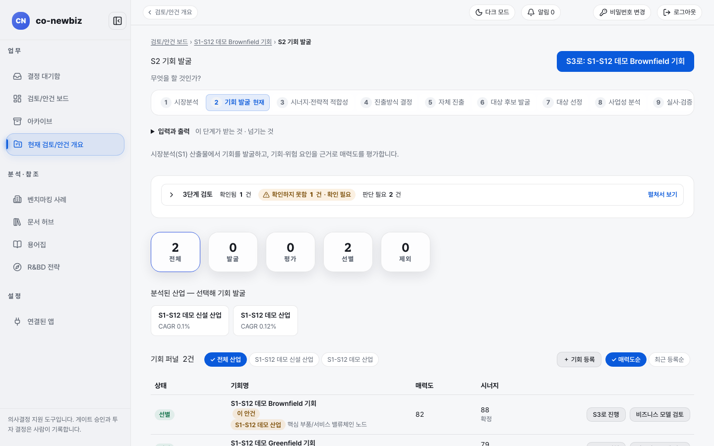
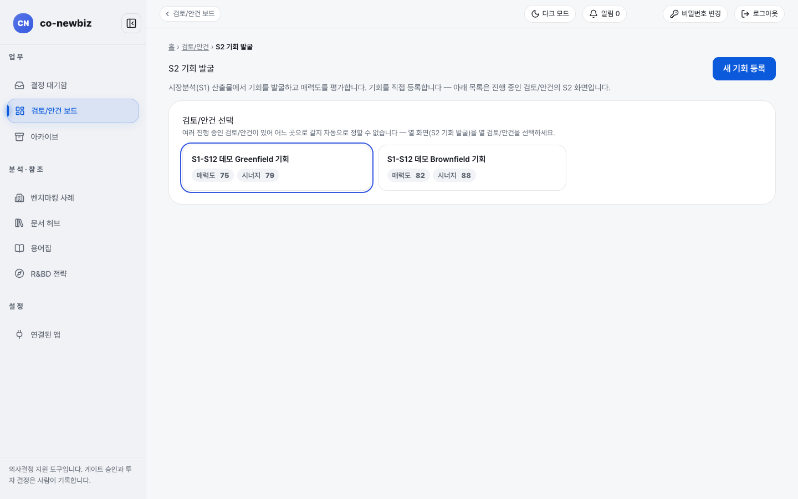
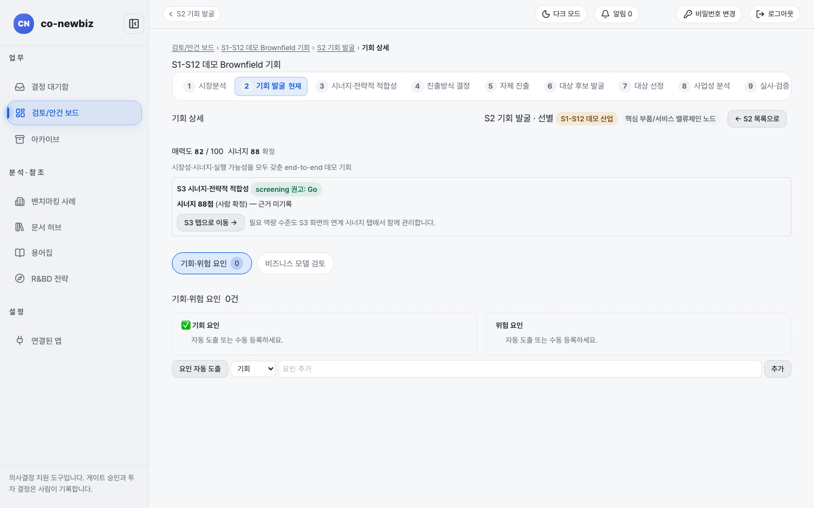

# 기회 발굴하고 매력도 평가하기

**목적:** S1에서 분석된 산업에서 사업 기회를 찾아 등록하고 매력도를 평가한다.

**누가/언제:** 분석가. S1 리포트가 있어야 산업과 연결된다.

**사전 조건:** ① 직전 단계: S1 시장분석의 리포트. ② 필요 권한: 프로젝트 구성원 이상. ③ 준비물: 데모 안건 `S1-S12 데모 Brownfield 기회`.

> [!NOTE]
> **트랙:** 그린필드와 브라운필드가 같은 화면을 쓴다.

> [!NOTE]
> 이 쪽의 화면 그림은 **데모 자료**다. 기회 이름과 점수는 내 자료와 다르다.

## 왜 이 단계인가

S2는 두 번째 질문 "무엇을 할 것인가?"에 답하는 단계로, S1이 그린 지도 위에 갈 만한 곳에 핀을 꽂고 점수를 매기는 일이다. 화면 이름인 `기회 퍼널`이 비유를 그대로 준다. 넓게 모은 기회를 `발굴` → `평가` → `선별` → `제외`로 좁혀 간다. S1 산출물이 있어야 산업과 연결되므로 이 단계는 S1 바로 뒤에 온다. `매력도`와 `시너지` 아래의 `제안`, `권고(미확정)`, `확정` 표지가 AI 값과 사람 값의 경계를 보여 주며, `확정`만 사람이 확정한 값이다. 여기서 만든 기회와 점수는 S3의 시너지 평가 대상이 되고 S4의 `진출방식 추천` 카드 신호가 된다.

| 표지 | 읽는 법 |
|---|---|
| `제안` | 아직 확정되지 않은 제안 값이다 |
| `권고(미확정)` | 권고일 뿐, 사람이 확정하기 전이다 |
| `확정` | 사람이 확정한 값이다 |

*S2 기회 발굴 화면. 위쪽에 `3단계 검토`, 퍼널 숫자 다섯 칸, 분석된 산업, 아래에 `기회 퍼널` 표가 있다.*

## 단계

1. 번호 띠에서 `2 기회 발굴`을 누른다(질문: "무엇을 할 것인가?"). 안건을 열지 않고 주소 `/opportunities`로 들어오면 `검토/안건 선택` 카드가 먼저 나온다. 오른쪽 위 버튼은 `새 기회 등록`이다.
2. 맨 위 `3단계 검토`에서 `확인됨`, `확인하지 못함`, `판단 필요`의 건수를 먼저 읽는다. `펼쳐서 보기`로 상세를 연다.
3. 퍼널 숫자 `전체`, `발굴`, `평가`, `선별`, `제외`로 현재 분포를 본다.
4. `분석된 산업 — 선택해 기회 발굴`에서 산업을 고른다. 산업마다 CAGR와 S1 외부 전망 대비 `격차`가 나온다.
5. `기회 퍼널` 표에서 산업 필터(`전체 산업` 외 산업명)를 고르고 `매력도순` 또는 `최근 등록순`으로 정렬한다.
6. 표의 열을 읽는다. `상태`는 `발굴`, `평가`, `선별`, `제외`이고 `매력도`와 `시너지` 아래에 `제안`, `권고(미확정)`, `확정` 표지가 붙는다. `확정`만 사람이 확정한 값이다.
7. (쓰기) 새 기회는 `+ 기회 등록` 또는 맨 아래 `기회 직접 등록`을 눌러 등록한다.
8. (쓰기) 기회 행의 **매력도 평가**를 눌러 기회 상세 화면을 열고 점수를 입력한다. 요인 입력과 `비즈니스 모델 검토`도 상세 화면에서 한다. **삭제**는 되돌릴 수 없고, 프로젝트로 승격된 기회는 삭제되지 않는다.
9. 안건을 다음으로 넘기려면 평가가 끝난 기회 행의 **S3로 진행**을 누른다(화면 위쪽에도 `S3로: <안건명>`이 있다).

### 기회 상세 읽기

기회 이름을 누르면 기회 상세(`/opportunities/{id}`)가 열린다.

1. 위쪽의 `매력도 82 / 100`, `시너지 88 확정`(사람 확정)을 읽는다. 숫자 아래 상자에 `S3 시너지·전략적 적합성`의 `screening 권고`와 근거가 있다. **S3 탭으로 이동 →**으로 S3 화면에 간다.
2. `기회·위험 요인` 탭에서 `기회 요인`과 `위험 요인`을 읽는다. 비어 있으면 **요인 자동 도출**(AI가 초안을 만든다)을 누르거나, 종류를 고르고 `요인 추가` 칸에 적어 **추가**를 누른다.
3. `비즈니스 모델 검토` 탭에서 비즈니스 모델 초안을 만들고 읽는다.
4. 위쪽 **← S2 목록으로**로 돌아온다.

*주소 `/opportunities`로 들어올 때 보이는 안건 선택 화면.*

*기회 상세. 기회·위험 요인이 아직 0건이라 "자동 도출 또는 수동 등록하세요."가 나온다.*

## 결과 확인

| 화면에 남는 변화 | 어디서 보이는지 |
|---|---|
| 매력도 | 평가가 끝나면 `매력도`에 숫자가 채워지고 상태가 바뀐다 |
| 시너지 확정 표지 | `시너지` 값은 S3에서 사람이 확정한 뒤에야 `확정`으로 표시된다 |

## 자주 하는 실수

| 오해 | 바른 읽기 |
|---|---|
| `S1 분석 산업 연결`이 `연결 안 됨`인 기회에서 산업을 고르지 않고 평가를 돌리는 것 | 산업을 먼저 연결한다 |
| `권고(미확정)`을 확정 값으로 읽는 것 | 확정 값은 `확정` 표지뿐이다 |
| `삭제`를 둘러보기 중에 누르는 것 | 누르지 않는다 |
| 목록의 **매력도 평가**를 누르면 바로 AI 평가가 돈다고 여기는 것 | 이 버튼은 상세 화면으로 이동한다 |

## 스스로 확인하기

`S1-S12 데모 Brownfield 기회`의 S2 표에서 `매력도`와 `시너지` 값을 읽어 본다(데모는 82와 88).

## 핵심 요약

- S2는 "무엇을 할 것인가?"에 답하며 S1 산출물이 있어야 산업과 연결된다.
- `기회 퍼널`은 발굴 → 평가 → 선별 → 제외로 기회를 좁힌다.
- `확정` 표지가 붙은 값만 사람이 확정한 값이다.
- 둘러보기에서는 `삭제`를 누르지 않는다. 프로젝트로 승격된 기회는 삭제되지 않는다.

이전: [20-공통-S1-시장분석](20-공통-S1-시장분석.md) | 다음: [22-공통-S3-시너지-전략적-적합성](22-공통-S3-시너지-전략적-적합성.md)
