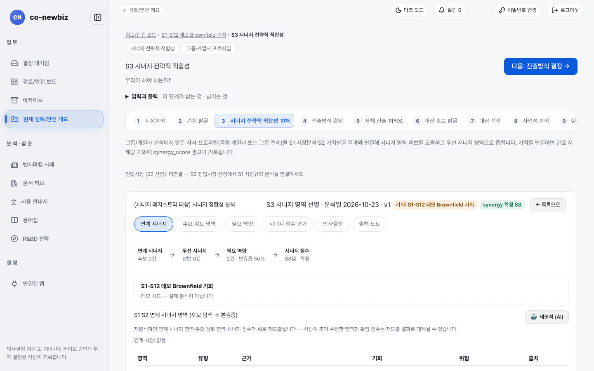
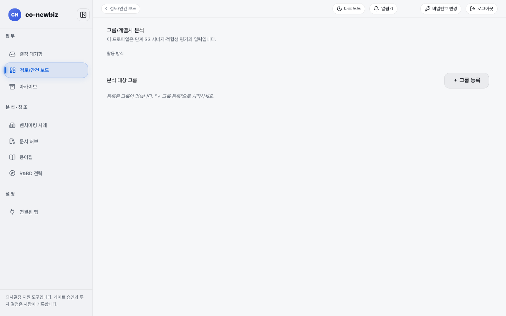

# 시너지·전략적 적합성 평가하기

**목적** — 우리 그룹·계열사 프로파일을 S1·S2 결과와 연결해 시너지 영역을 도출하고, 이 사업을 우리가 해야 하는지 판단하는 근거를 만듭니다.  **누가/언제** — 분석가가 평가하고 프로젝트 리드가 확정합니다. S2에서 기회가 선별된 뒤.  **사전 조건** — `그룹·계열사 프로파일`(`/our-company`)에 우리 회사 정보가 있어야 합니다.

> [!NOTE]
> **트랙** — 그린필드와 브라운필드 모두 같은 화면을 씁니다. 결과(`synergy_score` 권고)는 S4 추천의 근거 신호가 됩니다.

> [!NOTE]
> 이 쪽의 화면 그림은 **데모 자료**입니다. 데모에는 시너지 분석 목록이 비어 있고 우리 회사 프로파일도 비어 있어, 값이 채워진 모습은 직접 확인해야 합니다.

*S3 화면. 위쪽 두 칩(`시너지·전략적 적합성`, `그룹·계열사 프로파일`), 오른쪽 위 `새 시너지 평가 입력`, `3단계 검토`, 아래 `시너지 분석 목록`이 있습니다.*

> [!NOTE]
> `3단계 검토`의 사람 확인 체크는 누르는 즉시 저장됩니다. 체크한 항목에는 `확인 저장됨 · 확인한 사람 · 날짜` 칩이 붙고, `확인하지 못함` 구역의 항목도 똑같이 체크할 수 있습니다. 항목을 모두 확인하면 `✓ 모두 사람 확인 완료` 배너가 뜹니다.

## 단계

1. 번호 띠에서 `3 시너지·전략적 적합성`을 누릅니다(질문: "우리가 해야 하는가?").
2. 먼저 위쪽 `그룹·계열사 프로파일`을 눌러 우리 회사 프로파일(특정 계열사 또는 그룹 전체)이 있는지 확인합니다. 화면 제목은 `그룹/계열사 분석`입니다. 비어 있으면 "등록된 그룹이 없습니다."가 나오고 **+ 그룹 등록**으로 시작합니다.
3. `시너지 분석 목록`에서 `이 딜만`과 `전체`를 눌러 범위를 바꿉니다. 이 딜에 연결된 분석이 없으면 "이 딜에 연결된 시너지 분석이 없습니다."가 나옵니다.
4. (쓰기) 분석을 시작하려면 **이 딜로 분석 시작**(또는 `+ 새 분석`, `새 시너지 평가 입력`)을 누릅니다. 분석 대상은 다음 화면에서 직접 고르며 자동으로 제출되지 않습니다.
5. 완료된 분석을 열어 우선 시너지 영역과 근거를 읽습니다. 기회를 연결하고 완료하면 해당 기회에 `synergy_score` 권고가 기록됩니다.
6. 시너지 값은 프로젝트 리드가 확정해야 S2·S4에서 `확정`으로 표시됩니다.

*`그룹·계열사 프로파일`. 데모에는 등록된 그룹이 없어 `+ 그룹 등록`만 보입니다.*

## 결과 확인

- S2 표의 `시너지` 열에 권고(미확정) 또는 확정 값이 나타납니다.
- S4 `진출방식 추천` 카드의 신호에 "시너지 확정 88"처럼 인용됩니다.

## 자주 하는 실수

- 프로파일이 없는 채로 분석을 시작하는 것.
- `전체`로 보고 있는 목록을 이 딜의 분석으로 착각하는 것. `이 딜만`으로 바꿔 확인하세요.
- 시너지 권고를 확정 값으로 읽는 것.

## 알려진 불일치

데모 안건에서 S3 목록은 "이 딜에 연결된 시너지 분석이 없습니다"인데, S2·S4에는 시너지 `88`(확정)이 나옵니다. 값의 출처가 S3 분석인지 직접 입력인지 화면으로는 알 수 없습니다(결함 기록 D-15). 같은 쪽의 `synergy_score`는 영어 그대로 쓰는 화면 문구입니다.

## 다음 단계

[23-공통-S4-진출방식-결정](23-공통-S4-진출방식-결정.md)

## 스스로 확인하기

`S1-S12 데모 Brownfield 기회`의 S3에서 `이 딜만`과 `전체`를 바꿔 목록 건수가 어떻게 달라지는지 확인해 보세요.
