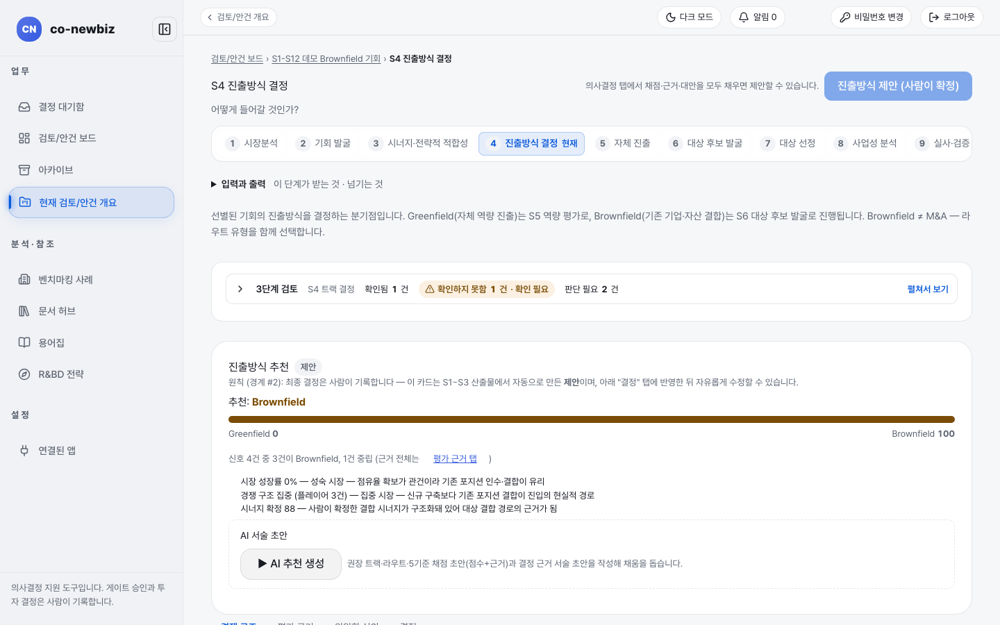
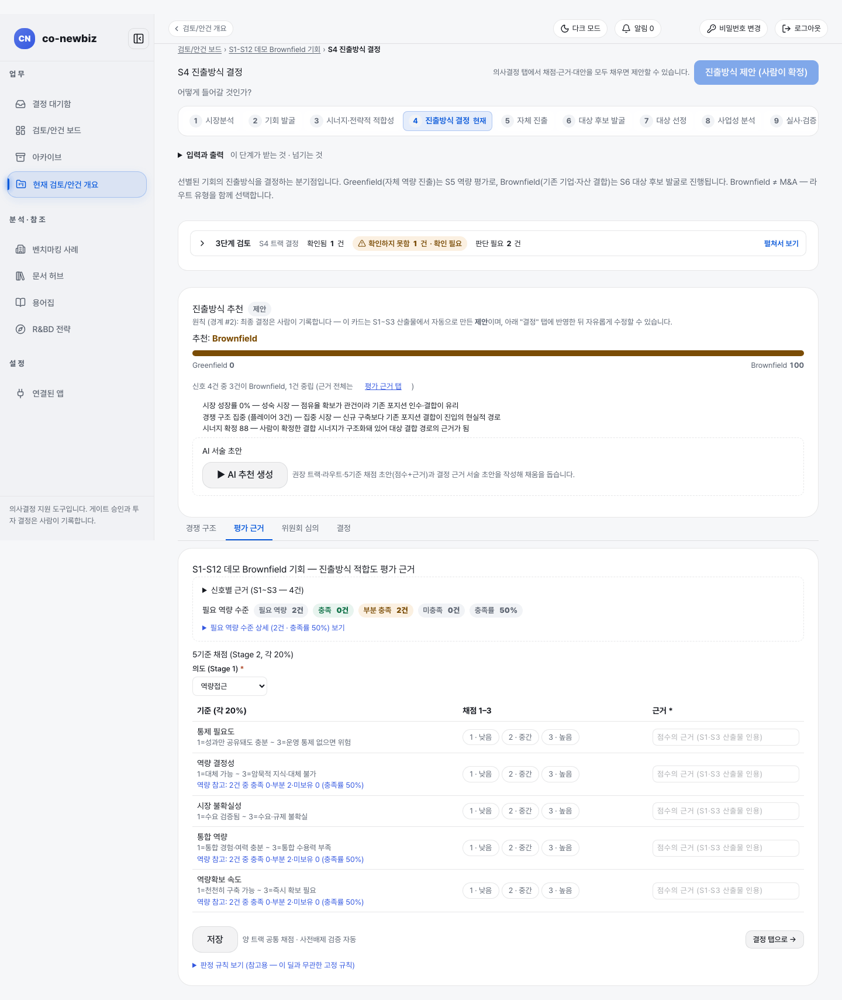
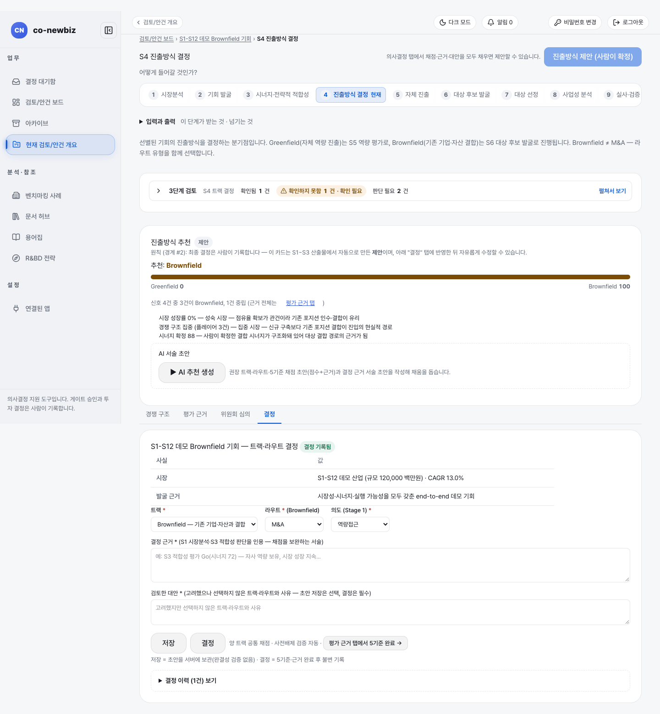
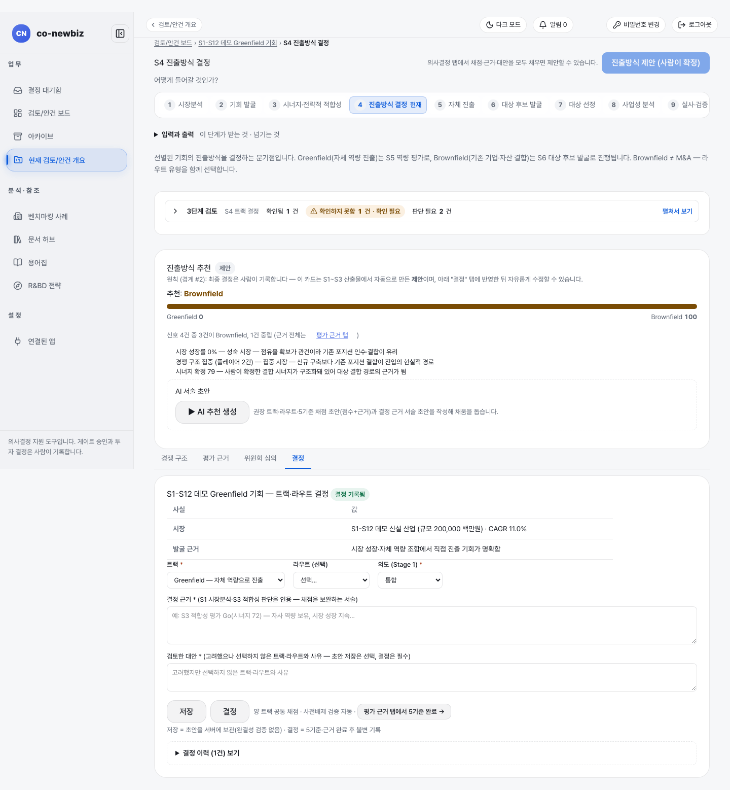

# 진출방식(트랙·라우트) 결정하기

**목적:** 선별된 기회를 우리 역량으로 새로 세울지(그린필드), 기존 기업·자산과 결합할지(브라운필드) 정하고 그 근거를 불변으로 기록한다. 이 화면이 갈림길이다.

**누가/언제:** 프로젝트 리드가 기록한다. 분석가는 채점과 근거 초안까지. 게이트 `Screening` 이후, 다음 게이트는 `Pre-FS`.

**사전 조건:** ① 직전 단계·게이트: S3 완료와 게이트 `Screening`. ② 필요 권한: 프로젝트 `lead`(결정 기록). ③ 준비물: S1~S3 산출물, 데모 안건 `S1-S12 데모 Brownfield 기회`.

> [!NOTE]
> **트랙:** 여기서 고른 `트랙`이 이후 길을 정한다. 그린필드면 S5(자체 진출), 브라운필드면 S6~S7(대상 후보 발굴·대상 선정)으로 간다. 브라운필드는 `라우트`를 필수로 고르고 그린필드는 `라우트 (선택)`이다(화면 표기). 브라운필드는 M&A와 같은 말이 아니다. 이후 길 안내: [40-그린필드-S5-자체-진출](40-그린필드-S5-자체-진출.md), [50-브라운필드-S6-대상-후보-발굴](50-브라운필드-S6-대상-후보-발굴.md).

> [!NOTE]
> 이 쪽의 화면 그림은 **데모 자료**다. 안건 이름, 규모, 점수는 내 자료와 다르다.

## 왜 이 단계인가

S4는 공통 단계의 마지막 질문 "어떻게 들어갈 것인가?"에 답하는 단계로, 두 길이 갈라지는 갈림길이다. S1~S3에서 모인 결과가 `진출방식 추천` 카드의 신호로 모이고 이 신호를 읽은 사람이 방향을 고른다. 여정의 갈림길에 세우는 이정표이자 한 번 적으면 지워지지 않는 기록이라, 화면의 다른 어느 입력보다 무겁다. `결정`은 불변 기록이고 사람만 기록하며 AI 카드는 제안일 뿐이다. 여기서 고른 `트랙`이 뒤의 모든 화면 구성을 바꾼다.

| 고른 것 | 이후 길 |
|---|---|
| `Greenfield — 자체 역량으로 진출` | S5 자체 진출로 간다 |
| `Brownfield — 기존 기업·자산과 결합` + `라우트 *`(필수) | S6~S7 대상 후보 발굴·대상 선정으로 간다 |

<svg viewBox="0 0 860 120" width="100%" role="img" xmlns="http://www.w3.org/2000/svg">
  <title>S4 갈림길: 트랙을 기록하면 두 길로 나뉘고 S8에서 다시 만난다</title>
  <defs>
    <marker id="wiki-ah" markerWidth="7" markerHeight="7" refX="5.5" refY="3" orient="auto">
      <path d="M0,0 L6,3 L0,6 z" fill="var(--border)"></path>
    </marker>
  </defs>
  <rect x="8" y="46" width="140" height="28" rx="6" fill="none" stroke="var(--border)"></rect>
  <text x="78" y="64.5" text-anchor="middle" font-size="13" fill="var(--fg)">S4 진출방식 결정</text>
  <line x1="148" y1="60" x2="162" y2="60" stroke="var(--border)" stroke-width="1.2"></line>
  <line x1="162" y1="30" x2="162" y2="90" stroke="var(--border)" stroke-width="1.2"></line>
  <line x1="162" y1="30" x2="174" y2="30" stroke="var(--border)" stroke-width="1.2" marker-end="url(#wiki-ah)"></line>
  <line x1="162" y1="90" x2="174" y2="90" stroke="var(--border)" stroke-width="1.2" marker-end="url(#wiki-ah)"></line>
  <rect x="180" y="16" width="210" height="28" rx="6" fill="var(--primary)" fill-opacity="0.08" stroke="var(--border)"></rect>
  <text x="285" y="34.5" text-anchor="middle" font-size="13" fill="var(--fg)">그린필드 · 라우트 (선택)</text>
  <rect x="180" y="76" width="210" height="28" rx="6" fill="var(--primary)" fill-opacity="0.08" stroke="var(--border)"></rect>
  <text x="285" y="94.5" text-anchor="middle" font-size="13" fill="var(--fg)">브라운필드 · 라우트 필수</text>
  <line x1="390" y1="30" x2="408" y2="30" stroke="var(--border)" stroke-width="1.2" marker-end="url(#wiki-ah)"></line>
  <rect x="414" y="16" width="140" height="28" rx="6" fill="none" stroke="var(--border)"></rect>
  <text x="484" y="34.5" text-anchor="middle" font-size="13" fill="var(--fg)">S5 자체 진출</text>
  <line x1="390" y1="90" x2="408" y2="90" stroke="var(--border)" stroke-width="1.2" marker-end="url(#wiki-ah)"></line>
  <rect x="414" y="76" width="200" height="28" rx="6" fill="none" stroke="var(--border)"></rect>
  <text x="514" y="94.5" text-anchor="middle" font-size="13" fill="var(--fg)">S6 후보 발굴 · S7 대상 선정</text>
  <path d="M 554,30 L 730,30 L 730,40" fill="none" stroke="var(--border)" stroke-width="1.2" marker-end="url(#wiki-ah)"></path>
  <path d="M 614,90 L 730,90 L 730,80" fill="none" stroke="var(--border)" stroke-width="1.2" marker-end="url(#wiki-ah)"></path>
  <rect x="660" y="46" width="140" height="28" rx="6" fill="none" stroke="var(--border)"></rect>
  <text x="730" y="64.5" text-anchor="middle" font-size="13" fill="var(--fg)">S8 사업성 분석</text>
</svg>

*S4 첫 화면. 오른쪽 위 `진출방식 제안 (사람이 확정)` 버튼은 `결정` 탭의 입력이 모두 채워져야 눌린다. 가운데 `진출방식 추천` 카드는 AI 제안이다.*

## 단계

1. 번호 띠에서 `4 진출방식 결정`을 누른다(질문: "어떻게 들어갈 것인가?"). `입력과 출력`을 펼쳐 둔다.
2. `진출방식 추천` 카드를 읽는다. `추천: Brownfield`, `Greenfield 0`·`Brownfield 100`, "신호 4건 중 3건이 Brownfield, 1건 중립"과 신호 목록이 나온다. 이 카드는 AI 제안일 뿐이다("최종 결정은 사람이 기록합니다"). 그린필드 안건에서도 같은 카드가 다른 추천을 낼 수 있으며 결정은 이 카드와 무관하게 사람이 정한다.
3. `경쟁 구조` 탭에서 S1 경쟁 구조(주요 기업 표: 기업, 티어, 비고)를 읽는다.
4. `평가 근거` 탭을 연다. `신호별 근거`와 `필요 역량 수준`(`필요 역량`, `충족`, `부분 충족`, `미충족`, `충족률`)을 읽는다.
5. 같은 탭의 `5기준 채점 (Stage 2, 각 20%)`에서 `의도 (Stage 1)`(`통합` 또는 `역량접근`)를 고르고 기준 다섯 개(`통제 필요도`, `역량 결정성`, `시장 불확실성`, `통합 역량`, `역량확보 속도`) 각각에 `1 · 낮음`, `2 · 중간`, `3 · 높음` 중 하나와 `근거`를 입력한 뒤 **저장**을 누른다. 입력을 마치면 **결정 탭으로 →**이 있다.
6. 필요하면 `위원회 심의` 탭에서 `위원회 소집`으로 심의를 돌릴 수 있다. 옵션은 `위원회 심의 후 제안`, `라운드별 인간 입장 포함`, `인간 심의만`이며 `예비타당성 검토(Pre-FS)`를 `진행`하는 항목이 함께 있다. 심의가 끝나면 `심의 결과`에 `의장 종합 (제안)`(GO·HOLD·KILL 표지)과 `소수 의견 (원문 보존)`이 나란히 나오고, 그 아래 `회의록` 줄의 **회의록 보기**로 읽고 **회의록 확정**으로 사람이 확정한다(아래 `위원회 회의록 읽기` 절).
7. `결정` 탭을 연다. 위쪽 `검토 안건 사실` 표(시장, 발굴 근거)를 읽는다.
8. `트랙 *`에서 `Greenfield — 자체 역량으로 진출` 또는 `Brownfield — 기존 기업·자산과 결합`을 고른다.
9. 브라운필드면 `라우트 * (Brownfield)`에서 `M&A`, `JV(합작)`, `전략적 투자`, `소수지분 투자`, `전략 제휴`, `R&BD(공동연구)`, `사내벤처(CVC)` 중 하나를 고르고 그린필드면 `라우트 (선택)`은 비워도 된다. 두 경우 모두 `의도 (Stage 1) *`(`통합` 또는 `역량접근`)를 고른다.
10. `결정 근거 *`(S1 시장분석·S3 적합성 판단을 인용)와 `검토한 대안 *`(선택하지 않은 트랙·라우트와 사유)를 쓴다.
11. 중간에 멈추려면 **저장**을 누른다(초안 보관, 완결성 검증 없음).
12. 5기준과 근거가 모두 채워졌으면 **결정**을 눌러 불변 기록한다. 이 기록은 사람만 한다.
13. `결정 이력 (1건) 보기`를 펼쳐 기록된 결정과 근거 전체를 읽는다. 소집한 위원회가 있으면 그 아래 `위원회 심의 이력`에 세션(상태 칩, 의사결정 모드, 날짜)이 붙고 행의 `회의록` 버튼으로 회의록을 다시 연다.

*`평가 근거` 탭. 5기준 채점표와 `저장`, `결정 탭으로 →`이 있다.*

*`결정` 탭. 제목 옆 `결정 기록됨` 표지, `트랙`은 `Brownfield — 기존 기업·자산과 결합`, `라우트`는 `M&A`로 채워져 있다.*

*그린필드 안건의 `결정` 탭. `트랙`은 `Greenfield — 자체 역량으로 진출`이고 `라우트 (선택)`은 비어 있다. 위쪽 `진출방식 추천` 카드는 데모에서 Brownfield를 가리키고 있어 기록된 결정과 다르다.*

## 법무·규제 스크리닝과 체크리스트 기록

S4에는 진출방식 결정과 별개로 법무·규제 스크리닝이 있다. 법무 담당 에이전트(`legal-counsel`)가 `법무·규제 체크리스트`(항목 `lr-01`~`lr-07`)를 항목마다 판정한다. 법령 원문 확인은 k-law로 하고 법적 판단은 법무 담당이 한다. 이 에이전트의 판정은 초안이며 게이트 결정은 사람이 한다.

- 판정을 적는 입력 화면은 없다. 사람이 기록한 판정을 시스템이 읽어 체크리스트 상태로 쓴다(기록은 덧붙이기만 되고 지워지지 않는다).
- 지금은 이 점검이 **참고 단계**로 켜져 있다. 판정이 비어 있어도 S4를 막지 않는다. 운영 환경에서는 `이 단계에서 남은 것`에 `[권고·shadow] chk-legal-regulatory 체크리스트 판정이 필요합니다 (Screening 게이트) — 판정 기록이 없습니다` 같은 참고 줄이 보일 수 있고 개발 환경에서는 이 줄이 나오지 않는다.
- 시행으로 전환되면 `법무·규제 스크리닝 판정 (법무·규제 체크리스트 lr-01~lr-07)`이 필수 항목으로 남아 S4를 마칠 수 없다. 필수 항목은 `충족`이거나 이유를 적은 `해당 없음`이어야 한다. 권장 항목은 막지 않는다.
- 이 점검이 생기기 전에 만든 기회에는 적용하지 않는다.

그린필드는 S5에서 같은 방식으로 `그린필드 실현가능성 체크리스트`(`gf-01`~`gf-12`)와 `부지 선정 체크리스트`(`ss-01`~`ss-09`)를 읽는다([40-그린필드-S5-자체-진출](40-그린필드-S5-자체-진출.md)).

## 위원회 회의록 읽기

`위원회 심의` 탭의 **회의록 보기**와 `결정` 탭 `위원회 심의 이력`의 `회의록` 버튼은 같은 회의록 창을 연다. 회의록은 AI가 작성한 초안이며 사람이 확인해 기록으로 남긴다(ADR-0104).

| 구성 | 보이는 것 |
|---|---|
| 상태 칩 | 세션 상태·트랙, `초안` 또는 `✓ 확정됨`. LLM 없이 만들어진 초안에는 `◐ 결정론적 대체 생성 (LLM 미사용)` 칩이, 결론 일부가 자동으로 채워진 초안에는 `일부 결론 자동 대체 (N건)` 칩이 붙는다 |
| `안건 쟁점 (의장 제안)` | 의장이 제안한 쟁점 목록. 의견이 갈린 쟁점에는 `◐ 쟁점 분분` 칩이 붙는다 |
| `쟁점별 논의` | 쟁점마다 좌석별 발언 요약과 `결론`. 결론은 `합의`, `일부 합의`, `미합의(보류)` 세 라벨로 보이고, `미합의(보류)` 항목에는 `미해결 질문 (N건)` 뱃지가 붙어 아래 `미해결 질문` 구역으로 건너뛴다 |
| `합의 사항` · `실행 항목` | 합의된 내용과 해야 할 일. 담당 좌석이 있으면 옆에 적는다 |
| `보존된 이의 (원문)` | 이의를 요약하지 않고 발언 원문 그대로 보존한다 |
| `제안 권고` | GO·HOLD·KILL 표지와 함께 "제안일 뿐 결정이 아닙니다"가 적힌다. 진출방식 결정은 어디까지나 `결정` 탭의 **결정**(사람만)이다 |

회의록 어디에도 통과 도장은 없다. 모달 아래 `✦ AI 초안` 표지와 함께 `AI 초안 구간입니다 — 부록의 원문 기록과 대조해 검증하세요` 안내가 붙는다. **회의록 확정**은 분석가 이상 권한의 사람이 누르는 행위이고 누르면 `✓ 확정됨` 칩과 함께 확정한 사람·날짜가 남는다. 확정은 회의록을 "읽었다"는 기록이지 결정 기록이 아니다.

## 결과 확인

| 화면에 남는 변화 | 어디서 보이는지 |
|---|---|
| 결정 표지 | `결정` 탭 제목 옆에 `결정 기록됨`이 나타나고 `결정 이력 (1건)`이 생긴다 |
| 번호 띠 | 선택한 트랙의 다음 단계(S5 또는 S6)가 열린다. 쓰지 않는 쪽은 `미적용`으로 표시된다 |
| 기록 성격 | `결정`은 불변 기록이다. 고치려면 새 결정으로 기록한다(개정 절차는 별도 안내 예정) |

## 자주 하는 실수

| 오해 | 바른 읽기 |
|---|---|
| AI 추천(`추천: Brownfield`)을 결정으로 받아들여 **결정**을 서두르는 것 | 추천은 제안이다 |
| 브라운필드를 고르면서 `라우트`를 비워 두는 것 | 필수다 |
| **저장**과 **결정**을 혼동하는 것 | **저장**은 초안, **결정**은 불변 기록이다 |
| 화면 위 문구가 말하는 "의사결정 탭"을 다른 탭으로 찾는 것 | 실제 탭 이름은 `결정`이다 |
| 분석가 계정으로 **결정**이 안 눌린다고 오류로 여기는 것 | 트랙 결정은 프로젝트 리드만 기록한다 |
| `[권고·shadow]` 줄을 막힘으로 읽는 것 | 참고 줄이다. 시행으로 전환되기 전에는 단계를 막지 않는다 |
| 회의록의 `제안 권고`나 `위원회 심의` 결과를 결정으로 읽는 것 | 제안이다. 트랙·라우트 결정은 `결정` 탭의 **결정**(사람만)으로만 기록된다 |
| 회의록을 읽기만 하고 **회의록 확정**을 누르지 않는 것 | 회의록은 AI 초안이라 사람의 확정이 필요하다. 확정은 분석가 이상 권한의 사람이 누른다 |

## 알려진 불일치

- 검토 패널 일부 문구가 영어로 보인다("Stage S4 (진출방식 결정) completion predicate is satisfied" 등, 결함 기록 D-12).
- 위쪽 안내 문구는 "의사결정 탭에서"라고 하지만 탭 이름은 `결정`이다(D-11).
- 그린필드 안건에서도 `진출방식 추천` 카드가 Brownfield를 추천하는 데모 화면이 있다. 카드와 기록된 결정이 다를 수 있다는 점을 알고 읽는다.

## 스스로 확인하기

`S1-S12 데모 Brownfield 기회`의 S4 `결정` 탭에서 기록된 `트랙`과 `라우트`, `결정 이력`을 찾아 읽는다. 어떤 버튼도 누르지 않는다.

## 핵심 요약

- S4는 여정의 갈림길이다. 여기서 고른 `트랙`이 이후 길(S5 또는 S6~S7)을 정한다.
- 브라운필드는 `라우트`가 필수이고 브라운필드는 곧 M&A가 아니다.
- **저장**은 초안, **결정**은 불변 기록이며 결정은 프로젝트 리드만 누른다.
- `진출방식 추천` 카드는 AI 제안일 뿐이다.
- 법무·규제 체크리스트(`lr-01`~`lr-07`)는 법무 담당 에이전트가 판정한다. 지금은 참고 단계라 `[권고·shadow]` 줄만 보이고 S4를 막지 않는다.
- `위원회 심의`를 돌리면 AI 초안 회의록이 남는다. 쟁점별 결론은 `합의`, `일부 합의`, `미합의(보류)`로 보이고 사람이 **회의록 확정**으로 확정한다. 회의록의 `제안 권고`는 결정이 아니다.

이전: [22-공통-S3-시너지-전략적-적합성](22-공통-S3-시너지-전략적-적합성.md) | 다음: [10-그린필드-여정](10-그린필드-여정.md) · [11-브라운필드-여정](11-브라운필드-여정.md)
