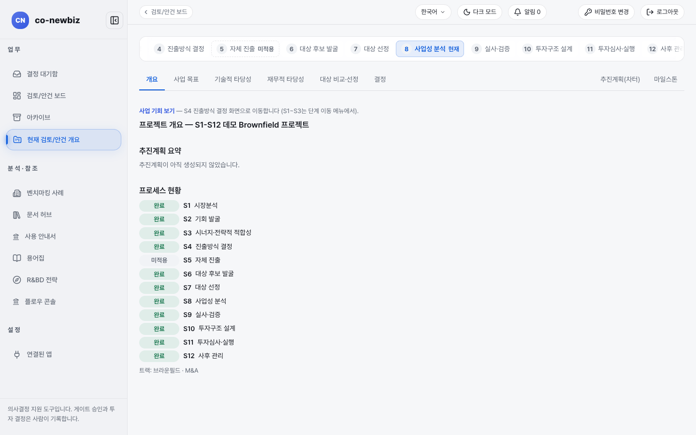
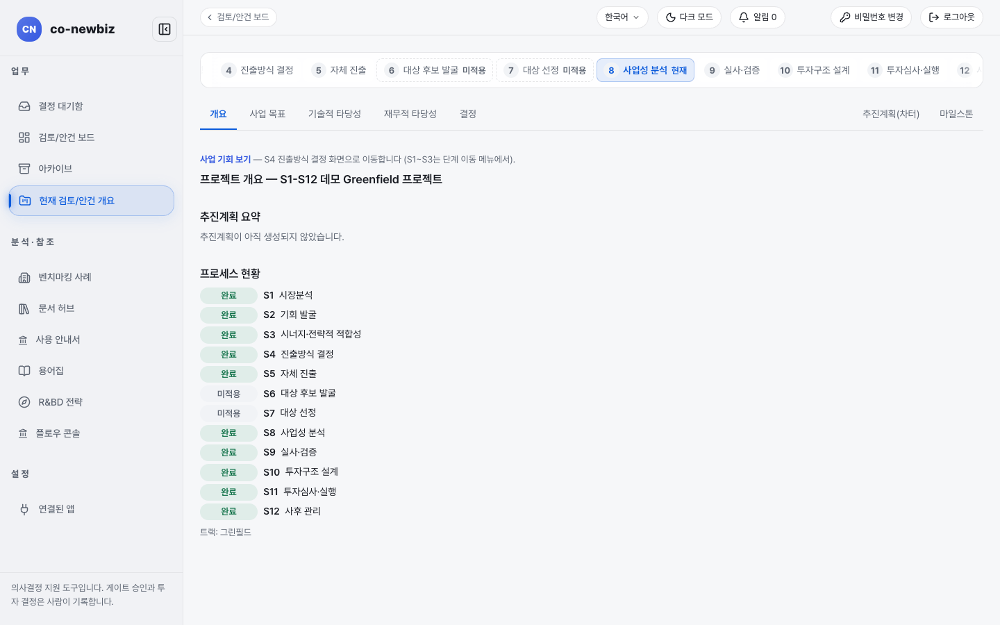

# 사업성 분석(S8) 읽고 기록하기: 두 트랙의 공통 부분

**목적:** 돈이 되는지("돈이 되는가?")를 시나리오별 순현재가치(NPV)·내부수익률(IRR)로 보고 할인율(WACC)을 정하고 채택할 사업 사례를 사람이 기록한다.

**누가/언제:** 분석가가 숫자를 만들고 프로젝트 리드가 채택과 결정을 기록한다. 게이트 `Pre-FS`(그린필드) 또는 `대상 선정`(브라운필드) 뒤이며 다음 게이트는 `FS`(타당성 분석)다.

**사전 조건:** ① 직전 단계·게이트: 그린필드는 `Pre-FS`, 브라운필드는 `대상 선정` 뒤다. ② 필요 권한: 숫자와 분석은 분석가, 채택과 게이트 결정 기록은 사람(프로젝트 리드)이다. ③ 준비물: 프로젝트로 승격된 안건(S8부터는 "프로젝트"다). 브라운필드라면 최종 후보 목록의 대상 목록이 분석 대상이다.

> [!NOTE]
> **트랙:** 화면과 게이트는 같고 분석 대상이 다르다. 그린필드는 대상이 하나(단일 범위)이고 브라운필드는 짧은 목록의 대상별로 분석한 뒤 사람이 대상을 고른다. 트랙별 절차는 [41-그린필드-S8-사업성-분석](41-그린필드-S8-사업성-분석.md)과 [52-브라운필드-S8-사업성-분석](52-브라운필드-S8-사업성-분석.md)을 본다.

> [!NOTE]
> 이 쪽의 화면 그림은 **데모 자료**다. 이름, 금액, 비율은 내 자료와 다르다.

## 왜 이 단계인가

S8은 두 길이 합류하는 지점에서 "돈이 되는가?"라는 질문에 답하는 단계다. 앞 단계의 진행 방식은 달랐다. 그린필드는 S5의 진출전략을 근거로 사업 케이스를 만들고 브라운필드는 S6~S7에서 좁힌 최종 후보 목록 대상마다 밸류에이션을 만들어 견준다. 그래도 이 단계부터는 절차가 다시 하나로 합쳐진다. 무엇을 새로 세우든 누구와 결합하든, 이 일이 돈이 되는가를 검산하는 대장은 한 권이어야 하기 때문이다. 화면에서 숫자는 엔진이 계산하지만 채택은 사람의 행위고 채택된 케이스의 NPV는 S11 투자심의 자료로 그대로 인용되므로 이 단계의 판단이 뒤의 투자심의를 좌우한다.

| | 그린필드 | 브라운필드 |
|---|---|---|
| 분석 대상 | 진출전략 한 건(단일 범위) | 최종 후보 목록의 대상별 |
| 위쪽 탭 | `개요`, `사업 목표`, `기술적 타당성`, `재무적 타당성`, `결정` | 위 다섯 개 + `재무적 타당성` 다음에 `대상 비교·선정` |
| 사람이 먼저 할 일 | 없음(진출전략을 근거로 분석) | `대상 비교·선정`에서 대상 한 곳을 사람이 선정 |
| `재무적 타당성` > `대상회사` | `연결된 대상 회사`(옆 표지 `greenfield · 분석 기준 회사`)에 매출액·영업이익률·부채비율·ROE가 나온다. 연결한 회사가 없으면 `연결된 벤치마크 회사가 없습니다`가 나온다. `벤치마크 회사 연결/변경`(회사 이름이나 DART 고유번호로 검색)으로 비교 기준이 될 회사를 사람이 고른다 | `연결된 대상 회사`(옆 표지 `brownfield · 인수 대상`)는 대상 비교·선정에서 선정한 대상으로만 정해진다. 이 하위 탭에서는 연결하거나 바꿀 수 없고 `S8 대상 비교·선정 열기 →` 링크만 있다 |
| 안내 | [41-그린필드-S8-사업성-분석](41-그린필드-S8-사업성-분석.md) | [52-브라운필드-S8-사업성-분석](52-브라운필드-S8-사업성-분석.md) |

*S8 `개요` 탭(브라운필드 데모). 위쪽 탭에 `대상 비교·선정`이 있다. 아래 `프로세스 현황`에서 S5 `자체 진출`은 브라운필드가 쓰지 않아 `미적용`이다.*

*그린필드 데모의 `개요` 탭. 위쪽 탭에 `대상 비교·선정`이 없고 대상이 하나다. `프로세스 현황`에서 S6·S7은 `미적용`이다.*

## S8 화면의 탭 구조

S8 화면의 탭 줄은 두 겹이다. 위쪽 줄은 S8의 큰 갈래이고, 그 가운데 `재무적 타당성`을 눌렀을 때만 아래에 둘째 줄(하위 탭)이 나온다. 위쪽 줄 오른쪽 끝에는 어느 단계에서든 같은 공통 링크 `추진계획(차터)`와 `마일스톤`이 붙는다. S8에는 `더보기`가 없다.

**위쪽 줄(왼쪽부터)**

| 위쪽 탭 | 묻는 것 | 화면에 있는 것 | 트랙 |
|---|---|---|---|
| `개요` | 지금 어디까지 왔는가 | 제목 `프로젝트 개요 — {프로젝트 이름}`, `추진계획 요약`, `프로세스 현황`. 프로젝트 목록의 `사업성(S8)`과 번호 띠 `8 사업성 분석`은 모두 이 탭으로 연다(주소 `/projects/{id}`) | 공통 |
| `사업 목표` | 무엇을 달성하려는가 | 목표 설정(`목표 미설정` 줄과 **목표 설정**)과 채택한 케이스의 목표 달성 표 | 공통 |
| `기술적 타당성` | 실현할 수 있는가 | 항목 T1~T6. 판정은 S9에서 하고 S8은 비추기만 한다([60-프로젝트-화면-안내](60-프로젝트-화면-안내.md)) | 공통 |
| `재무적 타당성` | 돈이 되는가 | 아래 둘째 줄의 하위 탭 일곱 개 | 공통 |
| `대상 비교·선정` | 어느 대상을 고를 것인가 | 최종 후보 목록 대상 비교 표와 `선정 기록` | 브라운필드만 |
| `결정` | 누가 무엇으로 결정하는가 | 두 타당성 요약 줄, `사업목표 기준 대비`, `🤖 AI 판단 지원`(`채택할 케이스`·`게이트 판단` 제안), `FS` 게이트 결정 | 공통 |

**둘째 줄: `재무적 타당성`의 하위 탭(왼쪽부터)**

| 하위 탭 | 화면에 있는 것 | 열리는 주소 |
|---|---|---|
| `설명·생성·권고` | 처음 열리는 쪽이다. 자동 생성 버튼, `생성 진행 상황` 패널, 계산 사슬 설명(그린필드는 S5 연결 블록도) | `/projects/{id}/business-case?tab=financial-model` |
| `시나리오 비교` | `기본(Base)`·`상승(Upside)`·`하락(Downside)` 표와 케이스 줄의 `채택` | `/projects/{id}/business-case?tab=scenarios` |
| `WACC` | 할인율 입력과 확정, `WACC 참조값` | `/projects/{id}/wacc` |
| `대상회사` | 연결된 대상 회사의 재무 요약(위 표의 `재무적 타당성` > `대상회사` 줄) | `/projects/{id}/financial-analysis` |
| `재무분석` | 손익분기(BEP). 아래 `손익분기(BEP) 읽기` | `/projects/{id}/business-case?tab=bep` |
| `파라미터·스냅샷` | 모델에 넣은 입력 파라미터와 입력 스냅샷 | `/projects/{id}/business-case?tab=params` |
| `타겟코스팅` | 시장가격·목표마진·추정 단위원가로 허용원가와 격차를 분석 | `/projects/{id}/business-case?tab=target-costing` |

- `WACC`와 `대상회사`는 따로 주소가 있지만 머리와 탭 줄은 다른 S8 화면과 같다. 옛 주소 `business-case?tab=wacc`와 `?tab=financial-analysis`로 들어와도 이 두 주소로 옮겨 준다.
- 그린필드에는 `대상 비교·선정` 탭이 없다. 옛 주소 `?tab=targets`로 들어오면 `설명·생성·권고`로 옮겨 준다.
- `?tab=` 없이 `business-case`를 열면 `개요`로 옮겨 준다.
- 위쪽 줄의 `재무적 타당성`을 누르면 하위 탭 가운데 `설명·생성·권고`가 열린다.

## 단계

1. 보드 `바로가기`의 `프로젝트 목록`에서 프로젝트 행의 `사업성(S8)`을 누르거나, 프로젝트 안에서 번호 띠 `8 사업성 분석`을 누른다. 어느 쪽이든 먼저 `개요` 탭이 열린다(제목 `프로젝트 개요 — {프로젝트 이름}`). `추진계획 요약`과 `프로세스 현황`을 읽은 뒤 다른 탭을 연다. 다른 탭에서는 큰 제목이 단계 이름 `S8 사업성 분석`이고 그 아래 부제로 이 화면 이름이 붙는다(그린필드 `시장 기반 밸류에이션`, 브라운필드 `이중 관점 밸류에이션 비교`). 질문은 "돈이 되는가?"다.
2. `사업 목표` 같은 S8 탭을 열면 위쪽에 안내 줄과 `3단계 검토`(`확인됨`, `확인하지 못함`, `판단 필요`)가 있다. 먼저 읽는다.
3. `사업 목표` 탭에서 사업 목표를 정한다. 목표가 없으면 `목표 미설정` 경고 줄이 보이고 **목표 설정**(또는 **사업 목표로 이동**) 버튼이 있다. 목표 없이도 시나리오 비교는 계속된다. 목표를 달성했는지는 **채택한 케이스**의 시나리오별 중앙값(`NPV p50`)으로 판정하고 채택하기 전에는 기본(Base) 케이스로 본다. 채택 창의 달성 판정과 S8 요약이 같은 기준을 쓴다.
4. `재무적 타당성`을 누르면 아래에 둘째 줄이 나온다. 그 가운데 `시나리오 비교` 하위 탭에서 `기본(Base)`, `상승(Upside)`, `하락(Downside)`을 읽는다. 같은 시나리오를 `시장 기반(진행 판정 1차)`과 `과거 기반(비교 근거)` 두 관점으로 평가해 나란히 보여 준다. 열은 `NPV p05`, `NPV p50`, `NPV p95`, `IRR (%)`, `p50 차이`, `페이퍼 DCF p50`이다. 케이스가 비어 있으면 자동 생성 안내가 나온다. 표 아래 작은 글씨 `신뢰구간은 매출 성장률 불확실성만 반영합니다. 설비투자·운영비·WACC는 고정값입니다.`를 함께 읽는다. `NPV p05`~`p95`의 폭은 매출 성장률이 흔들릴 때만 담은 것이다. 설비투자, 운영비, WACC가 달라질 때의 흔들림은 담기지 않았다. 다른 요인도 흔들린 실행이면 `신뢰구간이 반영하는 불확실성: …. 고정값: ….`처럼 반영된 요인이 적힌다.
5. 숫자를 다시 만들려면 `설명·생성·권고` 하위 탭의 생성 버튼(그린필드 `자동 생성 (시장 기반 × 3 시나리오)`, 브라운필드 `이중 관점 자동 생성 (시장 기반 + 과거 기반 × 3 시나리오)`)을 누른다. 만들기는 서버에서 돌아가므로 화면을 새로고침하거나 떠나도 이어진다. 진행 읽는 법은 아래 `생성 진행 보기와 이어 보기`를 본다.
6. `재무적 타당성` 아래 `WACC` 하위 탭에서 `현재 확정값`(WACC, `요구수익률(Hurdle IRR)`, `WACC 적용 주체`)을 읽고 `WACC 참조값`은 제안으로만 본다. 값을 정할 때는 `CAPM 분해에 모두 적용` 같은 버튼으로 채운 뒤 사람이 확정한다. 화면에도 `제안 — 확정은 사람`이라고 적혀 있다. `WACC 적용 주체`, `WACC`, `요구수익률(Hurdle IRR)` 세 가지를 모두 사람이 입력해야 확정으로 친다(브라운필드 대상별 세션은 적용 주체가 그 대상이어야 한다). 세 가지가 모두 확정되기 전에는 S8 결과, 투자심의 자료, 브리프에 `잠정 할인율` 표지와 `남은 항목`(`WACC 적용 주체`, `WACC`, `허들 IRR`)이 붙고 `할인율 확정하러 가기` 링크가 나온다. 이 상태에서는 S8을 마칠 수 없고 `FS` GO를 기록할 수 없다(`할인율이 확정되지 않아 GO를 기록할 수 없습니다`, 면제 방법 없음). `WACC가 허들 IRR 이상입니다. 두 비율을 확인하세요.` 경고가 보이면 두 비율을 다시 본다.
   참조값의 뜻과 채우는 법은 아래 `WACC 참조값 읽고 적용하기`를 본다.
7. `대상회사` 하위 탭에서 대상 회사의 매출액, 영업이익률, 부채비율, ROE를 확인한다. 값이 `N/A`이면 아직 동기화 전이다. 손익분기는 바로 옆 `재무분석` 하위 탭에서 읽는다(아래 `손익분기(BEP) 읽기`). 입력 파라미터와 입력 스냅샷은 `파라미터·스냅샷`, 허용원가 격차는 `타겟코스팅`에서 본다.
8. 채택할 사업 사례가 정해지면 `시나리오 비교`의 케이스 줄에서 `채택`을 누르고, 오른쪽 위 **결정 기록 (사람)** 또는 `결정` 탭에서 `FS` 게이트 결정을 사람이 기록한다. `결정` 탭의 `🤖 AI 판단 지원`이 `채택할 케이스`와 `채택 근거 초안`을 제안하지만 제안일 뿐이다. 이 화면의 `엔진 권고 ≠ 채택 — 채택은 사람의 행위입니다`가 그 뜻이다.

## 생성 진행 보기와 이어 보기

`설명·생성·권고` 하위 탭의 생성 버튼(그린필드 `자동 생성 (시장 기반 × 3 시나리오)`, 브라운필드 `이중 관점 자동 생성 (시장 기반 + 과거 기반 × 3 시나리오)`)을 누르면 서버가 만들기를 따로 시작하고 곧바로 응답한다. 만들기는 이 화면과 상관없이 서버에서 끝까지 돌아간다. 화면 문구는 소스 기준이며 화면에서 다시 확인하지 않았다.

1. **진행 패널.** 시작하면 `생성 진행 상황` 패널이 나온다. `{전체}단계 중 {끝난}단계 완료` 줄과 진행 막대가 보이고, 시작 직후에는 `준비 중...`이 먼저 나온다. 패널은 `서버에서 생성 중입니다 - 페이지를 새로고침해도 계속 진행되며, 완료되면 결과가 갱신됩니다.`라고 알려 준다.
2. **단계별 진행 보기.** 패널 아래 `단계별 진행 보기`는 처음에 접혀 있다. 펼치면 단계마다 상태 표지(`대기`, `진행 중`, `완료`, `실패`, `건너뜀`)와 걸린 시간(분:초)이 나온다. 단계 이름은 `[대상 회사 ·] 시나리오 · 관점 · 단계` 모양이고 단계는 `성장 전망`, `가치평가 모델`, `분포 가치평가`, `시나리오 위험 평가`다. 브라운필드는 대상 회사마다 같은 단계가 이어진다. `건너뜀`은 앞 단계가 실패해 그 단계까지 가지 못했다는 뜻이다.
3. **새로고침해도 이어 보기.** 만드는 도중에 화면을 새로고침하거나 다른 곳에 갔다 돌아오면 같은 프로젝트의 가장 최근 실행을 찾아 진행 패널을 되살리고 계속 따라간다. 끝나면 결과가 갱신된다. 만드는 동안에는 생성 버튼과 행 단위 동작이 모두 잠긴다(만들기가 사례 묶음을 통째로 바꾸기 때문이다).
4. **한 번에 하나.** 프로젝트마다 만들기는 한 번에 하나만 돈다. 이미 도는 중에 다시 시작하면 서버가 `409 already_running`으로 거절하고, 화면은 새로 시작하지 않고 도는 실행을 따라간다. 이미 끝난 실행이 있을 때 생성 버튼을 누르면 같은 누름으로 다시 만들기가 시작된다.
5. **실패와 중단.** 실패하면 `생성이 중단되었습니다 — 실패한 단계: …`(실패한 단계 이름과 오류 글) 또는 `생성이 실패했습니다 — 잠시 후 다시 실행하세요.`가 나온다. 실패한 지 하루가 안 되었으면 화면을 다시 열어도 실패한 실행이 보인다. 서버가 도중에 다시 시작되었거나 30분이 넘도록 끝나지 않은 실행은 서버가 실패로 정리하며 오류 글이 `timeout_or_crash`로 시작한다. 실패한 실행은 다시 시작하는 것을 막지 않으니 생성 버튼을 다시 누른다. 증상별 풀이는 [81-문제-해결](81-문제-해결.md)을 본다.
6. 만들기는 분석 후보만 만든다. 채택과 `FS` 게이트 결정은 그대로 사람이 한다. 만들기를 시작하는 데는 분석가 권한이 필요하다.

## 손익분기(BEP) 읽기

손익분기 화면은 `재무적 타당성` 아래 `재무분석` 하위 탭이다. 회사 재무(매출액·ROE 등)를 보는 `대상회사` 하위 탭과 다르다.

1. 맨 위 `시나리오 선택`의 버튼 `기본(Base)`, `보수(Downside)`, `낙관(Upside)` 가운데 하나를 눌러 시나리오를 바꾼다. 눌러 놓은 버튼이 지금 보는 시나리오이고 아래 제목 `BEP Analysis — 손익분기 (<시나리오>, <기준>)`이 따라 바뀐다. 기준은 `비율 기준`, `S5 투자 계획 기준`, `S5 손익 계획 기준` 가운데 하나다(브라운필드 인수 건은 제목이 `인수가격 회수`로 나온다).
2. 제목 아래 설명 줄은 손익분기 연도를 누적 할인 현금흐름이 0을 넘는 해로 정의하고 할인율(WACC)을 **소수 둘째 자리까지**(예: 9.37%) 적는다. 같은 WACC는 `채택 근거 초안`에도 소수 둘째 자리까지 적힌다. 표시만 자세해졌을 뿐 계산은 같다.
3. `손익분기(회수) 연도:`는 `n.nn년차`로 나오고, 검토 기간 안에 닿지 못하면 `검토 기간 내 미도달`로 나온다. 연도별 재무 명세 표와 차트가 그 아래에 이어진다.

## WACC 참조값 읽고 적용하기

`재무적 타당성` 아래 `WACC` 하위 탭의 `WACC 참조값` 카드는 값을 제안만 한다. 카드의 값을 입력칸에 채우는 일과 확정하는 일은 다르다. 채운 값은 사람이 `이 값으로 확정`을 눌러야 기록된다.

1. 카드에는 무위험이자율(Rf), 가산금리, 관측 D/E, 주식위험프리미엄(ERP) 공표값, 법정 한계세율이 나온다. 값을 못 구한 항목은 `가져오지 못한 항목` 목록에 이유와 함께 나열된다.
2. **금리와 베타 자료가 없을 때.** Rf와 가산금리는 한국은행 ECOS 자료를 수집해야 나온다. 자료가 없으면 `ECOS 금리 수집 실행`을 눌러 최근 12개월 치를 모은다(분석가 권한). 끝나면 참조값을 다시 불러온다. 베타 패널에서는 쓸 만한 수집 자료가 없을 때 `수집 실행`이 보이고, 누르면 `수집 중입니다. 몇 분 걸릴 수 있으며, 이 화면을 떠나도 계속됩니다.`가 나온다. 첫 수집은 몇 분 걸린다. 서버에 해당 키가 없거나 승인이 안 되어 있으면 시작되지 않는다([81-문제-해결](81-문제-해결.md)).
3. **한꺼번에 채우기.** `적용 가능한 n/총개수개 적용`을 누르면 지금 채울 수 있는 항목만 한 번에 채운다. 못 채우는 항목(예: 기준이 오래된 ERP)은 적용 가능 개수에서 빠지고 `가져오지 못한 항목`에 이유가 적힌다. 관측 D/E를 목표 D/E로 쓰는 일은 한꺼번에 채우기에 들지 않는다.
4. **가산금리와 신용등급.** 가산금리 줄은 회사의 신용등급으로 정해진다. 줄에 `등급 {등급}` 표지와 근거 표지(`공시`, `추정`, `기본값`)가 붙는다. 화면 문구는 소스 기준이다.
   - `공시`는 DART 공시에서 읽은 등급이다. 회사채 등급만 보고, 한국기업평가·한국신용평가·NICE신용평가마다 가장 최근 등급을 고른 뒤 그 가운데 가장 낮은 등급을 쓴다. 보증·담보·구조화 채권의 등급과 외국 평가사 등급은 회사 등급으로 세지 않는다. 사업보고서와 증권신고서(발행 시점 등급)의 등급이 다르면 낮은 쪽을 쓰고 다른 쪽을 `다른 공시에도 등급 …`으로 알려 준다. `추정`(영업이익÷이자비용으로 고르는 등급)은 아직 나오지 않는다.
   - `기본값`은 아직 수집하지 않았거나 읽은 등급이 없을 때의 BBB−다. `공시 등급도 추정 등급도 없어 …`가 붙고 자리표시일 뿐이다. 이 줄은 `적용 가능한 n/총개수개 적용`에서 빠지고 `가져오지 못한 항목`에 `등급 근거 없음 …`이 적히니, 회사 등급을 확인한 뒤 줄의 적용 버튼으로 하나씩 적용한다.
   - **신용등급 수집 실행** 버튼(분석가 권한)은 수집이 도움이 될 때(아직 수집하지 않았거나 공시 등급이 오래됐을 때)만 보인다. 누르면 서버가 DART에서 사업보고서와 채무증권 증권신고서를 읽는다. 사업보고서를 읽느라 시간이 걸릴 수 있으며(`DART에서 신용등급을 수집하는 중입니다 …`), 끝나면 `신용등급 수집을 마쳤습니다. 참조값을 다시 불러왔습니다.`가 나오고 참조값이 새로 불러와진다. 서버에 DART 키가 없거나, 회사에 DART 고유번호가 없거나, 대상 회사가 정해지지 않았으면 시작되지 않는다([81-문제-해결](81-문제-해결.md)).
   - 공시 등급 줄에는 `공시 신용등급 근거`가 붙는다. 평가사별 등급과 기준일, 전망, 채권 종류, 근거 공시 종류(`사업보고서` 또는 `증권신고서 (발행 시점 등급)`)와 `DART 공시 …` 링크가 나온다. `신용평가사 홈페이지 (직접 확인용)` 링크는 사람이 직접 확인하는 용도다. 등급 기준일이 18개월을 넘으면 `등급 오래됨` 표지가 붙고 한꺼번에 채우기에서 빠지지만, 줄의 적용 버튼으로는 쓸 수 있다.
   - 가산금리 값은 한국은행 ECOS의 AA−·BBB− 회사채 수익률(국고채 3년 대비) 사이를 등급 단계별로 보간한 값이라 공표된 수치가 아니다(`파생값`, `공시된 수치가 아닙니다 …`). AA− 이상은 AA− 값을, 투자등급 미만은 BBB− 값을 써서 실제보다 낮게 잡힌다. 결과 Kd가 Ke 이상이면 `Kd가 Ke 이상` 경고가 뜨지만 저장은 막지 않는다.
   - 공시 등급을 적용해 확정하면 서버가 저장된 공시에서 등급·평가사·공시 번호·기준일을 다시 계산해 기록하고 화면이 보낸 '고쳤음' 표시는 쓰지 않는다. 종류는 `user`로 남는다. 등급은 모델에 넣는 입력일 뿐 신용 의견이 아니다.
5. **ERP 공표값.** 무료로 누구나 볼 수 있는 공표 자료(예: Damodaran의 한국 값)가 줄마다 출처, 링크, 값, 기준일과 함께 나온다. `기본` 표지가 붙은 줄이 기본 출처이고 다른 출처는 그 아래에 들여 써서 나온다. 한꺼번에 채우기는 기본 출처만 쓰고, 다른 출처는 줄의 `ERP 적용`으로 하나씩 적용한다. 기준일이나 검증일이 12개월을 넘으면 `⚠ 오래됨 — 최신 판 확인 필요`가 붙고 한꺼번에 채우기에서 빠진다. 그래도 줄의 `ERP 적용`으로는 쓸 수 있다. 한국이 아닌 시장을 목표로 정한 프로젝트에는 `국내가 아닌 시장 — 등록된 공표 ERP가 없습니다`가 나온다. 목표 지역이 한국 하나뿐이거나 아직 정하지 않은 프로젝트는 국내로 본다.
6. **ERP와 세율은 늘 사람이 확정하는 값이다.** 공표값을 적용해도 종류는 `user`(사람 확정)로 남고 근거 등급을 올리지 않으며 자료 신뢰도 상한에도 영향이 없다. 적용한 뒤 숫자를 고쳐도 출처는 남고 근거 메모에 `edited_from_reference: true`가 적힌다.
7. **법정 한계세율.** `법정세율 적용`은 법인세법 제55조와 지방세법 제103조의20의 시행 중인 구간표(11.0 / 22.0 / 24.2 / 27.5%)에서 구간을 골라 채운다. 구간은 대상 회사의 DART 최근 영업이익으로 추정한다(세전이익은 아직 수집하지 않는다). 줄에 `구간 추정`이 붙으면 소득으로 고른 값이고, `최고세율 대체`가 붙으면 회사가 연결되지 않았거나 수집된 소득이 없거나 0 이하여서 최고 구간(27.5%)을 쓴 것이며 이유가 함께 나온다. 회계이익은 과세표준과 다르고 지방소득세는 조례로 ±50% 조정될 수 있으니 값은 사람이 확인한다.
8. **관측값을 목표로 적용.** 자본구조·세율 구역의 목표 D/E 칸 옆 `관측값을 목표로 적용`을 누르면 관측 D/E가 목표 D/E 칸에 복사되고 출처에 `관측 D/E 준용 (…)`이 적힌다. 관측 D/E가 없으면 버튼이 눌리지 않는다. 복사한 값도 사람이 확인하고 확정한다.
9. **출처 주소를 직접 쓸 때.** 칸에 쓰는 출처 주소는 `https://`, `doc:`, `src:` 가운데 하나로 시작하고 공백이 없어야 한다. 그렇지 않으면 확정이 `ref_invalid`로 거절된다([81-문제-해결](81-문제-해결.md)).

## 결과 확인

| 화면에 남는 변화 | 어디서 보이는지 |
|---|---|
| 완료 요건 표시 | 위쪽 초록 줄 `이 단계 완료 요건 충족 — 다음 단계로 진행할 수 있습니다`가 나온다 |
| 이어짐 | 채택된 사례의 NPV가 다음 단계의 투자심의 자료에 그대로 인용된다([33-공통-S11-투자심의와-실행](33-공통-S11-투자심의와-실행.md)) |
| 게이트 | 게이트 `FS` 결정은 안건 개요의 **타당성 분석(FS) 결정 열기 →**에서 사람이 기록한다 |

## 자주 하는 실수

| 오해 | 바른 읽기 |
|---|---|
| 엔진이 계산한 NPV를 "채택된 결과"로 읽는 것 | 사람이 채택해야 채택이다 |
| `목표 미설정` 경고를 오류로 여기고 시나리오 비교를 멈추는 것 | 비교는 계속된다 |
| 브라운필드에서 사람이 대상을 고르기 전에 모든 대상의 분석이 끝났다고 여기는 것 | 분석이 끝난 것과 대상이 정해진 것은 다르다. 대상 선정은 `대상 비교·선정` 탭에서 사람이 한다 |
| 자료가 낮은 신뢰도인데 숫자가 좋아 보인다고 종합 등급을 높게 기대하는 것 | 자료 신뢰도가 상한을 정한다. 등급 `U`(가치사슬 체인 기록 없음)는 종합 등급을 황색까지만 허용한다 |
| `NPV p05`~`p95` 폭을 모든 위험을 담은 범위로 읽는 것 | 매출 성장률 불확실성만 반영한다. 설비투자·운영비·WACC는 고정값이다 |
| 할인율이 `잠정`인데 `FS` GO를 기록하려는 것 | 세 가지(적용 주체, WACC, 허들 IRR)를 사람이 확정해야 한다 |
| 공표 ERP나 법정세율을 적용하면 확정된 것으로 읽는 것 | 적용은 칸을 채우는 일이다. 사람이 `이 값으로 확정`을 눌러야 기록되고 종류는 `user`다 |
| 오래된(⚠) ERP가 한꺼번에 채우기로 들어갔다고 여기는 것 | 기준이 12개월을 넘은 ERP는 한꺼번에 채우기에서 빠진다. 줄의 `ERP 적용`으로만 쓴다 |
| `기본값` 등급(BBB−)의 가산금리를 회사의 실제 등급으로 읽는 것 | 근거가 없을 때 쓰는 자리표시값이다. `신용등급 수집 실행`으로 공시 등급을 모으거나 등급을 확인한 뒤 개별로 적용한다 |
| 등급이 읽히지 않았다고 무등급으로 여기는 것 | 읽지 못한 것과 등급이 없는 것은 다르다. 사유 글(`공시 신용등급 …`, `신용등급 항목은 있으나 등급을 읽지 못했습니다 …`)을 읽고 공시 원문을 확인한다 |
| 생성이 도는 중에 화면을 새로고침하면 만들기가 멈춘다고 여기는 것 | 만들기는 서버에서 계속 돈다. 다시 열면 진행 패널이 되살아난다 |

## 알려진 불일치

- S5·S8 시점에 인허가·인센티브를 미리 기록하는 기능(S11 실행 기준선으로 사람이 가져옴)은 화면이 없고 API와 MCP 도구로만 쓴다.
- 과거 사례 기준값(base rate) 표를 읽는 화면은 아직 없다. 자료도 아직 넣지 않았다.

## 스스로 확인하기

데모 그린필드와 브라운필드의 S8 위쪽 탭 이름을 비교해 어느 쪽에 `대상 비교·선정`이 있는지 찾아 보고, `재무적 타당성`을 눌러 아래 둘째 줄의 하위 탭 이름을 읽는다(읽기 전용). 어떤 버튼도 누르지 않는다.

## 핵심 요약

- S8은 두 트랙이 합류하는 공통 단계다. 화면과 게이트는 같고 분석 대상만 다르다.
- S8의 위쪽 탭은 `개요`, `사업 목표`, `기술적 타당성`, `재무적 타당성`, (브라운필드만) `대상 비교·선정`, `결정`이다. `재무적 타당성` 아래 둘째 줄에 `설명·생성·권고`, `시나리오 비교`, `WACC`, `대상회사`, `재무분석`(손익분기), `파라미터·스냅샷`, `타겟코스팅`이 있다. `더보기`는 없다.
- 브라운필드는 분석에 앞서 `대상 비교·선정` 탭에서 사람이 대상 한 곳을 선정한다.
- `WACC 참조값`과 엔진 권고는 제안이며 확정과 채택은 사람이 한다.
- 할인율 세 가지(적용 주체, WACC, 허들 IRR)를 사람이 확정하기 전에는 `잠정 할인율`이고 `FS` GO가 막힌다.
- `WACC 참조값`(ECOS 금리, 신용등급별 가산금리, ERP 공표값, 법정 한계세율, 관측 D/E)은 채우기만 돕는 제안이다. 신용등급은 DART 공시에서 읽은 것(`공시`)이 없으면 `기본값` BBB−이며 이때는 개별로 확인해 적용한다. 금리와 베타는 화면에서 수집을 실행할 수 있으나 서버 키와 승인이 있어야 한다.
- 사업성 생성은 서버에서 따로 돌아 새로고침해도 이어지고, 한 프로젝트에 한 번에 하나만 돈다. 진행 패널의 `단계별 진행 보기`는 접혀 있다. 도중에 끊기면 실패로 정리되니 다시 누른다.
- 사업 목표 달성은 채택한 케이스의 `NPV p50`로 판정한다. 신뢰구간은 매출 성장률 불확실성만 반영한다.
- 채택된 케이스의 NPV는 S11 투자심의 자료에 그대로 반영된다.

이전: [45-그린필드-S12-사후-관리](45-그린필드-S12-사후-관리.md) · [56-브라운필드-S12-통합-PMI](56-브라운필드-S12-통합-PMI.md) | 다음: [31-공통-S9-실사](31-공통-S9-실사.md)
