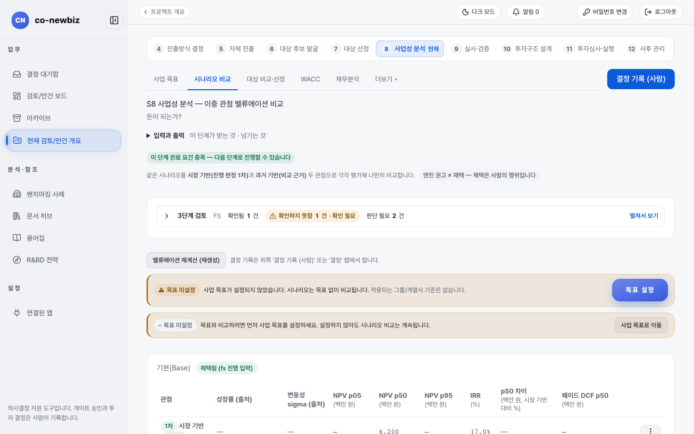
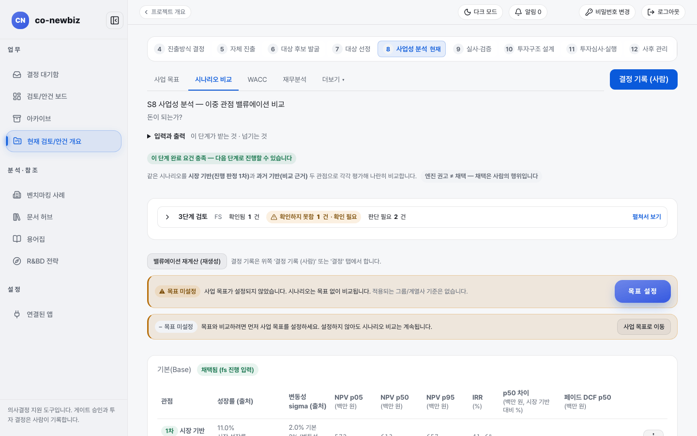

# 사업성 분석(S8) 읽고 기록하기: 두 트랙의 공통 부분

**목적:** 돈이 되는지("돈이 되는가?")를 시나리오별 순현재가치(NPV)·내부수익률(IRR)로 보고, 할인율(WACC)을 정하고, 채택할 사업 사례를 사람이 기록한다.

**누가/언제:** 분석가가 숫자를 만들고 프로젝트 리드가 채택과 결정을 기록한다. 게이트 `Pre-FS`(그린필드) 또는 `대상 선정`(브라운필드) 뒤이며, 다음 게이트는 `FS`(타당성 분석)다.

**사전 조건:** ① 직전 단계·게이트: 그린필드는 `Pre-FS`, 브라운필드는 `대상 선정` 뒤다. ② 필요 권한: 숫자와 분석은 분석가, 채택과 게이트 결정 기록은 사람(프로젝트 리드)이다. ③ 준비물: 프로젝트로 승격된 안건(S8부터는 "프로젝트"다). 브라운필드라면 `Short List`의 대상 목록이 분석 대상이다.

> [!NOTE]
> **트랙:** 화면과 게이트는 같고 분석 대상이 다르다. 그린필드는 대상이 하나(단일 범위)이고, 브라운필드는 짧은 목록의 대상별로 분석한 뒤 사람이 대상을 고린다. 트랙별 절차는 [41-그린필드-S8-사업성-분석](41-그린필드-S8-사업성-분석.md)과 [52-브라운필드-S8-사업성-분석](52-브라운필드-S8-사업성-분석.md)을 본다.

> [!NOTE]
> 이 쪽의 화면 그림은 **데모 자료**다. 이름, 금액, 비율은 내 자료와 다르다.

## 왜 이 단계인가

S8은 두 길이 합류하는 지점에서 "돈이 되는가?"라는 질문에 답하는 단계다. 앞의 길은 달랐다. 그린필드는 S5의 진출전략을 근거로 사업 케이스를 만들고, 브라운필드는 S6~S7에서 좁힌 `Short List` 대상마다 밸류에이션을 만들어 견준다. 그래도 이 단계부터는 절차가 다시 한 길이 된다. 무엇을 새로 세우든 누구와 결합하든, 이 일이 돈이 되는가를 검산하는 대장은 한 권이어야 하기 때문이다. 화면에서 숫자는 엔진이 계산하지만 채택은 사람의 행위고, 채택된 케이스의 NPV는 S11 투자심의 자료로 그대로 인용되므로 이 단계의 판단이 뒤의 투자심의를 좌우한다.

| | 그린필드 | 브라운필드 |
|---|---|---|
| 분석 대상 | 진출전략 한 건(단일 범위) | 짧은 목록(Short List)의 대상별 |
| 위쪽 탭 | `사업 목표`, `시나리오 비교`, `WACC`, `재무분석`, `더보기` | 위 다섯 개 + `대상 비교·선정` |
| 사람이 먼저 할 일 | 없음(진출전략을 근거로 분석) | `대상 비교·선정`에서 대상 한 곳을 사람이 선정 |
| 재무분석 탭 | 트랙 쪽 안내 참고 | `연결된 대상 회사`와 `대상 회사 연결/변경`(회사 이름이나 DART 고유번호로 검색) |
| 안내 | [41-그린필드-S8-사업성-분석](41-그린필드-S8-사업성-분석.md) | [52-브라운필드-S8-사업성-분석](52-브라운필드-S8-사업성-분석.md) |

*S8 `시나리오 비교` 탭(브라운필드 데모). `채택됨 (fs 진행 입력)` 표지는 사람이 채택한 사례라는 뜻이다.*

*그린필드 데모. 위쪽 탭에 `대상 비교·선정`이 없고 대상이 하나다.*

## 단계

1. 보드 `바로가기`의 `프로젝트 목록`에서 프로젝트 행의 `사업성(S8)`을 누르거나, 프로젝트 안에서 번호 띠 `8 사업성 분석`을 누른다. 제목은 `S8 사업성 분석 — 이중 관점 밸류에이션 비교`, 질문은 "돈이 되는가?"다.
2. 위쪽 안내 줄과 `3단계 검토`(`확인됨`, `확인하지 못함`, `판단 필요`)를 먼저 읽는다.
3. `사업 목표` 탭에서 사업 목표를 정한다. 목표가 없으면 `목표 미설정` 경고 줄이 보이고 **목표 설정**(또는 **사업 목표로 이동**) 버튼이 있다. 목표 없이도 시나리오 비교는 계속된다.
4. `시나리오 비교` 탭에서 `기본(Base)`, `상승(Upside)`, `하락(Downside)`을 읽는다. 같은 시나리오를 `시장 기반(진행 판정 1차)`과 `과거 기반(비교 근거)` 두 관점으로 평가해 나란히 보여 준다. 열은 `NPV p05`, `NPV p50`, `NPV p95`, `IRR (%)`, `p50 차이`, `페이퍼 DCF p50`이다. 케이스가 비어 있으면 자동 생성 안내가 나온다.
5. (쓰기) 숫자를 다시 만들려면 **밸류에이션 재계산 (재생성)**을 누른다.
6. `WACC` 탭에서 `현재 확정값`(WACC, `요구수익률(Hurdle IRR)`, `WACC 적용 주체`)을 읽고, `WACC 참조값`은 제안으로만 본다. (쓰기) 값을 정할 때는 `CAPM 분해에 모두 적용` 같은 버튼으로 채운 뒤 사람이 확정한다. 화면에도 `제안 — 확정은 사람`이라고 적혀 있다.
7. `재무분석` 탭에서 대상 회사의 매출액, 영업이익률, 부채비율, ROE를 확인한다. 값이 `N/A`이면 아직 동기화 전이다.
8. (쓰기) 채택할 사업 사례가 정해지면 오른쪽 위 **결정 기록 (사람)** 또는 `결정` 탭에서 사람이 기록한다. 이 화면의 `엔진 권고 ≠ 채택 — 채택은 사람의 행위입니다`가 그 뜻이다.

## 결과 확인

| 화면에 남는 변화 | 어디서 보이는지 |
|---|---|
| 완료 요건 표시 | 위쪽 초록 줄 `이 단계 완료 요건 충족 — 다음 단계로 진행할 수 있습니다`가 나온다 |
| 이어짐 | 채택된 사례의 NPV가 다음 단계의 투자심의 자료에 그대로 인용된다([33-공통-S11-투자심의와-실행](33-공통-S11-투자심의와-실행.md)) |
| 게이트 | 게이트 `FS` 결정은 안건 개요의 **타당성 분석(FS) 결정 열기 →**에서 사람이 기록한다 |

## 자주 하는 실수

| 오해 | 바른 읽기 |
|---|---|
| 엔진이 계산한 NPV를 "채택된 결과"로 읽는 것 | 사람이 채택해야 채택이다 |
| `목표 미설정` 경고를 오류로 여기고 시나리오 비교를 멈추는 것 | 비교는 계속된다 |
| 브라운필드에서 사람이 대상을 고르기 전에 모든 대상의 분석이 끝났다고 여기는 것 | 분석이 끝난 것과 대상이 정해진 것은 다르다. 대상 선정은 `대상 비교·선정` 탭에서 사람이 한다 |
| 자료가 낮은 신뢰도인데 숫자가 좋아 보인다고 종합 등급을 높게 기대하는 것 | 자료 신뢰도가 상한을 정한다 |

## 스스로 확인하기

데모 그린필드와 브라운필드의 S8 위쪽 탭 이름을 비교해 어느 쪽에 `대상 비교·선정`이 있는지 찾아 본다(읽기 전용). 어떤 버튼도 누르지 않는다.

## 핵심 요약

- S8은 두 트랙이 합류하는 공통 단계다. 화면과 게이트는 같고 분석 대상만 다르다.
- 브라운필드는 분석에 앞서 `대상 비교·선정` 탭에서 사람이 대상 한 곳을 선정한다.
- `WACC 참조값`과 엔진 권고는 제안이며, 확정과 채택은 사람이 한다.
- 채택된 케이스의 NPV는 S11 투자심의 자료로 그대로 이어진다.

이전: [45-그린필드-S12-사후-관리](45-그린필드-S12-사후-관리.md) · [56-브라운필드-S12-통합-PMI](56-브라운필드-S12-통합-PMI.md) | 다음: [31-공통-S9-실사](31-공통-S9-실사.md)
