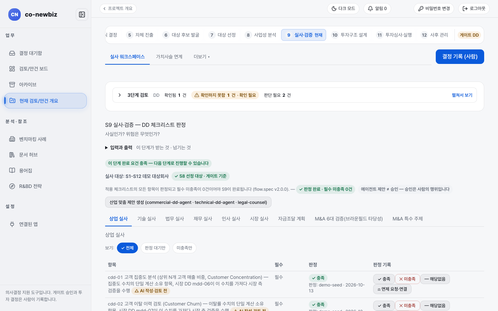
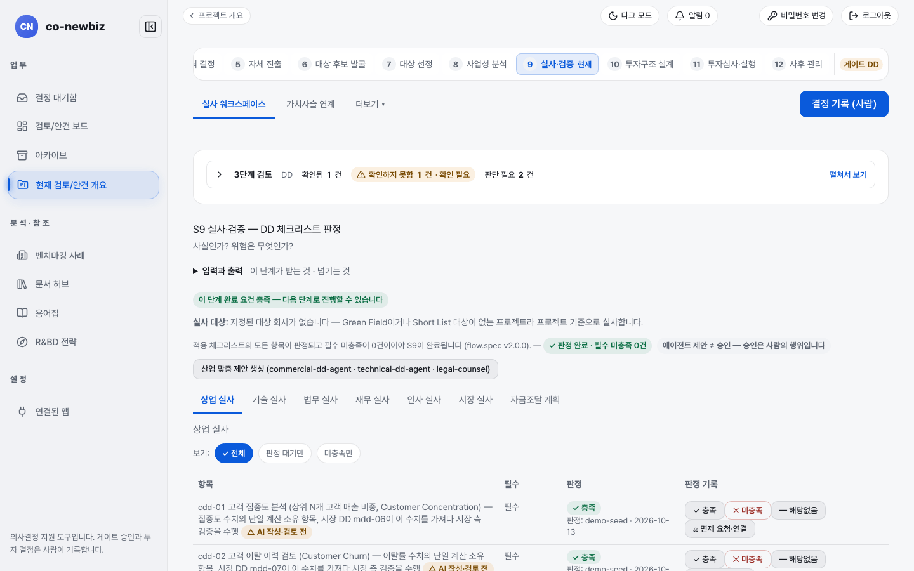

# 실사(S9) 체크리스트 판정하기: 두 트랙의 공통 부분

**목적:** 사실인지, 위험은 무엇인지("사실인가? 위험은 무엇인가?") 실사 체크리스트의 항목마다 판정하고 발견 사항을 기록한다.

**누가/언제:** 분석가가 판정과 발견을 기록하고 예외(면제)와 게이트 결정은 사람이 한다. 앞 게이트 `FS` 뒤이며 다음 게이트는 `DD`(실사)다.

**사전 조건:** ① 직전 단계·게이트: S8에서 사업 사례가 채택되고 게이트 `FS`가 기록되어 있을 것. ② 필요 권한: 판정과 발견 기록은 분석가, 면제 승인과 게이트 `DD` 결정은 사람이다. ③ 준비물: 데모라면 안건 `S1-S12 데모 Brownfield 기회`의 S9 화면.

> [!NOTE]
> **트랙:** 화면은 같고 검사 범위가 다르다. 브라운필드는 인수 거래에 필요한 여섯 가지 검증(반독점, 고객 이탈, 인센티브, 인력 통합, 인증 이전, 지역 노동 검토)과 `M&A 특수 주제` 탭이 더해진다. 그린필드는 설립·부지·인허가 쪽 항목이 중심이다. 트랙별 절차는 [42-그린필드-S9-실사](42-그린필드-S9-실사.md)와 [53-브라운필드-S9-실사](53-브라운필드-S9-실사.md)를 본다.

> [!NOTE]
> 이 쪽의 화면 그림은 **데모 자료**다. 항목 번호, 판정 날짜, 판정자(`demo-seed`)는 내 자료와 다르다.

## 왜 이 단계인가

S9는 S8에서 채택된 사업 사례를 받아 "사실인가? 위험은 무엇인가?"라는 질문에 점검표로 답하는 단계다. S8이 돈이 되는가를 검산했다면, S9은 그 판단의 바닥에 깔린 사실과 위험을 항목마다 확인해 기록한다. 판정과 발견은 분석가가 화면에 남기지만 면제 승인과 게이트 `DD` 결정은 사람의 행위다. 화면에도 `에이전트 제안 ≠ 승인 — 승인은 사람의 행위입니다`라는 안내가 있다. 점검표는 거래를 앞에 두고 몸 상태를 확인하는 건강검진 같은 것으로, 여기서 적어 둔 판정이 뒤의 투자구조와 투자심의 자료를 지탱한다. 판정 결과는 S10 투자구조와 S11 투자심의 자료의 `DD 요약`에 담긴다.

| | 그린필드 | 브라운필드 |
|---|---|---|
| `실사 대상` 줄 | "지정된 회사가 없습니다 … 프로젝트 기준으로 실사합니다." | 예: `실사 대상: <회사명>` + `S8 선정 대상 · 게이트 기준` |
| 분야 탭 | `상업 실사`, `기술 실사`, `법무 실사`, `재무 실사`, `인사 실사`, `시장 실사`, `자금조달 계획` | 위 일곱 개 + `M&A 6대 검증(브라운필드 타당성)`, `M&A 특수 주제` |
| 보조 화면 | 실사 워크스페이스(실사 조사 도구 카드), 가치사슬 연계 | 같은 화면 + `고객 집중 · 지위 변동(CoC)`, `경영진 보상 · 임금 형평` 카드 |
| 안내 | [42-그린필드-S9-실사](42-그린필드-S9-실사.md) | [53-브라운필드-S9-실사](53-브라운필드-S9-실사.md) |

실사 대상 범위는 "선정한 대상"이 기본이고 다른 짧은 목록 대상까지 실사하는 것은 선택이다.

*S9 `실사 워크스페이스`(브라운필드 데모). 위쪽에 `실사 대상`과 `S8 선정 대상 · 게이트 기준`이 보인다.*

*그린필드 데모. `실사 대상` 줄에 지정된 회사가 없다고 적혀 있고 분야 탭이 일곱 개다.*

## 단계

1. 프로젝트 목록의 `실사(S9)` 또는 번호 띠 `9 실사·검증`을 누른다. 큰 제목은 `S9 실사·검증`이고 부제는 `DD 체크리스트 판정`이다(그린필드 일부 갈래는 `계획 검증 — 체크리스트 판정`). 위쪽 탭은 `실사 워크스페이스`, `가치사슬 연계`다(더보기 메뉴는 없다. 조사 화면은 아래 실사 조사 도구에서 열린다). 탭 줄 오른쪽 끝에는 모든 단계에 공통인 `추진계획(차터)`, `마일스톤` 링크가 항상 붙는다.
2. `3단계 검토`와 `실사 대상` 줄을 읽는다. 초록 표지 `판정 완료 · 필수 미충족 0건`이 완료 조건이다. `에이전트 제안 ≠ 승인 — 승인은 사람의 행위입니다`라는 안내도 있다.
3. 처음이면 **산업 맞춤 제안 생성**을 눌러 AI가 이 산업에 맞는 항목을 제안하게 한다. 제안은 초안이고 사람이 판정한다.
4. 분야 탭(예: `상업 실사`)을 고르고 `보기`의 `전체`, `판정 대기만`, `미충족만`으로 목록을 좁힌다. 열은 `항목`, `필수`, `판정`, `판정 기록`이다.
5. 항목마다 `판정 기록`에서 **충족**, **미충족**, **해당없음**, **면제 요청·연결** 중 하나를 누른다. 항목 이름 옆 `AI 작성·검토 전` 표지는 아직 사람이 검토하지 않은 AI 초안 문구라는 뜻이다.
6. `3단계 검토`의 사람 확인 체크는 지금 자동으로 저장된다. 체크를 누르면 곧바로 원장에 남고 항목마다 `확인 저장됨 · 확인한 사람 · 날짜` 칩이 붙는다. `확인하지 못함` 구역의 항목도 똑같이 체크할 수 있다. 항목을 모두 확인하면 `✓ 모두 사람 확인 완료` 배너가 뜬다. 저장이 실패하면 안내 창이 뜨고 체크가 되돌려지니, 배너가 보이지 않으면 다시 누른다.
7. 필수 항목을 면제하려면 **면제 요청·연결**로 예외 요청을 올린다. 예외 승인은 사람이 한다. 면제는 요청한 사람과 다른 사람이 승인하며 승인자에게는 위원회 검토자 권한이 필요하고 기간은 승인일부터 최대 90일이다. 면제할 수 없는 필수 항목은 요청 자체가 거절된다. 필수 항목을 `해당없음`으로 표시하면 사유를 적어야 하고 표시한 사람이 아닌 다른 사람이 확인해야 한다.
8. `가치사슬 연계` 탭에서 산업과 연결해 통계 보정 근거를 관리한다(분석가가 판단을 기록하고 통계 수치는 직접 입력하지 않는다).
9. 모든 필수 항목이 판정되면 본문의 **결정 기록 (사람)**으로 게이트 `DD` 결정을 사람이 기록한다. GO를 고르면 `이 진행의 현재 상태`를 읽고 항목별 확인 사유를 적어야 하고, 발동한 중단 조건이 있거나 AI 권고와 다르면 추가 조건이 붙는다([33-공통-S11-투자심의와-실행](33-공통-S11-투자심의와-실행.md)의 `결정을 기록하기 전에 확인하는 것`). 머리 오른쪽 위 버튼은 기록 버튼이 아니라 `다음: … →` 이동 버튼이다.

## 실사 조사 도구

`실사 워크스페이스` 안에 `실사 조사 도구 — 실사 산물을 기록하는 화면` 칸이 있고 조사 화면마다 카드 한 장이 붙는다. 카드에는 기록 건수 칩이 함께 보인다.

| 카드 | 무엇을 기록하는 곳인가 |
|---|---|
| `전문가 인터뷰 · 채널 체크` | 핵심 주장과 주장당 독립 출처 수(삼각검증). 인터뷰 건수와 삼각검증된 주장 수가 칩으로 보인다. |
| `리스크 히트맵` | 실사 발견·계약·클로백·커버넌트(S10 `차입·여신`의 약정 조건 여유)를 한 그리드로 통합 판정. 항목 수와 높음 건수가 칩으로 보인다. |
| `고객 집중 · 지위 변동(CoC)` | 계약 스캔과 고객 집중도. 브라운필드에만 보인다. |
| `경영진 보상 · 임금 형평` | 경영진 보상 패키지와 임금 형평 집계. 브라운필드에만 보인다. |

그린필드는 고객 CoC·경영진 보상이 범위 밖이라 `전문가 인터뷰 · 채널 체크`와 `리스크 히트맵` 카드 두 장만 보인다. 인터뷰·고객 CoC·보상 화면은 이 카드(실사 워크스페이스)에서 열린다.

## 리스크 히트맵: 판정 대기와 항목 등록

`리스크 히트맵` 카드를 열면 화면 위쪽에 `판정 대기 — 어디에 무엇이 기록되어 있나` 스트립이 있다. 소스(`DD 발견사항·등록 리스크`, `고객·공급 계약 CoC`, `인센티브 클로백`, `커버넌트 여력`)마다 `플로팅 N` 또는 `기록 없음` 칩과 `기록 N건`, 기록 위치·부재 사유 안내를 보여 주므로 무엇을 판정할 수 있는지 먼저 알 수 있다.

아래에는 `리스크 항목 등록 (설명 *)` 폼이 있다. 설명과 `가치 영향 (백만 KRW, 음수)`, `근거 참조`를 적고 **리스크 등록**을 누르면 실사 항목(분류 `리스크`)으로 저장되어 히트맵·조사내역·투자심의 자료에 함께 반영된다. 히트맵 스냅샷은 투자심의 자료와 분기 모니터링 브리프에 자동 첨부되고 완화 판단은 사람의 몫이다.

| 화면 구역 | 무엇이 보이는가 |
|---|---|
| 위쪽 `판정 대기 — 어디에 무엇이 기록되어 있나` 스트립 | 소스(`DD 발견사항·등록 리스크`, `고객·공급 계약 CoC`, `인센티브 클로백`, `커버넌트 여력`)마다 `플로팅 N` 또는 `기록 없음` 칩과 `기록 N건` |
| 아래 `리스크 항목 등록 (설명 *)` 폼 | 설명과 `가치 영향 (백만 KRW, 음수)`, `근거 참조`를 적는 입력칸과 **리스크 등록** 버튼 |

<svg viewBox="0 0 860 70" width="100%" role="img" xmlns="http://www.w3.org/2000/svg">
  <title>리스크 히트맵: 판정 대기 확인, 항목 등록, 조사내역과 투자심의 자료 반영</title>
  <defs>
    <marker id="wiki-ah" markerWidth="7" markerHeight="7" refX="5.5" refY="3" orient="auto">
      <path d="M0,0 L6,3 L0,6 z" fill="var(--border)"></path>
    </marker>
  </defs>
  <rect x="40" y="18" width="220" height="30" rx="6" fill="none" stroke="var(--border)"></rect>
  <text x="150" y="37.5" text-anchor="middle" font-size="13" fill="var(--fg)">판정 대기 스트립</text>
  <line x1="260" y1="33" x2="312" y2="33" stroke="var(--border)" stroke-width="1.2" marker-end="url(#wiki-ah)"></line>
  <rect x="320" y="18" width="220" height="30" rx="6" fill="none" stroke="var(--border)"></rect>
  <text x="430" y="37.5" text-anchor="middle" font-size="13" fill="var(--fg)">리스크 항목 등록</text>
  <line x1="540" y1="33" x2="592" y2="33" stroke="var(--border)" stroke-width="1.2" marker-end="url(#wiki-ah)"></line>
  <rect x="600" y="18" width="220" height="30" rx="6" fill="none" stroke="var(--border)"></rect>
  <text x="710" y="37.5" text-anchor="middle" font-size="13" fill="var(--fg)">조사내역·투자심의 자동 반영</text>
</svg>

## 결과 확인

- `판정 완료 · 필수 미충족 0건` 표지와 `이 단계 완료 요건 충족` 줄이 나온다.
- 판정 결과의 값 영향은 S10 투자구조와 S11 투자심의 자료의 `DD 요약`에 반영된다.

## 자주 하는 실수

- `해당없음`으로 표시한 필수 항목을 같은 사람이 확인까지 하려는 것. 다른 사람이 확인해야 한다.
- `미충족` 필수 항목이 남아 있는데 게이트 결정을 기록하려는 것. 면제가 승인되거나 판정이 바뀌어야 한다.
- 범위가 바뀐 뒤 S9가 갑자기 미완료가 되었다고 오류로 여기는 것. 새로 범위에 든 항목이 아직 판정되지 않아서다([81-문제-해결](81-문제-해결.md) 참고).
- 화면의 `AI 작성·검토 전` 항목 문구를 확정된 규정으로 읽는 것.
- 실사 자료 없는 칸의 `N/A`를 오류로 여기는 것(자료 동기화 전일 수 있다).
- 더보기 메뉴에서 백테스트(조직 집계)를 찾는 것. 백테스트는 S8 예측과 S12 실측을 비교하는 학습 도구이며 S12의 더보기 메뉴에 있다.

## 스스로 확인하기

데모 브라운필드 S9에서 분야 탭이 모두 몇 개인지 세고 그린필드에는 없는 탭 두 개의 이름을 말해 본다(읽기 전용). 어떤 버튼도 누르지 않는다.

## 핵심 요약

- S9는 "사실인가? 위험은 무엇인가?"를 점검표 판정으로 답하는 단계다. 완료 조건은 `판정 완료 · 필수 미충족 0건`이다.
- 판정과 발견 기록은 분석가가 하고 면제 승인과 게이트 `DD` 결정은 사람이 한다.
- 화면은 같고 검사 범위가 다르다. 브라운필드에는 `M&A 6대 검증(브라운필드 타당성)`과 `M&A 특수 주제` 탭이 더 있다.
- 조사 화면(인터뷰·고객 CoC·보상·리스크 히트맵)은 `실사 조사 도구` 카드에서 열린다.
- 판정 결과는 S10과 S11 자료의 `DD 요약`에 담긴다.

이전: [30-공통-S8-사업성-분석](30-공통-S8-사업성-분석.md) | 다음: [32-공통-S10-투자심의-전](32-공통-S10-투자심의-전.md)
