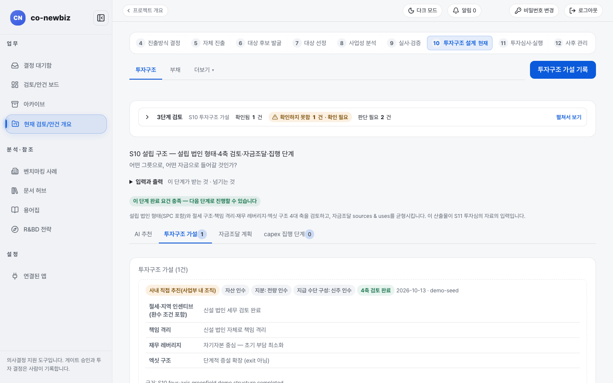
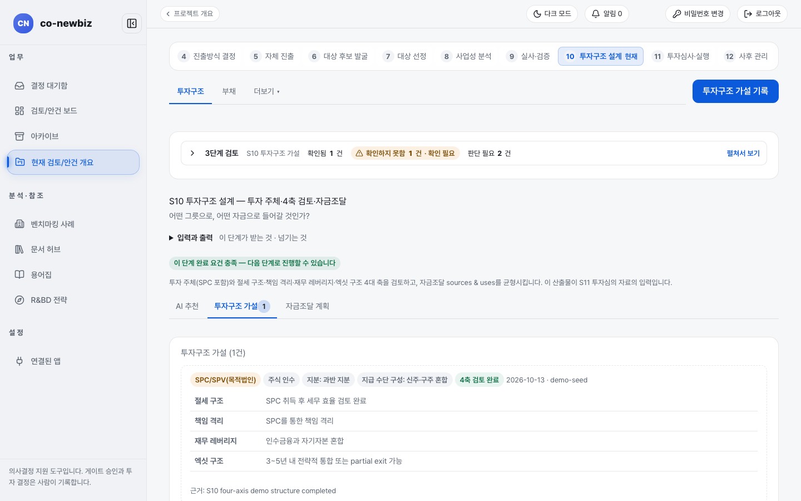

# 투자구조 설계(S10): 투자심의 전에 해 둘 일

**목적:** "어떤 그릇으로, 어떤 자금으로 들어갈 것인가?"를 정한다. 투자구조 가설을 네 축(절세 구조, 책임 격리, 재무 레버리지, 엑싯 구조)으로 검토하고, 자금조달 계획의 사용처와 조달처를 맞춘다. 이 결과가 S11 투자심의 자료의 입력이 된다.

**누가/언제:** 프로젝트 리드가 기록하고 분석가가 돕는다. 앞 단계 S9(게이트 `DD`) 뒤이며, 투자심의(S11) 앞이다.

**사전 조건:** ① 직전 단계·게이트: S9 실사 판정과 게이트 `DD` 결정. ② 필요 권한: 가설 기록은 프로젝트 리드, 입력은 분석가가 돕는다. ③ 준비물: S8 채택 사업 사례, S9 실사 발견, WACC·요구수익률.

> [!NOTE]
> **트랙:** 화면 이름은 같은 `투자구조`이지만 정하는 대상이 다르다. 그린필드는 새 법인을 어떤 형태로 세울지(`설립 법인 형태`)와 실행 기준선, 투자금 분할 집행을 다룬다. 브라운필드는 거래를 어떤 그릇(`투자 주체`)과 조건으로 할지를 다룬다. 트랙별 절차는 [43-그린필드-S10-실행-기준선](43-그린필드-S10-실행-기준선.md)과 [54-브라운필드-S10-거래-구조](54-브라운필드-S10-거래-구조.md)를 본다.

> [!NOTE]
> 이 쪽의 화면 그림은 **데모 자료**다. 구조 이름, 문구는 내 자료와 다르다.

## 왜 이 단계인가

S10은 S9의 실사 판정을 받아 "어떤 그릇으로, 어떤 자금으로 들어갈 것인가?"라는 질문에 답하는 단계다. 사실과 위험이 확인된 뒤에야 거래를 담을 그릇(투자 주체 또는 설립 법인 형태)과 자금 설계를 정할 수 있다. 네 축 검토는 근거 자료와 함께 기록되고 `4축 검토 완료`는 되돌리지 않는 기록이다. 자금조달 계획은 조달처와 사용처의 합계가 맞아야 완료 요건이 채워진다. 이 단계는 투자심의의 입력을 설계하는 자리다. 여기서 만든 가설과 자금조달 계획이 S11 투자심의 자료에 그대로 들어간다.

| | 그린필드 | 브라운필드 |
|---|---|---|
| 화면 제목 | `S10 설립 구조 — 설립 법인 형태·4축 검토·자금조달·집행 단계` | `S10 투자구조 설계 — 투자 주체·4축 검토·자금조달` |
| 정하는 것 | `설립 법인 형태`(예: 사내 직접 추진, 신설 법인) | `투자 주체`(예: SPC/SPV, 직접 투자, 지주회사, 합작법인)와 지분·지급 수단 |
| 아래쪽 탭 | `AI 추천`, `투자구조 가설`, `자금조달 계획`, `설비투자 집행 단계` | `AI 추천`, `투자구조 가설`, `자금조달 계획` |
| 추가로 확인할 것 | 실행 기준선(사람 확정), 투자 분할 집행 | `차입·여신` 탭, 거래 조건 |
| 안내 | [43-그린필드-S10-실행-기준선](43-그린필드-S10-실행-기준선.md) | [54-브라운필드-S10-거래-구조](54-브라운필드-S10-거래-구조.md) |

## 단계

1. 프로젝트 안에서 번호 띠 `10 투자구조 설계`를 누른다. 위쪽 탭은 `투자구조`, `차입·여신`, `더보기`다(더보기에는 `인센티브`, `부지·시설`, `인허가·인증`이 있고, 탭 줄 오른쪽 끝에 공통 링크 `추진계획(차터)`, `마일스톤`이 항상 붙는다). 질문은 "어떤 그릇으로, 어떤 자금으로 들어갈 것인가?"다.
2. `3단계 검토`, 아래 안내 줄(초록 `이 단계 완료 요건 충족 — 다음 단계로 진행할 수 있습니다`)을 읽는다.
3. 아래쪽 탭에서 `AI 추천`을 열어 AI의 구조 제안을 읽는다. 제안은 초안이다.
4. `투자구조 가설` 탭에서 기록된 가설 카드를 읽는다. 구조 이름 옆에 지분 구성(예: `지분: 과반 지분`), 지급 수단, `4축 검토 완료` 표지가 붙고 네 축(절세, 책임 격리, 재무 레버리지, 엑싯 구조) 설명과 함께 완료한 사람·날짜·근거 자료 참조가 보인다.
5. (쓰기) 새 가설은 오른쪽 위 **투자구조 가설 기록**으로 적는다. 네 축을 근거 자료와 함께 모두 채워야 `4축 검토 완료`가 된다. 비어 있는 축이 하나라도 있으면 완료 기록이 거부되고 완료 버튼이 비활성화된다.
6. `자금조달 계획` 탭에서 조달처(sources)와 사용처(uses)의 합계가 같은지, 0보다 큰지 확인한다. 이것이 완료 조건이다. 조달 행에는 자금 확정성 증빙(종류와 참조)을 함께 등록할 수 있고, 증빙은 종류·참조를 같이 적어야 받아들여진다.
7. `차입·여신` 탭에서 차입 상품과 커버넌트 조건을 확인한다. 화면 제목은 `차입·여신 관리 (부채·커버넌트)`이며 만기 칸에 `상환 구조`(예: 원리금 균등) 표시가 붙고, 시나리오 계산기가 차입마다 연간 상환액과 부채상환비율을 임계값과 대조한다. 커버넌트 여력은 투자심의 자료·리스크 히트맵으로도 전달된다(브라운필드에서 특히 중요).

### 등록의 수명주기

- 가설 등록은 사람의 기록이다. AI 추천은 등록되지 않는 초안이다.
- `4축 검토 완료`를 기록하면 완료한 사람·날짜·근거 자료 참조가 함께 남고, 뒤에서 되돌리지 않는다(감사 기록 유지).
- `자금조달 계획` 항목은 추가·삭제할 수 있지만, 조달 행의 증빙은 한 번 종류·참조를 같이 등록해야 한다. 인센티브 화면의 `→ 자금 조달` 버튼으로 보조금 증빙을 자동 등록할 수도 있다.
- 인센티브 NPV는 입력·표시 모두 억원 단위다(저장은 백만 KRW 기준으로, 화면이 알아서 바꿔 보여 준다).

*그린필드 데모의 `투자구조 가설`. `사내 직접 추진(사업부 내 조직)`처럼 설립 형태가 나오고 네 축 설명이 이어진다.*

*브라운필드 데모의 `투자구조 가설`. `SPC/SPV(목적법인)`, `주식 인수`, `지분: 과반 지분` 같은 거래 구조가 나온다.*

## 부지·시설과 인허가·인증

더보기의 `부지·시설`(`부지·시설 평가`)과 `인허가·인증`(`인허가·인증 추적`)은 서로 링크로 이어져 있다. 부지 화면 안내 줄의 `인허가·인증 추적 →` 링크와 인허가 화면 안내 줄의 `부지·시설 평가(주소 기반 법규 사전검토)와 함께 검토 →` 링크로 왕복한다.

부지 등록 폼에는 `주소 (법규 검토 근거)`, `인프라 확인 메모 (상하수도·전기·도로·물류 — 사람 확인 값)`, `인력 확인 메모 (주변 학교·인력pool)` 칸이 있다. 인프라·인력 값은 시스템이 자동으로 매기지 않고 사람이 확인해 기록한다.

주소를 넣은 부지에는 **⚖ 법규 초안** 버튼이 생긴다. 누르면 `법규 사전검토 초안`이 건축·환경·용도지역·인허가 절차 축으로 나오지만, 초안일 뿐 저장되지 않는다. 법령 원문은 k-law 확인이 필요하고 법조문 번호를 단정하지 않으며, 최종 판단은 법무 담당자의 몫이다. 필요한 내용은 조사내역에 사람이 기록한다.

## 결과 확인

- 가설 카드에 `4축 검토 완료`가 붙고, `자금조달 계획`의 합계가 맞다.
- 이 산출물이 S11 `투자심의 자료`에 들어간다([33-공통-S11-투자심의와-실행](33-공통-S11-투자심의와-실행.md)).

## 자주 하는 실수

- `AI 추천`을 가설로 받아들이는 것. 가설은 사람이 `투자구조 가설 기록`으로 남긴다.
- 네 축 중 하나만 비워 두고 완료를 기대하는 것.
- 사용처와 조달처의 합계가 맞지 않는 채로 다음 단계를 기대하는 것.
- 그린필드에서 `투자 주체`를 찾는 것. 그린필드 화면에서는 `설립 법인 형태`라고 부른다.
- 화면 아래 영어 문구(근거 `S10 four-axis demo structure completed` 등)를 오류로 여기는 것. 데모 자료 문구다.

## 스스로 확인하기

데모 그린필드와 브라운필드의 S10 화면 제목 두 개를 읽고, 그린필드에만 있는 아래쪽 탭 이름을 말해 본다(읽기 전용). 어떤 버튼도 누르지 않는다.

## 핵심 요약

- S10은 S9 판정을 받아 투자의 그릇과 자금을 정하는 단계다. 그린필드는 `설립 법인 형태`, 브라운필드는 `투자 주체`를 정한다.
- 네 축(절세 구조, 책임 격리, 재무 레버리지, 엑싯 구조)을 근거 자료와 함께 모두 채워야 `4축 검토 완료`가 되고, 완료 기록은 되돌리지 않는다.
- `자금조달 계획`의 조달처와 사용처 합계가 같고 0보다 커야 완료 요건이 채워진다.
- `AI 추천`은 등록되지 않는 초안이다. 가설은 사람이 기록한다.
- 이 산출물이 S11 `투자심의 자료`의 입력이다.

이전: [31-공통-S9-실사](31-공통-S9-실사.md) | 다음: [33-공통-S11-투자심의와-실행](33-공통-S11-투자심의와-실행.md)
