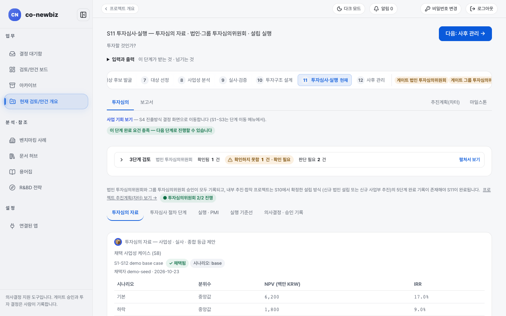
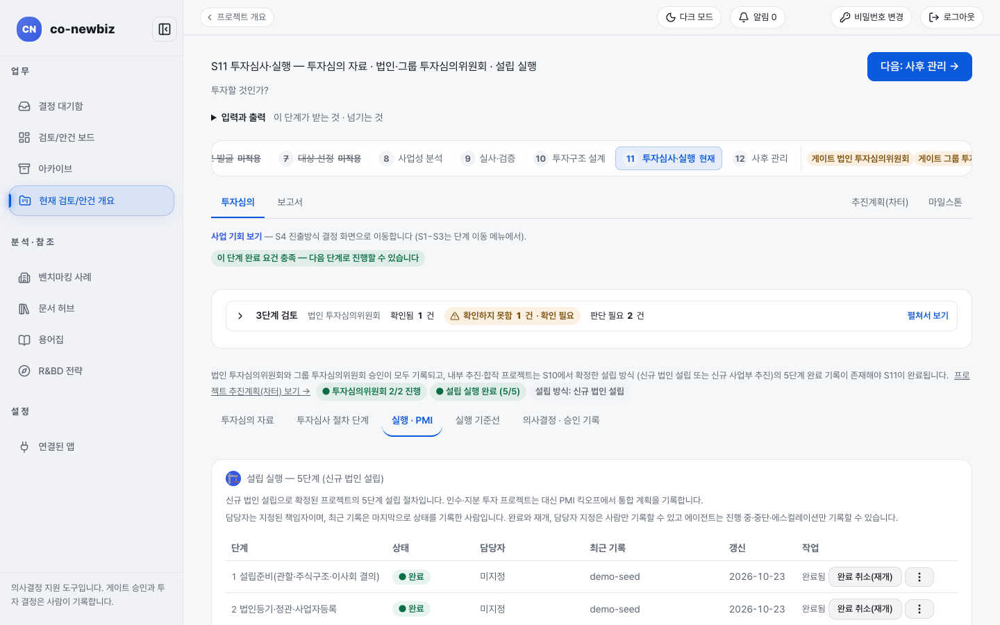

# 투자심의와 실행(S11): 심의 자료 읽고 결정 기록하기

**목적** — "투자할 것인가?"를 법인 투자심의위원회와 그룹 투자심의위원회가 차례로 심사하고, 결정은 사람이 기록합니다. 승인되면 트랙에 맞는 실행(그린필드는 설립 실행, 브라운필드는 PMI 킥오프)으로 넘어갑니다.  **누가/언제** — 투자심의 위원(검토자)이 결정을 기록하고 프로젝트 리드가 실행을 챙깁니다. 앞 단계 S10 뒤, 게이트 `법인 투자심의위원회` → `그룹 투자심의위원회`.  **사전 조건** — S8 채택 사례, S9 실사 판정, S10 투자구조 가설.

> [!NOTE]
> 이 쪽의 화면 그림은 **데모 자료**입니다. 사람 이름(`demo-seed`), 금액, 근거 문구는 내 자료와 다릅니다.

> [!NOTE]
> **트랙** — 심의 과정과 결정 기록 화면은 같습니다. 달라지는 곳은 승인 뒤입니다. 그린필드는 `설립 실행 — 5단계`를 사람이 하나씩 끝내고, 브라운필드는 설립 실행이 적용되지 않고 `PMI 킥오프`를 기록합니다.

## 두 트랙의 차이

| | 그린필드 | 브라운필드 |
|---|---|---|
| 승인 뒤 실행 | `실행 · PMI` 내부 탭의 `설립 실행 — 5단계`(설립준비·등기·인허가 분류·인력이전·완료확인) | 설립 실행은 적용되지 않음. 같은 탭에서 `PMI 킥오프` 기록 |
| 위쪽 `이 단계에서 남은 것` | 실행 기준선 사람 확인, 투자심의 자료, 추진계획 기준선, 사람 최종 승인, 설립 실행 기록 | 대체로 `투자심의 자료`와 승인 기록 |
| 완료 조건 | 법인·그룹 승인 + 설립 5단계 완료 기록(내부 추진·합작) | 법인·그룹 승인 |
| 안내 | [44-그린필드-S11-설립-실행](44-그린필드-S11-설립-실행.md) | [55-브라운필드-S11-클로징](55-브라운필드-S11-클로징.md) |

## 공통 단계

1. 프로젝트 목록의 `투자심사(S11)` 또는 번호 띠 `11 투자심사·실행`을 누릅니다. 제목은 `S11 투자심사·실행 — 투자심의 자료 · 법인·그룹 투자심의위원회 · 설립 실행`입니다. 번호 띠 오른쪽에 `게이트 법인 심의`, `게이트 그룹 심의` 표지가 있습니다. 위쪽 탭은 `투자심의`, `보고서`이고, 탭 줄 오른쪽 끝에 공통 링크 `추진계획(차터)`, `마일스톤`이 항상 붙어 있습니다(차터는 이 공통 링크로 어느 단계에서든 열립니다).
2. `투자심의` 탭 안에는 절차 순서대로 내부 탭 다섯 개가 놓여 있습니다. `투자심의 자료` → `투자심사 절차 단계` → `실행 · PMI` → `실행 기준선` → `의사결정 · 승인 기록`. 그린필드의 실행 기준선(투자 단계 대조·인허가/인증·인력/조직·가동 KPI·인센티브 의무)은 설립 실행에서 떼어 `실행 기준선` 내부 탭으로 따로 봅니다.
3. `3단계 검토`를 읽습니다. `확인됨`, `확인하지 못함`, `판단 필요` 세 구역이며 "통과" 도장은 없습니다. 사람 확인 체크는 누르는 즉시 저장되고 `확인 저장됨 · 사람 · 날짜` 칩이 붙습니다.
4. `투자심의 자료` 상자를 읽습니다. 채택된 사업 사례와 시나리오별 NPV·IRR, `DD 요약 (S9)`(판정 건수, 필수 미충족), `종합 등급`을 담고 있습니다. `종합 등급`에는 `AI 추천 (승인 아님)`과 자료 신뢰도 상한이 함께 나옵니다. 여섯 차원이 모두 평가되지 않으면 "종합 등급을 낼 수 없습니다"라고 나옵니다.
5. `투자심사 절차 단계` 내부 탭에서 절차 진행을 기록합니다. `step 2 — Kill Criteria 명시적 pass/fail`의 판정표에서 항목마다 `pass`, `fail`, `na`를 사람이 고르고(엔진 평가는 옆에 제안으로 나란히 표시됩니다), `step 3 — IC 메모 스냅샷`으로 심의 자료를 한 벌로 묶어 기록하고, `step 4 — 자금확정성 선결조건 (사실 확인 · 판단 아님)`에서 조달 증빙 사실을 확인합니다. `step 4.5 · 4.6 — 통합 인사이트 리뷰 · 의사결정 덱`에서는 **통합 인사이트 초안 생성 (LLM)**으로 해석 초안을 받아 검토 후 4.5 메모로 기록하고(초안은 저장되지 않습니다), **의사결정 덱 생성·기록**으로 브리핑 팩을 4.6 근거로 남깁니다.
6. `의사결정 · 승인 기록` 내부 탭에서 `법인 투자심의위원회`와 `그룹 투자심의위원회`의 진행 상태(`GO`)를 읽습니다. 위원회 순서는 법인 → 그룹입니다.
7. (선택) **🤖 AI 브리프 생성**으로 AI가 권고와 근거 초안을 만들게 합니다. 이것은 제안일 뿐이며 기록은 사람의 몫입니다.
8. (쓰기, 사람만) `기록 대상`(위원회)을 확인하고 `결정`(GO, HOLD, KILL)을 고른 뒤 `근거 *`를 쓰고 **결정**을 누릅니다. 근거를 입력해야 결정을 기록할 수 있습니다. 미완료 산출물이 남은 채 GO를 기록하려 하면 `누락 산출물 경고` 창이 열리고 `예외 근거 (필수)`를 직접 적어야 GO를 남길 수 있습니다(예외 근거는 투자심의 자료에 함께 남습니다). HOLD는 미완료 산출물 목록 없이 기록할 수 없습니다.
9. `결정 이력 (4건 — append-only, 위원회별)`을 펼쳐 기록을 확인합니다. 한 번 쓴 결정은 고치지 않고 새 결정으로 이어서 적습니다.
10. `보고서` 탭에서 **🧾 투자심의 자료로 초안 생성**으로 보고서 초안을 만듭니다. 초안에는 `## 0. 경영 요약 (AI 초안 — 검토 필수)`가 맨 앞에 붙고(사람이 검토·수정합니다), §8 `리스크 히트맵 요약`, §9 `자금 확정성 및 커버넌트 여력`, §10 `인허가·인증 현황`, §11 `마일스톤 요약`, §12 `투자심사 절차 단계` 섹션이 자동으로 채워집니다. **미리보기**로 저장 전에 읽어 보고, 문서 파일(docx/pdf/hwpx)로 내려받습니다. 저장한 스냅샷은 **보관**으로 이력 목록에서 치울 수 있고 `보관본 보기`로 다시 열람합니다(초안이며 결재가 아닙니다).

*S11 `투자심의` 탭(브라운필드 데모). 절차 순서의 내부 탭 다섯 개 — `투자심의 자료` · `투자심사 절차 단계` · `실행 · PMI` · `실행 기준선` · `의사결정 · 승인 기록` — 와 `투자심의위원회 2/2 GO` 표지가 보이고, 아래로 `투자심의 자료`(채택 사업 케이스의 NPV·IRR)가 이어집니다.*

*그린필드 데모의 `실행 · PMI` 내부 탭. `설립 실행 — 5단계` 표와 `투자심의위원회 2/2 GO`, `설립 실행 완료 (5/5)` 표지가 보입니다.*

머리 오른쪽 위 버튼은 `다음: 사후 관리 →` 이동 버튼입니다. 결정 기록·초안 생성 같은 동작은 각 내부 탭의 작업 면에 있습니다. 입력·출력 스트립은 목적 줄 바로 아래, 내부 탭 줄 위에 놓입니다.

## 결과 확인

- `투자심의위원회 2/2 GO`처럼 법인과 그룹의 결정이 모두 기록되면 위쪽 표지가 바뀝니다.
- 안건 개요 `게이트`에 `법인 투자심의위원회 · 진행(GO)`, `그룹 투자심의위원회 · 진행(GO)`이 표시됩니다.
- 설립 실행 단계를 다시 열거나 담당자를 지정하면 프로젝트 리드와 담당자에게 알림이 갑니다(알림 종과 [결정 대기함](12-공통-화면-둘러보기.md)).

## 자주 하는 실수

- AI가 만든 `종합 등급` 제안을 승인으로 읽는 것. `승인 아님`이라고 적혀 있습니다.
- 법인 심의 결정 전에 그룹 심의 결정을 기록하려는 것(그룹 심의는 법인 심의가 먼저입니다).
- `확인하지 못함` 구역의 항목을 "문제 없음"으로 읽는 것. 침묵은 승인이 아닙니다.
- 검토자가 아닌 계정으로 **결정**이 안 눌린다고 오류로 여기는 것. 권한 문제입니다([02-역할과-권한](02-역할과-권한.md)).
- 화면의 영어 문구(`Business Case`, `base`, `p50`, `RAG 제안` 등)를 오류로 여기는 것. 알려진 화면 표기입니다.
- 신뢰도 등급 조정을 제안한 사람이 스스로 승인하려는 것. 제안과 승인은 서로 다른 사람이 해야 하고, 제안자에게는 결정 버튼 대신 안내가 보입니다(백테스트 화면의 `제안 힌트` 참고).

## 다음 단계

[34-공통-S12-사후-관리](34-공통-S12-사후-관리.md)

## 스스로 확인하기

데모 브라운필드 S11에서 `결정 이력`을 펼쳐 위원회 이름과 결정 값, 근거를 찾아 읽어 보세요. 어떤 버튼도 누르지 않습니다.
