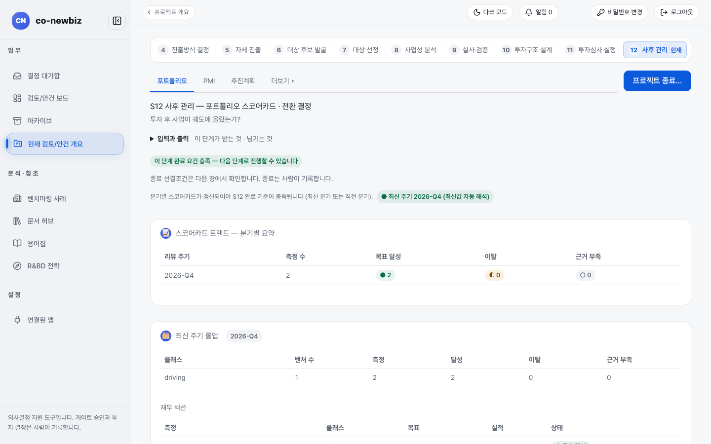
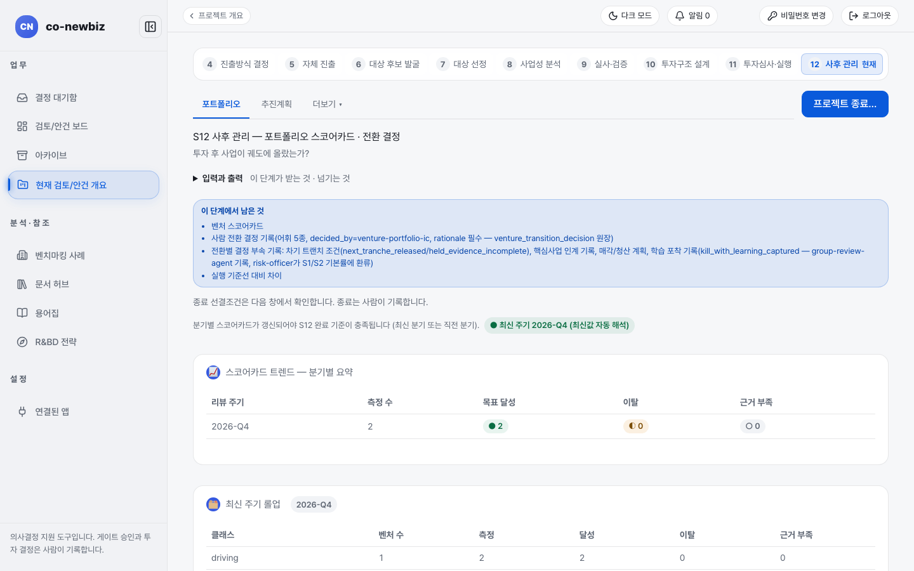
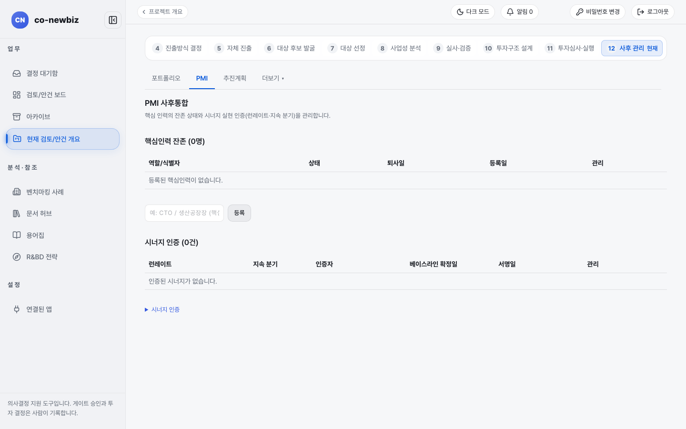

# 사후 관리(S12): 투자 뒤 성과 따라가기

**목적** — "투자 후 사업이 궤도에 올랐는가?"를 분기별 스코어카드로 따라가고, 계속·확대·축소·중단 같은 전환 결정을 사람이 근거와 함께 기록합니다.  **누가/언제** — 프로젝트 리드가 기록하고 열람자까지 읽을 수 있습니다. 투자심의(S11) 승인 뒤 계속.  **사전 조건** — S11 법인·그룹 투자심의위원회 승인 기록.

> [!NOTE]
> 이 쪽의 화면 그림은 **데모 자료**입니다. 분기, 건수, 담당자 이름은 내 자료와 다릅니다.

> [!NOTE]
> **트랙** — 위쪽 탭 `포트폴리오`와 `추진계획`은 같습니다. 그린필드는 투자 전에 확정한 실행 기준선과 비교한 차이를 함께 보고하고, 브라운필드는 `PMI` 탭에서 핵심 인력 잔존과 시너지 실현 인증을 관리합니다.

## 두 트랙의 차이

| | 그린필드 | 브라운필드 |
|---|---|---|
| 위쪽 탭 | `포트폴리오`, `추진계획`, `더보기` | `포트폴리오`, `PMI`, `추진계획`, `더보기` |
| 비교 기준 | 실행 기준선·S8 채택 사례 대비 차이 | 시너지 인증, 핵심 인력 잔존 |
| `이 단계에서 남은 것` 상자 | `벤처 스코어카드`, 사람 전환 결정, `실행 기준선 대비 차이` | `PMI`(핵심인력 잔존, 시너지 인증) 중심 |
| 안내 | [45-그린필드-S12-사후-관리](45-그린필드-S12-사후-관리.md) | [56-브라운필드-S12-통합-PMI](56-브라운필드-S12-통합-PMI.md) |

## 공통 단계

1. 프로젝트 목록의 `포트폴리오(S12)` 또는 번호 띠 `12 사후 관리`를 누릅니다. 제목은 `S12 사후 관리 — 포트폴리오 스코어카드 · 전환 결정`, 질문은 "투자 후 사업이 궤도에 올랐는가?"입니다.
2. 위쪽 안내를 읽습니다. 분기별 스코어카드가 갱신되어야 S12 완료 기준이 충족됩니다(`최신 주기 2026-Q4 (최신값 자동 해석)` 같은 표지로 어느 분기를 보는지 알려 줍니다).
3. `스코어카드 트렌드 — 분기별 요약`에서 `리뷰 주기`별 `측정 수`, `목표 달성`, `이탈`, `근거 부족` 건수를 읽습니다.
4. `최신 주기 롤업`에서 클래스별 건수와 아래 `재무 섹션`의 `측정`, `목표`, `실적`, `상태`를 읽습니다.
5. (쓰기, 사람만) 분기마다 사람이 전환 결정(계속·확대·축소/철수·중단 등)을 근거와 함께 기록합니다. 결정에 따라 차기 트랜치 조건, 핵심사업 인계, 매각·청산 계획, 학습 기록이 따라옵니다.
6. `추진계획` 탭에서 투자 전에 문서로 고정한 목적, 시장 범위, 밸류체인 노드, 진입 범위, KPI를 확인합니다. 고치려면 변경 이력을 남기는 새 버전으로만 가능합니다.
7. 사업을 끝낼 때는 오른쪽 위 **프로젝트 종료...**를 누릅니다. 종료 선결조건은 다음 창에서 확인하고, 종료는 사람이 기록합니다.

*S12 `포트폴리오` 탭(브라운필드 데모). 오른쪽 위에 **프로젝트 종료...**가 있고 분기별 스코어카드가 아래에 이어집니다.*

*그린필드 데모. 위쪽 파란 상자에 이 단계에서 남은 것(`벤처 스코어카드`, 사람 전환 결정, `실행 기준선 대비 차이`)이 나열됩니다.*

*브라운필드 데모의 `PMI` 탭. `핵심인력 잔존`과 `시너지 인증`을 등록하는 곳입니다.*

## 결과 확인

- 분기마다 스코어카드 줄이 늘고 전환 결정 이력이 쌓입니다.
- 모든 결정은 근거와 함께 남습니다. 학습 기록은 이후 S1·S2의 기준률에 반영됩니다.

## 자주 하는 실수

- **프로젝트 종료...**를 누르면 바로 끝난다고 여기는 것. 선결조건을 확인하는 창이 먼저 열리고, 종료는 사람이 기록합니다.
- 열람자 계정으로 기록이 안 된다고 오류로 여기는 것. 권한 문제입니다.
- 화면에 노출된 영어 식별자(`driving`, `venture_transition_decision` 등)를 오류로 여기는 것. 알려진 화면 표기입니다.

## 다음 단계

끝난 안건 자리는 왼쪽 메뉴 `아카이브`입니다(이 안내서는 아직 이 화면을 설명하지 않습니다). 문제가 생기면 [81-문제-해결](81-문제-해결.md)을 보세요.

## 스스로 확인하기

데모 프로젝트의 S12에서 `최신 주기`가 어느 분기인지와 `목표 달성` 건수를 찾아 읽어 보세요(읽기 전용).
