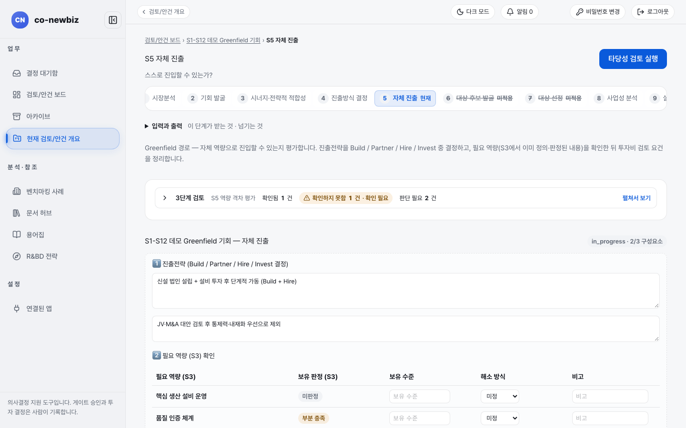
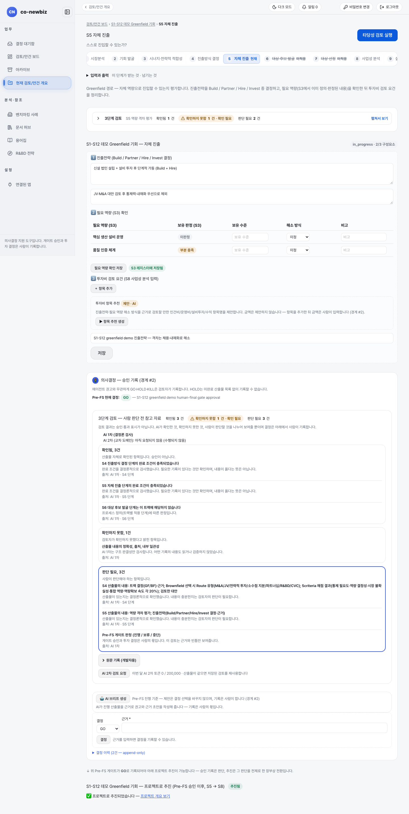

# 자체 진출 계획 세우기 (S5)

**목적:** 우리 힘으로 들어갈 수 있는지 보고 모자란 역량을 어떻게 채울지(구축, 파트너십, 영입, 투자) 정한 뒤 투자비 검토 요건을 적어 S8로 넘긴다.

**누가/언제:** 분석가가 입력하고 프로젝트 리드가 `Pre-FS` 게이트를 기록한다. S4에서 `Greenfield`를 기록한 뒤다.

**사전 조건:** ① 직전 단계·게이트: S4에서 `트랙`을 `Greenfield`로 기록. ② 필요 권한: 쓰려면 분석가 이상 권한이 필요하다. ③ 준비물: S3에서 정의한 필요 역량(없으면 S5에서 먼저 정의하라는 안내가 나온다), 데모 안건 `S1-S12 데모 Greenfield 기회`.

> [!NOTE]
> **Green Field에서만:** S5는 그린필드 전용이다. 브라운필드는 S5 대신 [50-브라운필드-S6-대상-후보-발굴](50-브라운필드-S6-대상-후보-발굴.md)로 간다.

> [!NOTE]
> 이 쪽의 화면은 연습용 데모 데이터다. 안건 이름과 입력값은 사용자의 데이터와 다르다.

## 왜 이 단계인가

S5는 "스스로 진입할 수 있는가?"라는 질문에 답하는 단계다. S4에서 `Greenfield`로 새로 세우는 여정을 골랐다면, 이제 그 계획이 우리 힘으로 가능한지 따진다. S3에서 정의한 필요 역량 옆에 현재 `보유 수준`을 적어 격차를 확인하고 격차마다 `미정`, `구축`, `파트너십`, `영입`, `투자` 중 해소 방식을 고른다. 착공 전의 설계도와 견적서를 한 장에 모으는 일과 같다. 필요 역량 표가 설계도면이고 `3️⃣ 투자비 검토 요건 (S8 사업성 분석 입력)`이 견적서며, `Pre-FS` 게이트가 시공 승인이다. AI는 항목 이름 제안과 게이트 브리프 초안까지만 만들고 평가와 게이트 기록은 사람이 한다. 여기서 적은 투자비 항목은 S8 사업 케이스 줄의 출발점이 되므로, 아래 단계는 표 한 줄을 채우는 일부터다.

*S5 `자체 진출` 위쪽. 번호 띠에서 6, 7이 `미적용`이고 `필요 역량 (S3) 확인` 표가 보인다. 데모 안건 `S1-S12 데모 Greenfield 기회`.*

## 단계

1. 안건 화면 번호 띠에서 `5 자체 진출`을 누른다. 제목 `S5 자체 진출`과 질문 "스스로 진입할 수 있는가?"가 나온다.
2. 위쪽 `3단계 검토` 줄(`확인됨`, `확인하지 못함`, `판단 필요`)을 읽는다. `펼쳐서 보기`를 누르면 AI가 확인한 것, 확인하지 못한 것, 사람이 판단할 것이 나뉘어 보인다. 이 줄에는 "통과" 도장이 없다.
3. `1️⃣ 진출전략 (Build / Partner / Hire / Invest 결정)` 아래 첫 칸(`진출전략`)에 진출전략과 근거를 쓴다. 두 번째 칸 `검토한 대안 (선택)`에 고려했지만 고르지 않은 안과 이유를 쓴다.
4. `2️⃣ 필요 역량 (S3) 확인` 표에서 줄마다 `보유 수준`에 현재 수준을 쓰고 `해소 방식`을 `미정`, `구축`, `파트너십`, `영입`, `투자` 중에서 고른다. 필요하면 `비고`를 쓴다. `필요 역량 (S3)`과 `보유 판정 (S3)`(`충족`, `부분 충족`, `미보유`, `미판정`)은 S3에서 온 값이라 여기서 고치지 않는다.
5. `필요 역량 확인 저장`을 누른다. `S3 레지스터에 저장됨` 표시가 나오면 저장된 것이다.
6. `3️⃣ 투자비 검토 요건 (S8 사업성 분석 입력)`에서 `+ 항목 추가`를 눌러 줄을 만든다. 칸은 `항목명`, `분류`(`인건비`, `운영비`, `설비투자`, `수익`, `정부 R&D`), `금액(억)`, `기준 통화`(`원화`, `달러`, `유로`, `엔화`, `위안`), `금액 기준`(`월`, `분기`, `년`, `일시불(총액)`), `비고`다.
7. 필요하면 `투자비 항목 추천`의 `▶ 항목 추천 생성`을 누르면 AI가 항목 이름만 제안한다(`제안 · AI`). 마음에 드는 줄의 `추가`를 누르면 목록 뒤에 붙고 금액은 0으로 시작한다. 금액은 사람이 입력한다.
8. 필요하면 `평가 근거`에 S1 시장분석과 S3 적합성 판단을 인용해 쓴다.
9. `저장`을 누르거나 진출전략 칸의 `평가 기록 (사람이 확정)`을 누른다. 둘 다 같은 평가를 기록한다. `평가 기록 (사람이 확정)`은 진출 방식을 고르거나 선택 근거를 쓰기 전에는 눌리지 않는다.
10. 아래 `의사결정 — 승인 기록` 영역에서 `Pre-FS` 게이트 결정을 기록한다. 기록 전에 확인할 것은 [33-공통-S11-투자심의와-실행](33-공통-S11-투자심의와-실행.md)의 `결정을 기록하기 전에 확인하는 것` 절을 본다. `결정`을 GO, HOLD, KILL 중에서 고르고 `근거 *`를 쓴 뒤 `결정`을 누른다. AI는 `AI 브리프 생성`으로 초안만 만들고 기록은 사람이 한다.
11. `Pre-FS` 현재 결정이 `GO`가 되면 아래 `프로젝트로 추진 (Pre-FS 승인 이후, S5 → S8)` 영역에서 `본인의 프로젝트 접근 필요 근거 *`를 쓰고 `원본 (origin)`을 고른다. 새 법인이나 사내 조직을 직접 세우는 안건이면 `내부 (internal)`, 합작회사를 세우면 `합작 (joint)`을 고른다. 이 값이 있어야 S11에 설립 실행 5단계가 나타난다([44-그린필드-S11-설립-실행](44-그린필드-S11-설립-실행.md)).
12. `프로젝트로 추진`을 누르고 확인 창에서 `추진`을 누르면 프로젝트가 만들어지고 프로젝트 화면으로 이동한다.

*S5 화면 전체. 가운데가 `3️⃣ 투자비 검토 요건`과 `투자비 항목 추천`, 아래가 `Pre-FS` 게이트 결정과 `프로젝트로 추진`이다. 데모 안건.*

## 체크리스트 판정 읽기

S5에서는 `그린필드 실현가능성 체크리스트`(`gf-01`~`gf-12`)와 `부지 선정 체크리스트`(`ss-01`~`ss-09`)가 `Pre-FS` 게이트의 입력이다. 판정을 적는 입력 화면은 없고 사람이 기록한 판정을 시스템이 읽는다. 운영 환경에서는 아직 참고 단계라 `이 단계에서 남은 것`에 `[권고·shadow] … 체크리스트 판정이 필요합니다 (Pre-FS 게이트)` 같은 줄이 보여도 S5를 막지 않는다. 같은 구조의 S4 설명은 [23-공통-S4-진출방식-결정](23-공통-S4-진출방식-결정.md)을 본다.

## 결과 확인

| 화면에 남는 변화 | 어디서 보이는지 |
|---|---|
| 오른쪽 위 칩 | `in_progress · 2/3 구성요소`처럼 바뀐다. 진출전략, 필요 역량, 투자비 항목 중 채운 개수다. 평가가 기록되면 `평가 기록 v1+`이 붙는다 |
| `Pre-FS` 게이트와 추진 | 게이트가 GO가 되고 `프로젝트로 추진`이 끝나면 `추진됨` 표시와 `프로젝트 개요 보기` 링크가 나타난다 |
| S8 이어짐 | 투자비 항목은 S8의 사업 케이스 줄과 같은 분류를 쓰므로 S8에서 그대로 쓰인다([41-그린필드-S8-사업성-분석](41-그린필드-S8-사업성-분석.md)) |

## 자주 하는 실수

| 오해 | 바른 읽기 |
|---|---|
| S3에서 필요 역량을 정의하지 않고 S5에 들어오는 것 | 표 대신 "아직 S3에 필요 역량이 정의되지 않았습니다" 안내가 나온다. 안내의 링크로 S3에 가서 먼저 정의한다 |
| `보유 판정 (S3)`을 여기서 바꾸려는 것 | 이 열은 읽기 전용이다. 바꾸려면 S3에서 고친다 |
| AI가 제안한 항목을 `추가`만 하고 금액을 비워 두는 것 | 금액이 0인 줄은 S8 계산에 도움이 되지 않는다 |
| `저장`만 하고 `Pre-FS` 게이트 결정을 기록하지 않는 것 | 게이트가 GO가 되기 전에는 프로젝트로 추진할 수 없다 |
| 번호 띠의 `6 대상 후보 발굴`, `7 대상 선정`을 누르는 것 | 그린필드에서는 `미적용`이다([10-그린필드-여정](10-그린필드-여정.md)) |

## 알려진 불일치

- 화면 위 설명문(`Greenfield 경로 — ...`)과 `3단계 검토`의 일부 문구가 영어와 한글이 섞여 있다. `Build / Partner / Hire / Invest`, `Pre-FS`, 칩 `in_progress`.
- 진출전략 입력칸 안내 예시에 오타(`Partner십`)가 있다.
- 캡처 `s5-02-scope-panel.png`는 `s5-01`과 같은 화면이라 이 쪽에서 쓰지 않았다.

## 스스로 확인하기

연습용 데모 안건(읽기 전용)에서 S5를 열고 필요 역량 표에 `핵심 생산 설비 운영`과 `품질 인증 체계`가 있는지, `Pre-FS` 현재 결정이 `GO`인지 찾아 본다. 어떤 버튼도 누르지 않는다.

## 핵심 요약

- S5는 필요 역량 격차를 해소 방식별로 채우고 진출전략과 투자비 검토 요건을 기록하는 그린필드 전용 단계다.
- 투자비 항목은 S8 사업 케이스 줄의 출발점이고 같은 분류를 쓴다.
- AI는 항목 이름과 게이트 브리프 초안만 제안하고 평가 기록과 `Pre-FS` 게이트 기록은 사람이 한다.
- `Pre-FS` GO와 `프로젝트로 추진`을 거쳐야 안건이 프로젝트가 되고, `원본 (origin)` 값이 있어야 S11에 설립 실행 5단계가 나타난다.
- 번호 띠의 6, 7은 그린필드에서 `미적용`이다.

이전: [10-그린필드-여정](10-그린필드-여정.md) | 다음: [41-그린필드-S8-사업성-분석](41-그린필드-S8-사업성-분석.md)
