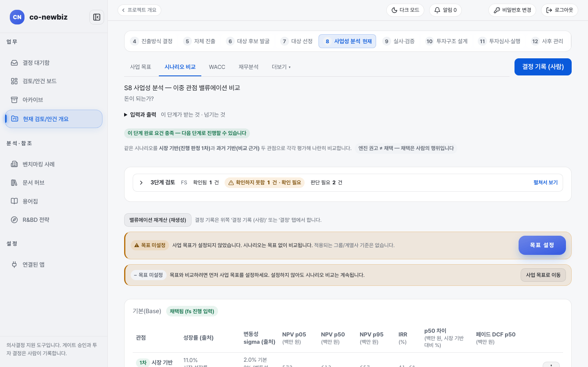

# 그린필드 사업성 분석하기 (S8)

**목적** — 대상이 하나인 사업 케이스를 만들고 숫자(순현재가치, 내부수익률)와 가중평균자본비용을 확인해 `FS` 게이트에서 쓸 케이스를 `채택`합니다.  **누가/언제** — 분석가가 케이스를 만들고 프로젝트 리드가 채택과 게이트 결정을 합니다. S5의 `Pre-FS`가 GO가 된 뒤입니다.  **사전 조건** — S5에서 `프로젝트로 추진`이 끝나 프로젝트가 있어야 합니다.

> [!NOTE]
> **Green Field에서만** — 그린필드의 S8은 분석 대상이 하나입니다(`단일 범위`). 대상 회사끼리 견주는 `대상 비교·선정` 탭이 없고, 사람이 대상을 고르는 단계도 없습니다. 브라운필드는 후보 여러 개를 견주고 대상을 고릅니다. 공통 설명은 [30-공통-S8-사업성-분석](30-공통-S8-사업성-분석.md), 브라운필드는 [52-브라운필드-S8-사업성-분석](52-브라운필드-S8-사업성-분석.md)을 보세요.

> [!NOTE]
> 이 쪽의 화면은 연습용 데모 데이터입니다. 숫자와 이름은 사용자의 데이터와 다릅니다.

*그린필드 프로젝트의 `시나리오 비교` 탭. 위 탭에 `대상 비교·선정`이 없습니다. 데모 프로젝트.*

## 단계

1. 프로젝트 화면 번호 띠에서 `8 사업성 분석`을 엽니다. 제목은 `S8 사업성 분석 — 이중 관점 밸류에이션 비교`입니다.
2. `이 단계 완료 요건 충족` 같은 상태 표시와 `3단계 검토` 줄을 읽습니다. 같은 시나리오를 `시장 기반(진행 판정 1차)`과 `과거 기반(비교 근거)` 두 관점으로 평가한다고 안내합니다. 화면은 "엔진 권고는 채택이 아니다"라고 알려 줍니다.
3. 위 탭 `사업 목표`를 엽니다. 목표가 없으면 `목표 미설정` 경고가 나옵니다. `목표 설정`을 눌러 정하거나 그냥 진행할 수 있습니다(목표 없이도 시나리오 비교는 계속됩니다).
4. `시나리오 비교` 탭으로 가서 `기본(Base)` 표를 읽습니다. 열은 `관점`, `성장률 (출처)`, `변동성 sigma (출처)`, `NPV p05`, `NPV p50`, `NPV p95`, `IRR (%)`, `p50 차이`, `페이드 DCF p50`입니다. 단위는 백만 원입니다. 1차(시장 기반) 줄이 진행 판정에 쓰입니다.
5. 숫자를 새로 계산하려면 `밸류에이션 재계산 (재생성)`을 누릅니다. 다른 탭 `더보기`의 `설명·생성·권고`, `파라미터·스냅샷`, `타겟코스팅`에서 입력을 손볼 수 있습니다. S5에서 적은 투자비 검토 요건이 사업 케이스 줄의 출발점입니다.
6. (선택) `설명·생성·권고`에서 `▶ 채택 권고 생성`을 누르면 AI가 `채택 근거 초안`을 제안합니다. 제안일 뿐입니다.
7. `WACC` 탭을 엽니다. 가중평균자본비용 입력과 확인은 사람이 합니다. 자세한 입력 방법은 [30-공통-S8-사업성-분석](30-공통-S8-사업성-분석.md)을 보세요.
8. 시나리오 표에서 쓸 케이스 줄의 `채택`을 누릅니다. 확인 창에 "이 케이스를 타당성 분석(FS) 진행 입력으로 채택합니다. 채택은 인간 결정이며 감사 기록으로 남습니다."가 나오면 확인합니다. 적용되는 사업 목표가 없으면 `목표 비교 없이 채택` 창이 열리고 `채택 사유`와 확인 칸이 필요합니다.
9. `결정` 탭(또는 오른쪽 위 `결정 기록 (사람)`)에서 `FS` 게이트 결정을 기록합니다. 근거를 쓰고 결정을 누릅니다.

## 결과 확인

- 채택한 줄에 `채택됨` 표시가, 위쪽에 `채택됨 (fs 진행 입력)`이 나타납니다.
- `FS` 게이트가 GO로 기록되면 [42-그린필드-S9-실사](42-그린필드-S9-실사.md)로 갑니다.
- 채택한 케이스는 S11 투자심의 자료의 `채택 Business Case (S8)`로 그대로 이어집니다.

## 자주 하는 실수

- 엔진이 권고한 케이스를 자동으로 채택된 것으로 여기는 것. 채택은 사람이 `채택`을 눌러야 기록됩니다.
- 2차(과거 기반) 숫자로 진행을 판단하는 것. 진행 판정은 1차(시장 기반) 값을 씁니다.
- 대상 비교·선정 탭을 찾는 것. 그린필드에는 없습니다. 옛 주소(`?tab=targets`)로 들어와도 `시나리오 비교`로 보내집니다.
- 가중평균자본비용을 확인하지 않고 케이스를 채택하는 것. 확인 상태는 `WACC` 탭에서 봅니다.

## 다음 단계

[42-그린필드-S9-실사](42-그린필드-S9-실사.md)

## 스스로 확인하기

연습용 데모 프로젝트(읽기 전용)에서 S8 `시나리오 비교` 탭을 열어 `기본(Base)` 표의 1차 줄 `NPV p50` 값을 찾고, 위쪽에 `채택됨 (fs 진행 입력)`이 있는지 확인하세요.

## 알려진 불일치

- 화면 일부 문구에 영어가 섞여 있습니다(`Base`, `NPV`, `IRR`, `sigma`, `fs`). 이 쪽은 화면 표기를 그대로 따랐습니다.
- 데모 프로젝트에서는 `목표 미설정` 경고가 둘 나옵니다(`목표 미설정`이 두 줄). 목표를 정하면 사라집니다.
