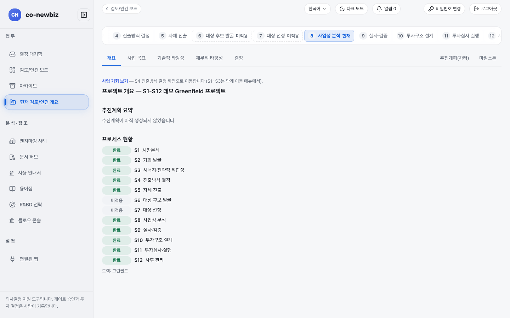

# 그린필드 사업성 분석하기 (S8)

**목적:** 대상이 하나인 사업 케이스를 만들고 숫자(순현재가치, 내부수익률)와 가중평균자본비용을 확인해 `FS` 게이트에서 쓸 케이스를 `채택`한다.

**누가/언제:** 분석가가 케이스를 만들고 프로젝트 리드가 채택과 게이트 결정을 한다. S5의 `Pre-FS`가 GO가 된 뒤다.

**사전 조건:** ① 직전 단계·게이트: S5의 `Pre-FS` GO와 `프로젝트로 추진`이 끝나 프로젝트가 있어야 한다. ② 필요 권한: 케이스 입력은 분석가, 채택과 게이트 결정은 사람(프로젝트 리드)이다. ③ 준비물: S5에서 적은 투자비 검토 요건.

> [!NOTE]
> **Green Field에서만:** 그린필드의 S8은 분석 대상이 하나다(`단일 범위`). 대상 회사끼리 견주는 `대상 비교·선정` 탭이 없고 사람이 대상을 고르는 단계도 없다. 브라운필드는 후보 여러 개를 견주고 대상을 고른다. 공통 설명은 [30-공통-S8-사업성-분석](30-공통-S8-사업성-분석.md), 브라운필드는 [52-브라운필드-S8-사업성-분석](52-브라운필드-S8-사업성-분석.md)을 본다.

> [!NOTE]
> 이 쪽의 화면은 연습용 데모 데이터다. 숫자와 이름은 사용자의 데이터와 다르다.

## 왜 이 단계인가

S8은 안건이 프로젝트가 된 뒤 처음 만나는 검산 단계다. S5가 세운 진출전략과 투자비 검토 요건이 사업 케이스 줄의 출발점이 되고 엔진이 시나리오별 NPV와 IRR을 계산한다. 같은 노선의 예상 소요 시간과 지난 실제 통행 시간을 나란히 놓고 보는 출근 경로 점검과 같다. 이 화면은 같은 시나리오를 `시장 기반(진행 판정 1차)`과 `과거 기반(비교 근거)` 두 관점으로 평가해 보여 주므로, 숫자가 좋아 보일 때 그 근거가 어느 가정에서 왔는지 함께 읽게 된다. 다만 확인 창의 문구대로 채택은 인간 결정이며 감사 기록으로 남으므로, `채택`과 `FS` 게이트 기록은 사람의 몫이다.

*그린필드 프로젝트의 `8 사업성 분석`을 처음 열면 나오는 `개요` 탭. 위쪽 탭 다섯 개에 `대상 비교·선정`이 없다. 데모 프로젝트.*

## 단계

1. 프로젝트 화면 번호 띠에서 `8 사업성 분석`을 연다. 먼저 `개요` 탭이 열린다. 그린필드의 위쪽 탭은 `개요`, `사업 목표`, `기술적 타당성`, `재무적 타당성`, `결정` 다섯 개다(`대상 비교·선정`은 없다). 다른 탭을 열면 큰 제목은 `S8 사업성 분석`이고 부제는 `시장 기반 밸류에이션`이다.
2. `사업 목표` 같은 S8 탭을 열면 위쪽에 `이 단계 완료 요건 충족` 같은 상태 표시와 `3단계 검토` 줄을 읽는다. 같은 시나리오를 두 관점으로 평가한다고 안내한다. 화면은 "엔진 권고는 채택이 아니다"라고 알려 준다.

   | 관점 | 쓰임 |
   |---|---|
   | `시장 기반(진행 판정 1차)` | 진행 판정에 쓰인다 |
   | `과거 기반(비교 근거)` | 비교 근거다 |

3. 위 탭 `사업 목표`를 연다. 목표가 없으면 `목표 미설정` 경고가 나온다. `목표 설정`을 눌러 정하거나 그냥 진행할 수 있다(목표 없이도 시나리오 비교는 계속된다). 목표 달성은 채택한 케이스의 `NPV p50`로 판정하고 채택 전에는 기본(Base) 케이스로 본다.
4. `재무적 타당성`을 누르고 아래 둘째 줄에서 `시나리오 비교` 하위 탭으로 가서 `기본(Base)` 표를 읽는다. 열은 `관점`, `성장률 (출처)`, `변동성 sigma (출처)`, `NPV p05`, `NPV p50`, `NPV p95`, `IRR (%)`, `p50 차이`, `페이드 DCF p50`이다. 단위는 백만 원이다. 1차(시장 기반) 줄이 진행 판정에 쓰인다. 표 아래 `신뢰구간은 매출 성장률 불확실성만 반영합니다. 설비투자·운영비·WACC는 고정값입니다.`라는 글처럼 `NPV p05`~`p95` 폭에는 매출 성장률의 흔들림만 담겨 있다.
5. 숫자를 새로 계산하려면 `설명·생성·권고` 하위 탭의 `자동 생성 (시장 기반 × 3 시나리오)`를 누른다. 만들기는 서버에서 따로 돌아 화면을 새로고침해도 이어지며 `생성 진행 상황` 패널이 단계별 진행(`단계별 진행 보기`는 접혀 있음)을 보인다. 읽는 법과 실패했을 때는 [30-공통-S8-사업성-분석](30-공통-S8-사업성-분석.md)의 `생성 진행 보기와 이어 보기`를 본다. 손익분기(BEP) 화면의 시나리오 버튼(`기본(Base)`, `보수(Downside)`, `낙관(Upside)`)과 소수 둘째 자리 WACC도 그 쪽의 `손익분기(BEP) 읽기`에 있다. `재무적 타당성` 아래 `파라미터·스냅샷`, `타겟코스팅` 하위 탭에서 입력을 손볼 수 있다.
6. 필요하면 `결정` 탭의 `🤖 AI 판단 지원`에서 `AI 판단 지원 생성`을 누른다. AI가 `채택할 케이스`와 `채택 근거 초안`을 제안한다. 제안일 뿐이다.
7. `재무적 타당성` 아래 `WACC` 하위 탭을 연다. 가중평균자본비용 입력과 확인은 사람이 한다. 자세한 입력 방법과 `WACC 참조값`(ECOS 금리 수집, 신용등급 가산금리와 `신용등급 수집 실행`, ERP 공표값, 법정 한계세율, `관측값을 목표로 적용`)은 [30-공통-S8-사업성-분석](30-공통-S8-사업성-분석.md)을 본다. 적용 주체, WACC, 허들 IRR을 사람이 모두 확정해야 하며 그 전에는 결과에 `잠정 할인율` 표지가 붙고 S8을 마칠 수 없다.
   그린필드는 `대상회사` 하위 탭에서 `벤치마크 회사 연결/변경`으로 비교 기준 회사를 고를 수 있다. 연결한 회사가 없으면 `연결된 벤치마크 회사가 없습니다`가 나온다.
8. `시나리오 비교` 하위 탭의 표에서 쓸 케이스 줄의 `채택`을 누른다. 확인 창에 "이 케이스를 타당성 분석(FS) 진행 입력으로 채택합니다. 채택은 인간 결정이며 감사 기록으로 남습니다."가 나오면 확인한다. 적용되는 사업 목표가 없으면 `목표 비교 없이 채택` 창이 열리고 `채택 사유`와 확인 칸이 필요하다.
9. `결정` 탭(또는 오른쪽 위 `결정 기록 (사람)`)에서 `FS` 게이트 결정을 기록한다. 근거를 쓰고 결정을 누른다.

## 결과 확인

| 화면에 남는 변화 | 어디서 보이는지 |
|---|---|
| 채택 표지 | 채택한 줄에 `채택됨` 표시가, 위쪽에 `채택됨 (fs 진행 입력)`이 나타난다 |
| 완료 판정 기준 | S8 완료는 채택한 케이스를 기준으로 본다. 채택 전에는 기본(Base) 모델을 기준으로 하며, 나중에 만든 하락(Downside) 케이스가 판정을 바꾸지 않는다. 이미 완료된 프로젝트는 그대로 완료다 |
| 다음 길 | `FS` 게이트가 GO로 기록되면 [42-그린필드-S9-실사](42-그린필드-S9-실사.md)로 간다 |
| 이어짐 | 채택한 케이스는 S11 투자심의 자료의 `채택 Business Case (S8)`에 그대로 들어간다 |

## 자주 하는 실수

| 오해 | 바른 읽기 |
|---|---|
| 엔진이 권고한 케이스를 자동으로 채택된 것으로 여기는 것 | 채택은 사람이 `채택`을 눌러야 기록된다 |
| 2차(과거 기반) 숫자로 진행을 판단하는 것 | 진행 판정은 1차(시장 기반) 값을 쓴다 |
| 대상 비교·선정 탭을 찾는 것 | 그린필드에는 없다. 옛 주소(`?tab=targets`)로 들어오면 `재무적 타당성`의 `설명·생성·권고` 하위 탭으로 옮겨 준다 |
| 가중평균자본비용을 확인하지 않고 케이스를 채택하는 것 | 확인 상태는 `재무적 타당성` 아래 `WACC` 하위 탭에서 본다. 확정 전에는 `FS` GO도 기록할 수 없다 |
| 방금 만든 하락(Downside) 케이스 때문에 S8 완료가 바뀐다고 여기는 것 | 완료는 채택한 케이스(없으면 기본 모델)로 본다 |

## 알려진 불일치

- 화면 일부 문구에 영어가 섞여 있다(`Base`, `NPV`, `IRR`, `sigma`, `fs`). 이 쪽은 화면 표기를 그대로 따랐다.
- 데모 프로젝트에서는 `목표 미설정` 경고가 둘 나온다(`목표 미설정`이 두 줄). 목표를 정하면 사라진다.

## 스스로 확인하기

연습용 데모 프로젝트(읽기 전용)에서 S8 `재무적 타당성`을 누른 뒤 `시나리오 비교` 하위 탭을 열어 `기본(Base)` 표의 1차 줄 `NPV p50` 값을 찾고 위쪽에 `채택됨 (fs 진행 입력)`이 있는지 확인한다. 어떤 버튼도 누르지 않는다.

## 핵심 요약

- 그린필드 S8은 대상이 하나다. `대상 비교·선정` 탭이 없고 사람이 대상을 고르는 단계도 없다. 위쪽 탭은 `개요`, `사업 목표`, `기술적 타당성`, `재무적 타당성`, `결정`이다. `재무적 타당성` 아래 둘째 줄의 하위 탭은 [30-공통-S8-사업성-분석](30-공통-S8-사업성-분석.md)의 `S8 화면의 탭 구조`를 본다.
- S5의 투자비 검토 요건이 사업 케이스 줄의 출발점이고 진행 판정은 1차(시장 기반) 값을 쓴다.
- 채택은 사람이 `채택`을 눌러야 기록되는 인간 결정이며 감사 기록으로 남는다.
- `FS` 게이트가 GO면 S9 실사로 간다.

이전: [40-그린필드-S5-자체-진출](40-그린필드-S5-자체-진출.md) | 다음: [42-그린필드-S9-실사](42-그린필드-S9-실사.md)
