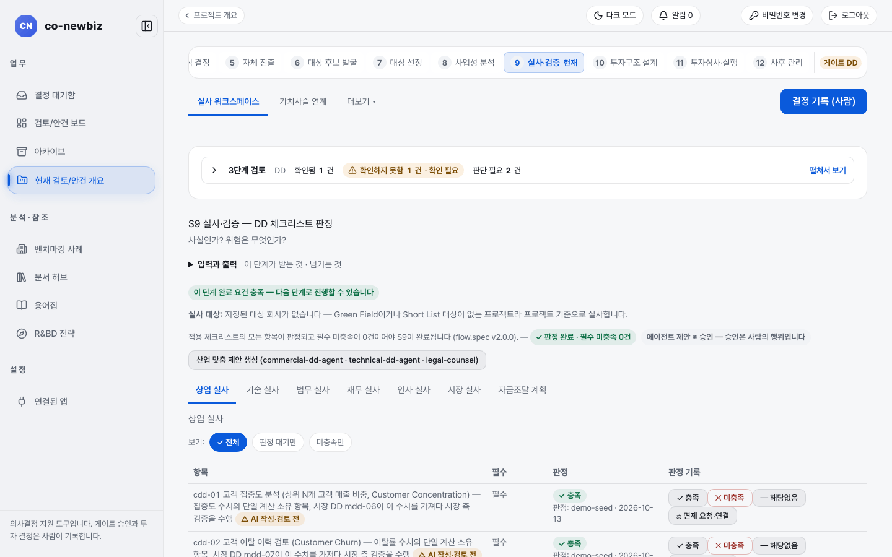

# 그린필드 실사 점검표 판정하기 (S9)

**목적** — 사업 계획이 실제로 가능한지 점검표 항목마다 `충족`, `미충족`, `해당없음`, 면제로 판정하고 `DD` 게이트를 준비합니다.  **누가/언제** — 분석가가 판정하고 프로젝트 리드가 게이트를 기록합니다. S8의 `FS` 게이트가 GO가 된 뒤입니다.  **사전 조건** — S8에서 사업 케이스가 채택되어 있어야 합니다.

> [!NOTE]
> **Green Field에서만** — 그린필드 S9에는 실사 대상 회사가 없습니다. 화면도 "지정된 대상 회사가 없습니다 — 프로젝트 기준으로 실사합니다"라고 알려 줍니다. 그리고 안건의 세부 갈래(`신규 부지 설립`, `기존 사업 R&BD 확장`, `사내벤처(CVC)`)에 따라 보이는 탭 이름과 범위가 다릅니다. 브라운필드는 선정된 대상 회사를 점검하고 M&A 필수 점검 여섯 가지가 더해집니다. 공통 설명은 [31-공통-S9-실사-검증](31-공통-S9-실사.md), 브라운필드 쪽은 [53-브라운필드-S9-실사](53-브라운필드-S9-실사.md)를 보세요.

> [!NOTE]
> 이 쪽의 화면은 연습용 데모 데이터입니다. 점검 항목의 판정자, 날짜, 값이 사용자의 데이터와 다릅니다. 데모 프로젝트는 세부 갈래가 없는 신규 부지 설립 사례라서, 아래 "세부 갈래가 있는 안건" 부분은 화면 캡처 없이 글로만 설명합니다.

*그린필드 프로젝트의 `실사 워크스페이스`. 가로 탭 `상업 실사`, `기술 실사`, `법무 실사`, `재무 실사`, `인사 실사`, `시장 실사`, `자금조달 계획`. 데모 프로젝트.*

## 단계

1. 프로젝트 번호 띠에서 `9 실사·검증`을 엽니다. 위 탭은 `실사 워크스페이스`와 `가치사슬 연계`입니다.
2. 제목 아래 안내를 읽습니다. 적용되는 점검표의 모든 항목이 판정되고 필수 미충족이 0건이어야 S9가 끝납니다. 칩 `✓ 판정 완료 · 필수 미충족 0건` 또는 `○ 대기 N건 · 미판정 N건 · ✕ 필수 미충족 N건`이 현재 상태입니다.
3. (선택) `산업 맞춤 제안 생성`을 누르면 AI가 이 안건에 맞는 항목 제안을 만듭니다. 제안일 뿐이고 승인은 사람의 행위입니다.
4. 가로 탭에서 영역을 고릅니다. `보기`에서 `전체`, `판정 대기만`, `미충족만`으로 줄을 거를 수 있습니다.
5. 항목 줄마다 `판정 기록` 열에서 `충족`, `미충족`, `해당없음`, `면제 요청·연결` 중 하나를 누릅니다. `필수` 열에 `필수`가 있는 항목이 게이트에 영향을 줍니다.
6. `해당없음`은 이유를 묻는 창이 열리는 경우가 있습니다(세부 갈래 규칙으로 빠진 항목). 이유를 적어야 기록됩니다.
7. `면제 요청·연결`은 이미 활성인 면제를 연결하거나 항목이 채워진 새 면제를 요청합니다. 면제된 항목은 `면제(waived)`로 보입니다.
8. 모든 탭이 끝나면 오른쪽 위 `결정 기록 (사람)`에서 `DD` 게이트를 기록합니다.

## 세부 갈래가 있는 안건 (`기존 사업 R&BD 확장`, `사내벤처(CVC)`)

S4에서 이 갈래를 골랐다면 점검표 범위가 안건에 맞게 줄어듭니다(범위 규칙은 안건 시작일 기준으로 적용되고, `DD` 게이트 결정이 이미 기록된 프로젝트는 그 시점의 범위를 유지합니다). 위쪽에 `범위 요약 — {세부 갈래 이름}` 칸이 나타나고 탭 이름이 바뀝니다.

| 원래 탭 | 이 안건에서의 탭 이름 |
|---|---|
| `상업 실사` | `판매 계획` |
| `기술 실사` | `기술 계획` |
| `법무 실사` | `법무·인허가 계획` |
| `시장 실사` | `시장 근거` |
| `재무 실사` | `재무 계획` |
| `인사 실사` | `인력/조직 계획` |
| `자금조달 계획` | `자금 마련 계획` |
| (추가) | `R&BD 기술` (`기존 사업 R&BD 확장`), `법인 설립 준비` (`사내벤처(CVC)`) |
| (추가) | `계획 준비 상태` (읽기 전용) |

탭 이름은 아직 임시 작업 이름입니다. `인력/조직 계획`만 확정된 이름입니다.

### 인력/조직 계획 탭

`범위 요약`의 `계획 준비 상태 — 인력/조직` 줄에 `인력/조직 계획 탭에서 판정하기` 링크와 `판정 N / M`이 있습니다. 링크를 누르면 `인력/조직 계획` 탭으로 이동합니다. 그 아래 `N단계 …` 목록은 핵심 인력·역량 준비도 같은 단계가 범위 안인지 밖인지, 기록이 있는지를 보여 줍니다. 이 줄의 일부 값은 `참고값 — 완료 집계에는 포함되지 않습니다`로 표시됩니다.

`계획 준비 상태` 탭은 점검표 항목이 없는 단계(4, 5, 6단계)의 상태를 보여 줍니다. 판정 버튼이 없고 완료 집계에도 들어가지 않습니다.

### 부지 필요 여부 확인하기 (사람만, 한 사람, 근거만)

부지 관련 단계(부지 방문 실사 등)가 이 안건에 필요한지는 사람이 확인합니다. `기존 사업 R&BD 확장`과 `사내벤처(CVC)`에는 기본값이 없어서 확인 전에는 부지 단계가 포함됩니다.

1. `범위 요약`의 `부지:` 칩을 읽습니다(`부지: 아직 확인하지 않았습니다 …` 또는 `부지: 확인됨 — 부지 필요`).
2. `부지 필요 여부 정하기`(이미 확인했다면 `다시 확인하기`)를 펼칩니다.
3. `이 계획에 새 부지나 부지 확장이 필요한가 (필수)`에서 `필요 — 부지 단계 적용` 또는 `불필요 — 부지 단계 제외`를 고릅니다.
4. `확인 근거 (필수)`에 이유를 씁니다. 증빙 문서를 붙일 필요는 없습니다.
5. `부지 필요 여부 확인`을 누릅니다. 선택만으로는 기록되지 않고 이 버튼을 눌러야 기록됩니다.

확인은 한 사람이 하고, 눌러 기록하면 바로 적용됩니다. 두 번째 사람의 검토는 없습니다. 상황이 바뀌면 새 근거를 적어 다시 확인하세요. 에이전트는 제안만 할 수 있고 읽기 권한만 있는 사용자(열람자)는 확인할 수 없습니다.

### 범위, 제외, 세는 규칙

- `범위 밖 단계:` 줄은 이 안건에서 빠진 단계를 알려 주고, 이유는 각 탭 머리글에서 볼 수 있습니다.
- 항목 옆 기호는 읽는 방식을 말합니다. `A 그대로 적용`, `R 그린필드 해석`(그린필드 계획에 맞게 다시 읽어 판정), `X 대체됨`(다른 항목이 대신 판정), `N 해당 없음(트랙 규칙)`(이 트랙에서는 판정하지 않음).
- 진행 상태는 한 줄로 셉니다: `판정 X / Y`. X는 판정한 항목, Y는 일곱 영역에서 판정할 수 있는 항목 수입니다. 옆의 `필수 미충족 N건`과 `트랙 규칙으로 제외 N건`은 따로 센 값입니다. 추가 점검표(`R&BD 기술`, `법인 설립 준비`)는 `추가 체크리스트 … 판정 a / b`로 줄 아래에 따로 나오며 X/Y에 섞이지 않습니다. 대체된(`X`) 항목은 대체 항목이 판정되기 전까지 X/Y에 포함되어 있다가 빠집니다.
- 새 작업 범위 규칙이 생기기 전에 시작된 프로젝트는 기존 범위가 유지되고 `새 작업 범위로 전환 미리보기` 버튼이 나옵니다. 눌러 미리보기를 읽고 `전환 사유 (필수)`를 쓴 뒤 `전환 기록`을 누르면 바뀝니다. 이미 기록한 판정은 지워지지 않습니다. 이 전환은 분석가 이상의 사람만 할 수 있습니다.

## 결과 확인

- 위쪽 칩이 `✓ 판정 완료 · 필수 미충족 0건`이 되고 `이 단계 완료 요건 충족` 표시가 나타납니다(세부 갈래가 있는 안건은 `판정 X / Y` 줄과 `필수 미충족 0건`).
- `DD` 게이트가 GO로 기록되면 [43-그린필드-S10-실행-기준선](43-그린필드-S10-실행-기준선.md)으로 갑니다.

## 자주 하는 실수

- `부지 필요 여부` 라디오만 고르고 `부지 필요 여부 확인`을 누르지 않는 것. 기록되지 않습니다.
- 안건이 부지가 필요 없는데 확인하지 않아서 부지 방문 실사 항목이 계속 `판정 대기`로 남는 것.
- `해당없음`을 이유 없이 누르려는 것. 세부 갈래 규칙으로 빠진 항목은 이유가 필요합니다.
- `계획 준비 상태` 탭에서 판정 버튼을 찾는 것. 읽기 전용입니다.
- `인력/조직 계획`이 완료 집계에 들어가지 않는다고 오해하는 것. 탭의 점검 항목은 집계에 들어갑니다. 집계에서 빠지는 것은 `참고값`이라고 적힌 줄뿐입니다.

## 다음 단계

[43-그린필드-S10-실행-기준선](43-그린필드-S10-실행-기준선.md)

## 스스로 확인하기

연습용 데모 프로젝트(읽기 전용)에서 S9를 열어 `상업 실사` 탭의 첫 항목 `cdd-01`의 판정이 `충족`인지, 위쪽 칩이 `✓ 판정 완료 · 필수 미충족 0건`인지 확인하세요.

## 알려진 불일치

- 안내 문구 `실사 대상: 지정된 대상 회사가 없습니다 — Green Field이거나 Short List …`에 영어 표기(`Green Field`, `Short List`)가 남아 있습니다.
- 항목 이름에 영어 원문이 섞여 있습니다(예: `Customer Concentration`).
- 세부 갈래가 있는 안건의 화면 캡처는 데모 데이터에 해당 안건이 없어 실리지 않았습니다.
