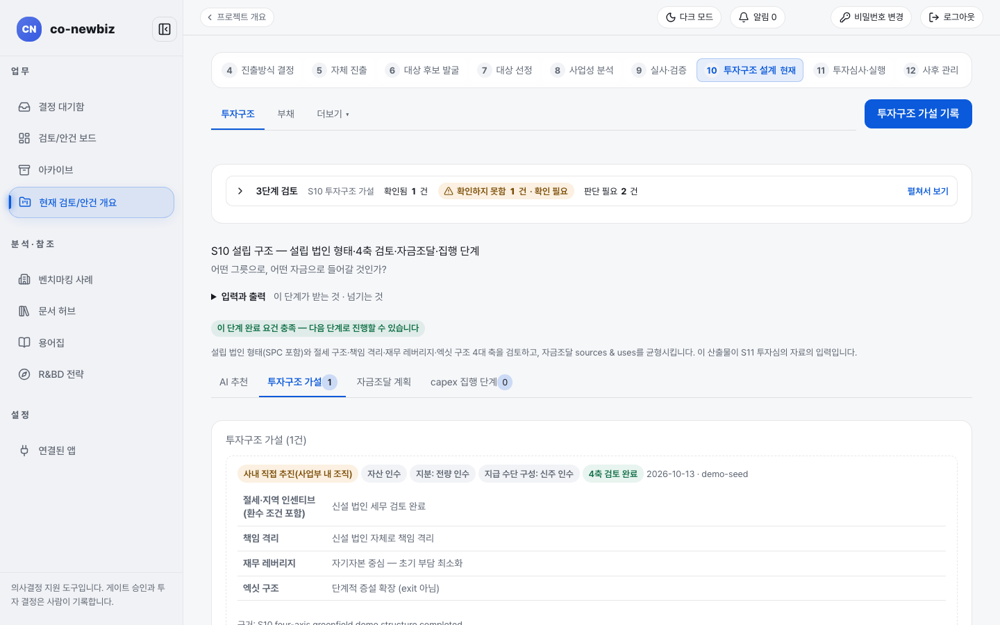
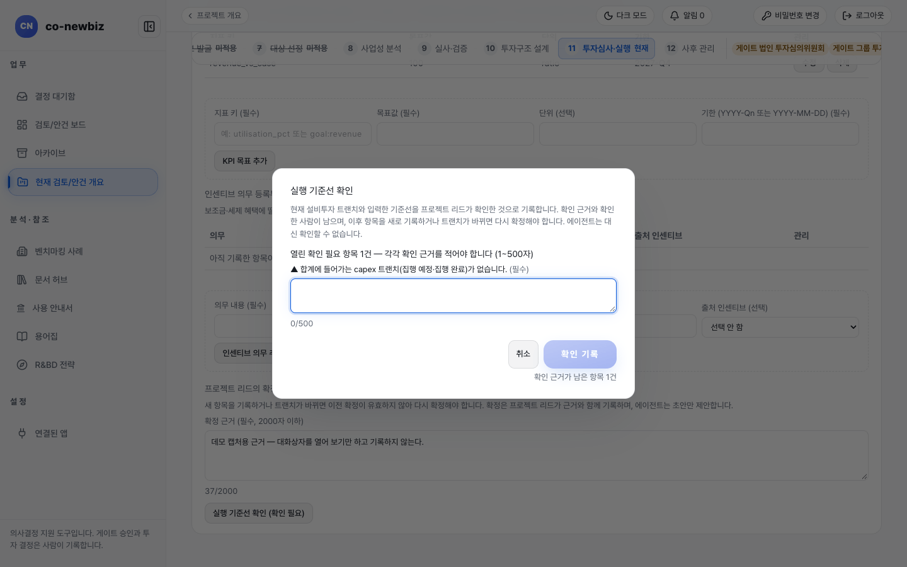

# 설립 구조와 집행 조건 정하기 (S10)

**목적:** 새로 세울 법인의 형태(`설립 법인 형태`), 4축 검토, 자금 마련(조달과 사용), 투자금을 나눠 집행하는 조건(설비투자 집행 단계)을 기록한다. 이 기록이 S11에서 `실행 기준선`의 바탕이 된다.

**누가/언제:** 분석가가 기록하고 프로젝트 리드가 챙긴다. S9의 `DD` 게이트가 GO가 된 뒤다.

**사전 조건:** ① 직전 단계·게이트: S9 완료(`DD` 게이트 GO). ② 필요 권한: 분석가 이상 권한. ③ 준비물: S9에서 판정을 마친 점검표와 설립 계획.

> [!NOTE]
> **Green Field에서만:** 그린필드 S10은 `투자 주체` 대신 `설립 법인 형태`를 정하고 인수 관련 칸(`자산/주식`, `지급 수단 구성`)은 쓰지 않는다. 대신 `설비투자 집행 단계` 탭이 더해진다. 브라운필드는 인수 거래 구조(`투자 주체`, 자산 인수·주식 인수, 지급 수단)를 정한다. 브라운필드 쪽은 [54-브라운필드-S10-거래-구조](54-브라운필드-S10-거래-구조.md)를 보고 공통 설명은 [32-공통-S10-투자심의-전](32-공통-S10-투자심의-전.md)을 본다.

> [!NOTE]
> 이 쪽의 화면은 연습용 데모 데이터다. 값과 이름이 사용자의 데이터와 다르다.

> [!NOTE]
> 파일 이름은 "실행 기준선"이지만 `실행 기준선`을 만드는 화면은 S10이 아니라 S11 화면 안에 있다. S10에서는 그 바탕이 되는 설립 구조와 집행 조건을 기록하고 기준선 입력과 확정은 [44-그린필드-S11-설립-실행](44-그린필드-S11-설립-실행.md)에서 한다.

## 왜 이 단계인가

S10은 "어떤 그릇으로, 어떤 자금으로 들어갈 것인가?"를 묻는 단계다. S9에서 계획의 사실성을 확인했으니, 이제 그 계획을 어떤 법인 형태로 세우고 어떤 자금 규율로 집행할지 정한다. `설립 법인 형태` 다섯 가지와 4축 검토가 그릇을 정하고, `자금조달 계획`의 조달과 사용이 같아야 한다는 균형 조건이 자금을 정한다. 투자금은 한 번에 쓰지 않는다. 공사대금을 "기초 공사 완료" 같은 조건마다 나눠 주는 공사 계약처럼, `설비투자 집행 단계`는 조건이 충족될 때마다 나눠 집행하는 칸이다. 집행 요청과 승인을 다른 두 사람이 한다는 경계도 여기서 만들어진다.

*그린필드 프로젝트의 S10 `투자구조 가설` 탭. 설립 법인 형태와 4축 노트가 보인다. 데모 프로젝트.*

## 단계

1. 프로젝트 번호 띠에서 `10 투자구조 설계`를 연다. 큰 제목은 `S10 투자구조 설계`이고 부제는 `설립 구조 — 설립 법인 형태·4축 검토·자금조달·집행 단계`다.
2. 탭이 `AI 추천`(분석가 이상), `투자구조 가설`, `자금조달 계획`, `설비투자 집행 단계`로 나뉜다. 먼저 `투자구조 가설`을 연다.
3. 오른쪽 위 `투자구조 가설 기록`을 누르거나 `투자구조 가설 입력란 펼치기`를 연다.
4. `설립 법인 형태`에서 고른다: `사내 직접 추진(사업부 내 조직)`, `SPC/SPV(목적법인)`, `자회사 설립(홀딩스 경유)`, `내부 벤처 분사`, `합작회사(JV) 설립`. `합작회사(JV) 설립`을 고르면 `합작 지분(우리 몫)`(`합작 지분 과반`, `합작 지분 소수`, `공동 통제`)이 나타난다.
5. 4축 칸 네 개를 적는다. `절세·지역 인센티브 (환수 조건 포함)`, `책임 격리`, `재무 레버리지`, `엑싯 구조`.
6. `근거 (필수)`를 쓰고 `가설 기록`을 누른다. 근거가 비어 있으면 버튼이 눌리지 않는다.
7. 기록된 가설 줄에서 `… 아티팩트 참조 (필수)` 칸에 근거 문서를 적고 `4축 검토 완료`를 누른다. 확인 창은 "되돌릴 수 없고 감사 로그에 남는다"고 알린다. 완료되면 칩이 `4축 검토 미완료`에서 `4축 검토 완료`로 바뀐다.
8. `자금조달 계획` 탭을 연다(`자금조달 계획 (sources & uses)`). `구분`을 `조달` 또는 `사용`으로 고르고 `항목명`, `금액 (백만 KRW)`, `비고`를 적은 뒤 `추가`를 누른다. 항목명 칸에는 추천값이 뜬다(조달: `자기자본(출자)`, `프로젝트 파이낸싱`, `정부 자금·보조금`, `차입금(금융기관)` / 사용: `부지·설비 자체 건설(build)`, `부지·설비 임차(lease)`, `연구개발·인력`, `운전자금`).
9. 아래 합계가 `조달 = 사용 — 균형`이고 칩이 `균형`이 될 때까지 맞춘다. 어긋나면 `불균형 — S10 완료 요건 미충족`이 보인다. 사용 합계는 S8에서 채택한 투자금과 ±5% 안에서 맞아야 하고, 차입을 쓴다면 위쪽 `차입·여신` 탭에 등록한다. 차입이 있으면 채택한 S8 케이스의 하락 현금흐름 기준 최저 원리금 상환 능력(DSCR)이 1.3배 이상이어야 S10이 끝난다. 등록, 수정, 삭제와 상환방식, 약정 조건의 읽는 법은 [54-브라운필드-S10-거래-구조](54-브라운필드-S10-거래-구조.md)의 `차입·대출 화면 읽기` 절을 본다.
10. `설비투자 집행 단계` 탭을 연다. `설비투자 집행 단계 — 트랜치와 집행 조건` 표 아래 줄에서 `번호`, `금액 (필수)`, `통화`, `집행 조건 (필수)`(예: 인허가 취득 및 1차 설비 발주 확정)를 쓰고 `집행 단계 추가`를 누른다. 투자금을 한 번에 집행하지 않고 조건이 충족될 때마다 나눠 집행하는 칸이라서, 화면에서는 `집행 단계(트랜치)`라고 부른다.
11. 집행 단계를 집행할 때는 줄의 `집행 단계 N 작업` 메뉴에서 `집행 요청 기록(다른 사람 승인 필요)`을 고르고 `사유 (필수)`를 쓴 뒤 `집행 요청 기록`을 누른다. 다른 사람이 같은 메뉴에서 `집행 승인(집행 완료로 기록)`을 고르고 `집행 승인`을 눌러야 `집행 완료`가 된다.

*`설비투자 집행 단계` 탭. 데모 프로젝트에는 집행 단계가 아직 없어 `등록된 트랜치가 없습니다` 안내가 보인다.*

*S11 화면의 `실행 기준선` 내부 탭에서 `실행 기준선 확인 (확인 필요)`을 눌렀을 때 열리는 확인 창이다. 열려 있는 `확인 필요 항목`마다 확인 근거 칸이 생기고 `취소`로 닫는다. 데모 프로젝트에서 창을 열어 보기만 했다.*

## 결과 확인

| 확인하는 곳 | 보이는 것 |
|---|---|
| `투자구조 가설` 탭 | 제목 옆 숫자와 `4축 검토 완료` 칩으로 확인한다 |
| `자금조달 계획` | `균형` 칩이 보여야 S10이 끝난다 |
| 집행 단계 | 상태는 `집행 예정`, `집행 완료`, `보류` 중 하나로 보인다 |
| 이어짐 | 이 기록은 S11 `투자심의 자료`로 넘어가고 S11의 `실행 기준선`이 이 집행 단계(트랜치)와 견주어 맞춰 본다 |

## 자주 하는 실수

| 오해 | 바른 읽기 |
|---|---|
| 같은 사람이 집행 요청과 승인을 모두 하려는 것 | 요청자와 승인자(그리고 집행 단계 작성자)는 달라야 한다 |
| 집행 완료한 집행 단계를 수정하거나 폐기하려는 것 | 집행 완료로 기록된 집행 단계는 고칠 수도 폐기할 수도 없다 |
| 인수용 칸(`자산/주식`, `지급 수단 구성`)을 찾는 것 | 그린필드에서는 숨겨진다. 조달 구성은 `자금조달 계획` 탭에, 집행 단계는 `설비투자 집행 단계` 탭에 적는다 |
| 4축 노트만 쓰고 `4축 검토 완료`를 누르지 않는 것 | 칩이 `4축 검토 미완료`로 남아 단계가 끝나지 않는다 |

## 알려진 불일치

- 표 제목과 안내 문구에 `트랜치`, `sources & uses` 같은 외래어가 남아 있다(탭·버튼은 `설비투자 집행 단계`, `집행 단계 추가`다).
- 파일 이름은 "실행 기준선"이나 이 쪽의 내용은 S10(설립 구조)이다. `실행 기준선`은 S11 화면에 있다.
- 캡처 `s10-gf-03-baseline-confirm-dialog.png`의 확인 창은 S11 화면의 `실행 기준선` 탭에서 열린다. 데모에는 기준선이 이미 확정되어 있어도 `실행 기준선 확인 (확인 필요)` 버튼과 확인 창은 다시 열린다(바뀐 항목을 다시 확정하는 경로다).

## 스스로 확인하기

연습용 데모 프로젝트(읽기 전용)에서 S10 `투자구조 가설` 탭을 열어 `설립 법인 형태`가 어떤 것으로 기록되어 있는지, 칩이 `4축 검토 완료`인지 찾아 본다. 어떤 버튼도 누르지 않는다.

## 핵심 요약

- 그린필드 S10은 `설립 법인 형태`와 4축 검토, 자금조달 균형, 집행 단계(트랜치)를 기록하는 단계다.
- 인수용 칸(`자산/주식`, `지급 수단 구성`)은 그린필드에서 숨겨지고 `설비투자 집행 단계` 탭이 더해진다.
- 4축 검토 완료는 되돌릴 수 없는 기록이고 자금조달은 `균형`이어야 S10이 끝난다.
- 집행 요청과 승인은 다른 두 사람이 하고 집행 완료 단계는 고치거나 폐기할 수 없다.
- 이 기록이 S11 `실행 기준선`의 바탕이 된다.

이전: [42-그린필드-S9-실사](42-그린필드-S9-실사.md) | 다음: [44-그린필드-S11-설립-실행](44-그린필드-S11-설립-실행.md)
