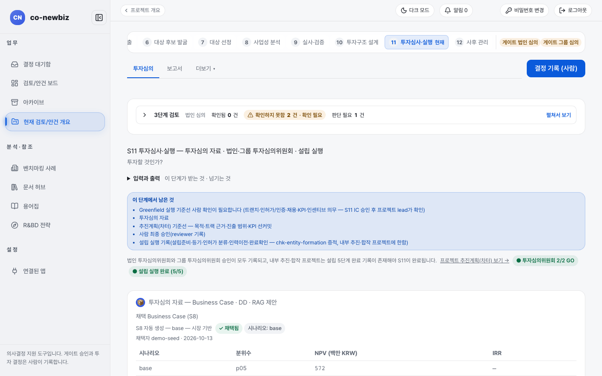

# 투자심의를 마치고 설립 실행하기 (S11)

**목적** — 투자심의 자료를 확인하고 `법인 투자심의위원회`와 `그룹 투자심의위원회` 결정을 기록한 뒤, 새 법인을 세우는 설립 실행 5단계와 실행 기준선을 마칩니다.  **누가/언제** — 위원회 결정은 사람이 기록하고, 설립 실행은 분석가와 지정된 담당자가, 실행 기준선 확정은 프로젝트 리드가 합니다. S10 완료 뒤입니다.  **사전 조건** — S10의 설립 구조와 트랜치가 기록되어 있어야 합니다.

> [!NOTE]
> **Green Field에서만** — `설립 실행 5단계`와 `신규 사업 실행 기준선`은 새로 세우는 안건에 나옵니다. 브라운필드는 인수 종결과 통합 계획(PMI 킥오프)을 기록합니다. 브라운필드 쪽은 [55-브라운필드-S11-클로징](55-브라운필드-S11-클로징.md)을 보세요. 공통 설명은 [33-공통-S11-투자심사-실행](33-공통-S11-투자심의와-실행.md)입니다.

> [!NOTE]
> 이 쪽의 화면은 연습용 데모 데이터입니다. 이름, 날짜, 단계 상태가 사용자의 데이터와 다릅니다.

*S11 `투자심의` 탭 위쪽. `이 단계에서 남은 것` 목록, `투자심의위원회 2/2 GO`, `설립 실행 완료 (5/5)`, 아래로 `투자심의 자료`. 데모 프로젝트.*

## 이 화면의 순서

위에서 아래로 네 덩어리입니다. ① `투자심의 자료`, ② `설립 실행 — 5단계`, ③ `신규 사업 실행 기준선`, ④ 위원회 결정 영역입니다. 위원회 승인이 먼저, 실행 기준선 확정은 승인 뒤에 프로젝트 리드가 합니다(화면의 `이 단계에서 남은 것`에도 "S11 승인 후 프로젝트 lead가 확인"이라고 적혀 있습니다).

## 단계: 투자심의 자료와 위원회 결정

1. 프로젝트 번호 띠에서 `11 투자심사·실행`을 엽니다. 제목은 `S11 투자심사·실행 — 투자심의 자료 · 법인·그룹 투자심의위원회 · 설립 실행`입니다.
2. `이 단계에서 남은 것` 목록을 읽습니다. 투자심의 자료, 추진계획(차터) 기준선, 사람 최종 승인, 설립 실행 기록, 그리고 신규 사업이면 실행 기준선 확인이 보입니다. `프로젝트 추진계획(차터) 보기 →` 링크로 차터를 열 수 있습니다.
3. `투자심의 자료`(제목에 `Business Case · DD · RAG 제안`이라고 적혀 있습니다)를 읽습니다. S8에서 `채택됨`으로 둔 사업 케이스와 `시나리오`, 분위수, `NPV (백만 KRW)`, `IRR`가 나옵니다. 아래쪽에 실사 결과와 종합 등급 제안이 이어집니다. 등급은 제안일 뿐이고 최종 결정은 사람이 합니다.
4. 맨 위 `3단계 검토`를 펼쳐 `확인됨`, `확인하지 못함`, `판단 필요` 세 구역을 읽습니다. "통과" 표시는 없습니다.
5. 맨 아래 위원회 결정 영역에서 먼저 `법인 투자심의위원회`를 기록합니다. `결정`(GO, HOLD, KILL)을 고르고 `근거 *`를 쓴 뒤 `결정`을 누릅니다.
6. `법인 투자심의위원회`가 GO가 되면 같은 영역에서 `그룹 투자심의위원회`를 기록합니다. 법인 GO가 없으면 "법인 투자심의위원회 GO가 기록된 뒤에 그룹 투자심의위원회 결정을 기록할 수 있습니다."라는 안내가 나옵니다.
7. 칩이 `투자심의위원회 2/2 GO`가 되면 두 위원회 승인이 끝난 것입니다. 결정 이력은 지울 수 없게 쌓입니다.

## 단계: 설립 실행 5단계

`설립 실행 — 5단계` 표는 새로 세우는 안건(원본이 `내부 추진` 또는 `합작`인 프로젝트)에만 나옵니다. 다른 경우에는 "이 프로젝트의 추진 방식(미분류)에는 설립 실행 5단계가 적용되지 않습니다"라는 안내만 나옵니다. 5/5가 되어야 S11이 끝납니다.

| 단계 | 하는 일 |
|---|---|
| 1 | 설립준비(관할·주식구조·이사회 결의) |
| 2 | 법인등기·정관·사업자등록 |
| 3 | 인허가 이전/재발급 분류 |
| 4 | 인력이전(신 근로계약+PIIA) |
| 5 | 완료확인(IP양도체인·거버넌스 베이스라인) |

표 열은 `단계`, `상태`, `담당자`, `최근 기록`, `갱신`, `작업`입니다. 상태는 `대기`, `진행 중`, `완료`, `중단`, `에스컬레이션` 중 하나이고 기호와 글자로 함께 보입니다.

### 상태 바꾸기

1. 단계 줄의 `상태 변경`을 누릅니다(펼친 뒤에는 `닫기`).
2. `상태`에서 `진행 중`, `완료`, `중단`, `에스컬레이션` 중 하나를 고릅니다.
3. `증적 URL (완료 선택 시 URL 또는 비고 필수)`과 `비고`를 적습니다. `완료`를 고르면 증적 URL 또는 비고가 꼭 있어야 합니다.
4. `상태 저장`을 누르고 확인 창 `설립 실행 N단계 상태 변경`에서 `기록`을 누릅니다. 기록한 사람이 `최근 기록`에 남습니다. 담당자는 바뀌지 않습니다.

### 담당자 지정하기

1. 단계 줄 끝 `N단계 더보기 (담당자 지정)` 메뉴에서 `담당자 지정`을 누릅니다.
2. `담당자`에서 프로젝트 구성원을 고릅니다(`미지정`으로 되돌릴 수도 있습니다). 구성원이 아닌 사람은 고를 수 없습니다.
3. `담당자 저장`을 누르고 확인 창에서 `지정`을 누릅니다. 새 담당자에게 알림이 갑니다.

### 완료 취소(재개)하기

1. `완료`된 단계 줄에서 `완료 취소(재개)`를 누릅니다.
2. `재개 사유 (필수, 10자 이상)`를 씁니다.
3. `재개 (확인 필요)`를 누르고 확인 창에서 `재개`를 누릅니다. 단계가 `진행 중`으로 돌아가고 기존 증적은 이력에만 남습니다. 다시 `완료`로 하려면 증적과 함께 새로 기록해야 합니다.
4. 5단계(`완료확인`)가 이미 `완료`인데 앞 단계를 재개하면 "완료확인(5단계)도 함께 재개됩니다. 계속할까요?"가 나옵니다. `함께 재개`를 눌러야 재개됩니다.
5. 재개 횟수는 상태 칩 아래 `재개 N회`로, 모든 변경은 단계 이름 아래 `이력 보기 (N건)`에서 누가, 언제, 어떤 경로(`화면`, `API`, `MCP`)로 했는지 볼 수 있습니다.

### 알림

- 단계를 재개하면 프로젝트 리드와 그 단계의 담당자에게 알림이 갑니다(재개한 본인에게는 가지 않습니다). 5단계까지 함께 재개해도 받는 사람마다 알림은 한 건입니다.
- 담당자를 지정하면 새 담당자에게만 알림이 갑니다.
- 알림은 화면 위쪽 `알림` 종과 받은 편지함에서 보입니다. 받은 편지함의 알림을 누르면 해당 화면으로 이동합니다.

### 승인 뒤에 재개했을 때의 경고

`법인 투자심의위원회`, `그룹 투자심의위원회`, `DD` 중 마지막 GO보다 나중에 단계가 재개되면 표 위에 "투자심의위원회 승인 이후 설립 실행 N단계가 재개되었습니다 (K건). 승인 기록은 자동으로 바뀌지 않으므로, 재개 내용이 승인 전제에 영향을 주는지 확인하고 필요하면 새 결정을 기록하세요."라는 경고가 나옵니다. 승인 기록은 바뀌지 않습니다. 재개한 내용이 승인 전제를 흔드는지는 사람이 판단하고, 필요하면 위원회 결정을 새로 기록하세요.

### 사람만 할 수 있는 일

- `완료` 처리, `완료 취소(재개)`, `담당자 지정`은 로그인한 사람이 화면에서만 할 수 있습니다. 개인 토큰으로 호출하는 API나 에이전트는 이 세 가지를 할 수 없고 `진행 중`, `중단`, `에스컬레이션`만 기록할 수 있습니다.
- 모든 변경은 확인 창을 거치고 기록자와 경로가 남습니다.
- 읽기 전용 사용자는 `작업` 열이 보이지 않습니다.

## 단계: 신규 사업 실행 기준선

`신규 사업 실행 기준선 — 트랜치 · 인허가/인증 · 인력/조직 계획 · 가동 KPI · 인센티브 의무` 영역은 새로 세우는 안건에만 나오고, 브라운필드에서는 아예 그려지지 않습니다. S10에서 정한 투자 조건과 S8에서 채택한 케이스를 기준으로 실행 계획을 한곳에 고정합니다.

1. 위쪽 칩을 읽습니다. 필수 여부(`▲ 확인 전까지 S11 차단` 또는 `○ 권장 — 차단하지 않음`)와 확정 여부(`● 기준선 확인됨` 등)가 따로 보입니다.
2. `확인 필요 항목 (N건)`이 있으면 읽습니다(예: 트랜치 합계가 S8 채택 케이스 capex와 다름, 집행 조건 비어 있음).
3. `capex 트랜치 대조` 표에서 S10 트랜치와 S8 채택 케이스 capex를 견줍니다. 집행은 여기서 하지 않고 `S10 capex 집행 단계 탭에서 집행 →` 링크로 갑니다.
4. 다섯 구역에 항목을 기록합니다. 구역마다 `… 추가` 버튼으로 줄을 만들고 `수정`, `삭제`로 고칩니다.
   - `인허가 마일스톤`(`인허가 마일스톤 추가`), `인증 마일스톤`(`인증 마일스톤 추가`): 인허가와 인증은 다릅니다. 인허가는 운영하게 해 주고 인증은 판매하게 해 줍니다.
   - `인력/조직 계획 — 채용 계획`(`채용 계획 추가`): `직군`, `분기 (YYYY-Qn)`, `인원 (명)`.
   - `가동(ramp-up) KPI 목표`(`KPI 목표 추가`): `지표 키`, `목표값`, `단위 (선택)`, `기한`.
   - `인센티브 의무 등록부`(`인센티브 의무 추가`): `의무 내용`, `기한 (선택)`, `선행 조건 (선택)`, `출처 인센티브 (선택)`.
   - 반드시 채워야 하는 것은 `가동(ramp-up) KPI 목표`, `채용 계획`, 그리고 인허가 또는 인증 마일스톤 둘 중 하나 이상입니다. 사내벤처에는 인허가·인증이 기본 적용되지 않습니다.
5. 프로젝트 리드가 `프로젝트 리드의 확정 — 실행 기준선`에서 `확정 근거 (필수, 500자 이하)`를 쓰고 `실행 기준선 확인 (확인 필요)`을 누릅니다(이미 확정했다가 바뀌었으면 `실행 기준선 재확정 (확인 필요)`).
6. `확인 필요 항목`이 열려 있으면 `실행 기준선 확인` 창이 뜨고 항목마다 확인 근거(1~500자)를 적어야 `확인 기록` 버튼이 켜집니다.

> [!NOTE]
> 새 항목을 기록하거나 트랜치가 바뀌면 이전 확정은 효력을 잃고 다시 확정해야 합니다. 확정은 프로젝트 리드만 할 수 있고, 리드가 아니면 확정 양식이 보이지 않고 "확정은 프로젝트 리드만 할 수 있습니다."라는 안내만 보입니다. 에이전트는 초안만 제안합니다.

## 결과 확인

- `투자심의위원회 2/2 GO`, `설립 실행 완료 (5/5)`(해당 시), `● 기준선 확인됨` 세 가지가 모두 보이면 S11이 끝납니다.
- 이 상태에서 [45-그린필드-S12-사후-관리](45-그린필드-S12-사후-관리.md)가 열립니다.

## 자주 하는 실수

- `완료`를 고르고 증적 URL과 비고를 모두 비워 두는 것. 둘 중 하나는 있어야 합니다.
- 승인 뒤에 단계를 재개하고도 위원회 쪽 판단을 하지 않는 것. 경고는 승인 기록을 자동으로 바꾸지 않습니다.
- 담당자를 지정하지 않고 진행해 알림이 가지 않는 것.
- 설립 5단계 표가 안 보여서 오류로 생각하는 것. 원본이 `내부 추진` 또는 `합작`이 아니면 표 대신 안내만 나옵니다. 원본은 S5의 `프로젝트로 추진`에서 정합니다.
- 실행 기준선을 기록한 뒤 트랜치를 바꾸고 재확정하지 않는 것.

## 다음 단계

[45-그린필드-S12-사후-관리](45-그린필드-S12-사후-관리.md)

## 스스로 확인하기

연습용 데모 프로젝트(읽기 전용)에서 S11을 열어 `투자심의위원회 2/2 GO` 칩과 `설립 실행 완료 (5/5)` 칩을 찾고, 설립 실행 5단계 표의 각 단계 `담당자`가 누구인지 확인하세요.

## 알려진 불일치

- 위쪽 `투자심의 자료` 제목에 영어(`Business Case`, `RAG`)가 남아 있습니다. 이 쪽에서는 종합 등급으로 풀어 적었습니다.
- 화면 제목 `설립 실행 — 5단계 (내부 추진·합작 프로젝트)`는 그린필드 전용 표현이 아닙니다. 원본이 비어 있는 그린필드 프로젝트에서는 표가 나오지 않아 혼란스러울 수 있습니다.
- 캡처 `s11-gf-01-establishment.png`는 화면 위쪽만 담고 있어 설립 실행 5단계 표와 실행 기준선 영역이 보이지 않습니다.
