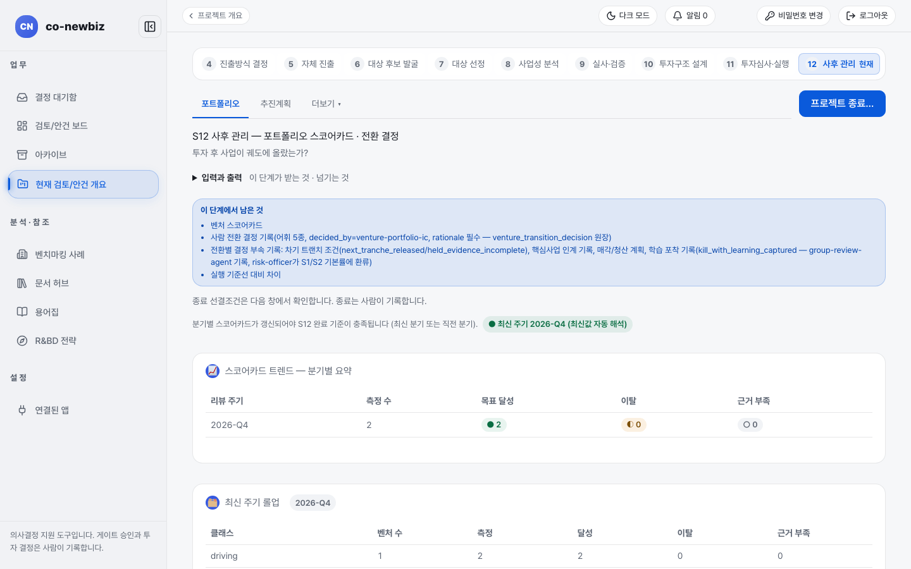

# 투자 뒤 분기 점검하고 전환 결정하기 (S12)

**목적:** 새로 세운 사업이 계획대로 자리잡는지 분기마다 점검하고 계속할지 줄일지 멈출지 사람이 결정을 기록한다.

**누가/언제:** 분석가가 점검 값을 기록하고 사람이 전환 결정을 기록한다. S11이 끝난 뒤 분기마다 한다.

**사전 조건:** ① 직전 단계·게이트: S11 완료(`투자심의위원회 2/2 GO`, 실행 기준선 확인). ② 필요 권한: 점검 값 기록은 분석가, 전환 결정 기록은 사람이다. ③ 준비물: S11 실행 기준선과 S8 채택 케이스·사업 목표.

> [!NOTE]
> **Green Field에서만:** 그린필드는 `신규 사업 가동 지표 — S8 사업 목표 대비` 영역이 나오고 점검 기준이 S11 실행 기준선과 S8 채택 케이스, S8 사업 목표다. 브라운필드는 인수 뒤 통합 점검(시너지 실현, 핵심 인력)을 본다. 브라운필드 쪽은 [56-브라운필드-S12-통합-PMI](56-브라운필드-S12-통합-PMI.md)를 보고 공통 설명은 [34-공통-S12-사후-관리](34-공통-S12-사후-관리.md)를 본다.

> [!NOTE]
> 이 쪽의 화면은 연습용 데모 데이터다. 분기, 점수, 이름이 사용자의 데이터와 다르다.

## 왜 이 단계인가

S12는 투자 뒤 사업이 궤도에 올랐는지 분기마다 확인하는 정기 검진이다. S11에서 확정한 실행 기준선과 S8 채택 케이스, S8 사업 목표가 점검의 기준이 되고 스코어카드가 실적을 모은다. 검진 수치가 나쁘다고 진단이 자동으로 내려지지는 않는다. 가동 지표는 참고 증적일 뿐 판정이 아니며 계속할지 줄일지 멈출지의 전환 결정은 사람이 기록한다. S12에는 게이트가 없어 아무것도 단계를 막지 않지만 분기별 스코어카드가 갱신되어야 완료 기준이 충족된다.

*S12 `포트폴리오` 탭 전체다. `이 단계에서 남은 것`, `스코어카드 트렌드 — 분기별 요약`, `신규 사업 가동 지표 — S8 사업 목표 대비 (참고 증적)`, `실행 기준선 대비 차이` 표, `포트폴리오 전환 결정` 영역까지 화면 전체가 담긴다. 데모 프로젝트.*

## 단계

1. 프로젝트 번호 띠에서 `12 사후 관리`를 연다. 큰 제목은 `S12 사후 관리`, 부제는 `포트폴리오 스코어카드 · 전환 결정`이다. 위 탭은 `포트폴리오`와 `더보기`이고 탭 줄 오른쪽 끝에 공통 링크 `추진계획(차터)`, `마일스톤`이 항상 붙어 있다.
2. `이 단계에서 남은 것` 목록을 읽는다. 스코어카드, 사람 전환 결정 기록, 전환별 부속 기록, 실행 기준선 대비 차이가 보인다. S12에는 게이트가 없어 아무것도 단계를 막지 않는다. 분기별 스코어카드가 갱신되어야 S12 완료 기준이 충족된다(최신 분기 또는 직전 분기).
3. `스코어카드 트렌드 — 분기별 요약`에서 `리뷰 주기`별 `측정 수`, `목표 달성`, `이탈`, `근거 부족`을 읽는다. 바로 아래 `최신 주기 롤업`은 가장 최근 분기의 클래스별 합계다.
4. `적용되는 사후 관리 항목` 표에서 이 프로젝트에 어떤 점검이 적용되는지 읽는다(그린필드는 신규 사업 점검과 `신규 사업 실행 기준선 (S11)`). 이 영역은 읽기 전용이다.
5. `신규 사업 가동 지표 — S8 사업 목표 대비 (참고 증적)`에서 `기본 벤처 클래스`와 `현재 적용` 클래스를 확인한다. 기본값은 신규 부지 설립 `성장 주도형`, `기존 사업 R&BD 확장` `역량 지원형`, `사내벤처(CVC)` `신생 탐색형`이다. 아래 `S8 사업 목표` 표(`지표`, `이름`, `목표`, `판정`)와 `최신 주기 가동 측정` 표(`측정`, `클래스`, `목표`, `실적`, `상태`)를 읽는다. 목표 대비 값은 참고 증적이고 합격·불합격 판정이 아니다. 그 아래 `실행 기준선 대비 차이` 표는 S11에서 확정한 기준선과 이번 분기 스코어카드를 맞춰 보는 곳이다(`계획대로`·`뒤처짐`·`앞섬`·`근거 부족` 요약과 항목 줄이 나오고 참고용이며 게이트를 막지 않는다).
6. 이번 분기 값을 기록하려면 `S12 안착 지표 기록`을 펼친다. `리뷰 주기`(예: `2026-Q4`)를 쓰고 `벤처 클래스`를 확인한다. 기본값과 다르게 고르면 `기본값과 다르게 지정하는 사유 (필수)`를 써야 하고 변경 이력이 감사 기록에 남는다.
7. 지표 줄에서 지표 키, `사업 목표 키`, `실적`, `목표`, `상태`, `증적 참조`, `관측일`을 채운다. 기록한 주기는 바꿀 수 없고 같은 지표를 다음 분기에 다시 기록하려면 새 분석 실행이 필요하다.
8. 아래 `포트폴리오 전환 결정` 영역에서 `결정 (어휘 5종)`을 고른다. 신규 사업에서 이 결정의 뜻은 `전환 결정 용어 — 신규 사업에서의 뜻`을 펼쳐 읽는다.

   | 결정 | 신규 사업에서의 뜻 |
   |---|---|
   | `다음 트랜치 집행` | S10에서 기록한 다음 집행 단계(트랜치)의 집행 조건이 충족되어 집행을 진행한다(집행 자체는 두 사람이 하는 별도 절차) |
   | `보류 — 근거 미완결` | 집행 조건의 근거가 아직 완결되지 않아 집행 단계(트랜치)를 보류한다 |
   | `코어 사업 전환` | 손익분기와 안정 가동에 도달해 운영 사업부로 넘긴다 |
   | `축소·매각` | 신규 사업 규모를 줄이거나 매각·정리한다 |
   | `중단 — 학습 내용 회수` | 사업을 중단하고 학습 내용을 S1·S2 기준 비율에 반영한다 |

9. `리뷰 주기`(비우면 현재 분기)와 `근거 (필수)`를 쓴다. 결정에 따라 추가 칸이 나온다. 중단이면 `학습 내용 회수`가 필수이고 다른 결정에는 그 결정에 맞는 부속 기록 칸(차기 집행 단계(트랜치) 조건, 핵심사업 인계, 매각·청산 계획)이 나온다.
10. `결정 기록 (확인 필요)`을 누르고 확인한다. 결정 이력은 같은 영역 표에 쌓인다.

## 결과 확인

| 화면에 남는 변화 | 뜻 |
|---|---|
| 전환 결정 이력 표의 새 줄 | 결정 주체는 사람 역할 키로 고정되고 기록자는 로그인한 사용자로 남는다 |
| `스코어카드 트렌드`의 이번 분기 | 칩 `● 최신 주기 2026-Q4 (최신값 자동 해석)`처럼 최신 분기가 보이면 점검이 갱신된 것이다 |
| 프로젝트 종료 | 본문 위쪽의 `프로젝트 종료…`를 누른다(S12 머리 오른쪽 위에는 이동 버튼이 아예 없다). 선결조건은 다음 창에서 확인하고 종료는 사람이 기록한다 |

## 자주 하는 실수

| 오해 | 바른 읽기 |
|---|---|
| 실적이 목표에 못 미쳤다고 "불합격"으로 읽는 것 | 가동 지표는 참고 증적일 뿐 판정이 아니다 |
| 기록한 리뷰 주기를 고치려는 것 | 바꿀 수 없다. 다음 분기에 새로 기록한다 |
| 기본 벤처 클래스를 바꾸고 사유를 쓰지 않는 것 | 사유 없이는 기록되지 않는다 |
| 분기를 거르는 것 | 최신 분기나 직전 분기의 스코어카드가 없으면 S12 완료 기준이 충족되지 않는다 |
| `다음 트랜치 집행` 결정을 기록하면 집행 단계(트랜치)가 자동 집행된다고 생각하는 것 | 집행은 S10의 `설비투자 집행 단계` 탭에서 두 사람이 따로 한다 |

## 알려진 불일치

- 화면 일부에 영어와 내부 용어가 남아 있다. `이 단계에서 남은 것` 목록의 `venture_transition_decision`, `decided_by`, 영역 이름 `벤처 스코어카드`, `S12 안착 지표`.
- 프로세스 사양의 "실행 기준선 대비 차이"는 `실행 기준선 대비 차이` 표로 화면에 나온다(기준선이 확정되지 않았거나 해당 분기 스코어카드가 없으면 그 사유 안내로 대신 보인다).

## 스스로 확인하기

연습용 데모 프로젝트(읽기 전용)에서 S12 `포트폴리오` 탭을 열어 `스코어카드 트렌드`의 `2026-Q4` 줄에서 `측정 수`와 `목표 달성` 값을 찾아 본다. 어떤 버튼도 누르지 않는다.

## 핵심 요약

- S12는 게이트 없이 분기마다 스코어카드를 갱신하고 최신 분기 또는 직전 분기가 있어야 완료 기준이 충족된다.
- 가동 지표와 `실행 기준선 대비 차이`는 참고 증적이며 판정이 아니다.
- 전환 결정은 어휘 5종 중 사람이 고르고 근거가 필수다. 중단이면 `학습 내용 회수`가 필수다.
- `다음 트랜치 집행`을 기록해도 집행은 S10 탭에서 두 사람이 따로 한다.
- 사람 역할별 권한 묶음은 [02-역할과-권한](02-역할과-권한.md)을 본다.

이전: [44-그린필드-S11-설립-실행](44-그린필드-S11-설립-실행.md) | 다음: [30-공통-S8-사업성-분석](30-공통-S8-사업성-분석.md)
