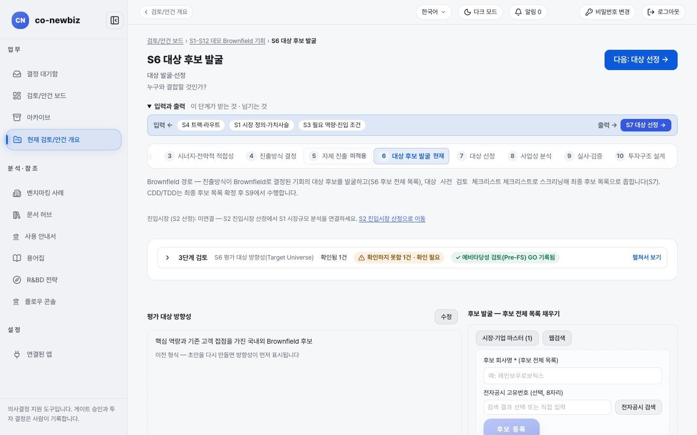

# 대상 후보 발굴하기

**목적:** "누구와 결합할 것인가?"에 답하기 위해 목표 시장을 정하고 결합할 만한 기존 기업·자산 후보 목록(화면 카드·표에는 `후보 전체 목록`, 입력·출력 칩에는 `Long List`)을 채운다.

**누가/언제:** 분석가가 채우고 프로젝트 리드가 확인한다. S4에서 `Brownfield`를 기록한 안건에서 시작하며, 사람이 `Pre-FS` 게이트에 `GO`를 기록해야 이 단계가 끝난다.

**사전 조건:** ① 직전 단계: S4 `결정` 기록(`트랙`과 `라우트`). 게이트 `Pre-FS`는 이 단계 안에서 기록한다. ② 필요 권한: 후보 등록은 분석가 권한이 필요하다. ③ 준비물: S1 시장분석과 S3 필요 역량(AI 정의 초안의 근거다).

> [!NOTE]
> **Brown Field에서만:** S6은 브라운필드 전용이다. 그린필드는 이 단계를 건너뛰고 S5로 간다([40-그린필드-S5-자체-진출](40-그린필드-S5-자체-진출.md)).

> [!NOTE]
> 이 쪽의 화면 캡처는 시험용 가상 자료(데모)로 찍었다. 화면에 보이는 회사 이름과 숫자는 여러분의 자료와 다르다.

## 왜 이 단계인가

S6은 질문에 답하기 시작하는 단계다. 그 질문은 "누구와 결합할 것인가?"다. S4에서 `Brownfield`를 기록한 안건은 이제 결합 상대를 찾는다. 순서가 중요하다. `평가 대상 방향성`이 후보 자격 기준(범위)과 최소 후보 수를 먼저 정해야, 그 범위 안에서 모은 후보 목록(`Long List`)이 비교 가능한 묶음이 된다. 동네 조건을 먼저 정하고 매물 목록을 모으는 집 구하기와 같다. AI의 정의 초안과 웹검색 후보는 제안일 뿐이고 후보 등록은 분석가 권한이 필요하다. S6과 S7은 화면이 나뉘어 있다. 후보 모으기와 `Pre-FS` 결정은 이 S6 화면에서 하고, 좁히기와 게이트(`Target Screening`)는 [51-브라운필드-S7-대상-선정](51-브라운필드-S7-대상-선정.md)의 S7 화면에서 한다. `Pre-FS` `GO`가 기록되기 전까지 S7은 잠겨 있다.

*데모 브라운필드 안건의 `6 대상 후보 발굴` 화면. 왼쪽에 `평가 대상 방향성`, 오른쪽에 `후보 발굴 — 후보 전체 목록 채우기` 카드가 있고, 단계 띠의 현재 표시는 `6 대상 후보 발굴` 한 곳에만 붙는다.*

## 단계

1. 안건 개요에서 단계 띠의 `6 대상 후보 발굴`을 누른다. 큰 제목은 `S6 대상 후보 발굴`, 그 아래 부제는 `대상 발굴·선정`이고, 질문은 "누구와 결합할 것인가?"다.
2. `입력과 출력`을 펼쳐 이 단계가 받는 것과 넘기는 것을 읽는다. 그 아래 `3단계 검토` 줄에서 `확인됨`, `확인하지 못함`, `판단 필요` 건수를 확인한다. 게이트 결정이 기록되어 있으면 접힌 줄이 건수 대신 `✓ 예비타당성 검토(Pre-FS) GO 기록됨` 같은 결정 상태 칩을 보여 준다.
3. `평가 대상 방향성` 카드에서 아직 정의가 없으면 `평가 대상 방향성 정하기`를, 이미 있으면 `수정`을 누른다. 창 제목은 `평가 대상 방향성 수정`이다.
4. 필요하면 창 안에서 `방향성 초안 생성`을 누르면 S1 시장분석과 S3 필요 역량을 근거로 AI가 초안(`제안 · AI`)을 만든다. 초안은 결론 한 줄, 범위(산업·지역·규모), 가치사슬 위치, 우선해서 볼 후보 유형과 제외할 방향(각각 최대 3개)을 제안한다. 서버가 인용과 숫자를 근거 목록과 대조하며 근거가 없는 칸은 비우고 `검증 필요`로 표시한다. 시장 근거 한 줄(규모·성장률·단계별 수익성)은 서버가 S1 값으로 만든다. AI 초안은 기술 역량·인증·실적 조건을 범위나 제외 기준으로 제안하지 않는다. 역량 적합성은 S7에서 후보별로 판정한다. 마음에 들면 `방향성 입력에 적용`을 누른다. 이 버튼은 입력칸만 채울 뿐 저장하지 않으며 최소 후보 수는 바뀌지 않는다.
5. 입력칸과 최소 후보 수를 직접 확인하고 `방향성 저장`을 누른다. 저장하기 전까지는 아무 값도 반영되지 않는다.
6. `후보 발굴 — 후보 전체 목록 채우기` 카드에서 후보를 모은다. `평가 대상 방향성`에 우선해서 볼 후보 유형이 있으면 웹 검색 질의와 AI 후보 제안이 그 유형을 먼저 찾고 제외할 방향은 제안하지 않는다. 방법은 세 가지다.

   | 방법 | 하는 일 |
   |---|---|
   | `시장·기업 마스터` 탭 | 기업 마스터에서 제안된 후보를 고른다. 탭 이름 옆 숫자는 제안 건수다 |
   | `웹검색` 탭 | `웹검색 후보 제안` 창이 열린다. 근거가 있는 회사만 제안되며 마음에 드는 항목의 `후보 전체 목록에 등록`을 누른다. 필요 없으면 `무시`, 다시 받으려면 `다시 생성`을 누른다 |
   | 직접 등록 | `후보 회사명 * (후보 전체 목록)`에 이름을 쓰고 상장사라면 `DART 고유번호 (선택, 8자리)`를 쓰거나 `DART 검색`으로 찾아 고른다. 비상장 회사는 이름만 써도 된다. 마지막에 `후보 등록`을 누른다 |

7. 아래 후보 전체 목록(`Long List`) 표에서 등록된 후보를 확인한다. 열은 `후보`, `DART 고유번호`, `재무·기술 평가`, `잠정 순위 · 상태`, `작업`이다. 오른쪽 위에 `후보 전체 목록 3 · 최종 후보 목록 1`처럼 건수가 나온다. 점수 칩에는 점수만 `재무 50 · 기술 50`처럼 보이고 판정이 끝나지 않은 항목이 있으면 `일부 항목 미평가` 한 줄이, 사람이 아직 보지 않은 AI 판정이 있으면 `AI 판정 n건 미검토` 한 줄이 붙는다. 판정한 항목 수는 칩에 마우스를 올리면 말풍선으로 읽는다. `잠정 순위` 칸에는 `잠정`만 표시된다.
8. 각 행의 `작업` 칸에는 **AI 평가**, **항목 검토**, **버전 비교** 버튼이 차례로 있고 마지막에 **심사 종료**가 있다.

   | 버튼 | 하는 일 |
   |---|---|
   | **AI 평가** | 그 후보 한 곳만 평가한다. 재무는 DART 수치에 규칙을 적용한 판정이고, 기술은 공시에서 근거 구간을 인용해 LLM이 제안한 판정이다. 결과는 확인 단계 없이 곧바로 항목 판정으로 반영된다. 그 후보가 대기 중이거나 도는 동안에만 눌리지 않는다. 위쪽 `AI 평가`는 후보 전체를 대기열에 넣으며 늘 눌린다 |
   | **항목 검토** | 후보 상세 화면의 `평가` 탭으로 간다. 항목마다 판정 출처 뱃지(`사람`, `자동 규칙`, `AI`)가 맨 앞에 보이고, 자동 규칙 판정은 한꺼번에(`자동 규칙 판정 n건 모두 확인`), AI 판정은 항목별로 하나씩 확인한다 |
   | **버전 비교** | AI 평가 버전 이력을 읽기 전용으로 펼친다 |
   | **심사 종료** | 그 후보의 심사를 끝내고 최종 후보 목록으로 올린다(예전 이름 `승격`). 사람만 누를 수 있고 미검토 AI 판정이 남아 있으면 경고가 나온다. 심사 종료 자체는 막히지 않지만 게이트 `GO`는 미검토 AI 판정이 남아 있는 동안 기록되지 않는다 |

   평가 기준과 임계값은 `평가 기준` 창으로 열어 읽는다.

   **AI 평가는 후보별 대기열로 돈다.** 후보마다 평가 한 건이 되고 모든 실행이 하나의 일꾼 묶음을 나눠 써서 한 번에 3건씩 처리한다.

   | 읽는 곳 | 보이는 것 |
   |---|---|
   | 시작 | 다른 평가가 돌고 있어도 시작은 거절되지 않는다. 남는 건은 `대기 중`으로 기다린다. 후보 한 곳의 `AI 평가`는 대기 중인 전체 평가 건보다 먼저 처리된다. 시작 창에 대기열에 넣을 곳 수와 건너뛸 곳 수가 나온다 |
   | 진행 패널 | 도는 실행마다 `{done}/{total} 완료 · {running}건 진행 중 · {queued}건 대기`가 보이고, 0이 아니면 `건너뜀`, `취소`, `실패` 건수가 이어진다 |
   | 후보 행 | `대기 중` → 단계 글(재무 초안 작성 중 따위) → 결과 순으로 바뀐다. 이미 대기 중이거나 다른 곳에서 도는 후보는 `이미 진행 중`으로 건너뛴다. 멈춘 실행이 그 후보를 잡고 있어도 같은 표시가 나오며, 그 실행을 이어서 실행하거나 중단하면 풀린다. 취소된 건은 `취소됨`이다. 대기 중인 행에는 `대기 취소`가 있다 |
   | 한도 | 한 안건에 대기 건은 200건까지다. 넘으면 나중에 다시 시도하라는 안내가 나온다. 후보마다 시작 대기 시간이 있어 연달아 누르면 잠시 기다리라고 나온다. 10분 동안 진척이 없는 실행은 `중단됨 — 이어서 실행`으로 바뀌고, 한 건이 10분 넘게 멈추면 실패로 끝난다 |
   | 중단 | 실행을 중단하면 대기 건이 취소된다. 이미 도는 건은 지금 단계만 마치고 멈추며, 반영된 판정은 그대로 남는다 |
9. 후보 이름을 누르면 후보 상세 화면(`회사 프로파일`)으로 간다. `개요`, `강·약점 SWOT`, `재무`, `공시`, `사전 검토 근거`, `평가`, `출처` 탭이 있고 `AI 분석 실행`으로 분석 초안을 받을 수 있다.
10. 이 단계를 닫는 `Pre-FS` 결정은 사람이 기록한다. 화면의 `S6 완료기준`은 네 줄이다: `평가 대상 방향성(Target Universe)`, `Long List 후보 필수 속성·출처`, `Long List 최소 커버리지`, `Pre-FS 게이트 GO 결정`. 앞의 세 줄은 데이터가 채워지면 `충족`이 되고, 마지막 줄은 화면 맨 아래 `의사결정 — 예비타당성 검토(Pre-FS)` 카드에서 사람이 `GO`를 기록하면 `충족`이 된다. 네 줄이 모두 `충족`이면 `4가지 완료기준을 모두 충족했습니다` 한 줄으로 접히고 `7 대상 선정`(S7)이 열린다. `Pre-FS` 결정은 `GO`·`HOLD`·`KILL` 가운데 하나를 고르고 근거를 적어 기록하며 사람만 기록할 수 있다. `GO` 뒤에 `HOLD`를 다시 기록하면 `GO`가 무효가 되어 이 단계가 미완료로 돌아가고 S7이 다시 잠긴다.

## 결과 확인

| 화면에 남는 변화 | 어디서 보이는지 |
|---|---|
| `평가 대상 방향성` 카드 | 맨 위에 결론 한 줄이 나오고, 범위(산업·지역·규모), 가치사슬 위치, 우선해서 볼 후보 유형, 제외할 방향, 시장 근거 한 줄이 이어진다. 근거와 인용은 접혀 있고 읽기 전용이다. AI 제안은 `방향성 초안 생성`으로 받아 모달 입력칸을 채울 뿐이며, 저장(`방향성 저장`)은 사람이 한다. 모달에는 결론, 범위, 가치사슬 위치, 우선·제외 후보 유형 입력칸과 최소 후보 수가 있다 |
| `후보 전체 목록` 표 | 후보가 줄로 추가되고 오른쪽 위 건수가 늘어난다 |
| S6 완료 기준 | 평가 대상 방향성이 있고, 필수 속성·출처를 갖춘 후보 수가 최소 후보 수(기본 3건) 이상이며, 사람이 `Pre-FS` 게이트에 `GO`를 기록한 것이다. `S6 완료기준` 네 줄이 모두 `충족`이면 끝난다 |
| `평가 필요` 표시 | 아직 재무·기술 평가가 끝나지 않았다는 뜻이다 |
| 판정 출처 뱃지 | 후보 상세 `평가` 탭의 각 항목 맨 앞에 `사람`, `자동 규칙`, `AI`가 보인다. AI 평가 결과는 `잠정` 칩 없이 바로 점수에 반영되며 사람이 확인하면 `사람`으로 바뀐다 |

## 자주 하는 실수

| 오해 | 바른 읽기 |
|---|---|
| 평가 대상 방향성 없이 후보부터 등록하는 것 | 먼저 후보 자격 기준(범위)과 최소 후보 수를 정해야 한다 |
| AI가 제안한 정의나 웹검색 후보를 그대로 받아들이는 것 | 둘 다 제안이며 웹검색 후보에는 출처 신뢰도(A·B·C)가 붙고 근거 없는 후보는 `미검증`으로 표시된다 |
| AI 평가 결과를 확정 단계를 거쳐야 반영된다고 여기는 것 | 확정 단계는 없다. 결과는 곧바로 항목 판정에 반영되고, 사람이 항목별로 검토해 `사람` 판정으로 바꾼다 |
| 다른 평가가 도는 중이라 새 평가를 시작할 수 없다고 여기는 것 | 시작은 거절되지 않는다. 남는 건은 `대기 중`으로 기다리다 차례로 돈다 |
| 후보 행의 `이미 진행 중`을 오류로 읽는 것 | 그 후보가 이미 대기 중이거나 도는 중이라 이번에는 건너뛴 것이다. 끝난 뒤 다시 시작하거나, 일시 정지된 실행이 잡고 있으면 그 실행을 이어서 실행·중단한다 |
| **심사 종료**를 AI가 대신 한다고 여기는 것 | 사람만 누른다. 미검토 AI 판정이 있으면 경고가 먼저 나온다 |
| 미검토 AI 판정이 있어도 게이트 `GO`를 기록할 수 있다고 여기는 것 | 사람이 아직 보지 않은 AI 판정이 있으면 게이트 `GO`(`Pre-FS`, `Target Screening`)가 `AI 초안 판정 n건이 사람 검토를 기다리는 중`으로 거절된다. **항목 검토**로 후보 상세 `평가` 탭에 들어가 AI 판정을 항목별로 검토해 저장하면 풀린다. 자동 규칙 판정과 사람 판정은 막지 않는다 |
| 데이터를 다 채웠는데도 S7 작업이 막혀 있다고 여기는 것 | `Pre-FS` 게이트 `GO`가 아직 기록되지 않은 것이다. 이 화면 맨 아래 `의사결정 — 예비타당성 검토(Pre-FS)` 카드에서 사람이 `GO`를 기록해야 S7이 열린다 |
| 이 화면에서 `Target Screening` 승인 기록을 찾는 것 | S6에는 승인 기록이 없다. S7 화면의 `의사결정 — 승인 기록` 탭에서 한다 |
| 읽기 전용 계정으로 들어와 후보 등록이 막혔다고 오해하는 것 | "후보 발굴·등록은 분석가 권한이 필요합니다."라는 안내가 보인다 |

## 알려진 불일치

- 입력·출력 칩과 `S6 완료기준` 줄 이름에 `Long List` 같은 영어 표기가 남아 있다.

## 스스로 확인하기

데모 브라운필드 안건의 `6 대상 후보 발굴`에서 `평가 대상 방향성` 문장을 읽고 `후보 전체 목록` 표의 후보 줄 수와 오른쪽 위 건수가 같은지 확인한다. 어떤 버튼도 누르지 않는다.

## 핵심 요약

- S6은 평가 대상 방향성(범위와 최소 후보 수)를 먼저 정하고 `후보 전체 목록`을 채우는 단계다.
- S6은 사람이 `Pre-FS` 게이트에 `GO`를 기록해야 끝난다. `GO`가 없으면 S7이 잠긴다.
- 후보 모으기는 `시장·기업 마스터`, `웹검색`, 직접 등록 세 가지 방법이 있고 등록은 분석가 권한이 필요하다.
- AI 정의 초안과 웹검색 후보는 제안이며 웹검색 후보에는 출처 신뢰도(A·B·C)가 붙는다.
- S6과 S7은 화면이 나뉘어 있다. 후보 행의 **AI 평가**, **항목 검토**, **버전 비교**, **심사 종료**로 후보별 심사를 한다.
- AI 평가는 후보별 대기열(한 번에 3건)로 돌며 시작은 거절되지 않고 남는 건은 `대기 중`으로 기다린다. 결과는 확인 단계 없이 항목 판정에 바로 반영되고 출처 뱃지로 구분된다. 사람은 항목별로 검토하며 **심사 종료**는 사람만 한다.
- 사람이 아직 검토하지 않은 AI 판정(`AI 판정 n건 미검토`)이 남아 있으면 게이트 `GO`는 기록되지 않는다. 항목을 검토해 저장하면 풀린다.

이전: [11-브라운필드-여정](11-브라운필드-여정.md) | 다음: [51-브라운필드-S7-대상-선정](51-브라운필드-S7-대상-선정.md)
