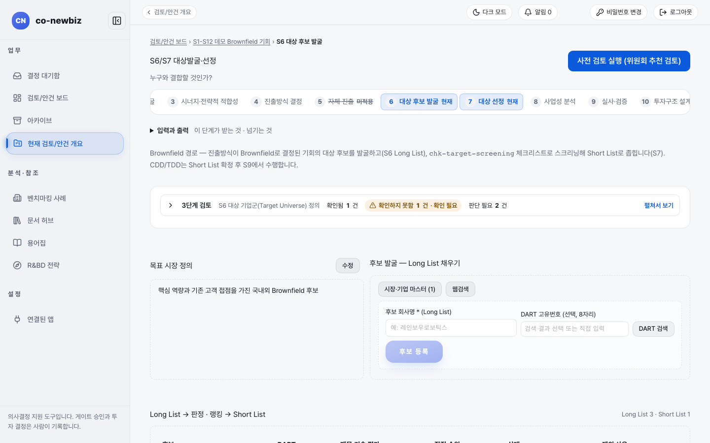

# 대상 후보 발굴하기

**목적:** "누구와 결합할 것인가?"에 답하기 위해 목표 시장을 정하고 결합할 만한 기존 기업·자산 후보 목록(화면 표기 `Long List`)을 채운다.

**누가/언제:** 분석가가 채우고 프로젝트 리드가 확인한다. 게이트 `Pre-FS` 뒤, S4에서 `Brownfield`를 기록한 안건에서 시작한다.

**사전 조건:** ① 직전 단계·게이트: S4 `결정` 기록(`트랙`과 `라우트`)과 게이트 `Pre-FS`. ② 필요 권한: 후보 등록은 분석가 권한이 필요하다. ③ 준비물: S1 시장분석과 S3 필요 역량(AI 정의 초안의 근거다).

> [!NOTE]
> **Brown Field에서만:** S6은 브라운필드 전용이다. 그린필드는 이 단계를 건너뛰고 S5로 간다([40-그린필드-S5-자체-진출](40-그린필드-S5-자체-진출.md)).

> [!NOTE]
> 이 쪽의 화면 캡처는 시험용 가상 자료(데모)로 찍었다. 화면에 보이는 회사 이름과 숫자는 여러분의 자료와 다르다.

## 왜 이 단계인가

S6은 "누구와 결합할 것인가?"라는 질문에 답하기 시작하는 단계다. S4에서 `Brownfield`를 기록한 안건은 이제 결합 상대를 찾는다. 순서가 중요하다. `목표 시장 정의`가 후보 자격 기준(범위)과 최소 후보 수를 먼저 정해야, 그 범위 안에서 모은 후보 목록(`Long List`)이 비교 가능한 묶음이 된다. 동네 조건을 먼저 정하고 매물 목록을 모으는 집 구하기와 같다. AI의 정의 초안과 웹검색 후보는 제안일 뿐이고 후보 등록은 분석가 권한이 필요하다. S6과 S7은 같은 화면에서 이어진다. 이 쪽은 위쪽(후보 모으기)을 다루고 아래쪽(좁히기와 게이트)은 [51-브라운필드-S7-대상-선정](51-브라운필드-S7-대상-선정.md)에서 본다. 단계 띠의 `6 대상 후보 발굴`과 `7 대상 선정`은 같은 작업 화면의 위·아래다.

*데모 브라운필드 안건의 `6 대상 후보 발굴`. 왼쪽에 `목표 시장 정의`, 오른쪽에 `후보 발굴 — Long List 채우기` 카드가 있다.*

## 단계

1. 안건 개요에서 단계 띠의 `6 대상 후보 발굴`을 누른다. 제목은 `S6/S7 대상발굴·선정`, 질문은 "누구와 결합할 것인가?"다.
2. `입력과 출력`을 펼쳐 이 단계가 받는 것과 넘기는 것을 읽는다. 그 아래 `3단계 검토` 줄에서 `확인됨`, `확인하지 못함`, `판단 필요` 건수를 확인한다.
3. `목표 시장 정의` 카드에서 아직 정의가 없으면 `목표 시장 정의 시작`을, 이미 있으면 `수정`을 누른다. 창 제목은 `목표 시장 정의 수정`이다.
4. 필요하면 창 안에서 `정의 초안 생성`을 누르면 S1 시장분석과 S3 필요 역량을 근거로 AI가 초안(`제안 · AI`)을 만든다. 초안은 산업·지역·규모 범위에 더해 수익성·지속가능성 조건(`재무 기준`)을 제안하고, 근거가 없으면 `검증 필요` + 필요한 데이터를 명시하며 그 행에 `검증 필요` 칩이 붙는다. 초안 근거 줄에는 쓰인 S1 버전과 데이터 신뢰도 등급(A·B·C·U)이 함께 표시된다. AI 초안은 기술 역량·인증·실적 조건을 선정 기준으로 제안하지 않는다. 역량 적합성은 S7에서 후보별로 판정한다. 마음에 들면 `정의 입력에 적용`을 누른다. 이 버튼은 `정의` 입력칸과 `재무 기준` 입력칸만 채우며 후보 자격 기준과 최소 후보 수는 바뀌지 않는다.
5. 정의와 후보 자격 기준, 최소 후보 수를 직접 확인하고 `목표 시장 저장`을 누른다. 저장하기 전까지는 아무 값도 반영되지 않는다.
6. `후보 발굴 — Long List 채우기` 카드에서 후보를 모은다. 방법은 세 가지다.

   | 방법 | 하는 일 |
   |---|---|
   | `시장·기업 마스터` 탭 | 기업 마스터에서 제안된 후보를 고른다. 탭 이름 옆 숫자는 제안 건수다 |
   | `웹검색` 탭 | `웹검색 후보 제안` 창이 열린다. 근거가 있는 회사만 제안되며 마음에 드는 항목의 `Long List에 등록`을 누른다. 필요 없으면 `무시`, 다시 받으려면 `다시 생성`을 누른다 |
   | 직접 등록 | `후보 회사명 * (Long List)`에 이름을 쓰고 상장사라면 `DART 고유번호 (선택, 8자리)`를 쓰거나 `DART 검색`으로 찾아 고른다. 비상장 회사는 이름만 써도 된다. 마지막에 `후보 등록`을 누른다 |

7. 아래 `Long List → 판정 · 랭킹 → Short List` 표에서 등록된 후보를 확인한다. 열은 `후보`, `DART`, `재무·기술 평가`, `잠정 순위`, `상태`, `제외 사유`다. 오른쪽 위에 `Long List 3 · Short List 1`처럼 건수가 나온다.
8. 후보 이름을 누르면 후보 상세 화면(`회사 프로파일`)으로 간다. `개요`, `강·약점 SWOT`, `재무`, `공시`, `사전 검토 근거`, `평가`, `출처` 탭이 있고, `AI 분석 실행`으로 분석 초안을 받을 수 있다.

## 결과 확인

| 화면에 남는 변화 | 어디서 보이는지 |
|---|---|
| `목표 시장 정의` 카드 | 정의 문장이 나타난다. 모달 안에는 S7 후보 평가와 비교하는 `재무 기준` 입력(선택)도 있다 |
| `Long List` 표 | 후보가 줄로 추가되고 오른쪽 위 건수가 늘어난다 |
| S6 완료 기준 | 목표 시장 정의가 있고 후보 수가 최소 후보 수(기본 3건) 이상인 것이다 |
| `평가 필요` 표시 | 아직 재무·기술 평가가 끝나지 않았다는 뜻이다 |

## 자주 하는 실수

| 오해 | 바른 읽기 |
|---|---|
| 목표 시장 정의 없이 후보부터 등록하는 것 | 먼저 후보 자격 기준(범위)과 최소 후보 수를 정해야 한다 |
| AI가 제안한 정의나 웹검색 후보를 그대로 받아들이는 것 | 둘 다 제안이며 웹검색 후보에는 출처 신뢰도(A·B·C)가 붙고 근거 없는 후보는 `미검증`으로 표시된다 |
| S6에서 후보를 `Short List`로 올리려는 것 | 승격은 S7 작업이다 |
| 읽기 전용 계정으로 들어와 후보 등록이 막혔다고 오해하는 것 | "후보 발굴·등록은 분석가 권한이 필요합니다."라는 안내가 보인다 |

## 알려진 불일치

- 화면에 `Long List`, `Short List`, `DART`, `chk-target-screening` 같은 영어·코드 표기가 남아 있다.
- 단계 이름은 S6과 S7로 나뉘어 있지만 화면은 하나다.

## 스스로 확인하기

데모 브라운필드 안건의 `6 대상 후보 발굴`에서 `목표 시장 정의` 문장을 읽고, `Long List` 표의 후보 줄 수와 오른쪽 위 건수가 같은지 확인한다. 어떤 버튼도 누르지 않는다.

## 핵심 요약

- S6은 목표 시장 정의(범위와 최소 후보 수)를 먼저 정하고 `Long List`를 채우는 단계다.
- 후보 모으기는 `시장·기업 마스터`, `웹검색`, 직접 등록 세 가지 방법이 있고 등록은 분석가 권한이 필요하다.
- AI 정의 초안과 웹검색 후보는 제안이며 웹검색 후보에는 출처 신뢰도(A·B·C)가 붙는다.
- S6과 S7은 같은 화면의 위·아래다. 승격은 S7 작업이다.

이전: [11-브라운필드-여정](11-브라운필드-여정.md) | 다음: [51-브라운필드-S7-대상-선정](51-브라운필드-S7-대상-선정.md)
