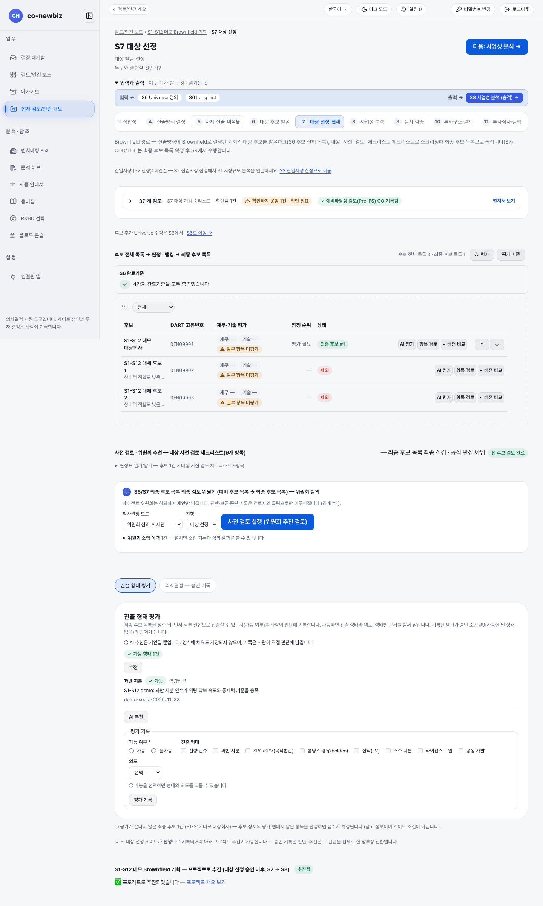
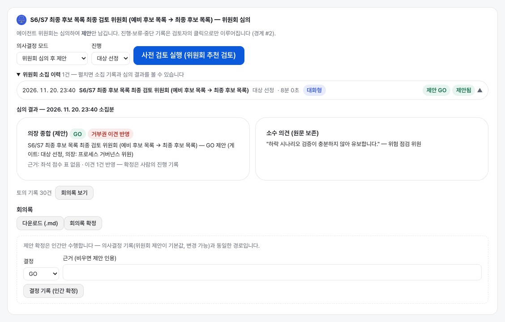
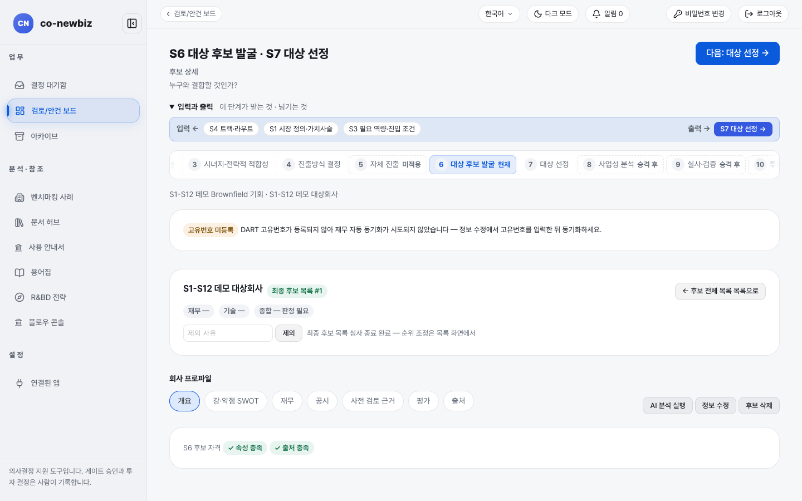

# 후보 좁히고 대상 선정 준비하기

**목적:** 후보 목록(`Long List`)에서 쓸 만한 후보만 최종 후보 목록으로 올리고 거를 기준(knock-out)을 점검한 뒤, `Target Screening` 게이트를 사람이 기록해 안건을 프로젝트로 넘긴다.

**누가/언제:** 분석가가 평가와 점검을 하고 프로젝트 리드가 게이트를 기록한다. S6 완료 뒤, 게이트 `Target Screening` 앞에서 한다.

**사전 조건:** ① 직전 단계·게이트: S6 완료(평가 대상 방향성과 후보 목록). ② 필요 권한: 평가와 점검은 분석가 이상, 게이트 기록은 프로젝트 리드다. ③ 준비물: S6의 `Long List` 후보.

> [!NOTE]
> **Brown Field에서만:** S7은 브라운필드 전용이다. 그린필드는 S5에서 바로 S8로 간다([40-그린필드-S5-자체-진출](40-그린필드-S5-자체-진출.md)).

> [!NOTE]
> 이 쪽의 화면 캡처는 시험용 가상 자료(데모)로 찍었다. 화면에 보이는 회사 이름과 숫자는 여러분의 자료와 다르다.

> [!NOTE]
> 단계 이름은 `7 대상 선정`이지만 이 단계에서 "한 곳을 고르는" 기록은 하지 않는다. 여기서는 최종 후보 목록을 만들고 게이트를 기록한다. 대상을 하나 고르는 사람의 기록은 [52-브라운필드-S8-사업성-분석](52-브라운필드-S8-사업성-분석.md)의 `대상 비교·선정` 탭에서 한다.

## 왜 이 단계인가

S7은 "어떤 대상이 유망한가?"를 묻는 좁히기 단계다. S6에서 모은 `Long List`를 재무·기술 평가와 거를 기준(knock-out)으로 점검해 최종 후보 목록으로 좁히고 `Target Screening` 게이트를 사람이 기록하면 안건이 프로젝트로 추진된다. 오디션에서 서류 심사로 1차 합격자를 뽑는 일과 같다. 최종 캐스팅(대상 한 곳 선정)은 이 단계가 아니라 S8의 `대상 비교·선정` 탭에서 이뤄진다. 사전 검토 판정표는 공식 판정이 아니지만 위원회가 심의의 근거로 삼고 완료되지 않은 산출물이 있으면 `HOLD`조차 기록할 수 없다.

*데모 브라운필드 안건의 `7 대상 선정`(S6과 같은 화면의 아래쪽). 후보 표, 사전 검토, 게이트 결정, 프로젝트 추진 순서로 내려간다.*

## 단계

1. 단계 띠에서 `7 대상 선정`을 누르고 화면을 아래로 내린다. `후보 전체 목록 → 판정 · 랭킹 → 최종 후보 목록` 표가 시작점이다.
2. 후보 행의 **AI 평가**로 평가를 돌리거나 **항목 검토**로 후보 상세를 열고 `평가` 탭에서 재무·기술 평가를 채운다. AI 평가 결과는 확인 단계 없이 항목 판정에 바로 반영되며 항목마다 출처 뱃지(`사람`, `자동 규칙`, `AI`)가 맨 앞에 붙는다. 자동 규칙 판정은 한꺼번에, AI 판정은 항목별로 사람이 확인한다([50-브라운필드-S6-대상-후보-발굴](50-브라운필드-S6-대상-후보-발굴.md)). 판정·가중치를 바꾸면 항목 아래 `저장 전 변경 N건` 칩이 붙고 카테고리 오른쪽 아래 저장 버튼을 눌러야 기록된다(`변경 취소`로 되돌릴 수 있다). 점수 칩에는 점수만 보이고 평가 점수는 충족 1점, 부분 충족 0.5점, 미충족 0점의 가중 평균이다(해당없음·예외와 미판정은 계산에서 제외). 판정한 항목 수는 칩 말풍선에서 읽는다.
3. 평가가 끝난 후보의 `작업` 칸에서 **심사 종료**(예전 이름 `승격`)를 누르면 최종 후보 목록으로 올라간다. 사람만 누를 수 있고 미검토 AI 판정이 남아 있으면 경고가 나온다. 올라간 후보는 `최종 후보 목록 #1`처럼 순위가 붙는다.
4. 최종 후보 목록 후보는 같은 칸의 위·아래 화살표(`순위 올리기`, `순위 내리기`)로 순위를 사람이 조정한다. `잠정 순위`는 점수 기준 참고값이고 최종 순위는 사람이 정한 값이다.
5. 적합하지 않은 후보는 후보 상세에서 `제외 사유`를 쓰고 `제외`를 누른다. `Long List` 표에서는 `제외` 상태와 `제외 사유`가 보인다. 사유 없이 제외하지 않는다.
6. 아래 `사전 검토 · 위원회 추천 — chk-target-screening (t-01~t-09)` 카드를 연다(`판정표 열기/닫기`). 최종 후보 목록 후보 × 9항목 판정표다. 위쪽 `Part 1 — 필수 (knock-out)`은 `t-01` 지분 인수 가능성과 `t-02` 규제 스크리닝이고 아래 `Part 2 — 권장 평가`가 나머지다.
7. 각 칸에서 `미판정`, `충족 (근거 명확)`, `충족 (추정)`, `부분 충족`, `미충족`, `근거 부족` 중 하나를 고르고 후보별 `판정 저장`을 누른다. 오른쪽 칩이 `사전 검토 완료` 또는 `사전 검토 미완료 n/m`으로 바뀐다.
8. 필요하면 화면 맨 위 `사전 검토 실행 (위원회 추천 검토)`을 누르면 AI가 비어 있는 칸에 판정 제안을 채우고 위원회가 심의해 결과를 제안으로 남긴다. 제안은 칸을 채울 뿐이며 확정은 7번의 `판정 저장`이다. `의사결정 모드`는 기본 `위원회 심의 후 제안`이다. 위원회 회의는 대화형으로 열리며(운영자가 켠 환경) 진행은 화면의 한 줄 상태와 **회의 보기**로 보고, 끝나면 **회의록 보기**와 `위원회 소집 이력`(펼치면 이 위원회의 회의만 나온다)에서 읽는다. 읽는 법은 [23-공통-S4-진출방식-결정](23-공통-S4-진출방식-결정.md)의 `위원회 회의 진행 보기`와 `위원회 회의록 읽기` 절에 있다.

*캡션: S7 화면의 위원회 패널. `위원회 소집 이력`을 펼치면 이 위원회(`S6/S7 최종 후보 목록 최종 검토 위원회`)의 회의만 나오고 행을 열면 `의장 종합 (제안)`, `소수 의견 (원문 보존)`, **회의록 보기**가 보인다.*

9. 최종 후보 목록 아래에는 두 탭이 있다. `진출 형태 평가`(기본)와 `의사결정 — 승인 기록`이다. `의사결정 — 승인 기록` 탭을 연다(승인 기록은 S6이 아니라 여기에만 있다). `Target Screening 현재 결정`에서 지금 기록된 결정(예: `GO`)을 읽는다. knock-out 스크리닝을 통과한 후보가 없으면(모두 제외됨) 중단 기준에 해당한다는 경고가 붉게 보인다. 평가가 덜 끝난 최종 후보가 있으면 별도 참고 노트로만 안내한다(게이트 조건이 아니다). 필요 역량의 실제 검증은 S9 `필요 역량 검증` 탭에서 이뤄진다.
10. 근거 초안이 필요하면 `AI 브리프 생성`을 누른다. 이 브리프는 제안이며 결정 선택은 바꾸지 않는다.
11. `결정`에서 `GO`, `HOLD`, `KILL` 중 하나를 고르고 `근거 *`를 쓴 뒤 `결정`을 누른다. `결정 이력`에서 이전 기록을 읽을 수 있고 기록은 추가만 가능하다. 완료되지 않은 산출물이 있으면 `HOLD`는 기록할 수 없다. `게이트 선행 요건이 미완료입니다.`로 거절되면 같은 줄에 끝나지 않은 단계가 나열된다. 후보 판정 가운데 사람이 아직 보지 않은 AI 초안이 있으면 `GO`는 기록되지 않고 목록에 `AI 초안 판정 n건이 사람 검토를 기다리는 중`이 나온다. 후보 상세 화면의 `평가` 탭에서 AI 판정 항목을 하나씩 검토해 저장하면 `사람` 판정으로 바뀌며 건수에서 빠진다. 모두 처리한 뒤 다시 `GO`를 기록한다. 자동 규칙 판정과 사람 판정은 `GO`를 막지 않는다.
12. 게이트가 `GO`로 기록되면 아래 `프로젝트로 추진` 카드가 열린다. 제목은 `<안건 이름> — 프로젝트로 추진 (Target Screening 승인 이후, S7 → S8)`이다. `본인의 프로젝트 접근 필요 근거 *`를 쓰고 필요하면 `이름·아이디 검색`으로 팀원을 추가한 뒤 `프로젝트명`을 쓰고 `프로젝트로 추진`을 누른다.

*데모 후보 `S1-S12 데모 대상회사`의 상세 화면. `최종 후보 목록 #1` 칩, `제외 사유`와 `제외`, 아래 `회사 프로파일` 탭이 보인다. 그 아래 `Long List 목록으로`로 돌아간다.*

### 진출 형태 평가 기록하기

`진출 형태 평가` 탭은 최종 후보 목록을 정한 뒤 먼저 외부 결합으로 진출할 수 있는지(`가능 여부`)를 사람이 판단해 기록하는 곳이다. 가능하면 진출 형태와 의도, 형태별 근거를 함께 남긴다. 기록된 평가는 중단 조건 #9(가능한 딜 형태 없음)의 근거가 된다.

1. 위쪽 줄에서 평가 상태와 중단 조건 #9 상태를 읽는다. 아직 기록이 없으면 평가 전으로 남고 `불가능`이면 `불가능: 가능한 진출 형태 없음 (중단 조건 #9 해당)`, `가능`이면 `가능 형태 n건`이 나온다. 형태별 표는 없고 `기록된 진출 형태 평가` 목록에 기록한 평가 하나가 나온다.
2. 양식에서 `가능 여부`를 먼저 고른다. `가능`과 `불가능` 가운데 하나이며 기본값이 없다. `불가능`을 고르면 `근거 (필수)`와 `근거 자료 참조 (선택)`만 적는다. 진출 형태와 의도는 보내지 않는다.
3. `가능`을 고르면 `진출 형태` 체크칸과 `의도` 선택칸이 켜진다. 가능한 형태를 하나 이상 체크하고 `의도`를 고른다. 체크한 형태마다 `<형태> 근거 (필수)`와 `<형태> 근거 자료 참조 (선택)`가 나오며 형태마다 근거를 적는다. **평가 기록**을 누르면 평가 전체가 한 번에 기록된다.
4. 기록한 평가를 고치려면 **수정** 버튼 하나를 누른다. 기록된 판단 전체(가능 여부, 형태, 의도, 근거)가 양식에 다시 불러와지며 형태 하나만 따로 고치지 않는다. 저장하면 현재 평가 전체가 새 평가로 바뀌고 이전 평가는 `평가 이력`에 `새 평가로 대체됨`으로 남는다.
5. 도움이 필요하면 **AI 추천**을 누른다. 카드에 `전체 판단`(가능·불가능·판단 보류)이 가장 먼저 나오고 가능일 때만 AI가 제안한 진출 형태가 함께 나온다. AI는 최종 후보 목록이 있어야 추천하며 없으면 먼저 후보를 올리라는 안내가 나온다.
6. 제안이 마음에 들면 **양식에 채우기**를 누른다. 양식만 채워지고 저장되지 않으므로 내용을 확인한 뒤 사람이 **평가 기록**을 눌러야 기록된다.
7. 평가 기록은 분석가 역할만 할 수 있고 다른 역할은 기록을 읽기만 한다.

## 결과 확인

| 화면에 남는 변화 | 어디서 보이는지 |
|---|---|
| 진출 형태 평가 | `진출 형태 평가` 탭의 `기록된 진출 형태 평가` 목록과 위쪽 평가 상태 줄(`불가능` 또는 `가능 형태 n건`)에 나타난다. `불가능`이면 중단 조건 #9에 해당한다 |
| 후보 표 | `최종 후보 목록 #n` 칩이 보인다 |
| `Target Screening 현재 결정` | 방금 기록한 결정이 나타나고 `결정 이력` 건수가 늘어난다 |
| `프로젝트로 추진` | 카드가 `추진됨`으로 바뀌고 `프로젝트 개요 보기` 링크가 생긴다. 이때부터 안건 대신 프로젝트가 S8~S12를 이어 가고 상단 단계 띠도 프로젝트 화면 기준으로 바뀐다 |

## 자주 하는 실수

| 오해 | 바른 읽기 |
|---|---|
| 사전 검토 판정표를 "공식 판정"이라고 읽는 것 | 화면에 `공식 판정 아님`이라고 적혀 있고 심사 종료와 추진을 막지도 않는다. 다만 위원회가 이 판정을 근거로 심의한다 |
| `t-01`(지분 인수 가능성), `t-02`(규제 스크리닝)가 `미충족`인 후보를 그대로 최종 후보 목록에 두는 것 | 이 둘은 거를 기준이며 면제 대상이 아니다 |
| **심사 종료**(예전 `승격`)를 눌러도 순위가 사라진다고 걱정하는 것 | `잠정 순위`는 제외를 뺀 전 후보에 대해 유지되고, `최종 후보 목록 #n`은 사람이 조정한 순위다 |
| **AI 추천**이나 **양식에 채우기**가 평가를 기록한다고 여기는 것 | 제안일 뿐이며 양식만 채운다. **평가 기록**은 사람이 누른다 |
| 진출 형태를 하나씩 따로 기록하거나 형태별로 `불가`를 남기려는 것 | 먼저 `가능 여부` 하나를 고른다. `불가능`이면 근거만 적고 형태는 고르지 않는다. 전체 평가가 `불가능`이면 중단 조건 #9에 해당한다 |
| 최종 후보 목록 없이 **AI 추천**을 누르는 것 | 후보가 있어야 추천한다. 먼저 **심사 종료**로 후보를 올린다 |
| 게이트를 기록하지 않고 `프로젝트로 추진`부터 찾는 것 | `GO`가 먼저 필요하다 |
| 미검토 AI 초안 판정이 남은 채 `GO`를 기록하려는 것 | `AI 초안 판정 n건이 사람 검토를 기다리는 중`으로 거절된다. 후보 상세 `평가` 탭에서 AI 판정 항목을 검토해 저장한 뒤 다시 기록한다 |
| 기회가 `선별` 상태가 아닌데 AI 추천이나 게이트 결정을 기록하려는 것 | 서버가 거절한다. S3에서 **이 기회 선택**을 먼저 누른다 |

## 알려진 불일치

- `Target Screening`, `GO·HOLD·KILL`, `PROPOSED` 같은 영어 표기가 화면에 있다.
- 한 화면에 S6과 S7이 함께 있어 두 단계 이름이 다른 화면을 약속하는 것처럼 읽힌다.

## 스스로 확인하기

데모 브라운필드 안건의 `7 대상 선정`에서 `최종 후보 목록 #1` 후보와 `Target Screening 현재 결정`, `결정 이력` 건수를 찾아 읽는다. 어떤 버튼도 누르지 않는다.

## 핵심 요약

- S7은 재무·기술 평가와 knock-out(`t-01`, `t-02`)으로 `Long List`를 최종 후보 목록으로 좁히는 단계다.
- 최종 순위는 사람이 조정하고 `잠정 순위`는 점수 기준 참고값이다.
- 최종 후보 목록 아래 `진출 형태 평가` 탭에서 `가능 여부`(가능·불가능)를 먼저 사람이 기록한다. `가능`이면 진출 형태와 의도, 형태별 근거를 더하고 `불가능`이면 근거만 적는다. 전체가 `불가능`이면 중단 조건 #9에 해당한다. AI 추천은 `전체 판단`을 먼저 보이는 제안이고 **양식에 채우기**는 양식만 채운다.
- `의사결정 — 승인 기록`은 S7의 탭이며 S6에는 없다.
- 사전 검토 판정표는 공식 판정이 아니지만 위원회 심의의 근거가 된다.
- 위원회 심의는 AI 위원의 대화형 회의다. 진행은 **회의 보기**로, 결과는 **회의록 보기**로 읽고 회의록 확정과 게이트 결정은 사람이 한다.
- `Target Screening` 게이트는 사람이 기록하고 `GO` 없이는 `프로젝트로 추진`이 열리지 않는다.
- 사람이 아직 검토하지 않은 AI 초안 판정이 남아 있으면 `GO`는 기록되지 않는다(`AI 초안 판정 n건이 사람 검토를 기다리는 중`). 항목을 검토해 저장하면 풀린다.
- 대상 한 곳을 고르는 기록은 다음 단계(S8)의 `대상 비교·선정` 탭에서 한다.

이전: [50-브라운필드-S6-대상-후보-발굴](50-브라운필드-S6-대상-후보-발굴.md) | 다음: [52-브라운필드-S8-사업성-분석](52-브라운필드-S8-사업성-분석.md)
