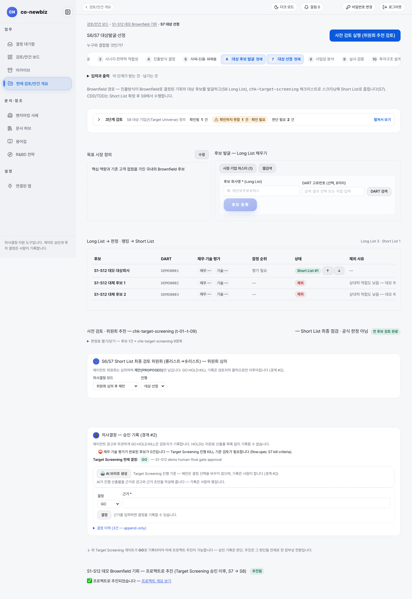
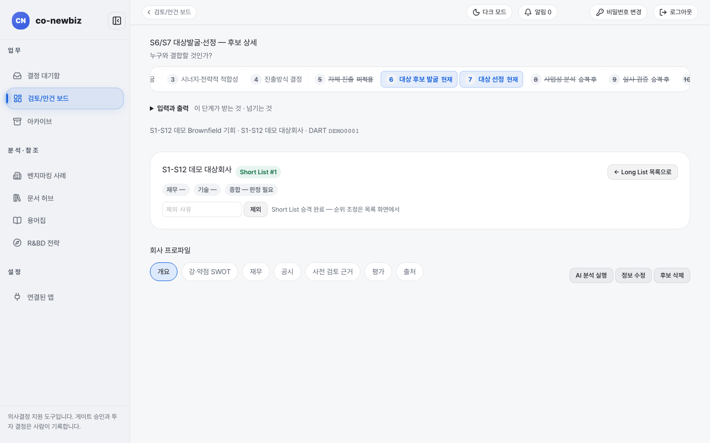

# 후보 좁히고 대상 선정 준비하기

**목적** — 후보 목록(`Long List`)에서 쓸 만한 후보만 `Short List`로 올리고, 거를 기준(knock-out)을 점검한 뒤, `Target Screening` 게이트를 사람이 기록해 안건을 프로젝트로 넘깁니다.  **누가/언제** — 분석가가 평가와 점검을 하고, 프로젝트 리드가 게이트를 기록합니다. S6 완료 뒤, 게이트 `Target Screening` 앞에서 합니다.  **사전 조건** — S6의 목표 시장 정의와 후보 목록, 분석가 이상 권한.

> [!NOTE]
> **Brown Field에서만** — S7은 브라운필드 전용입니다. 그린필드는 S5에서 바로 S8로 갑니다([40-그린필드-S5-자체-진출](40-그린필드-S5-자체-진출.md)).

> [!NOTE]
> 이 쪽의 화면 캡처는 시험용 가상 자료(데모)로 찍었습니다. 화면에 보이는 회사 이름과 숫자는 여러분의 자료와 다릅니다.

> [!NOTE]
> 단계 이름은 `7 대상 선정`이지만 이 단계에서 "한 곳을 고르는" 기록은 하지 않습니다. 여기서는 `Short List`를 만들고 게이트를 기록합니다. 대상을 하나 고르는 사람의 기록은 [52-브라운필드-S8-사업성-분석](52-브라운필드-S8-사업성-분석.md)의 `대상 비교·선정` 탭에서 합니다.

*캡션: 데모 브라운필드 안건의 `7 대상 선정`(S6과 같은 화면의 아래쪽). 후보 표, 사전 검토, 게이트 결정, 프로젝트 추진 순서로 내려갑니다.*

## 단계

1. 단계 띠에서 `7 대상 선정`을 누르고 화면을 아래로 내립니다. `Long List → 판정 · 랭킹 → Short List` 표가 시작점입니다.
2. 후보 이름을 눌러 후보 상세를 열고 `평가` 탭에서 재무·기술 평가를 채웁니다. 판정·가중치를 바꾸면 항목 아래 `저장 전 변경 N건` 칩이 붙고, 카테고리 오른쪽 아래 `재무적 평가 저장` / `기술적 평가 저장` 버튼을 눌러야 기록됩니다(`변경 취소`로 되돌릴 수 있습니다). 점수 칩은 `점수 / 100점 (판정 N/M 항목)`처럼 근거가 되는 판정 수를 함께 보여주고, 평가 점수는 충족 1점, 부분 충족 0.5점, 미충족 0점의 가중 평균입니다(해당없음·예외와 미판정은 계산에서 제외).
3. (쓰기) 평가가 끝난 후보의 `상태` 칸에서 `승격`을 누르면 `Short List`로 올라갑니다. 올라간 후보는 `Short List #1`처럼 순위가 붙습니다.
4. (쓰기) `Short List` 후보는 같은 칸의 위·아래 화살표(`순위 올리기`, `순위 내리기`)로 순위를 사람이 조정합니다. `잠정 순위`는 점수 기준 참고값이고, 최종 순위는 사람이 정한 값입니다.
5. (쓰기) 적합하지 않은 후보는 후보 상세에서 `제외 사유`를 쓰고 `제외`를 누릅니다. `Long List` 표에서는 `제외` 상태와 `제외 사유`가 보입니다. 사유 없이 제외하지 않습니다.
6. 아래 `사전 검토 · 위원회 추천 — chk-target-screening (t-01~t-09)` 카드를 엽니다(`판정표 열기/닫기`). `Short List` 후보 × 9항목 판정표입니다. 위쪽 `Part 1 — 필수 (knock-out)`은 `t-01` 지분 인수 가능성과 `t-02` 규제 스크리닝이고, 아래 `Part 2 — 권장 평가`가 나머지입니다.
7. (쓰기) 각 칸에서 `미판정`, `충족 (근거 명확)`, `충족 (추정)`, `부분 충족`, `미충족`, `근거 부족` 중 하나를 고르고 후보별 `판정 저장`을 누릅니다. 오른쪽 칩이 `사전 검토 완료` 또는 `사전 검토 미완료 n/m`으로 바뀝니다.
8. (선택) 화면 맨 위 `사전 검토 실행 (위원회 추천 검토)`을 누르면 AI가 비어 있는 칸에 판정 제안을 채우고 위원회가 심의해 결과를 제안으로 남깁니다. 제안은 칸을 채울 뿐이며 확정은 7번의 `판정 저장`입니다. `의사결정 모드`는 기본 `위원회 심의 후 제안`입니다.
9. `의사결정 — 승인 기록` 카드로 갑니다. `Target Screening 현재 결정`에서 지금 기록된 결정(예: `GO`)을 읽습니다. knock-out 스크리닝을 통과한 후보가 없으면(모두 제외됨) 중단 기준에 해당한다는 경고가 붉게 보입니다. 평가가 덜 끝난 최종 후보가 있으면 별도 참고 노트로만 안내합니다(게이트 조건이 아닙니다). 필요 역량의 실제 검증은 이 단계가 아니라 S9 `필요 역량 검증` 탭에서 합니다.
10. (쓰기) 근거 초안이 필요하면 `AI 브리프 생성`을 누릅니다. 이 브리프는 제안이며 결정 선택은 바꾸지 않습니다.
11. (쓰기) `결정`에서 `GO`, `HOLD`, `KILL` 중 하나를 고르고 `근거 *`를 쓴 뒤 `결정`을 누릅니다. `결정 이력`에서 이전 기록을 읽을 수 있고, 기록은 추가만 가능합니다. 완료되지 않은 산출물이 있으면 `HOLD`는 기록할 수 없습니다.
12. (쓰기) 게이트가 `GO`로 기록되면 아래 `프로젝트로 추진` 카드가 열립니다. 제목은 `<안건 이름> — 프로젝트로 추진 (Target Screening 승인 이후, S7 → S8)`입니다. `본인의 프로젝트 접근 필요 근거 *`를 쓰고, 필요하면 `이름·아이디 검색`으로 팀원을 추가한 뒤 `프로젝트명`을 쓰고 `프로젝트로 추진`을 누릅니다.

*캡션: 데모 후보 `S1-S12 데모 대상회사`의 상세 화면. `Short List #1` 칩, `제외 사유`와 `제외`, 아래 `회사 프로파일` 탭이 보입니다. 그 아래 `Long List 목록으로`로 돌아갑니다.*

## 결과 확인

- 후보 표에 `Short List #n` 칩이 보입니다.
- `Target Screening 현재 결정`에 방금 기록한 결정이 나타나고 `결정 이력` 건수가 늘어납니다.
- `프로젝트로 추진`을 누르면 카드가 `추진됨`으로 바뀌고 `프로젝트 개요 보기` 링크가 생깁니다. 이때부터 안건 대신 프로젝트가 S8~S12를 이어 갑니다. 상단 단계 띠도 프로젝트 화면 기준으로 바뀝니다.

## 자주 하는 실수

- 사전 검토 판정표가 "공식 판정"이라고 읽는 것. 화면에 `공식 판정 아님`이라고 적혀 있고, 승격과 추진을 막지도 않습니다. 다만 위원회가 이 판정을 근거로 심의합니다.
- `t-01`(지분 인수 가능성), `t-02`(규제 스크리닝)가 `미충족`인 후보를 그대로 `Short List`에 두는 것. 이 둘은 거를 기준이며 면제 대상이 아닙니다.
- `승격`을 눌러도 순위가 사라진다고 걱정하는 것. `잠정 순위`는 제외를 뺀 전 후보에 대해 유지되고, `Short List #n`은 사람이 조정한 순위입니다.
- 게이트를 기록하지 않고 `프로젝트로 추진`부터 찾는 것. `GO`가 먼저 필요합니다.

## 알려진 불일치

- `Short List`, `Target Screening`, `GO·HOLD·KILL`, `PROPOSED` 같은 영어 표기가 화면에 있습니다.
- 한 화면에 S6과 S7이 함께 있어, 두 단계 이름이 다른 화면을 약속하는 것처럼 읽힙니다.

## 다음 단계

[52-브라운필드-S8-사업성-분석](52-브라운필드-S8-사업성-분석.md) — 프로젝트가 된 뒤 대상별 사업성을 비교하고 대상을 고릅니다.

## 스스로 확인하기

데모 브라운필드 안건의 `7 대상 선정`에서 `Short List #1` 후보와 `Target Screening 현재 결정`, `결정 이력` 건수를 찾아 읽어 보세요. 어떤 버튼도 누르지 않습니다.
