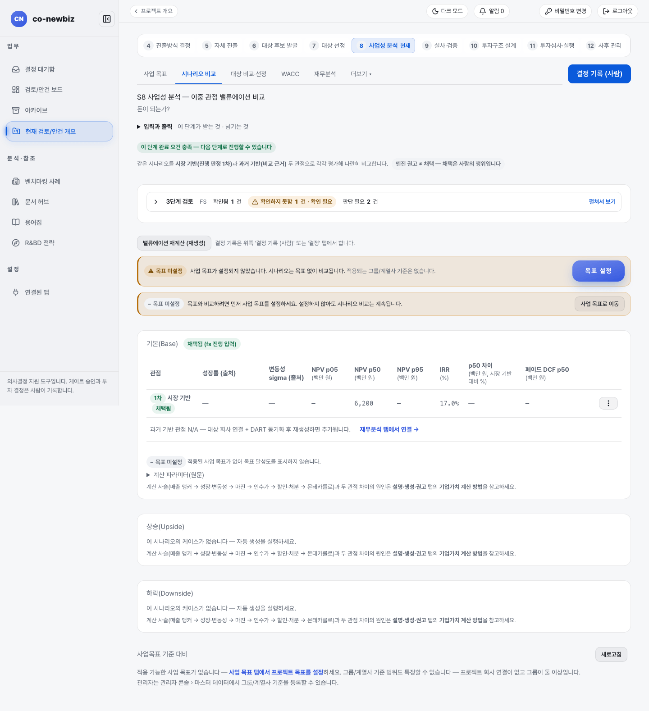

# 대상별 사업성 비교하고 대상 고르기

**목적:** `Short List` 후보마다 사업성(밸류에이션)을 만들어 나란히 비교하고, 사람이 근거를 남겨 대상 한 곳을 고른다.

**누가/언제:** 분석가가 분석하고 프로젝트 리드가 대상을 고르고 게이트를 기록한다. 프로젝트가 된 뒤(S7에서 `프로젝트로 추진`) 게이트 `FS` 앞에서 한다.

**사전 조건:** ① 직전 단계·게이트: S7의 `Target Screening` GO와 `프로젝트로 추진` 완료. ② 필요 권한: 프로젝트 `lead` 또는 `member`. 대상 선정 기록과 케이스 채택은 쓰기 권한이 필요하다(관리자 역할은 프로젝트 데이터를 바꿀 수 없어 이 기능이 보이지 않는다). ③ 준비물: S7의 `Short List` 후보 목록.

> [!NOTE]
> **Brown Field에서만:** 브라운필드의 S8은 `Short List` 후보 전체가 분석 대상이고, 마지막에 사람이 한 곳을 고른다. 그린필드는 단일 안건 하나만 분석한다. 공통 설명은 [30-공통-S8-사업성-분석](30-공통-S8-사업성-분석.md), 그린필드는 [41-그린필드-S8-사업성-분석](41-그린필드-S8-사업성-분석.md)을 본다.

> [!NOTE]
> 이 쪽의 화면 캡처는 시험용 가상 자료(데모)로 찍었다. 화면에 보이는 회사 이름과 숫자는 여러분의 자료와 다르다.

## 왜 이 단계인가

S8의 질문은 "돈이 되는가?"인데, 브라운필드는 대상이 여럿이라 비교가 먼저다. S7에서 좁힌 `Short List` 후보마다 밸류에이션을 만들어 `대상 비교·선정` 탭에서 한 줄로 세워 견준다. 여러 매물에 감정가를 붙여 나란히 놓고 보는 것과 같다. `★ 권고안` 칩은 엔진이 하방(p05) 기준으로 권고한 표시일 뿐이고, 최종 선택은 근거를 남기는 `선정 기록`으로 사람이 한다. 이 근거가 결정 기록으로 남는 이유는, 선정이 끝나야 S9 실사가 선정된 대상으로 좁혀지고 그 뒤의 비용과 판단이 한 대상에 집중되기 때문이다.

*데모 브라운필드 프로젝트의 `8 사업성 분석`. 이 캡처는 `시나리오 비교` 탭이다. `대상 비교·선정` 탭은 같은 줄 가운데에 있다.*

## 단계

1. 프로젝트 개요에서 단계 띠의 `8 사업성 분석`을 누른다(`/projects/{id}/business-case`). 질문은 "돈 되는가?"다.
2. 필요하면 `사업 목표` 탭에서 사업 목표를 정한다. 목표가 없으면 노란 `목표 미설정` 줄이 보이며, 목표 없이도 시나리오 비교는 계속된다.
3. 대상별 케이스가 없으면 `설명·생성·권고` 탭으로 가서 `이중 관점 자동 생성 (시장 기반 + 과거 기반 × 3 시나리오)`을 누른다. 대상 없이 만든 모델이 이미 있으면 `대상별 재생성`으로 다시 만든다.
4. `시나리오 비교` 탭에서 기본·상승·하락 시나리오를 시장 기반(`1차`, 진행 판정에 쓰임)과 과거 기반(`비교`, 참고용) 두 관점으로 읽는다. 두 값의 차이가 클수록 성장 가정이 불확실하다는 뜻이다.
5. `대상 비교·선정` 탭을 연다. 제목은 `Short List 대상 비교·선정`이다. 표 열은 `대상`, `S7 순위`, `Base NPV p05`, `Base NPV p50`, `IRR`, `케이스`, `계산 엔진` 등이다.
6. `★ 권고안` 칩이 붙은 대상은 엔진이 하방(p05) 기준으로 권고한 대상이다. 권고일 뿐이며 선정이 아니다.
7. `평가 기준` 열을 확인한다.

   | `평가 기준` 값 | 뜻 |
   |---|---|
   | `실적 앵커 (DART)` | 회사 연매출로 평가한 것이다 |
   | 시장 점유율 폴백 | 시장규모 × 시장점유율로 평가한 것이다 |

   기준이 섞이면 대상 간 순위 비교가 맞지 않다는 노란 안내가 나오니, 재무분석 탭에서 회사를 연결한 뒤 재생성한다.
8. 고를 대상 줄에서 `대상 선택`을 누르면 `<대상> 대상 선정 근거 (필수 — 결정 기록으로 남습니다)`가 열린다. 근거를 쓰고 `선정 기록`을 누른다. 중단하려면 `취소`를 누른다.
9. `WACC` 탭에서 할인율을 확정한다. WACC는 사람이 확정하는 값이고 선정된 대상 회사 기준이다. `재무분석` 탭에서는 선정 대상의 재무를 확인한다.
10. `시나리오 비교`에서 채택할 케이스를 사람이 채택한다. 선정 뒤 채택은 선정된 대상의 케이스로 제한된다. 기록할 때는 확인 창이 한 번 나온다.
11. 오른쪽 위 `결정 기록 (사람)`으로 `FS` 게이트를 기록한다. 근거를 쓰고 `GO`, `HOLD`, `KILL` 중 하나를 고른다.

## 결과 확인

| 화면에 남는 변화 | 어디서 보이는지 |
|---|---|
| 선정 표지 | 대상 줄에 `선정됨` 칩이 붙고, 표 위에 `선정됨 <대상 이름> — 근거: …`와 선정한 사람이 나온다 |
| 완료 요건 | 단계 띠에서 `8 사업성 분석`이 완료 요건 충족(`이 단계 완료 요건 충족 — 다음 단계로 진행할 수 있습니다`)으로 바뀐다 |
| 요건의 내용 | 이 요건은 대상 비교 분석과, 사람이 남긴 대상 선정 기록이 있는 것이다 |

## 자주 하는 실수

| 오해 | 바른 읽기 |
|---|---|
| `★ 권고안`을 선정으로 착각하는 것 | 선정은 `선정 기록`으로 사람이 근거를 남길 때만 된다 |
| 근거를 비워 두고 `선정 기록`을 누르려는 것 | 근거가 비면 버튼이 눌리지 않는다 |
| 평가 기준이 서로 다른 대상끼리 순위를 비교하는 것 | 위 7번의 노란 안내를 확인한다 |
| 밴드를 확정한 사람과 대상을 선정한 사람이 같은 경우의 경고를 무시하는 것 | 다른 검토자의 확인을 권장하는 알림이다(표시만 하며 막지는 않는다) |

## 알려진 불일치

- 캡처의 표 제목과 안내 문구에 `Short List`, `gate-primary`, `p05`, `NPV` 같은 영어·약어가 섞여 있다.
- 데모 캡처는 `대상 비교·선정` 탭이 아니라 `시나리오 비교` 탭이다.

## 스스로 확인하기

데모 브라운필드 프로젝트의 `대상 비교·선정` 탭에서 `선정됨` 칩이 붙은 대상과 그 근거를 찾아 읽는다. 어떤 버튼도 누르지 않는다.

## 핵심 요약

- 브라운필드 S8은 `Short List` 후보 전체를 분석해 `대상 비교·선정` 탭에서 견주고, 사람이 한 곳을 선정한다.
- `★ 권고안`은 엔진 권고일 뿐이고, 선정은 근거가 필수인 `선정 기록`으로만 기록된다.
- 평가 기준(`실적 앵커 (DART)`과 시장 점유율 폴백)이 섞이면 비교가 어긋나므로 재생성한다.
- 선정 뒤 채택은 선정된 대상의 케이스로 제한되고, 완료 요건은 대상 선정 기록이다.

이전: [51-브라운필드-S7-대상-선정](51-브라운필드-S7-대상-선정.md) | 다음: [53-브라운필드-S9-실사](53-브라운필드-S9-실사.md)
