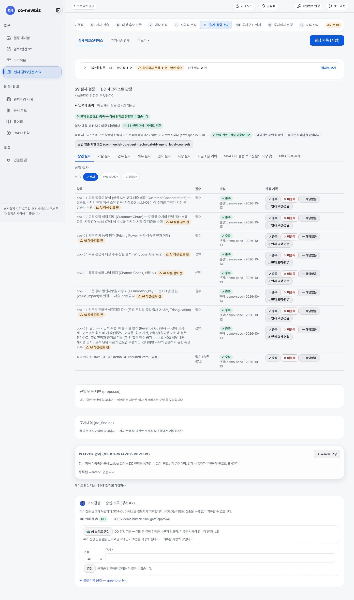
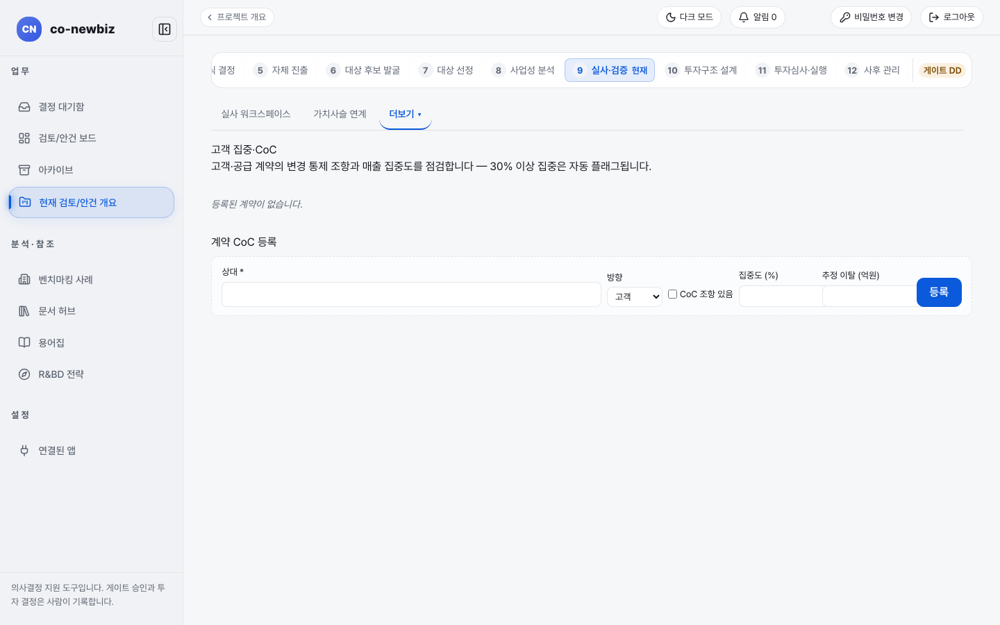
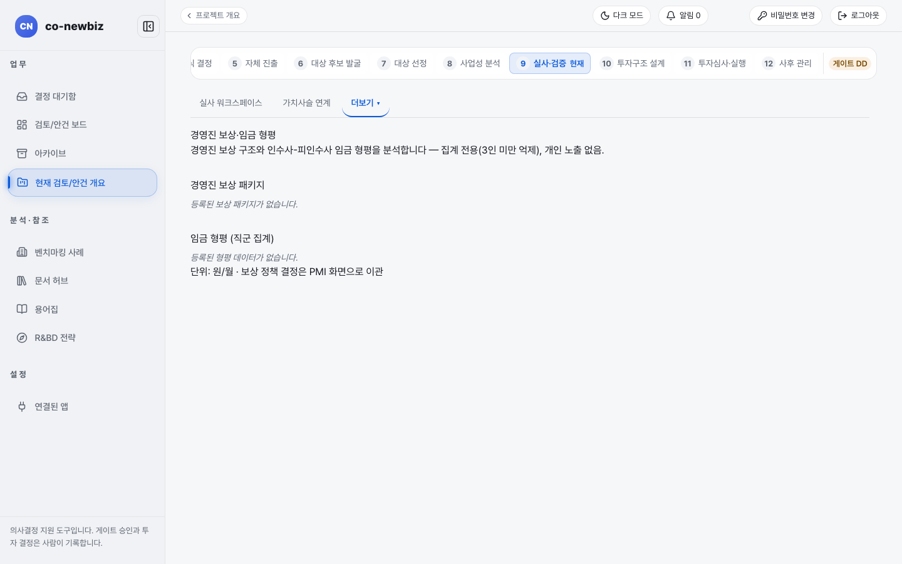
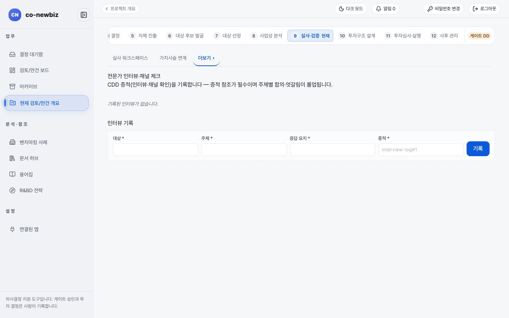

# 실사 점검표 판정하고 M&A 필수 검증 마치기

**목적:** 선정된 대상을 놓고 사실과 위험을 점검표로 확인하고, 거래 형태(`라우트`)에 맞는 범위를 적용하며, M&A라면 필수 검증 여섯 가지를 모두 기록한 뒤 `dd` 게이트를 사람이 기록한다.

**누가/언제:** 분석가가 판정과 조사내역을 기록하고 프로젝트 리드가 게이트를 기록한다. S8의 게이트 `FS` 뒤다.

**사전 조건:** ① 직전 단계·게이트: S8 완료와 게이트 `FS`, 브라운필드라면 S8에서 대상 선정이 기록되어 있을 것. ② 필요 권한: 판정과 조사내역 기록은 분석가 이상, 게이트 기록은 프로젝트 리드다. ③ 준비물: S8에서 선정한 대상. 데모라면 `S1-S12 데모 Brownfield 기회` 프로젝트.

> [!NOTE]
> **Brown Field에서만:** 점검표 범위가 S4에서 고른 `라우트`에 따라 달라지고, `M&A`는 필수 검증 여섯 가지가 더해진다. 그린필드의 실사는 [31-공통-S9-실사](31-공통-S9-실사.md)를 본다.

> [!NOTE]
> 이 쪽의 화면 캡처는 시험용 가상 자료(데모)로 찍었다. 화면에 보이는 회사 이름과 숫자는 여러분의 자료와 다르다.

## 왜 이 단계인가

S9는 S8에서 사람이 선정한 대상을 놓고 "사실인가? 위험은 무엇인가?"를 점검표로 확인하는 단계다. 대상 선정이 `실사 대상`을 게이트 기준으로 고정하기 때문에, 이 단계의 판정은 선정된 대상의 실체를 밝히는 건강검진에 해당한다. `라우트`에 따라 점검표 범위가 갈리고 `M&A`는 필수 검증 여섯 가지가 더해진다. 판정과 조사내역은 분석가가 기록하고, 면제 승인과 게이트 `dd` 결정은 사람이 기록한다. 여기서 남긴 판정과 발견은 S10의 투자 주체와 자금조달 구조, S11 투자심의 자료의 `DD 요약`으로 그대로 흘러간다.

*캡션: 데모 브라운필드 프로젝트의 `9 실사·검증`. 위에 `실사 대상`, 가운데에 탭 열(`상업 실사` ~ `M&A 특수 주제`)과 판정표, 아래에 `산업 맞춤 제안`, `조사내역`, `WAIVER 관리`, 게이트 `의사결정`이 있다. 이 캡처의 열린 탭은 `상업 실사`다.*

## 실사 범위 한눈에

- **필수 범위:** S8에서 선정한 대상이다. 화면 위에 `실사 대상: <대상 이름>`과 `S8 선정 대상 · 게이트 기준` 칩으로 보인다.
- **선택 범위:** 다른 후보의 실사는 선택이다. 열지 않은 후보는 `DD 미개설 대상` 구역에, 열어 본 후보는 `대상별 DD 비교 근거` 표에 보인다. 게이트 기준은 선정 대상뿐이다.
- **세부 트랙 범위:** `M&A`는 기준 범위 그대로다. 다른 여섯 `라우트`는 일부 항목이 `그대로 적용`, `해석을 바꿔 적용`, `대체`, `거래 형태상 해당 없음`으로 갈리고, 해당 없음에는 이유가 화면에 붙는다.
- **추가 점검표:** `라우트`마다 붙는 점검표가 다르다. 탭 열 끝쪽에 나타난다.

| 탭 이름 | 붙는 `라우트` |
|---|---|
| `M&A 6대 검증(브라운필드 타당성)`, `M&A 특수 주제` | `M&A` (전략적 투자·소수지분 투자·사내벤처(CVC)는 `M&A 특수 주제`의 기업결합 신고 항목 일부만) |
| `파트너십 점검`, `체결 전 딜 구조 점검` | `JV(합작)`, `전략 제휴`, `소수지분 투자` (전략적 투자·사내벤처(CVC)는 `체결 전 딜 구조 점검`의 외국인 투자 심사 항목 일부만) |
| R&BD 기술 점검표 | `R&BD(공동연구)` |

## 단계

1. 단계 띠에서 `9 실사·검증`을 누른다(`/projects/{id}/dd`). 질문은 "사실인가? 위험은 무엇인가?"다.
2. `실사 대상`과 `3단계 검토` 줄을 읽는다. `판정 완료 · 필수 미충족 0건` 칩이 나오면 판정 쪽 요건은 채워진 것이다.
3. (선택) 세부 트랙 `범위 요약 — <라우트 이름>` 카드가 보이면 읽는다. `판정 X / Y`, `필수 미충족 n건`, `트랙 규칙으로 제외 n건`, 추가 점검표 판정이 따로 세어져 있다. 새 범위 규칙이 생기기 전에 시작한 프로젝트에는 `새 작업 범위로 전환 미리보기` 버튼이 나올 수 있다. 누르면 `전환 사유 (필수)`를 쓰고 `전환 기록`으로 전환한다. 기존 판정은 모두 보존된다. 이 전환은 사람이 선택하는 것이다.
4. (선택) `산업 맞춤 제안 생성` 버튼으로 산업 맞춤 항목 제안을 받는다. 제안은 `산업 맞춤 제안 (proposed)`에 쌓이고 사람이 승인해야 점검표에 들어간다.
5. 탭을 하나씩 열어 항목을 판정한다. 항목 줄마다 `필수`/`선택`, 현재 판정, 판정 기록 버튼이 있다. 보기 `전체`, `판정 대기만`, `미충족만`으로 거를 수 있다.
6. (쓰기) 각 항목에서 `충족`, `미충족`, `해당없음` 중 하나를 누른다. 세부 트랙 규칙으로 적용 여부가 정해지는 항목에서 `해당없음`을 고르면 `사유 (필수)`를 쓰라는 창이 열리고, 사유는 감사 기록에 남는다.
7. (쓰기) 필수 항목이 `미충족`이어도 넘어가야 하면 해당 줄의 `면제 요청·연결`을 눌러 면제(waiver)를 요청한다. 사유와 만료가 기록된 승인 면제만 효력이 있다. 승인 여부는 `WAIVER 관리 (S9 DD-WAIVER-REVIEW)` 구역에서 본다. 새 요청은 `+ waiver 요청`이다.
8. (쓰기) 실사 중 알게 된 사실은 `조사내역 (dd_finding)`에 기록한다. 가치에 영향을 주는 발견은 가정 키나 가치 영향 값에 연결해야 하며, 서술만 남기지 않는다.
9. 아래 [M&A 필수 검증 여섯 가지](#m-a-필수-검증-여섯-가지) 절을 따라 `M&A`의 필수 검증을 마친다.
10. 본문의 `결정 기록 (사람)`을 눌러 `의사결정 — 승인 기록` 카드로 간다. 머리 오른쪽 위 버튼은 `다음: … →` 이동 버튼이라 기록 버튼이 아니다. `DD 현재 결정`을 읽고, 근거 초안이 필요하면 `AI 브리프 생성`을 누른다.
11. (쓰기) `결정`에서 `GO`, `HOLD`, `KILL` 중 하나를 고르고 `근거 *`를 쓴 뒤 `결정`을 누른다. `결정 이력`은 추가만 가능하다.

## 항목 옆 검토 상태 배지

점검표 항목 옆에 작은 배지가 붙는다. 이는 참고 표시이며 판정이나 게이트를 막지 않는다.

| 배지 | 뜻 |
|---|---|
| `AI 작성·검토 전` | AI가 쓴 항목 문구이고 변호사 검토 전이다. 확정이 아니다 |
| `법무 검토됨(이름)` | 법무 담당자가 검토했다. 최종 확정 전이다 |
| `확정(이름)` | 확정된 문구다 |

법령·규정이 걸린 항목은 배지가 `확정`이 아니면 원문과 담당자 의견을 따로 확인한다.

## M&A 필수 검증 여섯 가지

`M&A`에서는 `bf-01` 항목이 아래 여섯을 모두 수행·기록했는지 묻는다. 하나라도 빠지면 면제로 넘어갈 수 없다(면제 불가 항목). 기록 순서는 다음처럼 정해져 있다.

| 순서 | 검증 | 화면에서 기록하는 곳 |
|---|---|---|
| 1 | 독과점(antitrust): 관련시장, HHI, 기업결합 신고, 이행 금지(건 점핑) | `M&A 특수 주제` 탭의 `ma-01`~`ma-03` |
| 2 | 고객 유지(customer-retention): 고객·공급사 계약의 지배권 변경 조항과 이탈 위험 | `실사 워크스페이스`의 `실사 조사 도구` 칸 `고객 집중 · 지위 변동(CoC)` 카드, `ma-07`·`ma-08` |
| 3 | 인센티브(incentive): 이전·구조조정 때의 환수 위험 | `ma-09` |
| 4 | 인력 통합(hr-integration): 경영진 보상과 임직원 보상 평준화(상향 편향) | `실사 워크스페이스`의 `실사 조사 도구` 칸 `경영진 보상 · 임금 형평` 카드, `ma-04`~`ma-06` |
| 5 | 지역 노동 검토(region labor) | `M&A 6대 검증` 탭의 `bf-01` 판정 |
| 6 | 인증 승계 가능성(certification transferability): 마지막에, 인증 기관 자체 규정으로 확인 | `ma-12`, `bf-03` |

> [!NOTE]
> 순서의 처음(독과점)과 마지막(인증 승계)은 규칙으로 정해져 있다. 가운데 네 개의 순서는 이 표를 권장 순서로 본다. 인증 승계는 추정으로 판정하지 않는다. 인증 기관의 규정 원문으로만 확인한다.

### 기업결합 신고와 외국인 투자 심사

- `ma-01`~`ma-03`은 관련시장·HHI, 모든 관할의 기업결합 신고 요건, 이행 금지 확인이다.
- 외국인 투자 심사는 `체결 전 딜 구조 점검`의 `min-05`에서 다룬다.
- `전략적 투자`, `소수지분 투자`, `사내벤처(CVC)`에서는 이 항목들이 따로 붙어, 지분만 사도 신고·심사 요건을 빠뜨리지 않게 한다.

*캡션: 데모 프로젝트의 `고객 집중 · 지위 변동(CoC)` 화면(`실사 워크스페이스`의 `실사 조사 도구` 카드에서 열린다). `계약 CoC 등록`에 `상대 *`, `방향`, `CoC 조항 있음`, `집중도 (%)`, `추정 이탈 (억원)`을 쓰고 `등록`을 누른다. 30% 이상 집중은 자동으로 표시된다.*

*캡션: 데모 프로젝트의 `경영진 보상 · 임금 형평` 화면(`실사 조사 도구` 카드에서 열린다). `경영진 보상 패키지`와 `임금 형평 (직군 집계)`를 본다. 5인 미만 집계는 가려지고 개인 노출이 없다.*

*캡션: 데모 프로젝트의 `전문가 인터뷰 · 채널 체크` 화면(`실사 조사 도구` 카드에서 열린다). `인터뷰 기록`에 `대상 *`, `주제 *`, `응답 요지 *`, `증적 *`을 쓰고 `기록`을 누른다.*

## 결과 확인

- `판정 완료 · 필수 미충족 0건` 칩이 나타나고 `3단계 검토`의 `확인하지 못함` 건수가 줄어든다.
- 게이트를 기록하면 `DD 현재 결정`과 `결정 이력`이 갱신된다.
- 항목 배지가 `AI 작성·검토 전`으로 남아 있어도 게이트는 막히지 않지만, `확인하지 못한 영역` 안내에 건수가 남는다. S11 투자심의 자료에서도 이 건수를 다시 읽는다.

## 자주 하는 실수

- 필수 검증 여섯 중 하나를 빼고 게이트를 기록하려는 것. 면제 경로가 없다.
- 배지 `AI 작성·검토 전`을 "검토 완료"로 읽는 것. 반대다.
- 선택 사항인 후보별 실사를 모두 채워야 한다고 생각하는 것. 필수는 선정 대상뿐이다.
- `해당없음`을 이유 없이 누르는 것. 세부 트랙 규칙 항목은 사유가 필수이고 감사 기록에 남는다.
- 인증 승계를 대상 회사의 설명이나 관행만으로 `충족` 처리하는 것.
- 서술만으로 발견사항을 남겨 두는 것. 가치 영향이 있으면 가정 키나 가치 영향 값에 연결한다.

## 알려진 불일치

- 탭 이름 `M&A 6대 검증(브라운필드 타당성)`은 점검표 이름 `M&A 6대 검증 체크리스트`와 조금 다르고, `파트너십 점검`은 합의된 이름 `전략 제휴`와 다르다.
- 경영진 보상·임금 형평 화면에 "보상 정책 결정은 PMI 화면으로 이관"이라고 적혀 있으나, PMI 화면에는 보상 정책 입력이 없다([56-브라운필드-S12-통합-PMI](56-브라운필드-S12-통합-PMI.md) 참고).
- 데모 캡처는 `상업 실사` 탭이라 여섯 가지 검증 순서가 한눈에 보이지 않는다.

## 스스로 확인하기

데모 브라운필드 프로젝트의 `9 실사·검증`에서 `실사 대상` 이름, `DD 현재 결정`, 그리고 `M&A 6대 검증(브라운필드 타당성)` 탭의 `bf-01` 항목 문구를 찾아 읽어 본다. 어떤 버튼도 누르지 않는다.

## 핵심 요약

- S9는 선정된 대상의 사실과 위험을 점검표로 확인하는 단계다. 완료 표지는 `판정 완료 · 필수 미충족 0건`이다.
- 점검표 범위는 S4에서 고른 `라우트`를 따르고, 필수 범위는 S8에서 선정한 대상뿐이다.
- `M&A`는 필수 검증 여섯 가지(독과점·고객 유지·인센티브·인력 통합·지역 노동·인증 승계)를 모두 기록해야 하고 면제 경로가 없다.
- 항목 배지(`AI 작성·검토 전` 등)는 참고 표시이며 게이트를 막지 않는다.
- 실사 결과는 S10 투자 주체·자금조달 구조와 S11 `DD 요약`으로 이어진다.

이전: [52-브라운필드-S8-사업성-분석](52-브라운필드-S8-사업성-분석.md) | 다음: [54-브라운필드-S10-거래-구조](54-브라운필드-S10-거래-구조.md)
