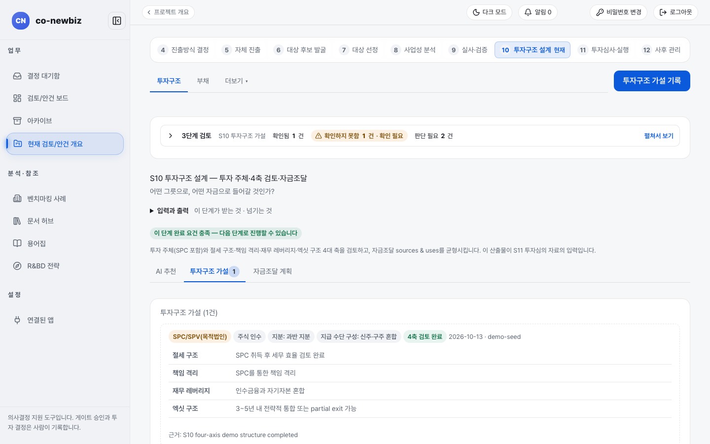
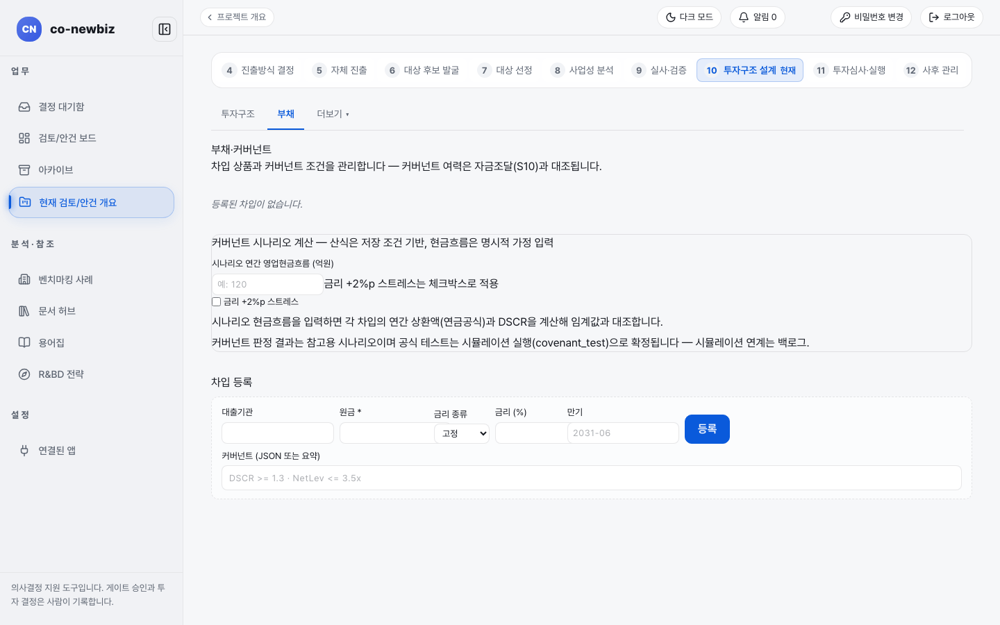

# 거래 구조 정하기

**목적:** 어떤 그릇(투자 주체)으로, 어떤 지분과 지급 수단으로, 어떤 자금으로 들어갈지 정하고, 네 가지 축(절세 구조, 책임 격리, 재무 레버리지, 엑싯 구조)을 검토해 기록한다. 합작(JV)이면 합작 조건을 함께 기록한다.

**누가/언제:** 프로젝트 리드가 구조를 정하고 분석가가 입력한다. S9의 게이트 `dd` 뒤다. 이 단계에는 별도 게이트가 없다.

**사전 조건:** ① 직전 단계·게이트: S9 실사 판정과 게이트 `dd`. ② 필요 권한: 가설 기록은 분석가 권한이 필요하고 구조 확정은 프로젝트 리드다. ③ 준비물: S8에서 채택한 사업 케이스, S9 조사내역.

> [!NOTE]
> **Brown Field에서만:** 이 쪽의 `투자 주체`, `지분`, `지급 수단 구성`은 브라운필드 입력칸이다. 그린필드는 `설립 법인 형태`를 정하고 실행 기준선과 투자 분할 집행을 다룬다. [32-공통-S10-투자심의-전](32-공통-S10-투자심의-전.md)와 [40-그린필드-S5-자체-진출](40-그린필드-S5-자체-진출.md)의 흐름을 참고한다.

> [!NOTE]
> 이 쪽의 화면 캡처는 시험용 가상 자료(데모)로 찍었다. 화면에 보이는 회사 이름과 숫자는 여러분의 자료와 다르다.

## 왜 이 단계인가

S10은 S9에서 확인한 사실과 위험을 받아 "어떤 그릇으로, 어떤 자금으로 들어갈 것인가?"를 정하는 단계다. `투자 주체`, `자산/주식`, `지분`, `지급 수단 구성`으로 거래를 담을 그릇을 정하고 네 축(절세 구조, 책임 격리, 재무 레버리지, 엑싯 구조)을 근거와 함께 검토한다. 가설 기록과 `4축 검토 완료`는 되돌리지 않는 사람의 기록이고, 자금조달 계획은 조달과 사용의 합계가 맞아야 완료 요건이 채워진다. 이 단계에는 별도 게이트가 없지만 그 결과가 S11 투자심의 자료의 입력이 된다. 합작(`JV(합작)`)이라면 합작 조건도 구조에 반영한다.

*캡션: 데모 브라운필드 프로젝트의 `10 투자구조 설계`. `투자구조 가설 (1건)`에 투자 주체(`SPC/SPV(목적법인)`), `주식 인수`, `지분: 과반 지분`, 네 축 노트가 보인다.*

## 단계

1. 단계 띠에서 `10 투자구조 설계`를 누른다(`/projects/{id}/deal-structure`). 질문은 "어떤 그릇으로, 어떤 자금으로 들어갈 것인가?"다.
2. `입력과 출력`과 `3단계 검토` 줄을 읽는다. 이 단계의 산출물이 S11 투자심의 자료의 입력이다.
3. 필요하면 `AI 추천` 탭에서 `▶ AI 추천 생성`을 누르면 S8에서 채택한 케이스, S9 조사내역, WACC를 근거로 투자 주체와 지분·수단, 네 축 노트, 구조 근거 초안이 나온다. 제안일 뿐이다. 마음에 들면 `▶ 가설 폼에 반영`을 누르고 확인 창에서 `반영`을 누르면 아래 입력칸에 초안이 채워진다. 등록은 여전히 사람이 한다.
4. `투자구조 가설` 탭에서 `투자구조 가설 입력란 펼치기`를 연다.
5. `투자 주체`를 고른다. 값은 `직접 투자(direct)`, `SPC/SPV(목적법인)`, `홀딩스 경유(holdco)`, `내부 벤처 스핀오프`, `합작(JV)`이다.
6. `자산/주식`에서 `자산 인수`, `주식 인수`, `혼합`을 고르고, `지분`에서 `전량 인수`, `과반 지분`, `소수 지분`, `공동 통제` 중 하나를 고른다. `지급 수단 구성`은 `신주 인수`, `구주 매입`, `신주·구주 혼합` 중에서 고른다.
7. 네 축 입력칸에 `절세 구조`, `책임 격리`, `재무 레버리지`, `엑싯 구조`를 각각 쓴다.
8. `근거 (필수)`를 쓰고 `가설 기록`을 누른다. 근거가 비어 있으면 버튼이 눌리지 않는다.
9. 등록된 가설 줄에서 칩 `4축 검토 미완료`를 확인한다. 네 축 검토가 끝나면 `아티팩트 참조 (필수)`를 쓰고 `4축 검토 완료`를 누른다. 확인 창에 `되돌릴 수 없습니다`라고 나오니 내용을 다시 읽고 진행한다. 칩이 `4축 검토 완료`로 바뀐다.
10. `자금조달 계획` 탭에서 조달(자기자본, 차입, 정부 자금 등)과 사용(인수 대금, 비용 등)을 맞춘다. `구분`에서 `조달` 또는 `사용`을 고르고, `항목명`, `금액 (백만 KRW)`, `비고`를 쓴 뒤 `추가`를 누른다. 조달과 사용의 차액이 0이 되면 칩이 `균형`이 된다. `불균형 — S10 완료 요건 미충족`이 보이면 아직 완료가 아니다.
11. `차입·여신` 탭에서 차입을 기록한다(아래 캡처). 화면 제목은 `차입·여신 관리 (부채·커버넌트)`로, 괄호 안 `부채`는 별칭으로 남아 있다. `차입 등록`에 `대출기관`, `원금 *`, `금리 종류`, `금리 (%)`, `만기`, `커버넌트 (JSON 또는 요약)`를 쓰고 `등록`을 누른다. 차입 목록의 만기 칸에는 `상환 구조` 표시가 함께 붙는다. `시나리오 연간 영업현금흐름 (억원)`을 넣으면 상환액과 부채상환비율(DSCR)을 계산해 커버넌트와 대조하고, 아래 `커버넌트 여력` 표는 최신 시뮬레이션의 재무약정 시험을 기준으로 `위반`·`빠듯 (<10%)`·`여력 있음` 판정을 보여 준다. `금리 +2%p 스트레스`를 체크하면 금리 상승 상황도 본다. 이 결과는 참고용이며 투자심의 자료·리스크 히트맵으로 전달된다.
12. 합작(JV)이라면 합작 조건을 `파트너·JV` 화면에 기록한다. 이 화면은 S10이 아니라 S12 줄의 `더보기`에 있다. 아래 [합작 조건 기록하기](#합작-조건-기록하기)를 본다.

*캡션: 데모 브라운필드 프로젝트의 `차입·여신` 탭. `차입·여신 관리 (부채·커버넌트)`, `차입 등록` 입력줄과 `금리 +2%p 스트레스` 체크박스가 보인다.*

## 합작 조건 기록하기

`JV(합작)` 라우트에서는 파트너와의 약정을 구조에 반영해야 한다.

<svg viewBox="0 0 860 98" width="100%" role="img" xmlns="http://www.w3.org/2000/svg">
  <title>합작 조건은 S12 줄의 더보기에 있는 파트너·JV 화면에서 기록한다</title>
  <defs>
    <marker id="wiki-ah" markerWidth="7" markerHeight="7" refX="5.5" refY="3" orient="auto">
      <path d="M0,0 L6,3 L0,6 z" fill="var(--border)"></path>
    </marker>
  </defs>
  <text x="8" y="30" font-size="12" fill="var(--muted-fg)">합작(JV) 라우트일 때만</text>
  <rect x="178" y="12" width="160" height="28" rx="6" fill="none" stroke="var(--border)"></rect>
  <text x="258" y="30.5" text-anchor="middle" font-size="13" fill="var(--fg)">S10 거래 구조 화면</text>
  <line x1="338" y1="26" x2="356" y2="26" stroke="var(--border)" stroke-width="1.2" marker-end="url(#wiki-ah)"></line>
  <rect x="362" y="12" width="140" height="28" rx="6" fill="none" stroke="var(--border)"></rect>
  <text x="432" y="30.5" text-anchor="middle" font-size="13" fill="var(--fg)">S12 줄의 더보기</text>
  <line x1="502" y1="26" x2="520" y2="26" stroke="var(--border)" stroke-width="1.2" marker-end="url(#wiki-ah)"></line>
  <rect x="526" y="12" width="280" height="28" rx="6" fill="none" stroke="var(--border)"></rect>
  <text x="666" y="30.5" text-anchor="middle" font-size="13" fill="var(--fg)">파트너·JV (파트너 검토·JV 조건)</text>
  <text x="8" y="76" font-size="12" fill="var(--muted-fg)">파트너·JV 화면</text>
  <rect x="178" y="58" width="140" height="28" rx="6" fill="none" stroke="var(--border)"></rect>
  <text x="248" y="76.5" text-anchor="middle" font-size="13" fill="var(--fg)">파트너 후보 등록</text>
  <line x1="318" y1="72" x2="336" y2="72" stroke="var(--border)" stroke-width="1.2" marker-end="url(#wiki-ah)"></line>
  <rect x="342" y="58" width="130" height="28" rx="6" fill="none" stroke="var(--border)"></rect>
  <text x="407" y="76.5" text-anchor="middle" font-size="13" fill="var(--fg)">JV 조건 등록</text>
  <line x1="472" y1="72" x2="490" y2="72" stroke="var(--border)" stroke-width="1.2" marker-end="url(#wiki-ah)"></line>
  <rect x="496" y="58" width="310" height="28" rx="6" fill="none" stroke="var(--border)"></rect>
  <text x="651" y="76.5" text-anchor="middle" font-size="13" fill="var(--fg)">표 JV 조건: 파트너별 기록 값 확인</text>
</svg>

1. S12 줄의 `더보기`에서 `파트너·JV`를 연다(`/projects/{id}/partnership`, 화면 제목 `파트너 검토·JV 조건`).
2. `파트너 후보 등록`에서 `후보명 (필수)`, `제휴 유형 (필수)` 등을 쓰고 `등록`을 누른다.
3. `JV 조건 등록`에서 `파트너 (필수)`를 고르고 `지분 구조`, `거버넌스`, `거부권 사항`, `출자`, `엑싯 조항`, `교착 해소`, `경업 금지`를 쓴다.
4. 표 `JV 조건`에서 파트너별로 기록된 값을 확인한다.

## 결과 확인

- `투자구조 가설 (1건)`이 생기고 칩이 `4축 검토 완료`다.
- `자금조달 계획`에 `균형` 칩이 보인다.
- 단계 띠에서 `10 투자구조 설계`가 `이 단계 완료 요건 충족 — 다음 단계로 진행할 수 있습니다`로 바뀐다.

## 자주 하는 실수

- AI 추천을 구조 확정으로 읽는 것. 추천은 입력칸을 채울 뿐 등록은 사람이 한다.
- `4축 검토 완료`를 급히 누르는 것. 되돌릴 수 없고 감사 기록에 남는다.
- 조달과 사용이 맞지 않는데 `불균형`을 그대로 두는 것. 완료 요건이 채워지지 않는다.
- 합작 조건을 S10 화면에서 찾는 것. S12 `더보기`의 `파트너·JV`에 있다.

## 알려진 불일치

- 합작 조건 입력이 S10이 아니라 S12 줄에 있어 찾기 어렵다.
- `sources & uses`, `capex`, `DSCR`, `covenant_test` 같은 영어 표기가 화면 문구에 남아 있다.
- 이 단계의 `더보기`에는 `인센티브`, `부지·시설`, `인허가·인증`이 있지만 이들은 주로 그린필드용이다.

## 스스로 확인하기

데모 브라운필드 프로젝트의 `10 투자구조 설계`에서 `투자구조 가설 (1건)`의 `투자 주체`와 `4축 검토 완료` 칩, 그리고 `자금조달 계획`의 `균형` 칩을 찾아 읽어 본다. 어떤 버튼도 누르지 않는다.

## 핵심 요약

- S10은 거래를 담을 그릇(`투자 주체`)과 지분·지급 수단, 자금을 정하는 단계다. 이 단계에는 별도 게이트가 없다.
- 네 축 검토를 `아티팩트 참조 (필수)`와 함께 마쳐야 칩이 `4축 검토 완료`가 되고, 이 기록은 되돌리지 않는다.
- `자금조달 계획`은 조달과 사용의 차액이 0이 되어야 `균형`이 되고, 이것이 완료 요건이다.
- `차입·여신` 탭의 커버넌트 여력은 참고용이며 투자심의 자료·리스크 히트맵으로 전달된다.
- 합작 조건은 S12 줄의 `더보기`에 있는 `파트너·JV` 화면에서 기록한다.

이전: [53-브라운필드-S9-실사](53-브라운필드-S9-실사.md) | 다음: [55-브라운필드-S11-클로징](55-브라운필드-S11-클로징.md)
