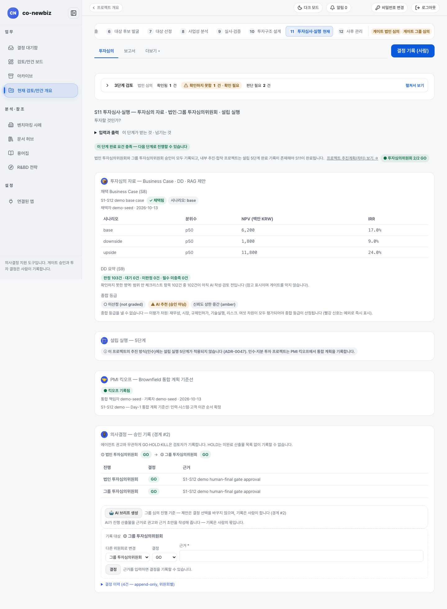

# 투자심의 자료 읽고 투자심의위원회 결정 기록하기

**목적:** 투자심의 자료를 읽고, 법인 투자심의위원회와 그룹 투자심의위원회의 결정을 순서대로 사람이 기록하고, 통합(PMI)을 시작할 기준선(킥오프)을 남긴다.

**누가/언제:** 위원회 구성원과 프로젝트 리드. S10 뒤이며, 게이트 `법인 투자심의위원회`(`entity_ic`)와 `그룹 투자심의위원회`(`group_ic`) 단계다.

**사전 조건:** ① 직전 단계: S10의 투자구조 가설(`4축 검토 완료`)과 자금조달 계획(`균형`). ② 필요 권한: 결정 기록은 사람만 기록하고, 프로젝트 안에서는 분석가 이상이 검토에 참여한다. ③ 준비물: S10의 투자구조 가설과 자금조달 계획.

> [!NOTE]
> **Brown Field에서만:** 인수·지분 투자는 클로징(거래 종결) 쪽 일을 하므로 `설립 실행 5단계`가 적용되지 않고, 대신 `PMI 킥오프`를 기록한다. 그린필드는 설립 실행 5단계를 끝내야 한다([33-공통-S11-투자심의와-실행](33-공통-S11-투자심의와-실행.md) 참고).

> [!NOTE]
> 이 쪽의 화면 캡처는 시험용 가상 자료(데모)로 찍었다. 화면에 보이는 회사 이름과 숫자는 여러분의 자료와 다르다.

## 왜 이 단계인가

S11은 S10의 투자구조 가설과 자금조달 계획을 투자심의 자료 한 벌로 묶어 "투자할 것인가?"를 법인 투자심의위원회와 그룹 투자심의위원회 순서로 심사하는 단계다. 심의 자료에는 채택 케이스의 시나리오별 NPV·IRR과 S9의 `DD 요약`, `종합 등급` 제안이 모이고, 결정(GO, HOLD, KILL)은 근거와 함께 사람만 기록한다. 한 번 쓴 결정은 고치지 않고 새 결정으로 이어서 적는다. 투자심의 자료는 위원회 앞에 놓이는 한 벌의 청구서이자, 승인 뒤의 통합 작업이 출발하는 기준선이다. 승인 뒤 인수·지분 투자는 설립 실행 대신 `PMI 킥오프`를 기록해 통합(PMI)의 출발점을 남긴다.

*캡션: 데모 브라운필드 프로젝트의 `11 투자심사·실행` 전체(`투자심의 자료` 내부 탭). 위에서부터 내부 탭 다섯 개(`투자심의 자료` · `투자심사 절차 단계` · `실행 · PMI` · `실행 기준선` · `의사결정 · 승인 기록`)와 `투자심의 자료`(채택 사업 케이스 NPV·IRR, `DD 요약 (S9)`, `종합 등급`)가 이어진다. 설립 실행 5단계와 PMI 킥오프는 `실행 · PMI` 내부 탭에서 본다.*

## 단계

1. 단계 띠에서 `11 투자심사·실행`을 누른다(`/projects/{id}/ic-review`, 탭 `투자심의`). 질문은 "투자할 것인가?"다.
2. `3단계 검토` 줄에서 `확인됨`, `확인하지 못함`, `판단 필요` 건수를 읽는다. 이 화면에는 합격 표시가 없다. 무엇을 확인했고 무엇을 확인하지 못했는지만 알려 준다.
3. `투자심의 자료` 카드의 `채택 Business Case (S8)`를 읽는다. 채택한 케이스의 시나리오별(`base`, `downside`, `upside`) 분위수, `NPV (백만 KRW)`, `IRR` 표가 있다.
4. 같은 카드의 `DD 요약 (S9)` 칩과 안내를 읽는다. 판정 건수와 필수 미충족 건수가 나오고, "확인하지 못한 영역"에 점검표 항목 중 아직 `AI 작성·검토 전`인 건수가 나온다. 참고 표시이며 게이트를 막지 않는다.
5. `종합 등급`을 읽는다. 여섯 차원이 모두 평가되어야 종합 등급이 나온다. 빠진 차원은 `미평가 차원`으로 나열된다. `AI 추천 (승인 아님)` 칩은 AI가 제안한 값이라는 뜻이다.
6. `실행 · PMI` 내부 탭의 `설립 실행 — 5단계` 카드를 읽는다. 인수·지분 투자라면 "이 프로젝트의 추진 방식(인수)에는 설립 실행 5단계가 적용되지 않습니다"라고 나온다. 합작처럼 추진 방식이 합작인 프로젝트에서는 5단계가 적용된다.
7. 법인 투자심의위원회와 그룹 투자심의위원회 결정을 `의사결정 · 승인 기록` 내부 탭에서 기록한다. 순서는 `법인 투자심의위원회` → `그룹 투자심의위원회`다. `기록 대상`에 지금 기록할 위원회가 나오고, `다른 위원회로 변경`에서 바꿀 수 있다.
8. 근거 초안이 필요하면 `🤖 AI 브리프 생성`을 누른다. 브리프는 제안이며 `결정` 선택을 바꾸지 않는다.
9. `결정`에서 `GO`, `HOLD`, `KILL` 중 하나를 고르고 `근거 *`를 쓴 뒤 `결정`을 누른다. 법인 쪽이 먼저, 그룹 쪽이 나중이다. 미완료 산출물이 남은 채 GO를 기록하려 하면 `예외 근거 (필수)`를 직접 적어야 한다. 표 `진행`, `결정`, `근거`에서 기록된 내용이 보인다. `결정 이력 (n건 — append-only, 위원회별)`을 펼치면 이전 기록이 보인다.
10. `PMI 킥오프`는 법인·그룹 승인 뒤 `실행 · PMI` 내부 탭에서 기록한다. 인수(`M&A`), 합작(`JV(합작)`), `전략적 투자`에서만 이 카드가 나온다. `통합 책임자 (필수)`와 `통합 계획 기준선 (필수, 20자 이상)`을 쓰고 `킥오프 기록 (확인 필요)`을 누른다. 확인 창에 `에이전트가 대신 기록할 수 없습니다`라고 나온다.
11. `보고서` 탭에서 승인 결과를 문서로 확인한다. **🧾 투자심의 자료로 초안 생성**으로 초안을 만들고(§8 리스크 히트맵 요약 ~ §12 투자심사 절차 단계까지 자동 구성), **미리보기**로 읽어 본 뒤 docx/pdf/hwpx로 내려받는다. 저장한 스냅샷은 **보관**으로 이력 목록에서 치울 수 있고 `보관본 보기`로 다시 열람한다. 차터는 탭 줄 오른쪽 끝 공통 링크 `추진계획(차터)`이나 상단 `프로젝트 추진계획(차터) 보기 →` 링크로 어느 때든 열린다.

## 결과 확인

- 화면 위 칩이 `투자심의위원회 2/2 GO`로 바뀐다.
- `PMI 킥오프` 카드에 `● 킥오프 기록됨`, 통합 책임자, 기록자, 날짜가 보인다. `○ 킥오프 미기록`이면 S11이 완료되지 않은 것이다.
- 단계 띠에서 `11 투자심사·실행`이 완료되고 S12로 간다.
- S11 완료 요건은 법인·그룹 승인 기록과, PMI가 적용되는 `라우트`의 킥오프 기록이다.

## 자주 하는 실수

- `AI 추천 (승인 아님)` 칩의 종합 등급을 승인으로 읽는 것. 이 시스템에서 투자 결정은 위원회 구성원이 `결정`으로 기록할 때만 된다.
- 그룹 위원회 결정을 먼저 기록하려는 것. 법인 투자심의위원회가 먼저다.
- 킥오프를 승인 전에 기록하려는 것. 법인·그룹 승인 뒤에 기록한다.
- `소수지분 투자`, `전략 제휴`, `R&BD(공동연구)`, `사내벤처(CVC)`에서 `PMI 킥오프` 카드를 찾는 것. 이 `라우트`에서는 카드가 나오지 않고, S12의 `PMI` 탭도 보이지 않는다.
- 에이전트나 외부 호출로 결정을 기록하려는 것. 결정은 화면에서 사람이 기록한다(REST로는 사람 전용).

## 알려진 불일치

- 카드 제목 `투자심의 자료 — Business Case · DD · RAG 제안`에 영어와 약어(`RAG`)가 남아 있고, `종합 등급` 칩에 `not graded`, `amber` 같은 영어가 섞인다. 합의된 표기는 `종합 등급`이다.
- `설립 실행 — 5단계` 카드가 인수 프로젝트에도 보이지만 "적용되지 않습니다"라는 설명만 있다. 안내 문구에 설계 번호(ADR-0047)가 그대로 나온다.

## 스스로 확인하기

데모 브라운필드 프로젝트의 `11 투자심사·실행`에서 `법인 투자심의위원회`와 `그룹 투자심의위원회`의 `결정`과 `근거`, 그리고 `PMI 킥오프` 카드의 `통합 책임자`를 찾아 읽어 본다. 어떤 버튼도 누르지 않는다.

## 핵심 요약

- S11은 "투자할 것인가?"를 법인·그룹 투자심의위원회 순서로 심사하고 결정은 사람만 기록하는 단계다.
- `종합 등급`은 `AI 추천 (승인 아님)`이며 여섯 차원이 모두 평가되어야 나온다.
- 인수·지분 투자에는 `설립 실행 5단계`가 적용되지 않고, 법인·그룹 승인 뒤 `PMI 킥오프`를 기록한다. PMI 대상은 `M&A`, `JV(합작)`, `전략적 투자`뿐이다.
- 보고서 초안은 `투자심의 자료로 초안 생성`으로 만들며 결재가 아니라 초안이다.

이전: [54-브라운필드-S10-거래-구조](54-브라운필드-S10-거래-구조.md) | 다음: [56-브라운필드-S12-통합-PMI](56-브라운필드-S12-통합-PMI.md)
