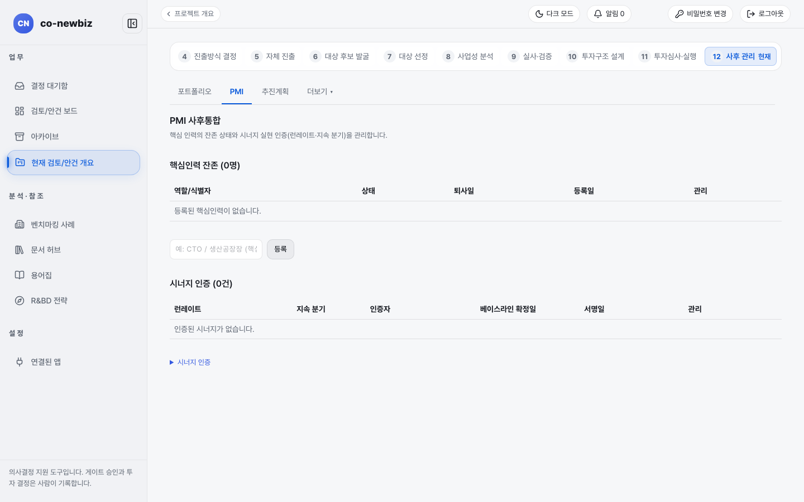
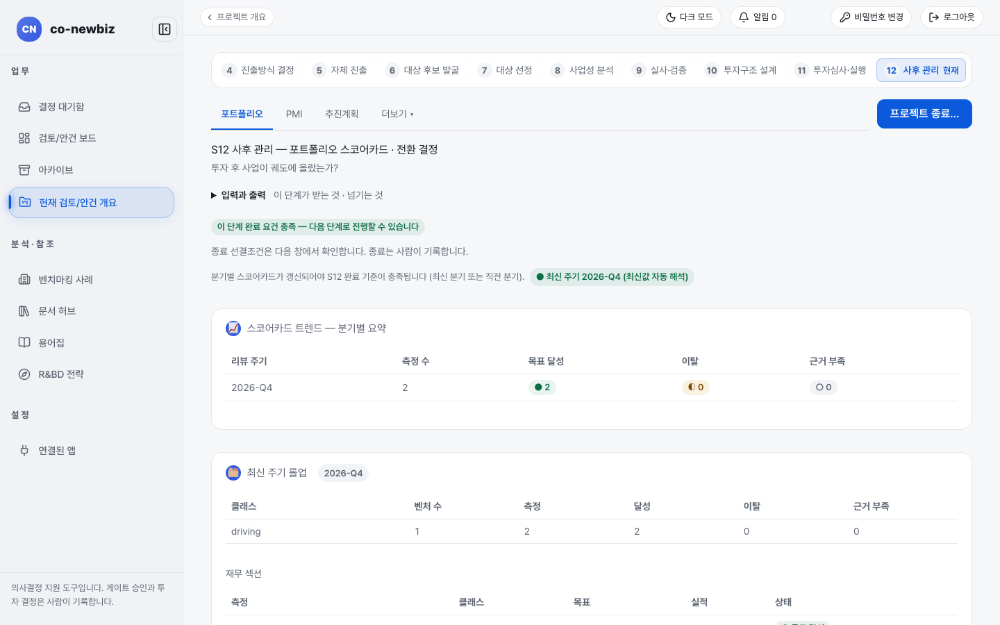

# 인수 후 통합(PMI) 기록하고 점검하기

**목적:** 인수·합작 뒤 핵심인력이 남아 있는지, 시너지가 실제로 나오는지 기록하고 분기마다 포트폴리오 스코어카드로 점검한 뒤, 끝낼 때는 사람이 종료를 기록한다.

**누가/언제:** 프로젝트 리드가 기록하고 열람자(P4)는 읽는다. S11의 투자심의위원회 결정과 `실행 · PMI` 내부 탭의 `PMI 킥오프` 기록 뒤다. S12에는 게이트가 없어 모든 항목이 권장이며 단계를 막지 않는다.

**사전 조건:** ① 직전 단계: S11 `PMI 킥오프` 기록. ② 필요 권한: 프로젝트 `lead` 또는 `member`(기록은 분석가 이상), 열람자(P4)는 읽기만 한다. ③ 준비물: 통합 책임자와 통합 계획 기준선(S11 킥오프에 기록한 값).

> [!NOTE]
> **Brown Field에서만:** `PMI` 탭은 `M&A`, `JV(합작)`, `전략적 투자`에만 쓰인다. `소수지분 투자`, `전략 제휴`, `R&BD(공동연구)`, `사내벤처(CVC)`와 그린필드는 `PMI` 탭이 숨겨지거나 조회만 가능하다. 그린필드는 실행 기준선 대비 차이를 본다([45-그린필드-S12-사후-관리](45-그린필드-S12-사후-관리.md)).

> [!NOTE]
> 이 쪽의 화면 캡처는 시험용 가상 자료(데모)로 찍었다. 화면에 보이는 회사 이름과 숫자는 여러분의 자료와 다르다.

## 왜 이 단계인가

S12는 인수·합작 뒤의 질문 "투자 후 사업이 궤도에 올랐는가?"를 `PMI` 탭과 포트폴리오 스코어카드로 따라가는 단계다. 투자심의에서 약속한 시너지가 실제로 나오는지 `시너지 인증`으로 확인하고 지켜야 할 핵심인력이 남아 있는지 `핵심인력 잔존`으로 기록한다. 인증과 잔존 기록은 분기 스코어카드와 `통합 모니터링` 요약으로 모이고 끝낼 때의 종료 기록은 사람의 행위다. S12에는 게이트가 없어 모든 항목이 권장이며 단계를 막지 않는다. 계약이 끝난 뒤에도 약속을 계속 확인하는 장부가 이 탭이다.

*캡션: 데모 브라운필드 프로젝트의 `12 사후 관리`, `PMI` 탭(화면 제목 `PMI 사후통합`). `핵심인력 잔존 (0명)`과 `시너지 인증 (0건)` 표가 비어 있다.*

## 단계

1. 단계 띠에서 `12 사후 관리`를 누르고 `PMI` 탭을 연다(`/projects/{id}/pmi`). 질문은 "투자 후 사업이 궤도에 올랐는가?"다. 탭이 보이지 않거나 `○ 이 트랙에는 적용되지 않음`이 보이면 PMI 비대상 `라우트`다.
2. `핵심인력 잔존` 구역에서 지켜야 할 핵심인력을 등록한다. 입력칸(`예: CTO / 생산공장장 (핵심인력)`)에 역할이나 식별자를 쓰고 `등록`을 누른다. 이름 대신 역할이나 식별자를 쓴다.
3. 상태가 바뀌면 줄의 버튼으로 기록한다. `재직 중으로 되돌림`, `아쉬운 퇴사 처리`, `계획된 퇴사·이동 처리`가 있고 각각 확인 창이 나온다. 잘못 등록하면 `핵심인력 삭제`로 지운다.
4. `시너지 인증` 구역에서 `시너지 인증`을 펼친다. `런레이트 (bp, 연환산)`, `지속 분기 수`, `베이스라인 확정일 (빈칸=오늘)`을 쓰고 `인증`을 누른다. 표에는 `런레이트`, `지속 분기`, `인증자`, `베이스라인 확정일`, `서명일`이 남는다. 잘못 인증하면 `시너지 인증 해제`로 지운다.
5. `포트폴리오` 탭으로 가서 `적용되는 사후 관리 항목` 표를 읽는다. 이 프로젝트에 적용되는 항목에만 `적용` 칩이 켜지며 모두 권장이다.
6. 같은 탭의 `통합 모니터링 — 인수 후 시너지·핵심인력 (읽기 전용)`에서 `시너지 인증 건수`, `최신 시너지 런레이트`, `핵심인력 재직`, `아쉬운 퇴사`, `계획된 퇴사·이동`, `핵심인력 잔존율`을 읽는다. JV나 제휴라면 `파트너십 모니터링 — JV·제휴 조건과 성과 (읽기 전용)`도 있다.
7. `스코어카드 트렌드 — 분기별 요약`과 `최신 주기 롤업`을 읽는다. 분기마다 스코어카드가 갱신되어야 S12 완료 기준이 채워진다(최신 분기 또는 직전 분기). `목표 달성`, `이탈`, `근거 부족` 건수로 상태가 보인다.
8. 오른쪽 공통 링크 `마일스톤`(`프로젝트 마일스톤` 화면)에서 통합 일정을 관리한다. 기한이 임박하거나 지연된 항목이 있으면 링크 옆에 `임박 N`·`지연 N` 배지가 붙는다. 브라운필드에는 "M&A 실사·PMI 관점"(단계별 실사 종결·시너지 인증·핵심인재 확보·통합) 관점 안내가 붙고, **🤖 AI 추천 마일스톤 보기**로 4~7건을 제안받아 항목별 `추가`로 사람이 등록한다(제안 전용).
9. 필요하면 AI 모니터링 브리프(초안)로 투자 상태 평가와 전환 제안 초안을 받을 수 있다. 전환 결정은 사람이 기록한다.
10. 끝낼 때는 본문 위쪽의 `프로젝트 종료…`를 눌러 선결조건을 확인하고 종료를 기록한다(S12 머리 오른쪽 위에는 이동 버튼이 아예 없다). 종료는 사람이 기록한다.

*캡션: 데모 브라운필드 프로젝트의 `포트폴리오` 탭. `S12 사후 관리 — 포트폴리오 스코어카드 · 전환 결정`, `스코어카드 트렌드 — 분기별 요약`, `최신 주기 롤업`이 보인다. 본문 위쪽에 `프로젝트 종료…`가 있다.*

## 결과 확인

- `핵심인력 잔존 (n명)`과 `시너지 인증 (n건)`의 괄호 숫자가 늘어난다.
- `통합 모니터링` 요약의 `핵심인력 잔존율`과 `최신 시너지 런레이트`가 갱신된다.
- 상단 안내가 `최신 주기 <분기> (최신값 자동 해석)`으로 바뀌고 S12 완료 요건이 충족된다.

## 자주 하는 실수

- 핵심인력 칸에 실명이나 연락처를 쓰는 것. 역할이나 식별자를 쓴다.
- 시너지 인증을 계획 수치로 채우는 것. 인증은 실제 달성한 런레이트와 지속 분기를 사람이 확인해 기록하는 것이다.
- 인수 후 보상 정책 결정을 PMI 화면에서 찾는 것. 현재 이 화면에는 보상 정책 입력이 없다.
- PMI 비대상 `라우트`에서 기록이 안 된다고 오해하는 것. 의도된 동작이며 기존 기록은 지워지지 않는다.
- `프로젝트 종료…`를 승인 단계로 읽는 것. 종료 선결조건 확인 뒤 사람이 기록하는 별도 행위다.

## 알려진 불일치

- `S9` `경영진 보상·임금 형평` 화면에 경영진 보상 패키지 입력과 `→ 조사내역` 등록이 생겼다. 보상 정책 결정 자체는 여전히 PMI 화면에 없다.
- 스코어카드 표에 `driving`, `venture` 같은 영어·그린필드 용어가 보인다.
- 단계 띠의 이름은 `사후 관리`이고 탭 화면 제목은 `PMI 사후통합`이라 두 이름이 섞여 쓰인다.

## 스스로 확인하기

데모 브라운필드 프로젝트의 `PMI` 탭에서 `핵심인력 잔존` 인원 수와 `시너지 인증` 건수를 읽고, `포트폴리오` 탭의 `통합 모니터링` 요약과 같은지 비교해 본다. 어떤 버튼도 누르지 않는다.

## 핵심 요약

- `PMI` 탭은 `M&A`, `JV(합작)`, `전략적 투자`에만 보이고 다른 `라우트`와 그린필드에서는 숨겨지거나 조회만 가능하다.
- `핵심인력 잔존`에는 실명이 아니라 역할·식별자를 등록하고, `시너지 인증`은 실제 달성한 런레이트와 지속 분기로 사람이 기록한다.
- 인수 후 보상 정책 결정은 이 화면에 없다. 관련 입력은 S9의 `경영진 보상·임금 형평` 화면에 있다.
- 두 트랙 공통의 사후 관리 설명은 [34-공통-S12-사후-관리](34-공통-S12-사후-관리.md)에 있고 브라운필드 여정 전체는 [11-브라운필드-여정](11-브라운필드-여정.md)에서 본다.

이전: [55-브라운필드-S11-클로징](55-브라운필드-S11-클로징.md) | 다음: [30-공통-S8-사업성-분석](30-공통-S8-사업성-분석.md)
