# 프로젝트 화면 안내: 단계 밖에서 보조로 쓰는 화면

**목적:** 프로젝트(S8 이후)의 보조 화면을 어디서 열고 무엇을 하는지 한 쪽에서 본다.

**누가/언제:** 분석가, 프로젝트 리드, 투자심의 위원, 열람자. 단계 화면을 읽다가 근거를 더 보고 싶을 때.

**사전 조건:** 프로젝트(S8 이후) 열람 권한.

> [!NOTE]
> 이 쪽의 화면 그림은 모두 **데모 자료**다. 이름, 금액, 날짜(`demo-seed`)는 내 자료와 다르다. 이 화면들은 주소로 직접 열 수도 있지만 아래 표의 "여는 길"로 열면 번호 띠 안에서 길을 잃지 않는다.

## 프로젝트 목록 읽기

왼쪽 메뉴의 프로젝트 목록(`/projects`)은 여섯 열이다. `프로젝트 번호`, `프로젝트명`, `트랙`, `데이터 상태`, `생성일`, `바로가기`. 프로젝트를 여는 길은 `프로젝트명` 링크와 `바로가기` 열이다.

`바로가기` 열에는 `사업성(S8)`, `실사(S9)`, `투자심사(S11)`, `사후 관리(S12)` 단계 버튼이 한 줄에 나란히 놓인다. 프로젝트 리드에게는 같은 줄에 종료·삭제 컨트롤도 함께 보인다.

## 한눈에 보기

| 화면 | 화면 이름(부제) | 여는 길 | 쓰는 사람 |
|---|---|---|---|
| 추진계획(차터) | `프로젝트 추진계획 — 목적·범위·KPI 사전 확정` | 모든 단계 탭 줄 오른쪽 끝의 공통 링크 `추진계획(차터)` | 프로젝트 리드, 모두 읽기 |
| 마일스톤 | `프로젝트 마일스톤` | 모든 단계 탭 줄 오른쪽 끝의 공통 링크 `마일스톤` | 프로젝트 리드, 모두 읽기 |
| WACC | `WACC 입력 세션 — 타당성 분석(FS) 진행 할인율 확정` | S8 `WACC` 탭 | 분석가 입력, 사람 확정 |
| 재무분석 | `재무분석 — 대상 회사 연결` | S8 `재무분석` 탭 | 분석가 |
| 타임라인 | `프로세스 타임라인·SLA` | S12 `더보기` | 리드, 열람자 |
| 리스크 히트맵 | `검토/안건 리스크 히트맵` | S9 `실사 워크스페이스`의 `실사 조사 도구` 카드 | 리드, 위원(가능성·영향 판정은 분석가 이상) |
| 가치사슬 연계 | `가치사슬 연계 — 링크와 보정 근거` | S9 `가치사슬 연계` 탭 | 분석가 |
| 백테스트 | `예측-실적 백테스트 조직 집계` | S12 `더보기` | 리드, 운영 담당 |
| 보고서 | `보고서 — 스냅샷 · 렌더러` | S11 `보고서` 탭 | 리드 |
| 에이전트 실행 이력 | `에이전트 실행 이력` | 주소로 직접(`/projects/{id}/agent-runs`, 메뉴에서는 제외) | 위원, 리드 |
| 외부 안전 공유 | `외부 안전 공유` | 주소로 직접(`/projects/{id}/share`, 메뉴에서는 제외) | 리드(보안 승인 뒤) |
| 포트폴리오 | 큰 제목 `S12 사후 관리`, 부제 `포트폴리오 스코어카드 · 전환 결정` | S12 `포트폴리오` 탭 | 리드 |
| 투자심사 검토 | `S11 투자심사·실행 …` | S11 `투자심의` 탭 | 위원 |

번호 띠 아래 둘째 줄 탭은 단계마다 다르다(예: S12는 `포트폴리오 · PMI · 더보기`). `더보기`를 누르면 숨은 화면 목록이 열리고 그 오른쪽 끝에는 어느 단계에서든 같은 공통 링크 `추진계획(차터)`와 `마일스톤`이 붙어 있다.

표의 `화면 이름`은 화면 머리에서 큰 제목 아래 부제로 보인다. 큰 제목은 그 화면이 속한 단계 이름이다(아래 `화면 머리 읽기`).

단계 화면 자체의 안내는 [30-공통-S8-사업성-분석](30-공통-S8-사업성-분석.md)부터 [34-공통-S12-사후-관리](34-공통-S12-사후-관리.md)까지의 공통 쪽에 있다.

## 화면 머리 읽기

S1부터 S12까지 모든 단계 화면의 머리는 같은 순서다.

| 순서 | 보이는 것 | 읽는 법 |
|---|---|---|
| 1 | 큰 제목 | 단계의 공식 이름이다. 예: `S10 투자구조 설계`. 번호 띠 이름과 브라우저 탭 제목(예: `S10 투자구조 설계 · 차입·대출`)이 같은 이름으로 시작한다 |
| 2 | 부제 | 그 단계 화면의 이름이다. 예: `포트폴리오 스코어카드 · 전환 결정`, S10은 `투자 주체·4축 검토·자금조달`. 부제가 없는 화면도 있다 |
| 3 | 질문 줄 | 단계의 질문. 예: "어떤 그릇으로, 어떤 자금으로 들어갈 것인가?" |
| 4 | `입력과 출력` 줄 | 이 단계가 받는 것과 넘기는 것 |
| 5 | 번호 띠(안건) 또는 단계 탭 줄(프로젝트) | 단계 이동 |
| 6 | 진입시장 줄(프로젝트 S8~S12) | `진입시장 (S2 산정)`과 규모·성장률. S2에서 연결하지 않았으면 `미연결`과 `S2 진입시장 산정으로 이동` 링크가 나온다 |
| 7 | 안내와 알림 | `이 단계에서 남은 것`, 다시 확인 알림 등 |

- 오른쪽 위 파란 버튼은 언제나 `다음: {다음 단계 이름} →`이다. 기록·생성 같은 동작은 본문 안에 있다.
- S6과 S7은 한 화면을 같이 쓴다. 주소가 가리키는 쪽의 단계 이름이 큰 제목이 되고, 어느 쪽도 아니면 두 이름이 함께 나온다.
- 같은 단계의 보조 화면은 단계 화면과 똑같은 머리와 탭 줄을 쓴다. 예를 들어 S10의 `투자구조`, `차입·여신`, `인센티브`, `부지·시설`, `인허가·인증`은 큰 제목과 부제가 모두 같고, 어느 화면인지는 본문 제목과 브라우저 탭 제목(`S10 투자구조 설계 · 차입·대출`)으로 구분한다.
- 안건 주소 `/deals/{id}/s8`부터 `s12`까지를 열면 그 프로젝트의 정식 화면(`사업성`, `실사`, `투자구조`, `투자심사`, `사후 관리`)으로 바로 넘어간다. 프로젝트로 승격하기 전이면 승격이 필요하다는 안내가 나온다.

## 다시 확인 알림 읽기

예전 게이트 규칙으로 기록한 프로젝트는 쓰기 전에 사람이 다시 확인해야 할 수 있다. 이때 모든 프로젝트 단계 화면의 머리 아래에 `새로 쓰기 전에 다시 확인해야 합니다` 알림이 뜬다.

1. 알림 안의 항목을 읽는다. 항목은 `WACC와 적용 대상, 허들 수익률을 사람이 확인`, `투자위원회 GO를 두 번째 사람이 확인`, `필수 DD 항목의 해당 없음 표시를 두 번째 사람이 확인`이고 각각 `충족` 또는 `미충족`이 붙으며 `열기`로 해당 화면에 간다.
2. 이 알림이 떠 있는 동안 **새 GO 결정과 사업 사례 채택은 거절된다.** 화면에는 `이 프로젝트는 새로 사용하기 전에 다시 확인해야 하는 이전 기록입니다`가 뜬다. 열람과 HOLD·KILL 기록은 막지 않는다. 투자심의 GO는 두 번째 검토만 남았을 때는 기록할 수 있다.
3. 항목이 모두 `충족`이 되면 `요건 해제` 상자에서 `해제 사유`를 적고 **요건 해제**를 누른다. 투자심의 검토자 권한이 있고 이 프로젝트의 투자심의 결정을 기록하지 않은 사람만 해제할 수 있다. 관리자는 해제할 수 없다.
4. 요건은 관리자 화면 `게이트 무결성` 아래 `다시 확인 요건 열기`에서 연다([70-관리자-화면-안내](70-관리자-화면-안내.md)).

## 추진계획(차터) 읽기

1. 어느 단계 화면에서든 탭 줄 오른쪽 끝의 공통 링크 `추진계획(차터)`를 연다. 차터는 S8 승격 때부터 쓰고 S11에서 기준선으로 확정하기 때문에 어느 단계에서든 한 번에 열린다.
2. 초록 줄 `이 단계 완료 요건 충족 — 다음 단계로 진행할 수 있습니다`와 `확정됨 · 날짜`를 확인한다.
3. 안내 문구를 읽는다. 추진계획은 목적, 시장 범위, 밸류체인 노드, 진입 범위, KPI를 진행 심의 전에 문서로 고정하며 수정은 변경 이력(append-only 버전)과 변경 사유가 필수다.

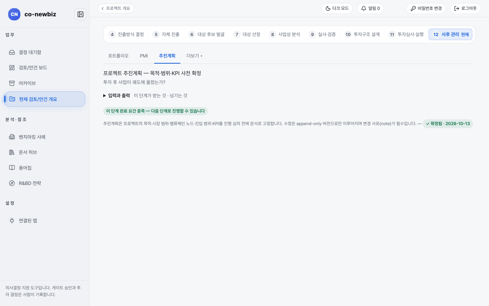
*추진계획 화면. 확정되면 `확정됨 · 날짜` 표지가 붙는다.*

## 마일스톤 읽기

1. 어느 단계 화면에서든 탭 줄 오른쪽 끝의 공통 링크 `마일스톤`을 연다(화면 제목 `프로젝트 마일스톤`). 기한이 임박하거나 지연된 항목이 있으면 링크 옆에 `임박 N`·`지연 N` 배지가 붙는다.
2. 트랙이 확정되면 관점 안내가 보인다. 그린필드는 `Green Field — 연구개발(R&D) 기반 사업화 관점`, 브라운필드는 `Brown Field — M&A 실사·PMI 관점`이다.
3. **🤖 AI 추천 마일스톤 보기**로 트랙·채택 사업에 맞는 4~7건을 제안받고 항목별 `추가` 버튼으로 사람이 등록한다. 제안은 저장되지 않는다.

## WACC 읽기

1. S8 화면에서 `WACC` 탭을 연다. 위쪽에 `목표 미설정` 줄이 있으면 **목표 설정**으로 사업 목표를 먼저 정할 수 있다.
2. `현재 확정값` 표에서 `WACC`, `요구수익률(Hurdle IRR)`, `WACC 적용 주체`, 출처(`default` 등)를 읽는다. 출처가 `default`이면 사람이 확정한 값이 아니다.
3. 아래 `WACC 참조값`은 한국은행 시장금리 등을 참고한 제안이다. **CAPM 분해에 모두 적용**으로 채우고 **새로고침**으로 다시 불러온다. 확정은 사람이 한다.
4. 베타 시계열 회귀는 [81-문제-해결](81-문제-해결.md)의 "베타 회귀 자료가 불러와지지 않을 때"를 본다.

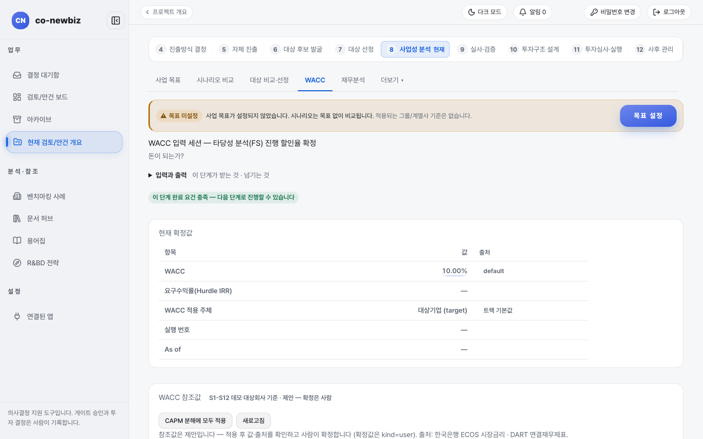
*WACC 화면. 현재 확정값은 기본값(`default`) 10.00%다.*

## 재무분석 읽기

1. S8 화면에서 `재무분석` 탭을 연다.
2. `연결된 대상 회사` 상자의 `매출액 (최근 연도)`, `영업이익률`, `부채비율`, `ROE`를 읽는다. `N/A`와 `동기화 전 — 회사 화면에서 동기화하세요` 표지는 아직 실적 자료가 없다는 뜻이다.
3. 회사를 바꾸려면 `대상 회사 연결/변경`에서 회사명이나 DART 고유번호를 검색하고 `연결 근거(rationale)`를 쓴 뒤 연결한다. 근거는 필수다.

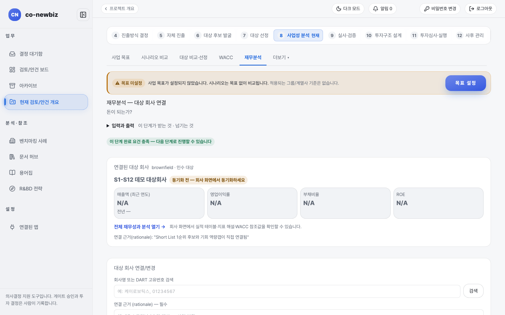
*재무분석 화면. 대상 회사 실적이 아직 동기화되지 않아 `N/A`다.*

## 타임라인 읽기

1. S12 화면에서 `더보기` → `프로세스 타임라인·SLA`를 연다.
2. 표의 `단계`, `SLA 목표`, `경과`, `경과/목표`, `상태`를 읽는다. SLA 정책이 없으면 `정책 미설정`으로 나온다. 경과 시간은 계산값이며 저장되지 않는다.
3. SLA를 넘긴 단계는 `리스크 히트맵`과 연동된다(표 아래 링크).

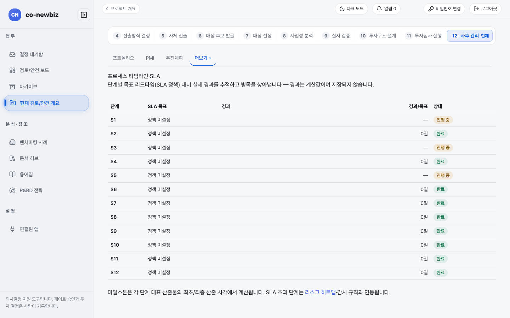
*타임라인. 데모에는 SLA 정책이 없어 모든 단계가 `정책 미설정`이다.*

## 리스크 히트맵 읽기

1. S9 `실사 워크스페이스`의 `실사 조사 도구`에서 `리스크 히트맵` 카드를 연다(화면 제목 `검토/안건 리스크 히트맵`).
2. 화면 위쪽 `판정 대기 — 어디에 무엇이 기록되어 있나` 스트립에서 소스마다 `플로팅 N` 또는 `기록 없음` 칩과 `기록 N건`을 읽는다.
3. 3×3 칸의 가로는 영향(`영향 低`, `영향 中`, `영향 高`), 세로 아래쪽은 가능성이 높음이다. 실제 기록만 플로팅된다.
4. 아래 `리스크 목록`은 실사 발견, 계약, 인센티브, 커버넌트 여력(S10 `차입·여신`의 약정 조건 여유, 채택한 S8 케이스의 하락 현금흐름 기준)에서 자동 집계된다. 기록이 없으면 칸이 비어 있다. 자동 산정된 가능성·영향은 기본값이고 분석가 이상이 항목별로 판정을 기록하면 그 값이 우선한다(`판정됨` 칩, 감사 로그). `리스크 항목 등록 (설명 *)` 폼으로 항목을 직접 등록하면 실사 항목(분류 `리스크`)으로 저장되어 조사내역·투자심의 자료에 함께 반영된다. 스냅샷은 투자심의 자료·분기 브리핑에 첨부되고 완화 판단은 사람이 한다.

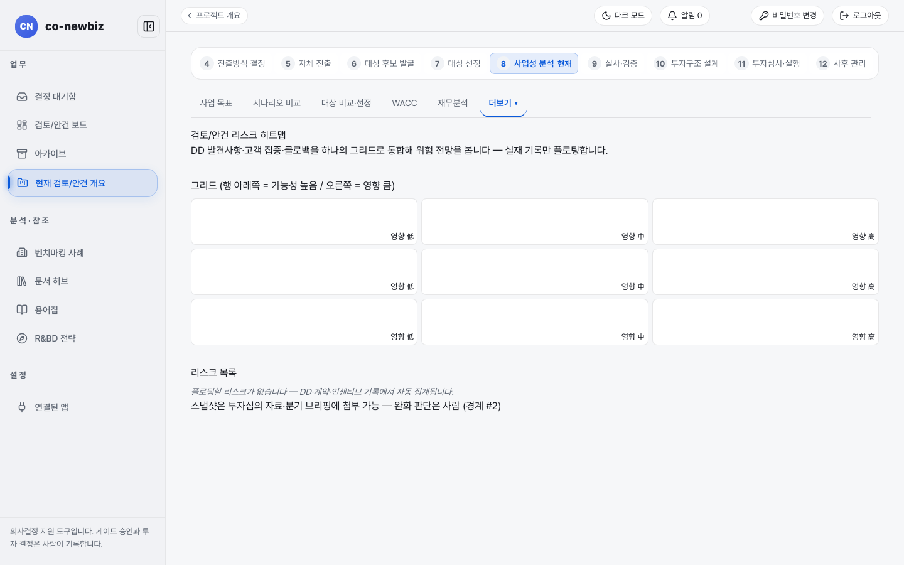
*리스크 히트맵. 데모에는 기록이 없어 칸이 비어 있다.*

## S8 기술적 타당성 탭 읽기

1. S8 `기술적 타당성` 탭의 항목 T1~T6는 **탭**으로 보인다. 모든 판정은 S9에서 이루어지고 S8은 결과를 비추기만 한다. 여기서 기록하거나 처리할 것은 없다.
2. `T1 역량 달성 가능성`은 필요 역량 판정에서 자동 도출된다. 브라운필드는 S9 `필요 역량 검증` 탭의 역량별 판정(해소/부분 해소/미해소)을 읽어 `S9 필요 역량 검증 N/M` 줄로 요약하고 표의 `판정` 칸 한 곳에 S9 칩·S5/S7 판정 문장·확정 메타가 쌓인다.
3. `T2 기술 성숙도(TRL)`·`T3 핵심 인력·설비·시설`·`T4 지식재산·라이선스`·`T5 인허가·인증`은 S9 체크리스트 항목들의 **롤업**이다. 각 탭은 자신을 구성하는 체크리스트 항목을 실사 탭별(기술·인사·법무 실사)로 묶어 판정 상태와 함께 보여 준다. 하나라도 미충족이면 미충족, 미판정이 남으면 판정 대기, 모두 충족이면 충족이다. 구성 항목은 각 실사 탭에서 평소처럼 판정하면 된다.
4. `T6 S9 실사 반영 현황`은 T2~T5 롤업이 얼마나 채워졌는지(`N/4`)와 공통 증적 항목(현장 실사·증적)을 보여 준다.

## S9 필요 역량 검증 탭 읽기

브라운필드 프로젝트의 S9 화면에만 보이는 탭이다. 그린필드는 같은 질문을 S5에서 답하므로 이 탭이 없다.

1. S9 `필요 역량 검증` 탭에서 S3 필요 역량 등록부의 각 역량에 대해 "이 인수가 격차를 실제로 메우는가"를 분석가 이상이 판정한다. 판정 값은 `해소 (대상 보유)` / `부분 해소` / `미해소 (자체 투자 필요)`이고 근거는 조사내역 인용이 권장된다.
2. 기록은 감사 로그에 남고 S8 기술적 타당성의 T1과 필요 역량 표에 읽기 전용으로 반영된다.

## 가치사슬 연계(proxy 체인) 읽기

1. S9 화면에서 `가치사슬 연계` 탭을 연다.
2. `프로젝트 산업 바인딩`에서 산업을 검색(`검색`)하고 `바인딩 근거(rationale)`를 쓰면 통계 보정 대상이 된다. 바인딩과 회수는 감사 로그에 남고 이력이 유지된다.
3. `프로젝트 가치사슬 링크`는 분석가의 판단 등록(탄력성, 전환비용, 대체위험)이다. `+ 링크 등록 폼`으로 근거와 함께 등록한다. 통계 수치(β·R²)는 수동 입력이 불가하며 아래 `보정된 proxy link`가 회귀로 산출한다.

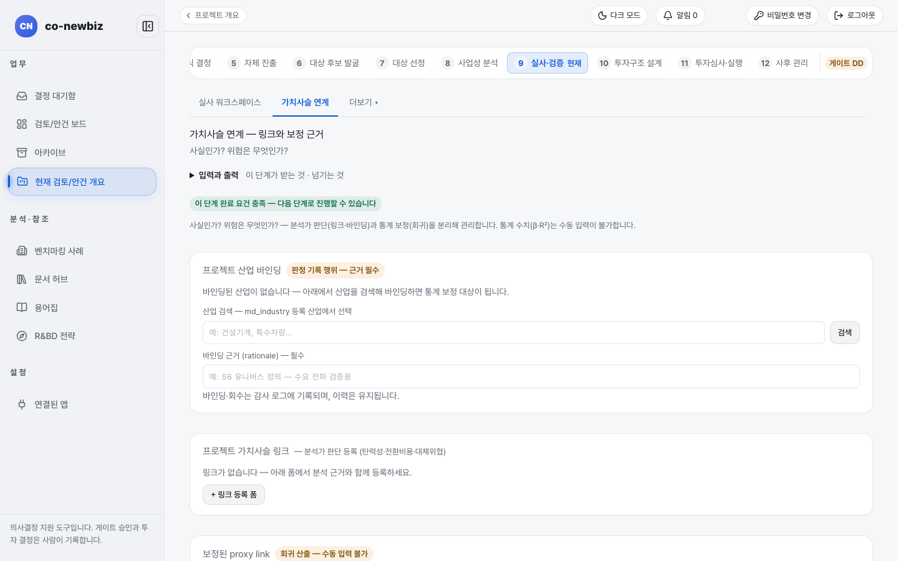
*가치사슬 연계. 데모에는 바인딩된 산업과 링크가 없다.*

## 백테스트 읽기

1. S12 화면에서 `더보기` → `예측-실적 백테스트 조직 집계`를 연다. 백테스트는 S8 예측과 S12 실측을 비교하는 학습 도구라서 S12의 더보기에 있다.
2. 표에서 프로젝트별 `NPV 예측 (p50)`, `실적 환산`, `괴리`, `판정`을 읽는다. 실적이 없으면 `—`와 `증거 부족`으로 나온다. 증거가 모자라면 가공하지 않고 그대로 보여 주는 화면이다.
3. `편향 탐지`에서 조직 전체 예측이 `과대 예측 편향`·`과소 예측 편향`·`편향 없음`·`표본 부족` 중 어느 쪽인지 읽는다. `제안 힌트`가 붙으면 사람이 아래 `신뢰도 등급 조정 제안`을 기록하고 다른 사람이 승인한다(제안한 사람은 스스로 승인할 수 없고 승인된 조정은 신뢰도 캡을 낮추기만 한다).

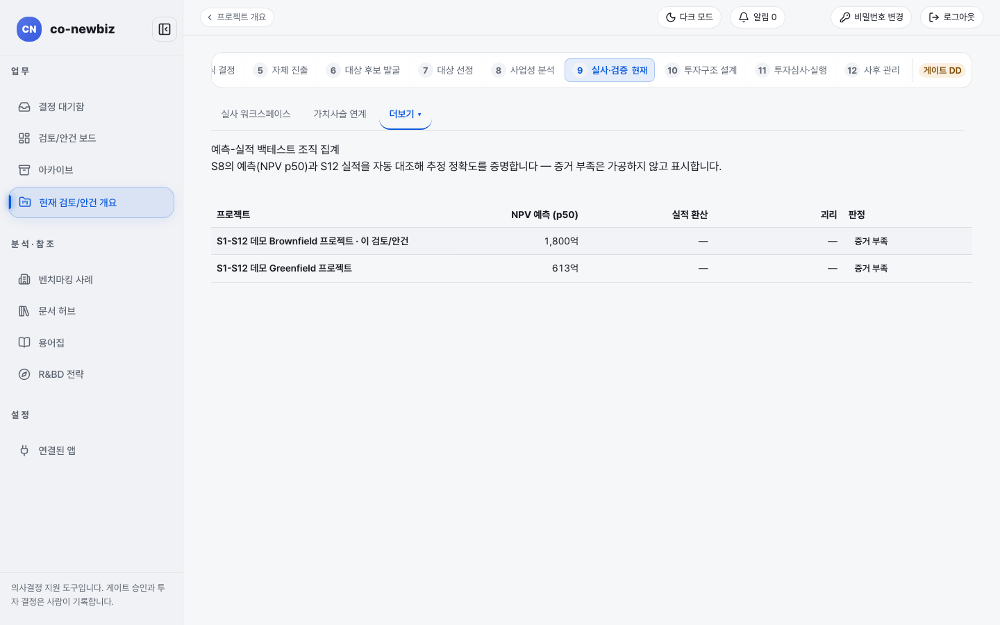
*백테스트. 데모는 실적이 아직 없어 두 프로젝트 모두 `증거 부족`이다.*

## 보고서 만들기

1. S11 화면에서 `보고서` 탭을 연다.
2. **🧾 투자심의 자료로 초안 생성**을 누르면 채택된 사업 사례(NPV/IRR), DD 완료 요약, 종합 등급 제안, 진행 이력, 이중 관점 비교에 더해 §8 `리스크 히트맵 요약`, §9 `자금 확정성 및 커버넌트 여력`, §10 `인허가·인증 현황`, §11 `마일스톤 요약`, §12 `투자심사 절차 단계`를 자동 구성하고 맨 앞에 `## 0. 경영 요약 (AI 초안 — 검토 필수)`를 붙여 돌려 준다. 경영 요약은 사람이 검토·수정한다.
3. **미리보기**로 저장 전에 읽어 보고, `제목`을 고치고 `렌더 포맷`(`docx`, `pdf`, `hwpx`)을 고른 뒤 `본문 (Markdown)`을 다듬어 저장한다. 저장하면 선택한 형식으로 렌더링되며 용어집 부록이 자동 첨부된다.
4. 저장한 스냅샷은 **보관**으로 이력 목록에서 치울 수 있고 `보관본 보기` 토글로 다시 열람한다(기록과 렌더 파일은 감사를 위해 남는다).

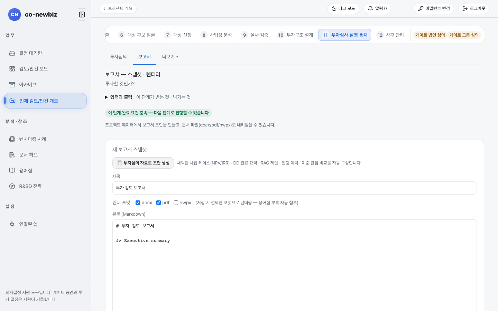
*보고서 화면. 기본 제목은 `투자 검토 보고서`이고 본문 첫 제목이 영어(`Executive summary`)로 들어 있다.*

## 에이전트 실행 이력 읽기

1. 에이전트 실행 이력은 메뉴에 없고 주소(`/projects/{id}/agent-runs`)로 열리는 화면이다. S11 화면 안의 기록이 필요하면 `투자심사 절차 단계` 내부 탭을 먼저 본다.
2. `실행 타임라인`에서 `시각`, `단계`, `활동`, `유형`, `상태`, `실행자`를 읽는다. AI가 한 일(제안)과 사람 기록은 항상 구분된다.
3. 아래 `AI 추천 신뢰도 점수`는 AI 제안이 사람의 같은 결정과 얼마나 일치했는지 보여 주는 표시 전용 값이며 진행 처리에 쓰이지 않는다. `위원회 PROPOSAL 기록`은 위원회가 만든 제안 기록이다.

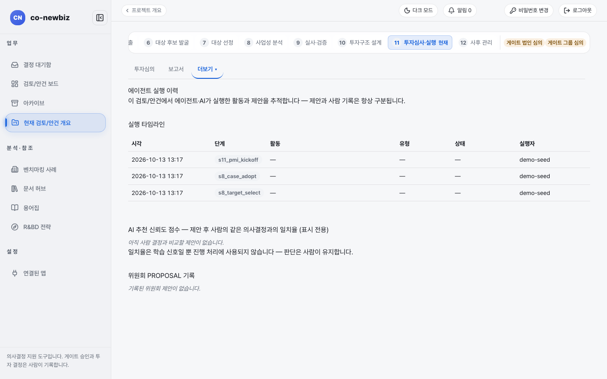
*에이전트 실행 이력. 데모에서는 시드 기록만 있고 `활동`, `유형`, `상태`가 `—`다.*

## 외부 안전 공유 쓰기

1. 외부 안전 공유도 메뉴에 없고 주소(`/projects/{id}/share`)로 열리는 화면이다. 제목 옆 `보안 설계 승인 후 사용` 표지는 보안 설계가 승인된 뒤에만 쓸 수 있다는 뜻이다.
2. 외부 자문사에게는 원본이 아니라 만료·워터마크·열람 기록이 있는 링크로만 공유한다. `자료 제목 *`, `수신자 *`, `만료 (일, ≤30)`(기본 7), `스냅샷 요약`을 채우고 **링크 생성**을 누른다.
3. 활성·만료된 링크가 없으면 "활성·만료된 공유 링크가 없습니다."가 나온다.

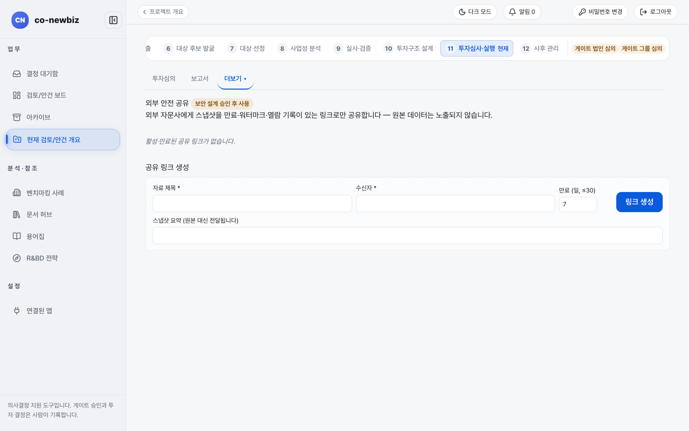
*외부 안전 공유. 링크 생성 칸 네 개와 **링크 생성**이 보인다.*

## 포트폴리오와 투자심사 읽기

이 두 화면은 단계 안내에서 자세히 다룬다. S12 `포트폴리오` 탭은 [34-공통-S12-사후-관리](34-공통-S12-사후-관리.md), S11 `투자심의` 탭은 [33-공통-S11-투자심의와-실행](33-공통-S11-투자심의와-실행.md)을 본다.

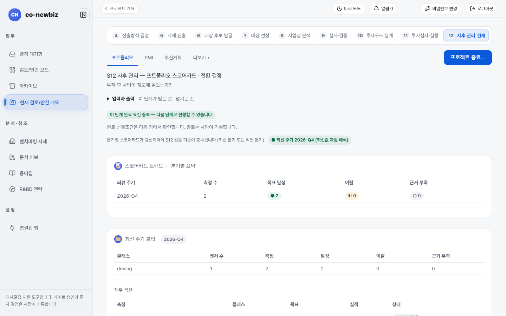
*S12 포트폴리오 스코어카드.*

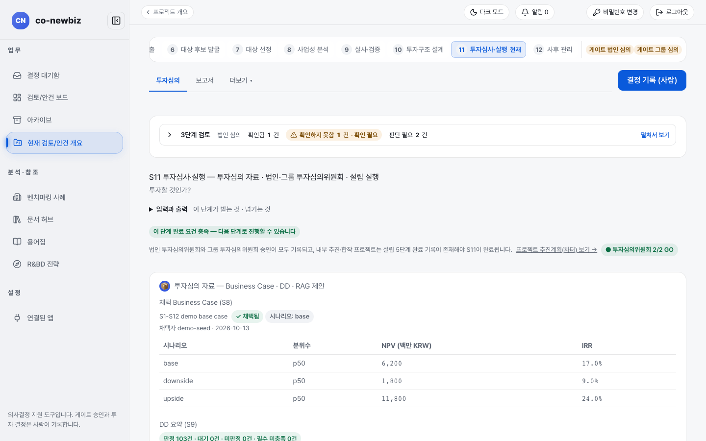
*S11 투자심사 검토 묶음. 아래에 승인 기록과 결정 이력이 이어진다.*

## 자주 하는 실수

- 큰 제목이 단계 이름(`S10 투자구조 설계`)인데 화면이 바뀌지 않았다고 여기는 것. 화면 이름은 그 아래 부제에 있다.
- 다시 확인 알림이 떠 있는데 GO나 사례 채택이 거절된다고 오류로 여기는 것. 항목을 마치고 요건을 해제해야 한다.
- 보조 화면에서 단계 완료나 게이트 결정을 기록하려는 것. 결정은 단계 화면의 **결정 기록 (사람)** 쪽에서만 한다.
- 비어 있는 화면(`리스크 히트맵`, `에이전트 실행 이력`)을 오류로 여기는 것. 기록이 생기면 채워진다.
- `외부 안전 공유`로 만든 링크를 보안 승인 전에 외부에 보내는 것.
- 같은 NPV가 화면마다 단위가 다른 것(`1,800억` vs `1,800` 백만 원)을 오류 없이 합산하는 것. 단위를 확인한다.

## 스스로 확인하기

데모 브라운필드 프로젝트에서 `더보기`로 열 수 있는 화면 이름을 S8, S9, S11, S12 각각 한 개씩 찾아 적어 본다(읽기 전용). 어떤 버튼도 누르지 않는다.

이전: [34-공통-S12-사후-관리](34-공통-S12-사후-관리.md) | 다음: [70-관리자-화면-안내](70-관리자-화면-안내.md)
