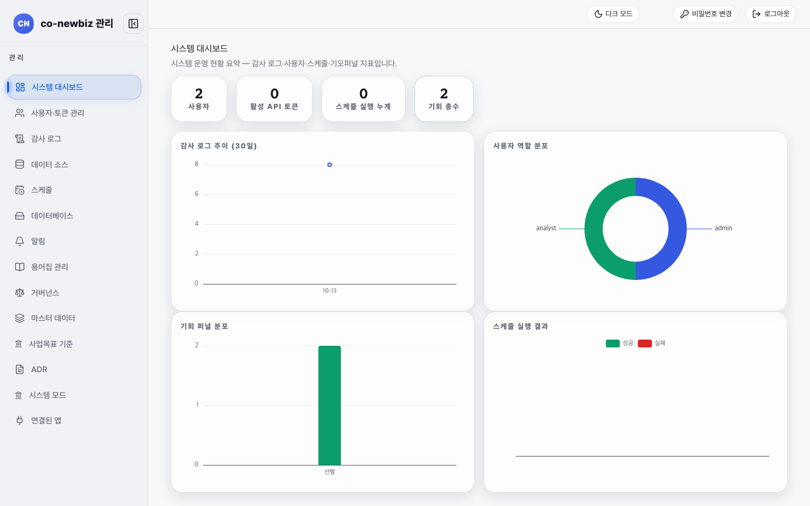
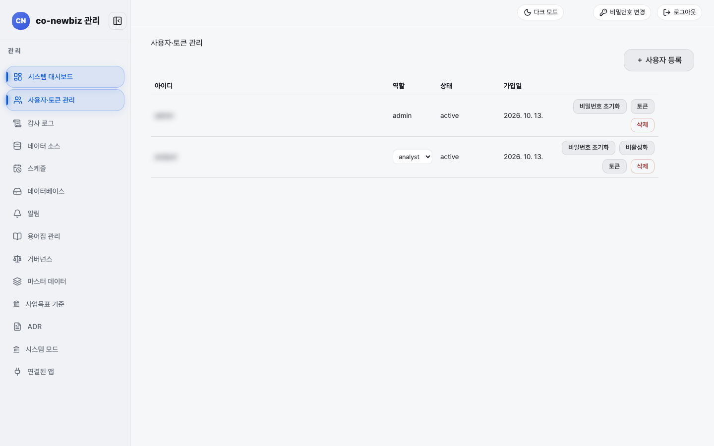
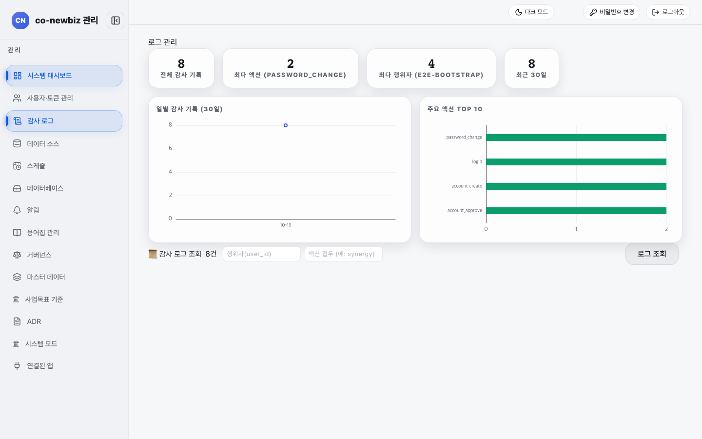
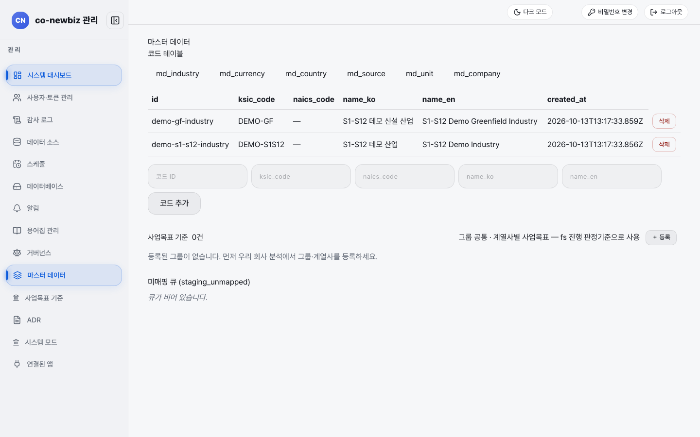
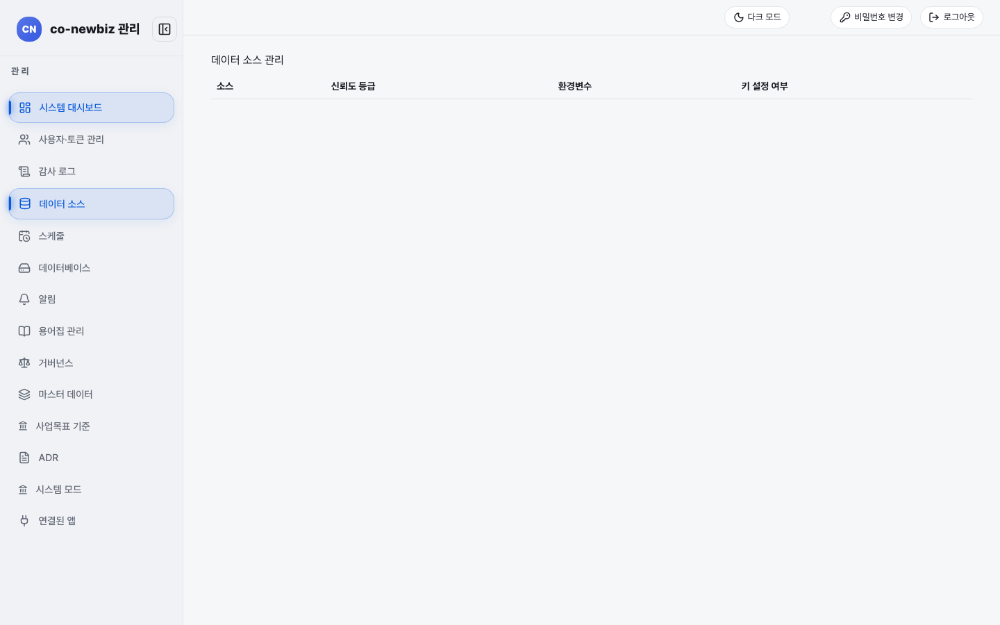
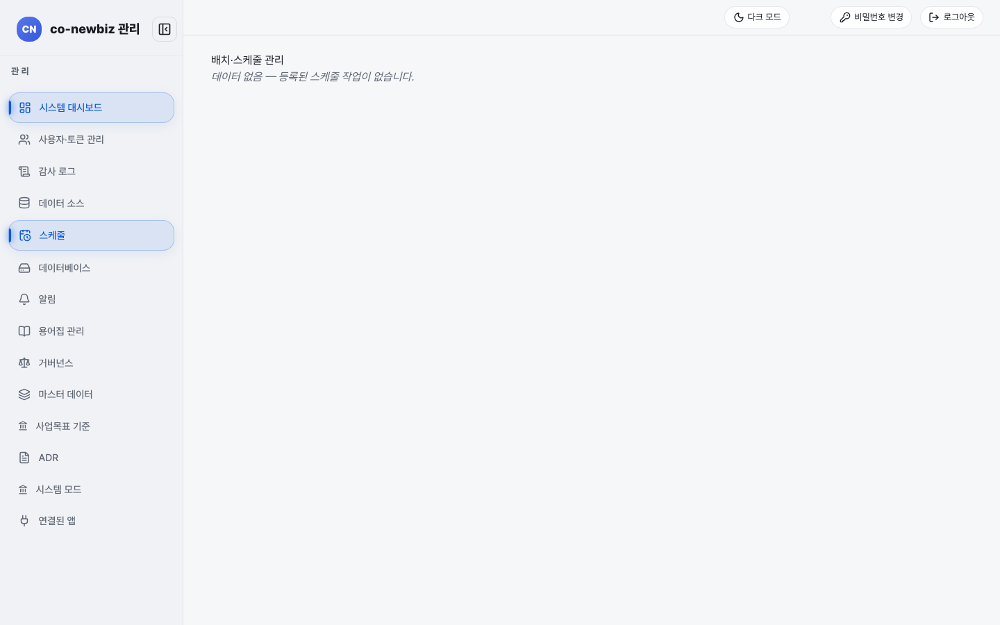
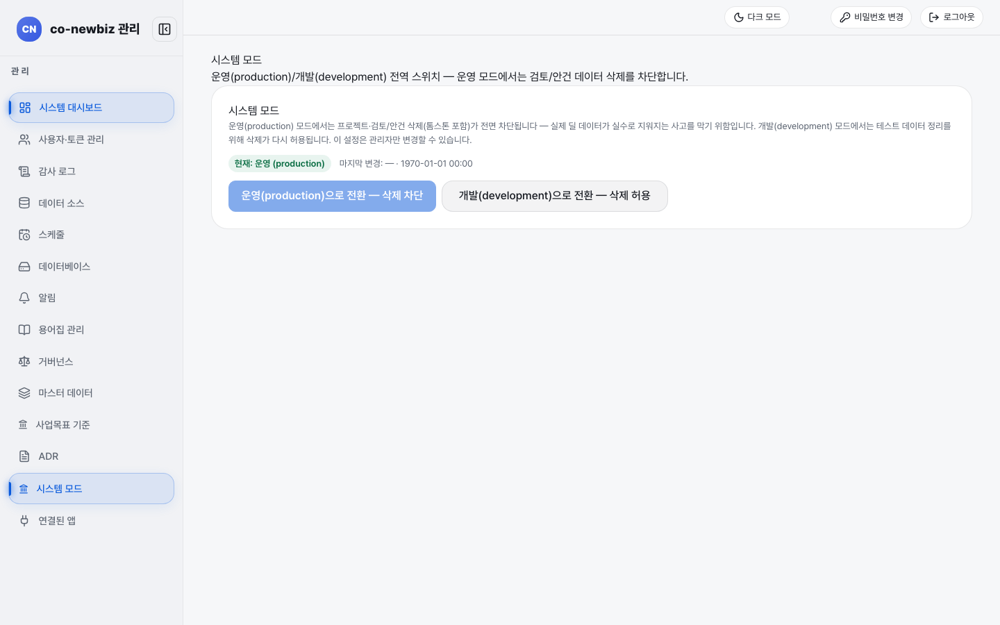
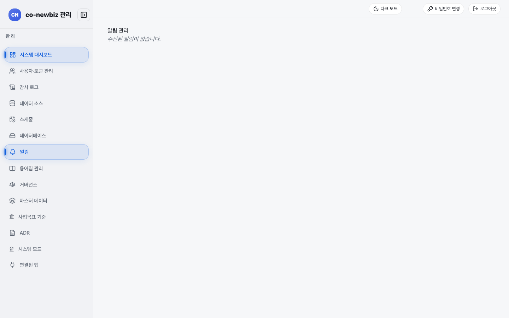
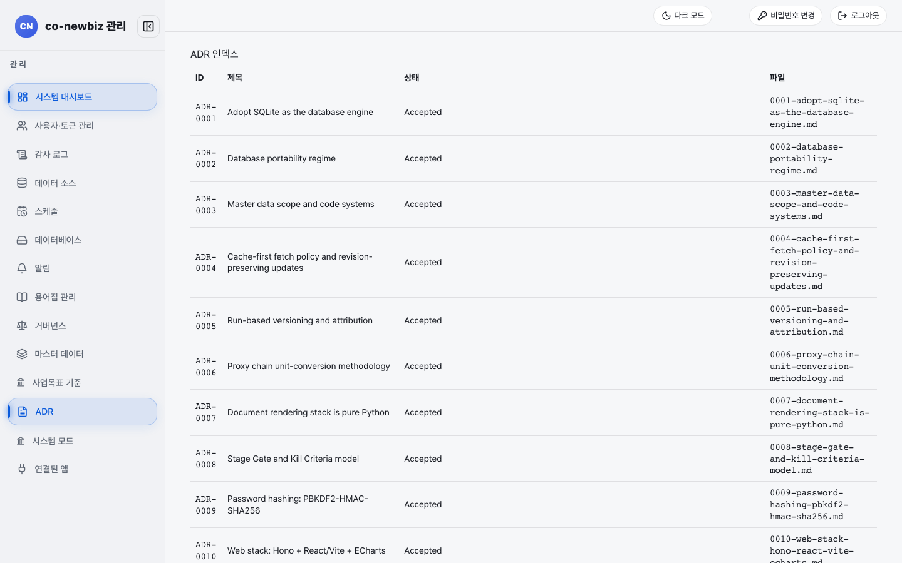
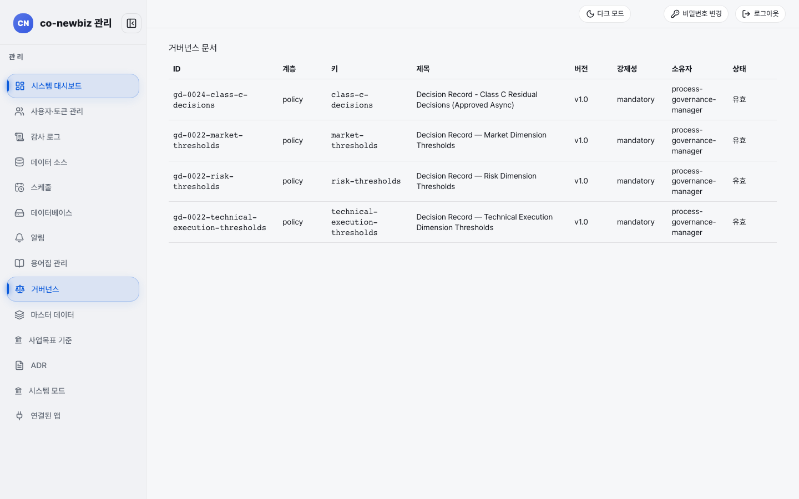

# 관리자 화면 안내

**목적:** 운영자(`admin`)가 쓰는 관리 콘솔의 화면을 한 쪽에서 보고, 무엇을 어디서 하는지 안다.

**누가/언제:** 운영자. 사용자 계정 관리, 기준 정보 정리, 시스템 상태 확인이 필요할 때.

**사전 조건:** `admin` 역할. 다른 역할은 이 화면에 들어올 수 없다.

> [!NOTE]
> 이 쪽의 화면 그림은 모두 **데모 자료**다. 사용자 아이디는 가렸고, 숫자와 날짜는 내 환경과 다르다. 운영 절차와 정책은 [관리자 매뉴얼](../../manuals/admin-manual_ko.md)과 [운영 매뉴얼](../../manuals/operations-manual_ko.md)이 기준이고, 이 쪽은 "어디를 누르는가"만 다룬다. 막히면 [81-문제-해결](81-문제-해결.md)을 본다.

## 관리 콘솔 왼쪽 메뉴

관리 콘솔 위쪽 이름은 `co-newbiz 관리`이고, 메뉴 `관 리` 아래 순서는 다음과 같다.

| 메뉴 | 주소 | 한 줄 설명 |
|---|---|---|
| `시스템 대시보드` | `/admin` | 사용자, 토큰, 스케줄, 기회 숫자 |
| `사용자·토큰 관리` | `/admin/users` | 계정 등록·역할·비밀번호 초기화·비활성화 |
| `감사 로그` | `/admin/audit` | 누가 언제 무엇을 했는지 조회 |
| `데이터 소스` | `/admin/data-sources` | 외부 자료 출처와 키 설정 여부 |
| `스케줄` | `/admin/schedule` | 정해진 때 도는 작업 |
| `데이터베이스` | `/admin/database` | 데이터베이스 상태(그림 없음) |
| `알림` | `/admin/notifications` | 수신된 알림 |
| `용어집 관리` | `/admin/glossary` | 용어 등록·검토(그림 없음) |
| `거버넌스` | `/admin/governance` | 정책·절차 문서 목록 |
| `마스터 데이터` | `/admin/master-data` | 산업·통화·국가 같은 코드표 |
| `사업목표 기준` | `/admin/business-targets` | 그룹·계열사별 사업 목표 기준(그림 없음) |
| `ADR` | `/admin/adr` | 설계 결정 기록 목록 |
| `시스템 모드` | `/admin/system-mode` | 운영/개발 전체 스위치 |
| `연결된 앱` | `/settings/connected-apps` | 모든 사용자 공통 화면([12-공통-화면-둘러보기](12-공통-화면-둘러보기.md)) |

## 시스템 대시보드 읽기

1. 왼쪽 메뉴 `시스템 대시보드`를 연다. 제목은 `시스템 대시보드`다.
2. 위쪽 숫자 칸 `사용자`, `활성 API 토큰`, `스케줄 실행 누계`, `기회 총수`를 읽는다.
3. 아래 그림 네 개: `감사 로그 추이 (30일)`, `사용자 역할 분포`, `기회 퍼널 분포`, `스케줄 실행 결과`(`성공`, `실패`).

*시스템 대시보드. 데모에는 사용자 2명(admin, analyst)이 있다.*

## 사용자 등록하고 관리하기

1. `사용자·토큰 관리`를 연다. 표 열은 `아이디`, `역할`, `상태`, `가입일`이고 행마다 버튼이 있다.
2. 새 계정은 오른쪽 위 **+ 사용자 등록**을 누른다. 계정 신청이 들어오면 상태가 `pending`인 행에 **승인** 버튼이 생기고, 누르면 로그인할 수 있게 된다(로그인 화면: "계정 신청 후 관리자 승인이 완료되면 로그인할 수 있습니다").
3. 행의 `역할` 드롭다운(`admin`, `analyst`, `viewer`)으로 역할을 바꾼다. 내 계정 행은 드롭다운 없이 글자로만 보인다. 행 버튼은 **비밀번호 초기화**, **비활성화**, **토큰**, **삭제**다. **삭제**는 되돌릴 수 없으니 신중히 누른다.
4. 비밀번호를 초기화하면 사용자는 임시 비밀번호로 로그인한 뒤 새 비밀번호로 바꿔야 한다([01-시작하기](01-시작하기.md)).

*사용자·토큰 관리. 실제 아이디는 흐리게 가렸다.*

## 감사 로그 조회하기

1. `감사 로그`를 연다. 제목은 `로그 관리`이고 위쪽에 `전체 감사 기록`, `최다 액션`, `최다 행위자`, `최근 30일` 숫자가 있다.
2. 아래 `감사 로그 조회` 칸에 `행위자(user_id)`, `액션 접두 (예: synergy)`를 넣고 **로그 조회**를 누르면 기록이 나온다.
3. 화면의 `주요 액션 TOP 10`에는 `password_change`, `login` 같은 액션 이름이 영어 그대로 보인다.

*감사 로그. 일별 기록 그림과 주요 액션 그림 아래에 조회 칸이 있다.*

## 마스터 데이터 관리하기

1. `마스터 데이터`를 연다. 제목 아래 `코드 테이블` 탭: `md_industry`, `md_currency`, `md_country`, `md_source`, `md_unit`, `md_company`.
2. 코드 표에는 `id`, `ksic_code`, `naics_code`, `name_ko`, `name_en`, `created_at`이 있다. 아래 입력 칸 다섯 개를 채우고 **코드 추가**를 누른다. 행 오른쪽 **삭제**로 지운다.
3. 아래 `사업목표 기준`(그룹 공통·계열사별 사업 목표를 FS 진행 판정 기준으로 씀)과 `미매핑 큐 (staging_unmapped)`가 있다. 그룹이 없으면 "먼저 우리 회사 분석에서 그룹·계열사를 등록하세요."가 나온다.

*마스터 데이터. 데모에는 산업 코드 두 건이 있다.*

## 데이터 소스와 스케줄 읽기

1. `데이터 소스`에서 `소스`, `신뢰도 등급`, `환경변수`, `키 설정 여부` 표를 읽는다. 키 값 자체는 보이지 않고 설정 여부만 보인다. 데모는 비어 있다.
2. `스케줄`(제목 `배치·스케줄 관리`)에서 등록된 스케줄 작업을 읽는다. 데모는 `데이터 없음 — 등록된 스케줄 작업이 없습니다.`다.

*데이터 소스. 데모는 표 머리글만 있다.*

*스케줄. 등록된 작업이 없을 때의 모습.*

## 시스템 모드 바꾸기

1. `시스템 모드`를 연다. `현재: 운영 (production)` 표지가 현재 상태다.
2. 운영 모드에서는 프로젝트·검토/안건 삭제(톰스톤 포함)가 모두 막힌다. 실수로 실제 딜 자료가 지워지는 사고를 막기 위해서다.
3. (쓰기, 운영자만) `운영(production)으로 전환 — 삭제 차단` 또는 `개발(development)으로 전환 — 삭제 허용` 버튼을 눌러 바꾼다. 개발 모드는 테스트 자료 정리용이다. 이 설정은 관리자만 바꿀 수 있다.

*시스템 모드. 지금은 운영 모드라 삭제가 막혀 있다.*

## 알림, ADR, 거버넌스 읽기

- `알림`(제목 `알림 관리`): 수신된 알림 목록. 없으면 "수신된 알림이 없습니다."
- `ADR`(제목 `ADR 인덱스`): `ID`, `제목`, `상태`, `파일` 열로 설계 결정 기록을 본다. 영어 제목이 그대로 나온다.
- `거버넌스`(제목 `거버넌스 문서`): `ID`, `계층`, `키`, `제목`, `버전`, `강제성`, `소유자`, `상태` 열로 정책·절차 문서를 본다. 읽기 전용이다.

*알림 관리. 데모에는 받은 알림이 없다.*

*ADR 인덱스. 변경이 큰 일(DB 스키마, 인증, 도구 범위 등)은 ADR이 있어야 한다.*

*거버넌스 문서. 정책·절차는 이 화면에서 고치지 않고 저장소에서 바꾼다.*

## 자주 하는 실수

- 운영 모드에서 삭제가 안 된다고 오류로 여기는 것. 의도된 보호다.
- 사용자 `삭제`와 `비활성화`를 혼동하는 것. 계정을 남긴 채 잠시 막으려면 **비활성화**다.
- 이 화면이 비어 있다고 데이터가 사라졌다고 여기는 것(데모는 일부러 비어 있다).
- 에이전트나 토큰으로 관리 작업을 대신 시키려는 것. 에이전트는 호출한 사람의 권한만 물려받고, 사용자·토큰·시스템 모드는 로그인한 운영자의 웹 화면에서만 바꾼다.

## 스스로 확인하기

`시스템 모드`에서 현재 모드와 운영 모드의 보호 내용을 읽고, `사용자·토큰 관리`에서 역할이 `admin`인 행에 어떤 버튼이 없는지 확인한다(읽기 전용, 버튼은 누르지 않는다).

이전: [60-프로젝트-화면-안내](60-프로젝트-화면-안내.md) | 다음: [80-자주-묻는-질문](80-자주-묻는-질문.md)
