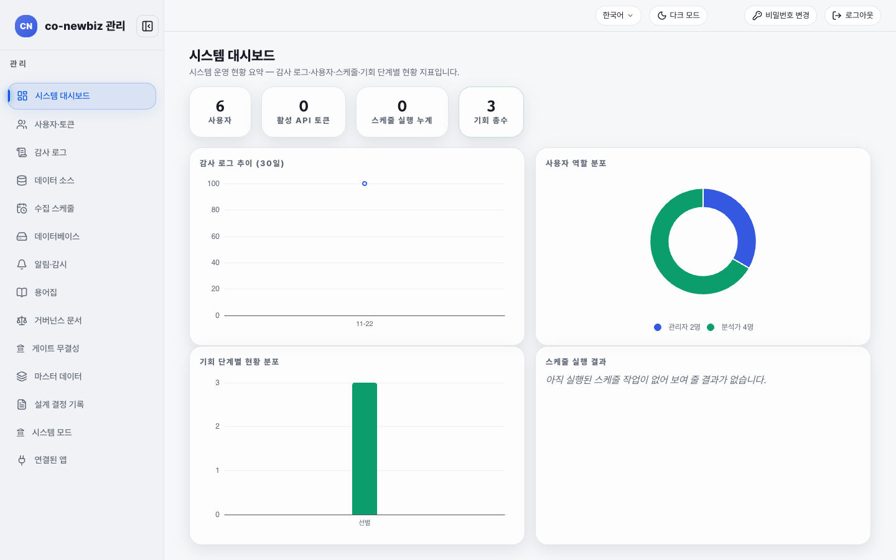
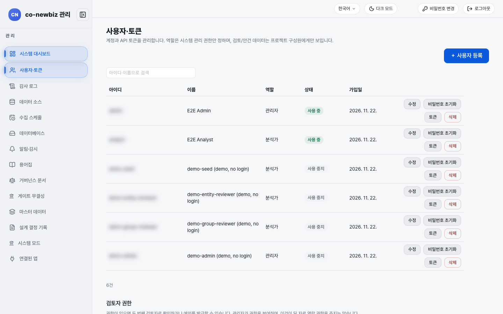
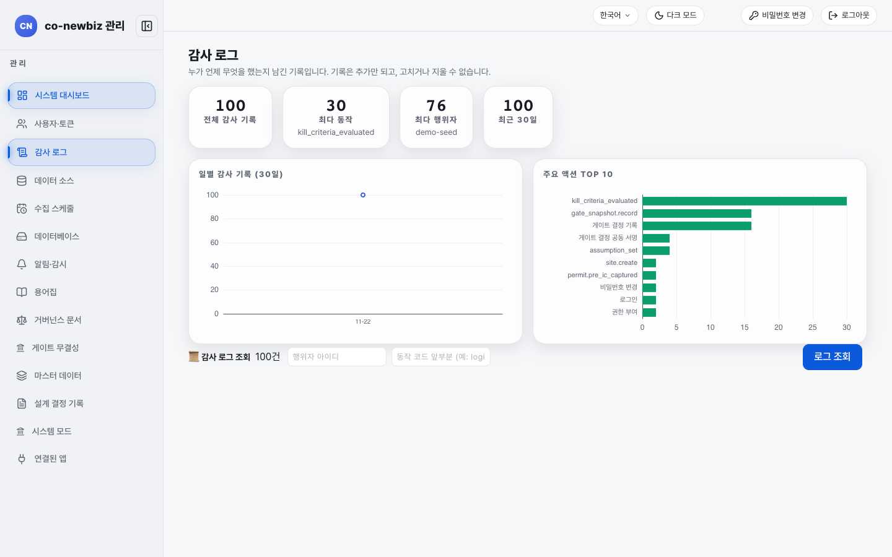
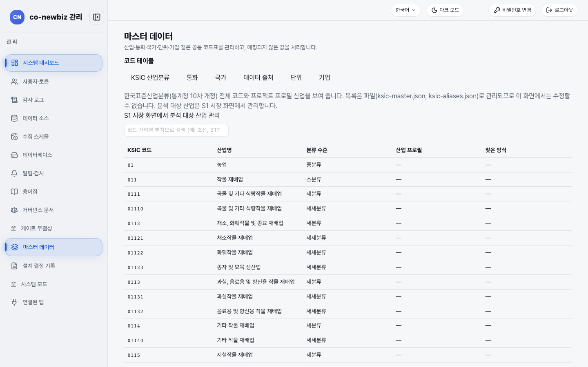
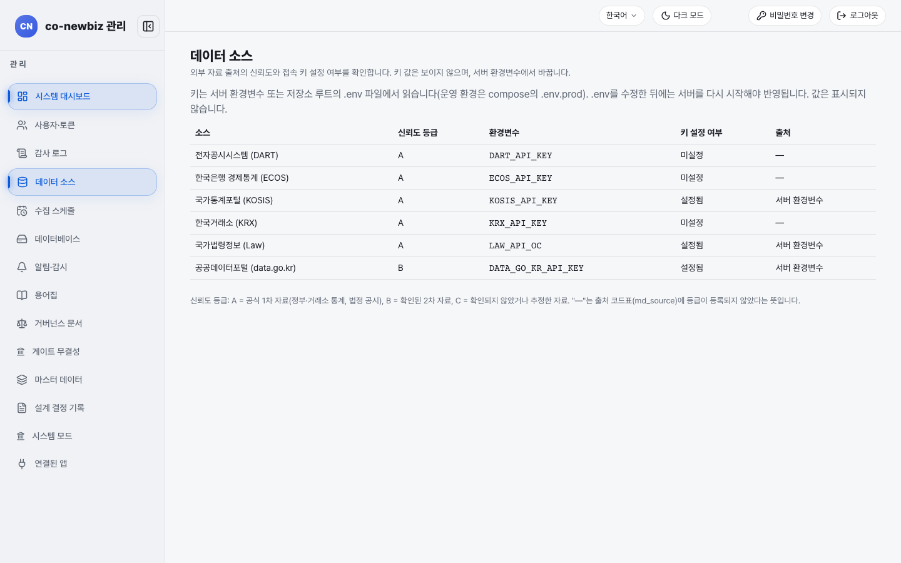
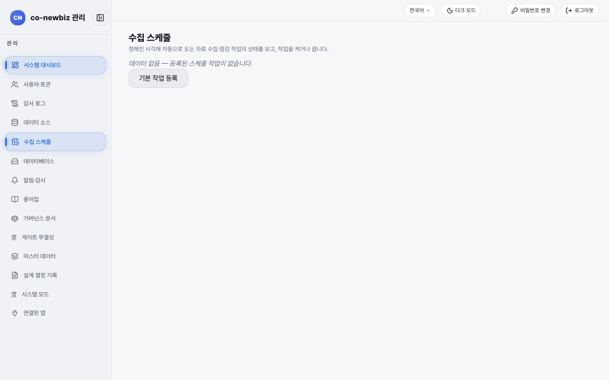
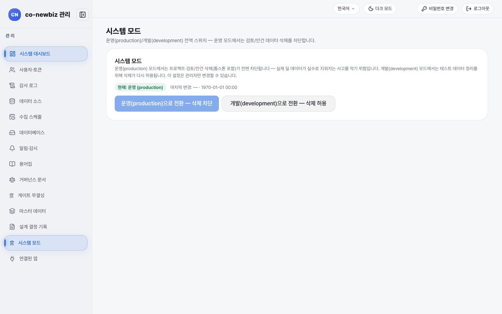
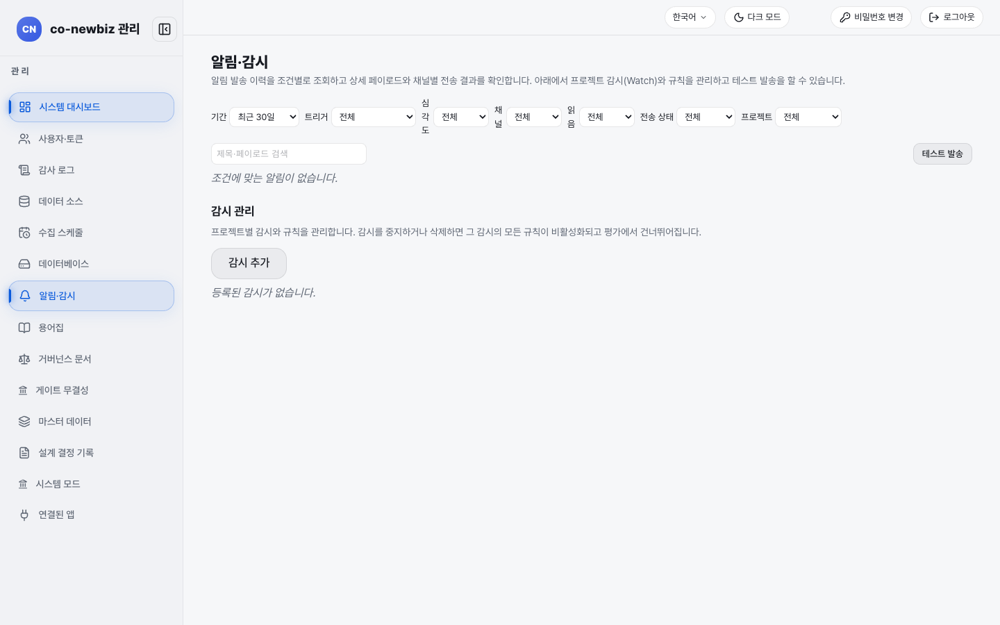
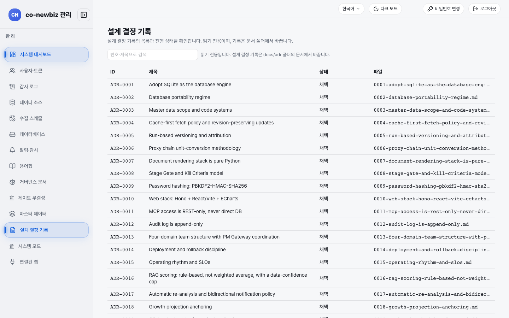
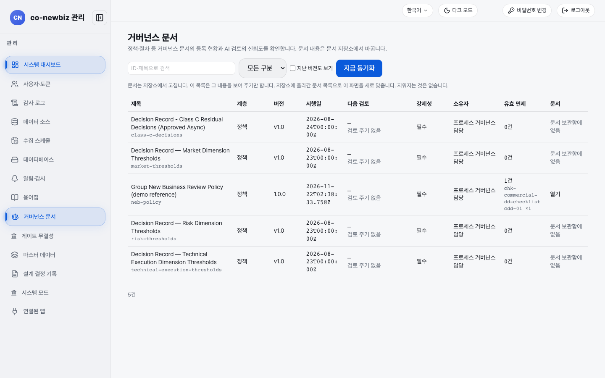

# 관리자 화면 안내

**목적:** 운영자(`admin`)가 쓰는 관리 콘솔의 화면을 한 쪽에서 보고 무엇을 어디서 하는지 안다.

**누가/언제:** 운영자. 사용자 계정 관리, 기준 정보 정리, 시스템 상태 확인이 필요할 때.

**사전 조건:** `admin` 역할. 다른 역할은 이 화면에 들어올 수 없다.

> [!NOTE]
> 이 쪽의 화면 그림은 모두 **데모 자료**다. 사용자 아이디는 가렸고 숫자와 날짜는 내 환경과 다르다. 운영 절차와 정책은 [관리자 매뉴얼](../../manuals/admin-manual_ko.md)과 [운영 매뉴얼](../../manuals/operations-manual_ko.md)이 기준이고 이 쪽은 "어디를 누르는가"만 다룬다. 막히면 [81-문제-해결](81-문제-해결.md)을 본다.

## 관리 콘솔 왼쪽 메뉴

관리 콘솔 위쪽 이름은 `co-newbiz 관리`이고 메뉴 `관 리` 아래 순서는 다음과 같다.

| 메뉴 | 주소 | 한 줄 설명 |
|---|---|---|
| `시스템 대시보드` | `/admin` | 사용자, 토큰, 스케줄, 기회 숫자 |
| `사용자·토큰 관리` | `/admin/users` | 계정 등록·역할·비밀번호 초기화·비활성화 |
| `감사 로그` | `/admin/audit` | 누가 언제 무엇을 했는지 조회 |
| `데이터 소스` | `/admin/data-sources` | 외부 자료 출처와 키 설정 여부 |
| `수집 스케줄` | `/admin/schedule` | 정해진 때 도는 작업 켜기·끄기·시간 바꾸기 |
| `데이터베이스` | `/admin/database` | 데이터베이스 상태(그림 없음) |
| `알림` | `/admin/notifications` | 수신된 알림 |
| `용어집 관리` | `/admin/glossary` | 용어 등록·검토(그림 없음) |
| `거버넌스` | `/admin/governance` | 정책·절차 문서 목록 |
| `게이트 무결성` | `/admin/gate-integrity` | 게이트 규칙의 주간 지표 G1~G12와 다시 확인 요건 열기 |
| `마스터 데이터` | `/admin/master-data` | 산업·통화·국가 같은 코드표 |
| `사업목표 기준` | (이전됨) | 관리자 화면에서 `/our-company`의 그룹 화면으로 옮겨졌습니다. 그룹·계열사별 사업 목표 기준은 그곳에서 관리합니다. |
| `ADR` | `/admin/adr` | 설계 결정 기록 목록 |
| `시스템 모드` | `/admin/system-mode` | 운영/개발 전체 스위치 |
| `연결된 앱` | `/settings/connected-apps` | 모든 사용자 공통 화면([12-공통-화면-둘러보기](12-공통-화면-둘러보기.md)) |

## 시스템 대시보드 읽기

1. 운영자로 로그인하면 첫 화면으로 이 화면(`시스템 대시보드`, `/admin`)이 열린다. 왼쪽 메뉴 `시스템 대시보드`로 언제든 돌아온다. 제목은 `시스템 대시보드`다.
2. 위쪽 숫자 칸 `사용자`, `활성 API 토큰`, `스케줄 실행 누계`, `기회 총수`를 읽는다.
3. 아래 그림 네 개: `감사 로그 추이 (30일)`, `사용자 역할 분포`, `기회 퍼널 분포`, `스케줄 실행 결과`(`성공`, `실패`).

*시스템 대시보드. 데모에는 사용자 2명(admin, analyst)이 있다.*

## 사용자 등록하고 관리하기

1. `사용자·토큰 관리`를 연다. 표 열은 `아이디`, `역할`, `상태`, `가입일`이고 행마다 버튼이 있다.
2. 새 계정은 오른쪽 위 **+ 사용자 등록**을 누른다. 로그인 화면의 자체 계정 신청(`/register`)은 닫혀 있어 사용자의 자발적 신청은 더 이상 들어오지 않는다. 상태가 `pending`(승인 대기)인 행은 **승인** 버튼이 생기고 누르면 로그인할 수 있게 된다.
3. 행의 `역할` 드롭다운(`admin`, `analyst`, `viewer`)으로 역할을 바꾼다. 내 계정 행은 드롭다운 없이 글자로만 보인다. 행 버튼은 **비밀번호 초기화**, **비활성화**, **토큰**, **삭제**다. **삭제**는 되돌릴 수 없으니 신중히 누른다.
4. 비밀번호를 초기화하면 사용자는 임시 비밀번호로 로그인한 뒤 새 비밀번호로 바꿔야 한다([01-시작하기](01-시작하기.md)).

*사용자·토큰 관리. 실제 아이디는 흐리게 가렸다.*

## 감사 로그 조회하기

1. `감사 로그`를 연다. 제목은 `로그 관리`이고 위쪽에 `전체 감사 기록`, `최다 액션`, `최다 행위자`, `최근 30일` 숫자가 있다.
2. 아래 `감사 로그 조회` 칸에 `행위자(user_id)`, `액션 접두 (예: synergy)`를 넣고 **로그 조회**를 누르면 기록이 나온다.
3. 화면의 `주요 액션 TOP 10`에는 `password_change`, `login` 같은 액션 이름이 영어 그대로 보인다.

*감사 로그. 일별 기록 그림과 주요 액션 그림 아래에 조회 칸이 있다.*

## 검토자 권한 부여하기

두 번째 검토(IC 연서)는 위원회 검토자 권한이 있는 사람만 한다. 권한은 관리자가 준다.

1. `사용자·토큰 관리` 아래쪽 `검토자 권한` 구역을 연다. 안내 문구는 "권한이 있으면 두 번째 검토자로 확인하거나 예외를 발급할 수 있습니다. 관리자가 권한을 부여하며, 이것이 딜 자료 열람 권한을 주지는 않습니다."다.
2. `사용자 *`와 `역할 *`(`법인 투자심의위원회 검토자` 또는 `그룹 투자심의위원회 검토자`)를 고르고 **권한 부여**를 누른다. 확인 창에서 한 번 더 확인한다. 본인에게는 줄 수 없다.
3. 표에서 `유효`와 `취소됨` 상태를 읽고 거둘 때는 행의 **취소**를 누른다. `취소된 권한 보기`로 지난 기록을 본다.
4. 시행 전에는 두 역할 각각에 서로 다른 사람이 둘 이상 있어야 한다. 한 명뿐이면 그 사람이 기록한 GO를 확인할 사람이 없다.

관리자는 권한만 줄 뿐 프로젝트 안의 결정을 대신 기록하거나 확인하지 않는다.

## 게이트 무결성 지표 읽기

1. 왼쪽 메뉴 `게이트 무결성`을 연다. 제목은 `게이트 무결성`이고 안내는 "게이트 규칙의 주간 지표 G1-G12입니다 …"다. 건수만 나오며 사유 본문과 프로젝트 이름은 보이지 않는다.
2. 위쪽 `기간과 조건`에서 `시작일`, `종료일(포함)`, `게이트`, `최소 결정 수 (G12)`를 정하고 **지표 보기**를 누른다. 시작일이 종료일보다 늦으면 `시작일이 종료일보다 늦을 수 없습니다.`가 나온다.
3. 요약 줄 `기간 … · 한도를 넘은 지표 N개`를 읽는다. 지표마다 상태가 `한도 이내`, `한도 초과`, `계산 불가`, `데이터베이스 변경 대기` 중 하나로 붙고 `한도 초과`는 `한도를 넘은 이유`를 보여 준다.
4. 지표는 다음과 같다.

| 지표 | 뜻 |
|---|---|
| G1 | GO / HOLD / KILL 분포 |
| G2 | AI와 사람의 결정이 다른 비율 |
| G3 | 다른 결정의 사유 기재 |
| G4 | 종류별 확인 응답 |
| G5 | GO 시점의 미평가 중단 조건 |
| G6 | 차단 예정 사건(그림자 운영) |
| G7 | 두 번째 검토 대기 시간과 대기 건수 |
| G8 | 열린 조건과 경과 기간 |
| G9 | 면제 건수와 경과 기간 |
| G10 | 해당 없음(na) 확인 대기 시간과 적체 |
| G11 | S8 이후에도 잠정인 WACC 비율 |
| G12 | 차단 예정 사건이 없는 날수 |

5. 구역 `시행 전환 선행 지표`는 규칙 묶음을 시행으로 바꾸기 전에 확인하는 지표다. G12의 `14일 충족`이 `예`여야 하고 그 기간의 결정 수가 `최소 결정 수` 이상이어야 한다.
6. 위쪽에 `아직 반영되지 않은 데이터베이스 변경이 있습니다`가 뜨면 일부 지표가 `데이터베이스 변경 대기`로 표시된다. 변경을 반영한 뒤 다시 불러온다.
7. 같은 쪽의 `다시 확인 요건 열기`는 관리자용 입력이다. 예전 규칙으로 기록한 프로젝트에 다시 확인 요건을 열 때 쓴다([60-프로젝트-화면-안내](60-프로젝트-화면-안내.md)).

## 마스터 데이터 관리하기

1. `마스터 데이터`를 연다. 제목 아래 `코드 테이블` 탭: `md_industry`, `md_currency`, `md_country`, `md_source`, `md_unit`, `md_company`.
2. 코드 표에는 `id`, `ksic_code`, `naics_code`, `name_ko`, `name_en`, `created_at`이 있다. 아래 입력 칸 다섯 개를 채우고 **코드 추가**를 누른다. 행 오른쪽 **삭제**로 지운다.
3. 아래 `사업목표 기준`(그룹 공통·계열사별 사업 목표를 FS 진행 판정 기준으로 씀)과 `미매핑 큐 (staging_unmapped)`가 있다. 그룹이 없으면 "먼저 우리 회사 분석에서 그룹·계열사를 등록하세요."가 나온다.

*마스터 데이터. 데모에는 산업 코드 두 건이 있다.*

## 데이터 소스와 스케줄 읽기

1. `데이터 소스`에서 `소스`, `신뢰도 등급`, `환경변수`, `키 설정 여부` 표를 읽는다. 키 값 자체는 보이지 않고 설정 여부만 보인다. 데모는 비어 있다.
2. 키가 설정되었다고 승인이 있다는 뜻은 아니다. 출처마다 신청과 승인이 따로 필요하다: KRX는 서비스마다 사용 신청, 공공데이터포털(data.go.kr)은 데이터셋마다 활용신청, 법제처·KOSIS·ECOS·DART는 각자의 키 발급이다. 출처별 환경변수, 신청 위치, 이 키에 기대는 앱 기능, 키가 없을 때 증상은 [관리자 매뉴얼](../../manuals/admin-manual_ko.md) 6절에 있다.
3. 공공데이터포털 데이터셋은 저장소의 `docs/runbooks/data-go-kr-datasets.yaml` 하나에 모두 적는다. 새 데이터셋은 먼저 활용신청하고, 그 목록에 올린 뒤, 코드를 만든다. 목록의 신청 상태는 기록일 뿐이니 `마이페이지 > 활용신청 현황`과 맞춰 보고 다르면 목록을 고친다. 목록 머리의 확인일에 맞춰 본 결과 신청 아홉 건이 모두 승인이고 모두 개발계정이다. 승인에는 기한(`expires_on`)이 있어 그 전에 활용연장으로 갱신해야 한다. 계획 기능인 신용등급 교차 확인은 `금융위원회_채권시세정보`를 아직 신청하지 않았으므로 신청하기 전에는 동작하지 않는다.
4. DART 키(`DART_API_KEY`)는 회사 재무 동기화뿐 아니라 WACC 화면의 `신용등급 수집 실행`에도 쓴다. 키가 없으면 그 수집이 `503 dart_api_key_missing`으로 시작되지 않고 WACC 카드는 기본 등급 BBB−와 수집 안내를 그대로 보인다. 키를 넣거나 바꾼 뒤에는 서버를 다시 시작해야 읽힌다. 이 수집은 분석가가 화면에서 직접 누르는 것이고 운영자가 스케줄에 올리는 작업이 아니다.
5. `수집 스케줄`에서 등록된 스케줄 작업을 읽는다. 데모는 `데이터 없음 — 등록된 스케줄 작업이 없습니다.`다. 쓰는 법은 아래 [수집 스케줄 화면 쓰기](#수집-스케줄-화면-쓰기)에 있다.

*데이터 소스. 데모는 표 머리글만 있다.*

*스케줄. 등록된 작업이 없을 때의 모습.*

## 수집 스케줄 화면 쓰기

작업 열한 개(`collect.dart`, `collect.ecos`, `collect.kofia`, `collect.kosis`, `collect.krx`, `collect.law`, `gate_integrity.shadow_report`, `notify.deliver`, `notify.digest`, `retention.cleanup`, `watch.evaluate`)의 하는 일, 기본 시각, 필요한 키는 [관리자 매뉴얼](../../manuals/admin-manual_ko.md) 6.3절이 기준이다. 이 절은 화면에서 어디를 누르는지만 다룬다.

1. 왼쪽 메뉴 `수집 스케줄`을 연다. 표 열은 `작업`, `스케줄`, `상태`, `다음 실행`, `최근 실행`이다. 상태에는 `활성`(●) 또는 `비활성`(○)이 보인다.
2. 목록이 비어 있으면 **기본 작업 등록**을 누른다. 등록한 작업은 모두 `비활성`으로 시작하고, 켜기 전에는 정해진 때에 돌지 않는다.
3. **켜기·끄기:** 행의 **활성화** 또는 **비활성화**를 누른다. 1분 안에 반영되고 서버나 컴퓨터 설정을 다시 할 필요가 없다.
4. **시간 바꾸기:** 행의 **편집**을 누른다. `cron 식`을 `빠른 설정`(빈도, 시각, 요일을 고름)이나 `직접 입력`으로 고친다. 시각은 한국시간(KST)이고 간격은 5분 이상이어야 한다. 아래 `다음 5회 실행 시각`으로 맞는지 보고 저장한다. 같은 창에서 `실행 제한(분)`(1~120)과 `실패 시 재시도 횟수`(0~5)도 고친다.
5. **지금 실행:** 행의 **이력**을 연 다음 **지금 실행**을 누르고, 확인 창에서 **실행 요청**을 누른다. 다음 tick(60초 안)에 돌고 `비활성` 작업도 돈다. 90초 안에 기록이 보이지 않으면 이력 창의 새로고침을 누르고 다시 확인한다.
6. **이력 읽기:** `이력` 창에는 시작·끝 시각, 상태(`성공`, `실패`, `건너뜀`, `실행 중`, `시간 초과`), 실행 방식(`예약`, `수동`, `밀린 실행`), 처리 행(읽기/쓰기/변경), 소요 시간, `오류 보기`가 나온다.

> [!NOTE]
> `건너뜀`은 고장이 아닐 수 있다. 이 화면은 상태만 보여 주고 사유는 보여 주지 않으므로 사유가 필요하면 운영자에게 묻는다. 대표적인 사유는 출처 키가 서버에 없는 경우(`credential_missing`)와 금융투자협회 등급별 수익률 수집 스위치가 꺼진 경우(`kofia_collect_off`)다. 둘째 경우 `collect.kofia`를 켜 두어도 스위치가 꺼져 있으면 매번 `건너뜀`이 되며, 금투협의 서면 허락이 있을 때까지 일부러 꺼 두는 기본값이다. 위쪽에 `스케줄러가 발화하지 않습니다`가 뜨거나 작업에 `예정보다 지연`, `N회 연속 실패` 표지가 붙으면 운영자에게 알린다([81-문제-해결](81-문제-해결.md)).

## 몬테카를로 엔진의 GPU 준비 (화면 밖)

이 준비는 관리 콘솔 화면이 아니라 서버를 돌리는 컴퓨터에서 하는 일이다. 자세한 절차와 명령은 [운영 매뉴얼](../../manuals/operations-manual_ko.md) 3.3절에 있다.

1. S8 몬테카를로 엔진은 언제나 CPU로 돌아가고 GPU는 선택 사항이다. 엔진은 `반복 횟수 x 케이스 수`가 200,000 이상인 큰 계산에서만 GPU를 쓴다. 작은 계산은 GPU가 있어도 CPU가 더 빠르다.
2. 개발 서버를 `bun run dev`로 띄우면 먼저 `bun run setup:python`이 자동으로 돈다. 가속기(Apple Silicon `mps`, NVIDIA `cuda`, Intel `xpu`, AMD `rocm`)를 찾아 알맞은 패키지를 저장소의 `.venv`에 깐다. 실패해도 서버는 뜨고 6시간 안에는 다시 시도하지 않는다.
3. `.env`의 `CO_NEWBIZ_SIM_GPU`(`auto` 기본, `none`, `cuda`, `mps`, `rocm`, `xpu`)는 **설치할 패키지**를 정한다. 실행 때 CPU로 못 박는 스위치가 아니다. 바꾼 뒤에는 서버를 다시 시작하고 설치를 다시 돌린다.
4. 설치가 맞게 되었는지는 `bun run setup:python --check`로 본다(바꾸지 않고 확인). 운영 컨테이너는 기본으로 파이썬이 없고, GPU 이미지는 빌드 인자 `SIM_GPU`로 따로 만든다([운영 매뉴얼](../../manuals/operations-manual_ko.md) 3.3절). GPU를 못 쓸 때 증상은 [81-문제-해결](81-문제-해결.md)을 본다.

## 시스템 모드 바꾸기

1. `시스템 모드`를 연다. `현재: 운영 (production)` 표지가 현재 상태다.
2. 운영 모드에서는 프로젝트·검토/안건 삭제(톰스톤 포함)가 모두 막힌다. 실수로 실제 딜 자료가 지워지는 사고를 막기 위해서다.
3. (쓰기, 운영자만) `운영(production)으로 전환 — 삭제 차단` 또는 `개발(development)으로 전환 — 삭제 허용` 버튼을 눌러 바꾼다. 개발 모드는 테스트 자료 정리용이다. 이 설정은 관리자만 바꿀 수 있다.

*시스템 모드. 지금은 운영 모드라 삭제가 막혀 있다.*

## 알림, ADR, 거버넌스 읽기

- `알림`(제목 `알림 관리`): 수신된 알림 목록. 없으면 "수신된 알림이 없습니다."
- `ADR`(제목 `ADR 인덱스`): `ID`, `제목`, `상태`, `파일` 열로 설계 결정 기록을 본다. 영어 제목이 그대로 나온다.
- `거버넌스`(제목 `거버넌스 문서`): `ID`, `계층`, `키`, `제목`, `버전`, `강제성`, `소유자`, `상태` 열로 정책·절차 문서를 본다. 읽기 전용이다.

*알림 관리. 데모에는 받은 알림이 없다.*

*ADR 인덱스. 변경이 큰 일(DB 스키마, 인증, 도구 범위 등)은 ADR이 있어야 한다.*

*거버넌스 문서. 정책·절차는 이 화면에서 고치지 않고 저장소에서 바꾼다.*

## 자주 하는 실수

- 관리자 계정으로 프로젝트 안의 GO를 기록하거나 두 번째 검토를 하려는 것. 관리자는 권한을 줄 뿐 결정을 하지 않는다.
- `한도 초과`를 곧바로 잘못으로 읽는 것. 지표를 보고 주간 검토에서 설명이 되는 사건인지 사람이 정한다.
- 운영 모드에서 삭제가 안 된다고 오류로 여기는 것. 의도된 보호다.
- 사용자 `삭제`와 `비활성화`를 혼동하는 것. 계정을 남긴 채 잠시 막으려면 **비활성화**다.
- 이 화면이 비어 있다고 데이터가 사라졌다고 여기는 것(데모는 일부러 비어 있다).
- 예약 작업을 `활성화`했는데 돌지 않는다고 고장으로 여기는 것. 등록한 작업은 꺼진 채로 시작하고, 켠 뒤에도 키나 스위치가 없으면 `건너뜀`이 된다.
- 에이전트나 토큰으로 관리 작업을 대신 시키려는 것. 에이전트는 호출한 사람의 권한만 물려받고 사용자·토큰·시스템 모드는 로그인한 운영자의 웹 화면에서만 바꾼다.

## 스스로 확인하기

`시스템 모드`에서 현재 모드와 운영 모드의 보호 내용을 읽고 `사용자·토큰 관리`에서 역할이 `admin`인 행에 어떤 버튼이 없는지 확인한다(읽기 전용, 버튼은 누르지 않는다).

이전: [60-프로젝트-화면-안내](60-프로젝트-화면-안내.md) | 다음: [80-자주-묻는-질문](80-자주-묻는-질문.md)
