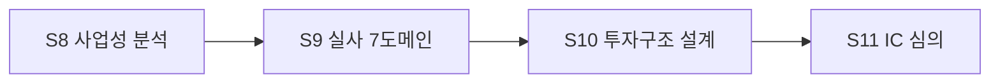

# DD 개요·프로세스

S9 실사·검증은 "사실인가? 위험은 무엇인가?"에 답하는 단계입니다. 트랙에 따라 성격이 다릅니다:

| 트랙 | 성격 | 대상 |
|---|---|---|
| Brownfield | 대상 기업에 대한 실사 | Short List 대상(merger 실사) |
| Greenfield | 우리 계획의 실현가능성 검증 | 진출전략·비용 구조(S5~S8 산출물) |

## 7도메인

commercial · technical · legal · financial · hr · market · financing — 각 도메인별 체크리스트는
`checklists/*.yaml`이 권위 원본입니다. 필수(mandatory) 항목은 활성 waiver 없이는 통과할 수
없습니다.

## 진행 규칙

- 판정 기본값은 **미정** — 조사 완료 시 pass/fail로 확정.
- 모든 항목 판정 + 필수 미충족 0건이 S9 완료 조건(ddCompletionSummary).
- 발견사항은 dd_finding으로 기록(아래 발견사항 규칙 문서).

## 출처 매핑

| 주장 | 근거 |
|---|---|
| 7도메인·완료 술어 | ADR-0099, process-flow.ts S9 분기 |
| 필수·waiver 규칙 | docs/manuals/business-manual §2, checklists front matter |
